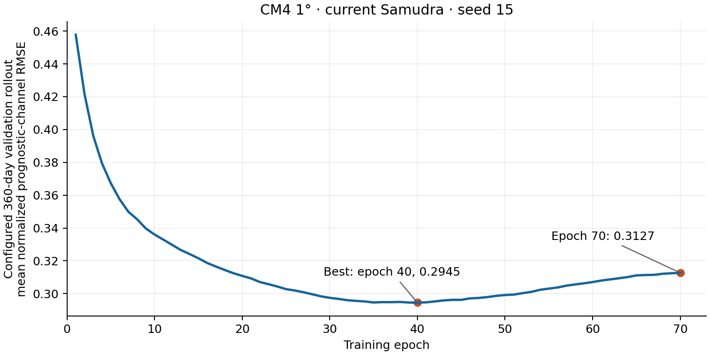

<!--
SPDX-FileCopyrightText: 2026 Samudra Authors
SPDX-License-Identifier: CC-BY-4.0
-->

# CM4 1-degree training completed

The current standard Samudra architecture trained from scratch for **70 epochs**
on the new CM4 dataset. Beta job **214219** and every recorded Slurm step completed
with exit `0:0`. The allocation ran on `b3-36-s1-dgx-03-c17` from **October 17,
2026, 17:09:10 to 22:30:41 EDT**: 5h21m31s on four GPUs, about **21.43 GPU-hours**.
The training loop itself reported 5h19m32s. There were 25,480 optimizer updates,
407,680 sampled training windows, and an effective batch size of 16.

[W&B run 4yoy3b6s](https://wandb.ai/ocean_emulators/default/runs/4yoy3b6s)
is `finished`. Its successful final sync reports five W&B files and 2,730 media
files. The scheduler, terminal logs, checkpoint metadata, final W&B summary, and
complete 70-epoch history agree on completion. The run's `error.log` is empty.

## Configuration and data

The executed source remains [79fcd103c](https://github.com/m2lines/Samudra/commit/79fcd103cb3794e27a8d9dbd1541f4c843d38143).
The [training config](../train.yaml) uses the standard widths, instance
normalization, bfloat16, seed 15, cosine learning rate from 0.0006, dynamic MSE
with a 20-fold weight-ratio cap, two input/two output states, and four
autoregressive calls. Rust loading consumed the compact, one-time/all-depth CM4
store with all 19 depths, 77 prognostic channels, and wind stress, `hfds`, and
`wfo` forcing. No loader changes were required.

The split is 80 training / 20 validation / 100 held-out no-leap years, with
the explicitly selected full-200-year normalization. See the [launch record](LAUNCH.md)
for exact dates, source provenance, transfer verification, and GPU qualification.

## Validation and checkpoint selection

| Epoch | Configured 360-day rollout normalized RMSE |
| ---: | ---: |
| 1 | 0.457752 |
| **40, best** | **0.294515** |
| 70 | 0.312688 |

These scores use the current EMA-validation defaults and average area-weighted
RMSE equally over the 77 normalized prognostic channels and rollout target times.
The annual rollout begins at the start of the validation split; this is one
configured validation trajectory, not a 20-year rollout ensemble or held-out
long-term evaluation. The final score is about 6.2% above the best score.

All 70 epoch summaries were retrieved from synchronized W&B history and checked
for complete epoch coverage. [epoch-history.csv](epoch-history.csv) preserves the
reported values; [plot_learning_curve.py](plot_learning_curve.py) renders the
figure. Dynamic training/validation losses are included for diagnosis, but their
evolving weights and different forecast horizons make them unsuitable as fixed
skill comparisons. Final dynamic losses were 3.433943 (training) and 0.758489
(ordinary validation).

Checkpoint metadata was inspected without loading tensor storage:

| File | Stored epoch | Bytes |
| --- | ---: | ---: |
| `best_validation_ckpt.pt` | 40 | 1,344,737,533 |
| `ckpt.pt` | 70 | 1,344,737,533 |
| `ckpt_70.pt` | 70 | 1,344,737,533 |
| `ema_ckpt.pt` | 70 | 1,008,560,817 |

The best checkpoint records selection by `rollout_rmse`, horizon `days: 360`,
score 0.2945153798867946, and W&B ID `4yoy3b6s`. Regular checkpoints include raw
model weights and EMA state. Reproducing the selected EMA score requires the
epoch-40 EMA state; `ema_ckpt.pt` contains the final epoch-70 EMA model.

All files are retained under
`/projects/ny/lz1955/multiscale/jrusak/runs/cm4-onedeg-samudra-20261017/output/cm4-onedeg-samudra-20261017/saved_nets/`.

## Ordinary-validation logging defect

`val/reduced/normalized_rmse/channel_mean` ends at 2,065,533.898731 and should
not be interpreted as model skill. The shared validation path adds the derived
`ocean_heat_content` diagnostic to the dictionary of normalized prognostic
fields, then `MeanAggregator.record_batch` includes every dictionary entry in
this channel average. Heat content is computed using physical density, heat
capacity, and layer thickness even when its input temperatures are normalized.
It therefore dominates a quantity labeled as a normalized channel mean.

A small CPU reproducer using the same 77-channel layout, zero targets, and
uniform 0.1 prediction errors gives **0.1** when averaging prognostic fields and
**34,431,004** through the current path including derived heat content. This is
a defect in the shared diagnostic calculation, rather than evidence for enormous
normalized ocean-state errors. The run's rollout aggregator explicitly uses
prognostic channels only, and `validation_score: rollout_rmse` uses that separate
metric. The erroneous ordinary-validation aggregate did not control optimization
or checkpoint selection. Its logged history is retained as reported, and the
processing/training source has not been modified as part of this result record.

The 100-year held-out forecast evaluation remains unrun, so long-term stability
and held-out skill have not yet been established.
