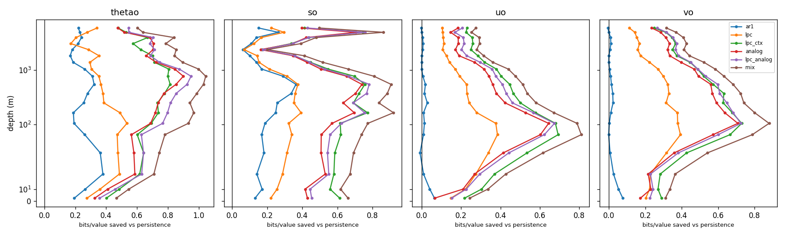
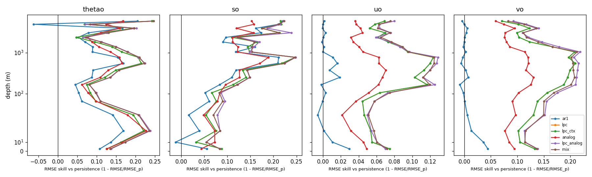
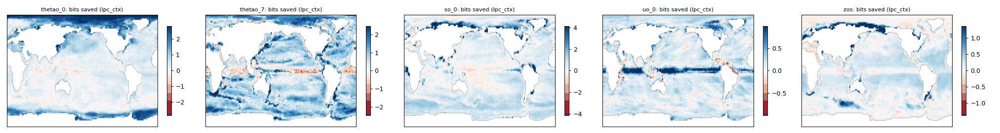

<!-- SPDX-FileCopyrightText: 2026 Samudra Authors -->
<!-- SPDX-License-Identifier: CC-BY-4.0 -->

# Compression baselines: bits per value for ocean emulators

**Status: run on OM4 2° (`v2026-09/om4_twodeg`) on 2026-11-12; results below.**
Every number in this README comes from a file in `om4_twodeg_results/`. The
code that produced `results.json` is commit `06f69d3` (`git_hash.txt`). After
the run, `report.py` gained the headline table and a smaller maps figure, and
`tables.md` and the figures were re-rendered from the same `results.json` and
`maps.npz`. `sanity.py` was added afterwards and run on the same cache.
The synthetic smoke test is kept in `synthetic_smoke/` as a toy (see the end).

This is an experiment record, not intended to merge.

## Answers to the two quests, so far

- **Baseline (primary quest): yes.** The ladder gives a scored baseline on all
  77 channels, and `mix` is the rung a neural emulator must beat in bits and
  RMSE (`om4_twodeg_results/tables.md`). What works are *models* borrowed from
  lossless coders: linear prediction (FLAC), context-coded scales (JPEG-LS) and
  mixing (PAQ). *Generic compressors* do not: the blosc residual bound costs
  more than `mix` on every channel, and compression-distance (NCD) analogs are
  no better than random neighbours (findings 5 and 8).
- **Metric (side quest): partly.** Bits per value is implemented and checked:
  the accounting tests pass, and a hand recomputation of persistence matches to
  within 0.0005 bits. It has not yet scored an ML emulator (Samudra or the
  all-fields classifier), and it has little resolution for deep tracers with
  this quantization (finding 4). Of the blosc diagnostics, the residual bound is
  uninformative on OM4. The compressibility ratio is ≈1 for one-step forecasts,
  as designed, and is untested on rollouts.

## Idea

Any forecaster with a predictive distribution is a lossless compressor: with
arithmetic coding, the true next value costs −log₂ P(its bin) bits. Fix one
quantization per channel and every model, from persistence to Samudra to the
all-fields classifier, gets a score in **bits per wet value**. Lower is better.

Two quests use that score:

1. **Metric (side quest).** Bits per value is a proper scoring rule, additive
   over cells, so it breaks down into maps, depth profiles and per-variable
   budgets. Differences between models on the same bins are exact; absolute
   bits depend on bin width.
2. **Baseline (primary quest).** A ladder of low-parameter predictors borrowed
   from lossless image and audio coding. A neural emulator should beat the top
   rung, in bits and in RMSE, before its complexity is justified.

## Protocol

| Item | Choice |
|---|---|
| Data | 2° OM4 five-day means, all 19 levels of `thetao`, `so`, `uo`, `vo`, plus `zos` (77 channels) |
| Task | Two-state history (t−1, t) to state t+1, five days ahead; no forcing (as in the classifier comparison) |
| Splits | Train 2003–2004, tune on 2010, test on 2015, all contiguous |
| Bins | 8,192 uniform bins per channel. The range comes from the 10⁻⁵ and 1−10⁻⁵ training quantiles plus 5% padding; the end bins absorb tails |
| Scoring | 8,000 test (time, cell) rows per channel, drawn with probability proportional to cell area. Cheap rungs are also scored on every wet test cell |
| Floor | All probabilities are mixed with 10⁻⁹ of a uniform distribution; the floor is the same for every model |

## The ladder

Every rung predicts the tendency x[t+1] − x[t] at one cell from 20 patch
features:

- 8 neighbour differences in a 3×3 patch
- the last tendency and its Laplacian
- the last tendencies of the other variables at the same level
- the tendencies at the levels above and below
- the anomaly from the channel mean
- two upwind-style advection terms, u·∂x/cos φ and v·∂y
- a bias term

Parameter counts are per channel.

| Rung | Predictive distribution | Params | Lineage |
|---|---|---:|---|
| `persistence` | Laplace(0, b) | 1 | |
| `ar1` | Laplace(a·tendency, b) | 2 | |
| `lpc` | Laplace(w·f, b), ridge regression per latitude band | 63 | FLAC linear prediction |
| `lpc_ctx` | `lpc` mean; Laplace scale from a 6×6 context table (gradient × last tendency) | ~110 | JPEG-LS / CALIC |
| `analog` | Kernel density over outcomes of the 32 nearest training patches (20k library) | 1 + library | Kernel analog forecasting |
| `lpc_analog` | `lpc` mean + kernel density over the neighbours' `lpc` residuals | 64 + library | |
| `mix` | Convex mixture of all rungs; weights by EM on validation log-likelihood | 6 | PAQ context mixing |

## Side-quest diagnostics

| Diagnostic | What it measures |
|---|---|
| Bits saved vs persistence, by depth and as maps | Where each model extracts information |
| Blosc residual bound | Blosc-zstd with byte shuffle (as in the OM4 stores) applied to the bin-index residual vs persistence. This is a generic-compressor upper bound on the conditional code length |
| Blosc compressibility ratio, forecast field / truth field | Below 1 means too smooth, above 1 too noisy. Meant for autoregressive rollouts; it is ≈1 for one-step forecasts by construction |
| Zonal correlation of `lpc` errors, and −½·log₂(1−ρ²) | A Gaussian estimate of the bits a joint (field-level) coder would save over any pointwise model |

## Ablation: compression distance vs Euclidean distance (`ncd_ablation.py`)

This tests the original gzip-classifier question. It uses the same library,
features and kernel density, and swaps only the neighbour search: Euclidean
distance, random neighbours, NCD with gzip, and NCD with blosc-zstd.

## OM4 results

Data: `https://nyu1.osn.mghpcc.org/m2lines-pubs/Samudra/v2026-09/om4_twodeg/OM4.zarr`
(store attributes `m2lines/*` are kept in `results.json` under `meta.attrs`).
Train 2003-01-03 to 2004-12-28 (146 states), validation 2010 (73), test 2015 (73).
Each rung was fit on up to 400,000 training rows per channel (243,216 for the
channel with the fewest wet cells). All tables are in
[`om4_twodeg_results/tables.md`](om4_twodeg_results/tables.md).

### Headline: three numbers per variable

Mean over the variable's levels, with the surface level in brackets. Bits are
per wet value on the fixed 8,192-bin quantization; RMSE skill is
1 − RMSE(mix)/RMSE(persistence) on the tendency; the joint-coding gap is the
Gaussian estimate −½·log₂(1−ρ²) from the zonal lag-1 correlation ρ of `lpc` errors.

| variable | bits saved by mix over persistence | RMSE skill of mix vs persistence | est. joint-coding gap (bits) |
|---|---:|---:|---:|
| thetao | 0.82 [0.47] | 0.154 [0.135] | 0.22 [1.02] |
| so | 0.66 [0.66] | 0.145 [0.084] | 0.10 [0.21] |
| uo | 0.45 [0.24] | 0.083 [0.072] | 0.49 [1.20] |
| vo | 0.54 [0.31] | 0.155 [0.137] | 0.12 [0.66] |
| zos | 0.23 | 0.041 | 1.20 |

For reference, `mix` costs 4.18 [7.35] bits for `thetao`, 1.92 [4.49] for
`so`, 7.73 [9.09] for `uo`, 7.86 [9.22] for `vo` and 7.35 for `zos`.





### Findings

1. **Every rung above persistence pays, and the mixture is the top rung on
   every channel.** On test, `mix` costs fewer bits than every component on
   all 77 channels (`sanity.json`: `mix_bits_worse_than_best_component = 0`).
   Among the parametric steps, the context-coded scale (`persistence → ar1 → lpc
   → lpc_ctx`, last step) is the largest on 50 of 77 channels, and `lpc_ctx`
   carries the largest mixture weight on 43 (`lpc_analog` on 30, `analog` on 4).
2. **On the surface, the estimated joint-coding gap is bigger than everything
   the ladder gains.** At the surface, the gap estimate is 1.02 bits for
   `thetao`, 1.20 for `uo`, 1.20 for `zos` and 0.66 for `vo`, against 0.47,
   0.24, 0.23 and 0.31 bits saved by `mix`. `so` is the exception (0.21 vs
   0.66). The gap falls with depth: below about 550 m it is ≤ 0.05 bits for
   `thetao`, `so` and `vo`, but `uo` keeps 0.24–0.43 bits to the bottom. Our
   hypothesis, not tested here, is that the surface error correlation is
   mostly unseen forcing (wind and heat-flux events span many 2° cells), since
   this protocol has no forcings. The estimate is crude: it assumes Gaussian
   errors and uses one zonal neighbour, so the causal context rung (below) is
   needed to measure the gap.
3. **Persistence is not hard to beat at depth.** This is the opposite of what we
   expected. At the deepest level, `mix` has RMSE skill 0.247 (`thetao_18`),
   0.223 (`so_18`), 0.076 (`uo_18`) and 0.083 (`vo_18`). For the tracers, `ar1`
   alone already gets 0.205 and 0.220, so the last five-day tendency persists
   at depth; a slow deep-ocean drift in OM4 would do this, but we have not
   checked. For velocities, `ar1` gets about zero skill at every depth, and the
   skill comes from the spatial and cross-variable features in `lpc`.
4. **No outlier widened any bin, but deep tracer bins are coarser than the
   signal.** At most 2.5 × 10⁻⁵ of test values land in an end bin on any
   channel, and deep `uo`/`vo` bins are fine: the mean absolute tendency spans
   33–126 bins on every velocity channel. The opposite problem shows up in
   `thetao` and `so`. One quantization per channel spans the global range at
   that level (e.g. `thetao_12`: −3.06 to 22.88 °C, bin width 0.0032 °C), while
   the mean absolute tendency is at most 1.5 bins for `thetao` below 1,400 m and
   under one bin for `so` below 375 m (`sanity.json`,
   `test_tendency_mad_over_bin_width`). There, most true next values stay in
   the current bin or its neighbour, so bits mostly measure bin crossings and
   the absolute costs are small (`mix` 0.27–2.23 bits, persistence 0.47–3.09). Differences between models on
   the same bins are still exact, but the metric has little resolution there;
   RMSE is the more informative score for deep tracers. The surface `so` range
   also reaches down to 0.14 psu because of near-fresh coastal cells (#974).
5. **On OM4, the generic blosc residual bound is useless, unlike on toy data.**
   The blosc-zstd code length of the bin-index residual is worse than `mix` on
   every channel, by at least 0.94 bits (`uo_0`). Part of that is the land mask:
   blosc on the mask alone costs 0.44 bits per wet value at the surface and
   3.62 at 6,000 m, where 10% of cells are wet. Even with that cost subtracted,
   `mix` still wins on 76 of 77 channels; the exception is `so_18` (−0.16 bits).
   The synthetic finding that a generic compressor beats pointwise rungs does
   not carry over.
6. **`mix` optimizes bits, not RMSE.** Its mean has slightly higher RMSE than
   the best single component on 58 of 77 channels, by at most 4.8%
   (`thetao_17`, vs `analog`). The mixture weights maximize validation
   log-likelihood, so this is expected; use the `lpc`/`lpc_analog` means when
   a point forecast is wanted.
7. **One-step compressibility ratios are ≈1.** For `lpc` forecasts, the ratio is
   0.998–1.001 for the tracers, 0.997 for `zos`, and 0.978–0.998 for `uo` and
   `vo`. So velocity forecasts are slightly smoother than truth, but this
   diagnostic is meant for rollouts.
8. **Compression distance (NCD) neighbours are no better than random.** For
   `thetao_0`, Euclidean neighbours cost 7.32 bits/value, random 8.27, NCD with
   blosc-zstd 8.12, and NCD with gzip 9.58, which is worse than random. For
   `thetao_7`: 5.15, 6.40, 6.25 and 6.41.
9. **Where the bits are saved** (maps, `lpc_ctx` vs persistence). The surface
   `uo` gains concentrate in the equatorial band; `thetao_0` gains are largest
   at high latitudes near sea ice; `zos` gains are largest in the Arctic and
   marginal seas. `thetao_7` (250 m) *loses* bits in the equatorial Pacific
   thermocline, where the context-coded model is worse than persistence.

### Checks done before believing the numbers (`sanity.py` → `sanity.json`)

- **Persistence by hand.** Recomputed from the cache with independent numpy
  (bins from training quantiles, Laplace scale from the full training set) on
  `thetao_0`, `so_10`, `uo_18` and `zos`. It matches the run's full-field
  persistence bits to within 0.0005 bits. The run fits its scale on a
  400,000-row subset, which explains the residual.
- **Bins.** The recomputed bin widths match `results.json` exactly; end-bin
  occupancy is reported above.
- **Sampling.** Bits on the 8,000 area-weighted test rows differ from the
  full-field bits by at most 0.077 bits on any channel and cheap rung. So
  per-channel absolute bits carry noise of that order; differences between
  rungs are computed on the same rows and are less noisy.
- **`mix` vs best component.** See findings 1 and 6.

### Runtimes

On `dtn012.hpc.nyu.edu` (Intel Xeon Platinum 8444H, 32 cores, 251 GB;
`run.log`), from `timings.tsv`: caching the data 66 s (about 1.4 GB), fitting
and scoring all 77 channels 345 s, NCD ablation 23 s + 20 s, report 3 s.

### Proposed protocol changes (not made)

- **Bins for deep tracers** (finding 4): size each channel's bins to its
  tendency spread, or use more bins for deep `thetao`/`so`. This would break
  comparability with the classifier experiment, so it needs agreement first.

## Synthetic smoke test (toy; not about the ocean)

`synthetic_smoke/` holds the tables, figure and JSON from a toy advection model.
It exercised the pipeline before OM4 was reachable. Its numbers say nothing
about the ocean.

1. **The accounting is right.** `test_coding.py` checks that interval
   probabilities sum to 1, that a correct Gaussian model's cost matches the
   discretized entropy to within 0.01 bits, and that a mis-specified model costs
   more.
2. **Bin ranges must be robust.** An unstable first version of the toy model
   produced outliers that widened every bin and drove costs to ≈0 bits. Hence
   the quantile-based ranges.
3. On toy velocities the blosc residual bound beat the pointwise rungs. On OM4
   it does not (finding 5).
4. NCD neighbours were barely better than random, as on OM4 (finding 8).

## Run it

```
pip install xarray zarr numcodecs fsspec aiohttp dask cftime scikit-learn scipy matplotlib
bash run_all.sh                       # OM4 2°: caches about 1.5 GB, then fits 77 channels
SYNTHETIC=1 bash run_all.sh /tmp/c /tmp/o   # smoke test, about 2 min
python -m pytest -c /dev/null test_coding.py
python sanity.py cache_om4_twodeg results_om4_twodeg/results.json results_om4_twodeg/sanity.json
```

`cftime` is required: the store's `time` uses a Julian calendar. The OM4 run used
Python 3.12 with numpy 1.26.4, xarray 2025.1.2, zarr 2.18.7, numcodecs 0.15.1,
fsspec 2025.5.1, aiohttp 3.11.16, dask 2025.2.0, cftime 1.6.4.post1, pandas 2.2.3,
scikit-learn 1.9.1, scipy 1.17.1 and matplotlib 3.10.1.

The run writes `results.json`, `tables.md`, `bits_gain_vs_depth.png`,
`rmse_skill_vs_depth.png`, `bits_gain_maps.png` and `ncd_*.json`. The `mix`
rung's bits and RMSE are the numbers a model has to beat.

## Next steps

- **Score the all-fields classifier and Samudra in the same units.** For the
  classifier: 2° retrain, or 0.25° with this code at 0.25°, rebinned to these
  bins.
- **Add a causal raster-scan context rung.** Condition on already-coded
  neighbours of t+1, as JPEG-LS does, to measure the joint-coding gap directly
  rather than estimating it. Finding 2 makes this the most informative next rung.
- **Run the compressibility-ratio diagnostic on Samudra rollouts**, as a cheap
  test for blurring and noise.
- **Include the forcings** (`hfds`, `tau*`, `wfo`) for comparison with
  Samudra's setup.
