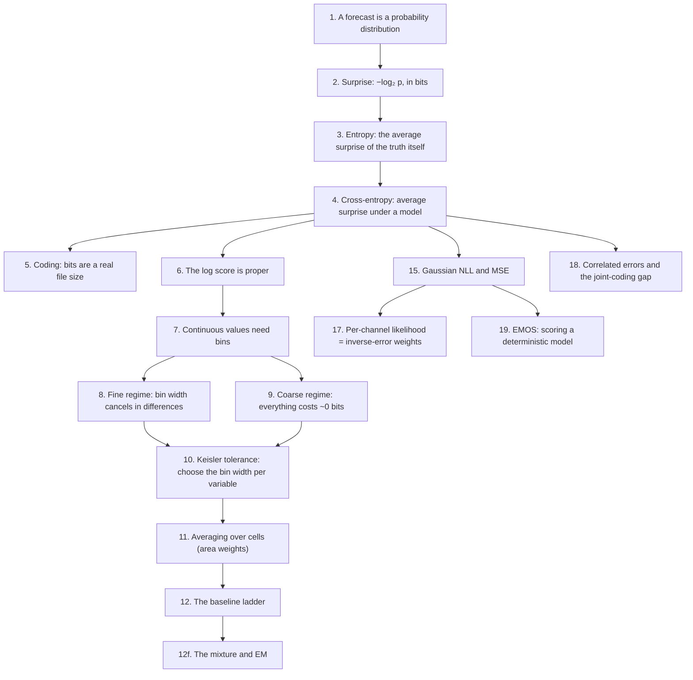
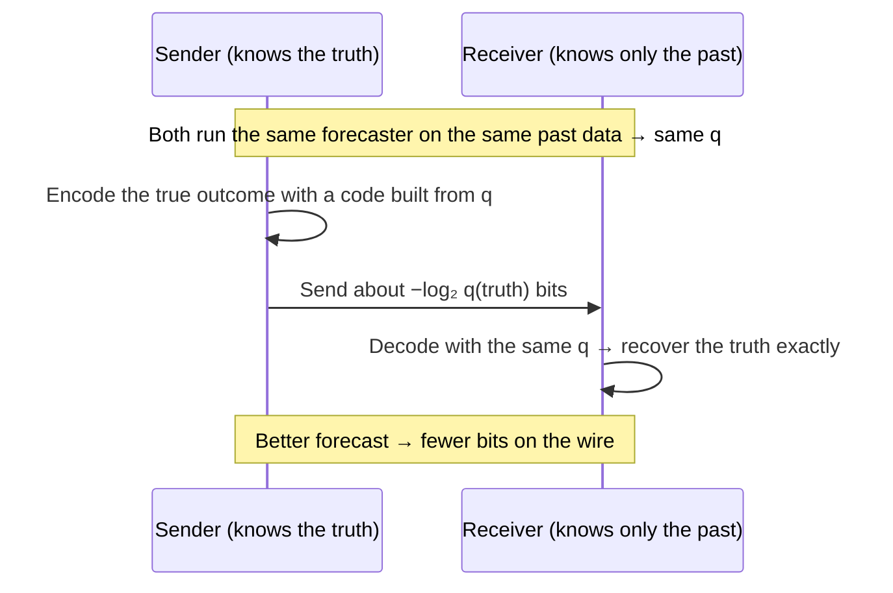
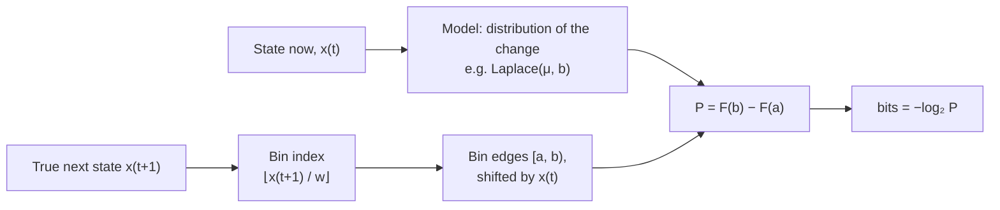
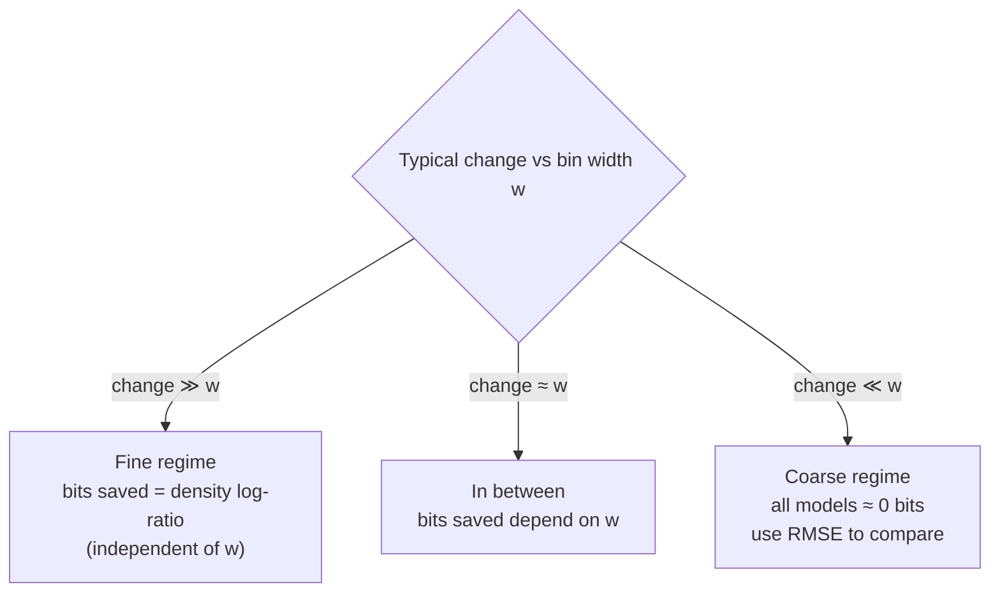
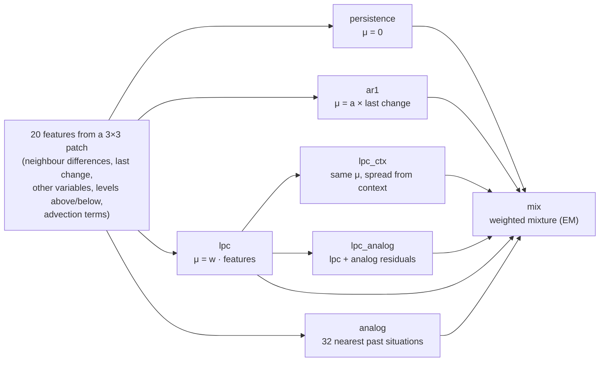
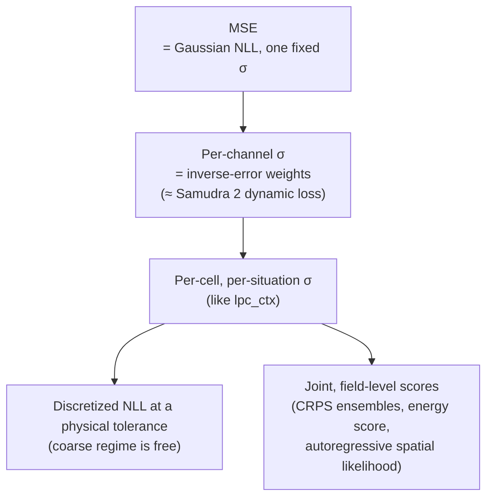
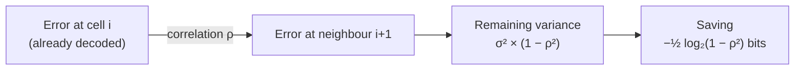

<!-- SPDX-FileCopyrightText: 2026 Samudra Authors -->
<!-- SPDX-License-Identifier: CC-BY-4.0 -->

# Background: the mathematics, from first principles

This is a supplement to the [overview](../README.md). It builds the mathematics
the experiment uses, one idea at a time, and each idea relies only on the ones
before it. Every equation is followed by a collapsed **worked example** with
small numbers. Open it, check the arithmetic by hand, and the formula should
stop being abstract.

All the worked numbers were computed in Python, not by hand. Logarithms are base
2 (written log₂) unless noted; "ln" is the natural logarithm.

## Map of the ideas

---

## 1. A forecast as a probability distribution

A deterministic forecast gives one number: "the temperature will be 15.2 °C". A
*probabilistic* forecast gives a probability to every possible outcome: "15.2 °C
is most likely, 15.0 to 15.4 °C covers most of the chance, and 16 °C would be
very surprising". Everything below scores forecasts of this second kind. Section
19 shows how to turn a deterministic forecast into one.

For outcomes that come in categories (rain or no rain), the forecast is a list
of probabilities that sum to 1. For real numbers (a temperature), it's a
*probability density* f(y). Section 7 handles that case.

## 2. Surprise, measured in bits

If a forecast gave probability p to the outcome that actually happened, its
**surprise** is

$$\text{surprise} = -\log_2 p \quad \text{bits}.$$

- p = 1 costs 0 bits: no surprise.
- Every halving of p adds 1 bit.
- p = 0 costs infinitely many bits: the forecast said it was impossible.

Worked example

| Probability given to what happened | Surprise |
|---:|---:|
| 1/2 | −log₂(0.5) = **1 bit** |
| 1/4 | **2 bits** |
| 1/8 | **3 bits** |
| 1/1024 | **10 bits** |
| 0.9 | **0.152 bits** |
| 0.1 | **3.322 bits** |

A forecaster said "90% chance of rain". If it rains, it pays 0.152 bits. If it
stays dry, the outcome it gave 10% to happened, so it pays 3.322 bits.
Confident and right is cheap; confident and wrong is expensive.

## 3. Entropy: the uncertainty of the outcome itself

Suppose outcomes really occur with probabilities p₁, p₂, …. A forecaster that
knows those exact probabilities pays, on average,

$$H(p) = -\sum_i p_i \log_2 p_i \quad \text{bits}.$$

This is the **entropy**: the irreducible uncertainty, the least any forecaster
can pay on average.

Worked example

- **Fair coin** (½, ½): H = −(½·log₂½ + ½·log₂½) = ½ + ½ = **1 bit**.
- **Biased coin** (0.9, 0.1): H = 0.9 × 0.152 + 0.1 × 3.322 = **0.469 bits**. It
  is less uncertain, so it is cheaper to describe.
- **Fair eight-sided die:** each face has p = 1/8, so H = 8 × (1/8 × 3) = **3 bits**.
- **Four symbols A, B, C, D with probabilities ½, ¼, ⅛, ⅛:** H = ½·1 + ¼·2 +
  ⅛·3 + ⅛·3 = **1.75 bits**.

## 4. Cross-entropy: what a real model pays

A real model doesn't know the true probabilities p. It uses its own guess q. On
average it pays the **cross-entropy**

$$H(p, q) = -\sum_i p_i \log_2 q_i = H(p) + D_{\mathrm{KL}}(p \,\|\, q).$$

The extra term, the **Kullback–Leibler divergence** D_KL, is never negative.
It is zero only when q = p. It is the price of having the wrong distribution.

So a model's average bits is always an *upper bound* on the true entropy, and a
better model pushes the bound down. The experiment's "bits per value" is a
cross-entropy estimated on test data.

Worked example

The truth is the biased coin (0.9, 0.1), with entropy 0.469 bits.

- **Model q = (0.5, 0.5):** cross-entropy = 0.9 × 1 + 0.1 × 1 = **1.000 bit**, so
  D_KL = 1.000 − 0.469 = **0.531 bits** wasted.
- **Model q = (0.7, 0.3):** cross-entropy = 0.9 × 0.515 + 0.1 × 1.737 =
  **0.637 bits**, so D_KL = **0.168 bits**. Closer to the truth, less waste.
- **Model q = (0.9, 0.1):** cross-entropy = **0.469 bits**, D_KL = 0. You can't
  do better.

## 5. Why bits are a real file size

The surprise −log₂ q isn't just a convenient score. It is the length of a real
code. If a sender and a receiver share the same forecast q, the sender can
transmit the true outcome in about −log₂ q(outcome) bits:

Huffman codes achieve this when every probability is a power of ½. Arithmetic
coding achieves it to within a few bits *per file* for any probabilities. That's
why "forecast skill" and "compressed size of the future given the past" are the
same number.

Worked example

Symbols A, B, C, D have probabilities ½, ¼, ⅛, ⅛. A prefix code with lengths
equal to −log₂ q is:

| Symbol | Probability | Code | Length = −log₂ q |
|---|---:|---|---:|
| A | ½ | `0` | 1 |
| B | ¼ | `10` | 2 |
| C | ⅛ | `110` | 3 |
| D | ⅛ | `111` | 3 |

The average length is ½·1 + ¼·2 + ⅛·3 + ⅛·3 = **1.75 bits**, exactly the
entropy from section 3. The message `A A B D` encodes as `0 0 10 111`, which is
7 bits. Each symbol costs its surprise.

## 6. The log score is *proper*

A scoring rule is **proper** if a forecaster minimizes its expected score only
by reporting what it truly believes. The log score (average surprise) is
proper, so it can't be gamed by hedging or by false confidence.

Worked example

The true chance of rain is 70%. A forecaster reports r and pays −log₂ r if it
rains, −log₂(1 − r) if not. The expected cost is
0.7·(−log₂ r) + 0.3·(−log₂(1 − r)):

| Reported r | Expected bits |
|---:|---:|
| 0.5 (hedging) | 1.000 |
| **0.7 (honest)** | **0.881** |
| 0.9 (overconfident) | 1.103 |
| 0.99 (very overconfident) | 2.003 |

Honesty wins. RMSE of a single guess has no notion of confidence, so it can't
make this distinction.

## 7. Real numbers need bins

A temperature is a real number. A continuous density f(y) gives probability zero
to any exact value, so to score it we pick a **bin width** w (the *tolerance*).
We then score the probability of the bin the true value fell in:

$$P(\text{bin}) = F(b) - F(a), \qquad \text{bits} = -\log_2 P(\text{bin}),$$

where [a, b) is the bin and F is the forecast's *cumulative distribution
function* (the probability of a value below a given point).

Our ladder mostly uses the **Laplace** distribution, which has a sharp peak and
heavier tails than a Gaussian. With centre μ and scale b, its cumulative
distribution is

$$F(y) = \begin{cases} \tfrac12 e^{(y-\mu)/b} & y < \mu \\ 1 - \tfrac12 e^{-(y-\mu)/b} & y \ge \mu \end{cases}$$

Worked example

- **Setup:** the current value is x = 0 and the true change is y = 0.13. With
  bin width w = 0.05, the true next value 0.13 falls in bin 2, which covers
  [0.10, 0.15).
- **Persistence** forecasts "no change": Laplace(μ = 0, b = 0.2).
  P = F(0.15) − F(0.10) = **0.0671**, which costs −log₂ 0.0671 = **3.898 bits**.
- **A better model** forecasts Laplace(μ = 0.1, b = 0.1): centred closer and
  more confident. P = **0.1967**, which costs **2.346 bits**.
- **Bits saved:** 3.898 − 2.346 = **1.552**. The better model gave the truth
  0.1967 / 0.0671 = **2.93×** more probability, and log₂ 2.93 = 1.55. **One bit
  saved means twice the probability on the truth.**

## 8. The fine regime: the bin width cancels in differences

When w is much smaller than the forecast's spread, the density is nearly flat
across one bin. So P(bin) ≈ f(y)·w and

$$\text{bits} \approx -\log_2 f(y) - \log_2 w .$$

- **Absolute bits depend on w.** Halving w adds exactly 1 bit to *every* model.
- **Differences don't.** For two models A and B, the −log₂ w terms cancel:

$$\text{bits}_B - \text{bits}_A \approx \log_2 \frac{f_A(y)}{f_B(y)},$$

the log-ratio of the two densities at the truth. This is why the experiment
leads with **bits saved**: in the fine regime, it doesn't depend on the arbitrary
choice of w.

Worked example

These are the same two models as in section 7, with true change 0.13, as the
bins shrink:

| Bin width w | Persistence bits | Model bits | Bits saved |
|---:|---:|---:|---:|
| 0.05 | 3.898 | 2.346 | 1.552 |
| 0.02 | 5.259 | 3.752 | 1.507 |
| 0.01 | 6.296 | 4.826 | 1.469 |
| 0.005 | 7.278 | 5.791 | 1.487 |
| 0.0025 | 8.269 | 6.773 | 1.496 |

- Absolute bits grow by about 1 per halving.
- Bits saved settle near the density log-ratio:
  log₂[f_model(0.13) / f_persist(0.13)] = **1.505**.
- The small wobble comes from where the true value happens to sit inside its bin.

The experiment's rule for choosing ε (section 10) is exactly this check: shrink
the bins until the surface channels' bits saved stop moving.

## 9. The coarse regime: everything costs about 0 bits

When the bin is much wider than the typical change, the true next value almost
always stays in the current bin. Every reasonable model gives that bin a
probability close to 1, costs close to 0 bits, and models become hard to tell
apart.

Worked example

- **Setup:** the current value is x = 0.5, sitting mid-bin in [0, 1) with
  w = 1. The true change is 0.013.
- Persistence uses Laplace(0, b = 0.02), so the bin [0, 1) is the change
  interval [−0.5, 0.5).
- P = F(0.5) − F(−0.5) = 0.99999999999 → **0.00000000002 bits**.

Any sensible model costs about the same. At this tolerance, there's nothing
left to code. In the ocean, this is deep temperature and salinity over five
days.

## 10. Choosing the tolerance: Keisler normalization

To compare variables measured in different units, we choose one tolerance per
variable from the spread of its five-day changes. Following Keisler (2022), we
pool over all depth levels so one physical unit counts the same everywhere:

$$\sigma_\Delta = \sqrt{\frac{\sum_{i} A_i\, (\Delta_i - \bar\Delta)^2}{\sum_i A_i}}, \qquad w = \varepsilon\, \sigma_\Delta,$$

where:
- Δᵢ are five-day changes over all cells, levels and training times;
- Aᵢ are cell areas, and Δ̄ is their area-weighted mean;
- ε is a small fraction (1/8 in the v2 run).

Worked example

- **Setup:** one variable has two levels and four equal-area cells.

  | | Five-day changes |
  |---|---|
  | Surface | 0.3, −0.2, 0.1, −0.2 |
  | Deep | 0.02, −0.01, 0.0, −0.01 |

- **Pooled over all eight:** mean 0, σ_Δ = **0.150**. With ε = 1/8,
  w = **0.0188**.
- **Per level, the spreads differ hugely:** 0.212 at the surface, 0.012 at
  depth.
- **Typical change in bins:** at the surface it is 0.2/0.0188 ≈ **10.6 bins**,
  the fine regime. At depth it is 0.01/0.0188 ≈ **0.53 bins**, the coarse
  regime.
- **This is intended.** Pooling makes the tolerance a property of the
  *variable*, not of each level. The deep level is honestly reported as having
  little to code at that precision.

## 11. Averaging over cells

A 2° grid cell near the pole covers far less ocean than one at the equator. So
averages over cells are **area-weighted**:

$$\overline{\text{bits}} = \frac{\sum_i A_i\, \text{bits}_i}{\sum_i A_i}.$$

Worked example

Three cells cost 4, 2 and 6 bits, with areas 1.0, 0.5 and 0.25 (the last near a
pole).

- Area-weighted: (4×1 + 2×0.5 + 6×0.25) / 1.75 = **3.714 bits**.
- A plain average would give 4.0, over-counting the small polar cell.

The experiment's 8,000 test rows per channel are *sampled* in proportion to
area, which gives the same expectation without weights.

## 12. The baseline ladder

Every rung predicts the five-day **change** at one cell and outputs a full
distribution.

### 12a. Fitting a Laplace spread

For Laplace errors, the best-fitting scale is simply the **mean absolute
error**:

$$\hat b = \frac{1}{n}\sum_j |e_j|.$$

Worked example

The errors are 0.1, −0.3, 0.2 and 0.0, so b̂ = (0.1 + 0.3 + 0.2 + 0) / 4 =
**0.15**.

### 12b. AR(1): continue part of the last change

$$\mu = a \cdot \text{last change}, \qquad \hat a = \frac{\sum_j t_j\, y_j}{\sum_j t_j^2},$$

where t is the last change and y the next one. â is the least-squares slope
through the origin.

Worked example

The last changes t = (1, 2, −1) were followed by y = (0.5, 1.1, −0.4).

- â = (1×0.5 + 2×1.1 + (−1)×(−0.4)) / (1 + 4 + 1) = 3.1/6 = **0.517**.
- So about half of each change carries over.
- A *sawtooth*, where successive changes flip sign, would give a **negative**
  â. That is the basis of one proposed failure-mode check.

### 12c. `lpc`: ridge regression on the features

$$\hat{\mathbf w} = (F^\top F + \lambda I)^{-1} F^\top \mathbf y.$$

This is least squares with a small penalty λ that keeps weights from blowing up
when features are nearly redundant. The mean forecast is the features dotted
with ŵ.

Worked example

**One feature only.** Features f = (1, 2, 3), targets y = (1, 2, 2).

- With no penalty: ŵ = (1 + 4 + 6) / (1 + 4 + 9) = 11/14 = **0.786**.
- With λ = 1: ŵ = 11/(14 + 1) = **0.733**, shrunk slightly toward 0.

### 12d. `lpc_ctx`: a spread that depends on the situation

The cells are split into context buckets, for example "calm" and "rough" by
local gradient and recent change. Each bucket gets its own Laplace scale
(section 12a). The mean is unchanged, so RMSE is unchanged, but the bits drop
because the forecast knows *when* to be confident.

Worked example

**Setup.** Calm cells have errors 0.01, −0.02, 0.01, so b_calm = **0.0133**.
Rough cells have errors 0.3, −0.2, 0.25, so b_rough = **0.25**. One global scale
over all six would be **0.1317**. The bin width is w = 0.001.

**Costs**, using the fine-regime formula with density f(e) = e^(−|e|/b) / (2b):

| Cell | With context scale | With global scale | Saved |
|---|---:|---:|---:|
| Calm, error 0.01 | 5.818 bits | 8.151 bits | **2.333 bits** |
| Rough, error 0.25 | 10.408 bits | 10.780 bits | **0.371 bits** |

Same mean forecast, same RMSE, fewer bits. This is why `lpc_ctx` is the ladder's
biggest single gain.

### 12e. Kernel analogs

**Setup.** Find the k most similar past situations. Their outcomes c₁…c_k
(what happened next) become the centres of small Gaussian bumps of width h:

$$P(\text{bin}) = \frac1k \sum_{j=1}^{k} \big[\Phi\big(\tfrac{b - c_j}{h}\big) - \Phi\big(\tfrac{a - c_j}{h}\big)\big],$$

where Φ is the standard normal cumulative distribution function.

Worked example

**Setup.** Three analogs had outcomes 0.1, 0.2 and 0.3, with h = 0.05. The true
outcome's bin is [0.15, 0.20).

- **Bin probability under each bump:** 0.1359, 0.3413 and 0.0214.
- **Average:** P = **0.1662**, which costs **2.589 bits**.

### 12f. The mixture and how its weights are fit (EM)

The mixture gives the truth a weighted average of the rungs' probabilities:

$$P_{\text{mix}} = \sum_k \pi_k\, P_k, \qquad \pi_k \ge 0,\ \sum_k \pi_k = 1.$$

The weights πₖ are fit on validation data by **expectation–maximization (EM)**,
which repeats two steps:

1. **E-step.** For each validation example j, compute each rung's
   *responsibility*: the share of the mixture's probability it supplied,

   $$r_{jk} = \frac{\pi_k P_{jk}}{\sum_m \pi_m P_{jm}}.$$

2. **M-step.** Set each weight to its average responsibility:

   $$\pi_k \leftarrow \frac1n \sum_j r_{jk}.$$

Each round lowers the mixture's average bits on validation, never raising
them.

Worked example

**Setup.** Two models score three validation examples. Each number is the
probability that model gave the truth:

| Model | Example 1 | Example 2 | Example 3 |
|---|---:|---:|---:|
| A | 0.5 | 0.3 | 0.1 |
| B | 0.1 | 0.2 | 0.6 |

**Fixed weights:**

| Weights | Mean bits |
|---|---:|
| A only | 2.020 |
| B only | 2.127 |
| 50 / 50 | 1.751 |

The mix beats both, because each model covers the other's misses.

**EM starting from π_A = 0.5:**

| Round | Responsibilities of A | New π_A | Mean bits |
|---:|---|---:|---:|
| 1 | 0.833, 0.600, 0.143 | 0.5254 | 1.7505 |
| 2 | 0.847, 0.624, 0.156 | 0.5423 | 1.7474 |
| 3 | 0.856, 0.640, 0.165 | 0.5535 | 1.7460 |
| 4 | 0.861, 0.650, 0.171 | 0.5608 | 1.7454 |

The best weight on this data is π_A ≈ 0.575 (1.745 bits), and EM approaches it
from below.

## 13. The floor: no cost is ever infinite

A model that gives the truth probability 0 would cost infinitely many bits. To
keep every cost finite, each model's probability is mixed with a tiny weight F
into a fixed, very broad reference distribution q:

$$P_{\text{floored}} = (1 - F)\,P + F\,q, \qquad F = 10^{-9}.$$

The reference is the same for every model, so it barely moves any honest score.

Worked example

**Setup.** Suppose the reference gives the true bin q = 0.001.

- **A model that gave P = 0** now costs −log₂(10⁻⁹ × 0.001) = **39.86 bits**:
  huge, but finite.
- **A model that gave P = 0.25** costs **2.000000 bits**, essentially unchanged.

## 14. RMSE skill

The point-forecast score next to bits is skill against persistence:

$$\text{skill} = 1 - \frac{\text{RMSE}_{\text{model}}}{\text{RMSE}_{\text{persistence}}}.$$

0 means no better than persistence, 0.15 means 15% less error, and a negative
value means worse.

Worked example

RMSE_model = 0.17 and RMSE_persistence = 0.20, so skill = 1 − 0.85 = **0.15**.

## 15. The Gaussian likelihood, NLL, and MSE

The **negative log-likelihood (NLL)** of the truth under a Gaussian forecast
with mean μ and spread σ is

$$\text{NLL} = -\ln f(y) = \frac{(y-\mu)^2}{2\sigma^2} + \ln \sigma + \tfrac12 \ln 2\pi .$$

- **NLL is bits by another name.** In base 2 and over a bin it is exactly the
  surprise of section 2 (natural log here, so the units are *nats*;
  1 nat = 1.443 bits).
- **With σ fixed, the last two terms are constants.** Minimizing NLL is then
  minimizing (y − μ)². **Training with mean squared error is maximum likelihood
  under a Gaussian with a fixed spread.**
- **If σ is learned too,** its best value is σ² = MSE.

Worked example

**Setup.** Three cells have truth (1.0, 2.0, 0.5) and forecast (1.2, 1.5, 0.5).
The errors are (−0.2, 0.5, 0.0), so MSE = (0.04 + 0.25 + 0) / 3 = **0.0967**.

**Mean NLL for different spreads:**

| σ | Mean NLL (nats) |
|---:|---:|
| 0.25 | 0.306 |
| **√0.0967 = 0.311** | **0.251** (the minimum) |
| 1.0 | 0.967 |

Too confident (σ too small) or too vague (σ too large) both cost more.

## 16. How much one bit is worth for a Gaussian forecast

For a calibrated Gaussian forecast with spread σ, scored at a fine tolerance w,
the expected cost is

$$\text{bits} \approx \tfrac12 \log_2\!\big(2\pi e\, \sigma^2\big) - \log_2 w .$$

Halving σ subtracts exactly log₂ 2 = **1 bit**. So a model that saves 0.5 bits
over another, through a narrower but honest spread, has a spread about
2^0.5 ≈ 1.41 times smaller.

Worked example

With w = 0.01:
- σ = 0.2 costs **6.369 bits**;
- σ = 0.1 costs **5.369 bits**.

Halving the spread saves exactly 1 bit.

## 17. Per-channel likelihood is inverse-error weighting

Give each channel c its own spread σ_c and sum the Gaussian NLL over channels:

$$\mathcal L = \sum_c \left[\frac{\mathrm{MSE}_c}{2\sigma_c^2} + \ln\sigma_c\right].$$

1. **Best spread.** Setting each σ_c² = MSE_c and substituting gives
   𝓛 = Σ_c ½ ln MSE_c + constant.
2. **Gradient.** Its gradient with respect to the network parameters θ is

$$\nabla_\theta \mathcal L = \sum_c \frac{1}{2\,\mathrm{MSE}_c}\, \nabla_\theta \mathrm{MSE}_c .$$

That is MSE with each channel weighted by **1 / its current error**, which is
what Samudra 2's `DynamicLoss` does. `DynamicLoss` also caps the ratio between
the largest and smallest weight, and smooths the weights over time
([losses note](losses_from_bits.md), section 2).

Worked example

**Setup.** A surface channel has MSE 4.0 and a deep channel has MSE 0.01.

- **Inverse-error weights:** 1/4 = **0.25** and 1/0.01 = **100**, a ratio of
  400. The small-error deep channel is strongly upweighted.
- **With `DynamicLoss`'s cap of 20:** the weights become **0.25** and
  **0.25 × 20 = 5.0**.

## 18. Correlated errors and the joint-coding gap

The ladder codes each cell on its own. Suppose its errors at two neighbouring
cells have correlation ρ. A coder that has already decoded one neighbour knows
part of the other's error. For Gaussian errors, the remaining variance shrinks
by a factor of 1 − ρ², so the cost per value falls by

$$\text{gap} = -\tfrac12 \log_2\big(1 - \rho^2\big) \quad \text{bits}.$$

This is the **estimated joint-coding gap**: what a field-level coder could
still save over *any* per-cell model.

Worked example

| Correlation ρ | Remaining variance factor 1 − ρ² | Gap |
|---:|---:|---:|
| 0.5 | 0.75 | **0.208 bits** |
| 0.86 | 0.260 | **0.971 bits** |
| 0.9 | 0.19 | **1.198 bits** |

At ρ = 0.86, close to what v2 measured for surface temperature, the gap is
about 1 bit, against the 0.50 bits the whole ladder saves there. It is a
Gaussian estimate with one neighbour, so treat it as an order of magnitude.

## 19. EMOS: scoring a deterministic model in bits

A deterministic model outputs one value m. **EMOS** (ensemble model output
statistics; Gneiting et al. 2005) wraps a distribution around it, with spread
fit on held-out data. The simplest form is

$$y \sim \mathcal N(m,\ \sigma^2), \qquad \sigma^2 = \text{mean squared validation error}.$$

Richer forms let the spread depend on context, as in `lpc_ctx`. The model can
then be scored in bits and added to the mixture as one more rung.

Worked example

The validation errors are 0.2, −0.1, 0.3 and −0.2, so
σ = √((0.04 + 0.01 + 0.09 + 0.04)/4) = **0.212**. A forecast of m = 1.0 becomes
the distribution N(1.0, 0.212²), which can be scored like any rung.

---

## References

- Shannon (1948). A Mathematical Theory of Communication. *Entropy and coding.*
- Cover & Thomas, *Elements of Information Theory*: chapters 2 and 5 cover
  entropy, cross-entropy and coding.
- Gneiting & Raftery (2007). Strictly Proper Scoring Rules, Prediction, and
  Estimation. *Proper scores, including the log score and CRPS.*
- Gneiting et al. (2005). Calibrated probabilistic forecasting using ensemble
  model output statistics. *EMOS.*
- Keisler (2022). Forecasting Global Weather with Graph Neural Networks,
  arXiv:2202.07575, §3.3.3. *Normalization by the spread of time differences.*
- Kendall, Gal & Cipolla (2018). Multi-task learning using uncertainty to weigh
  losses. *Per-task likelihood spreads as loss weights.*
