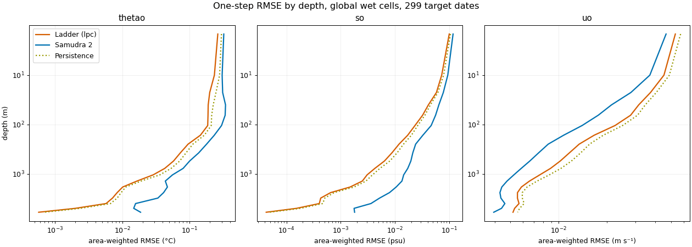
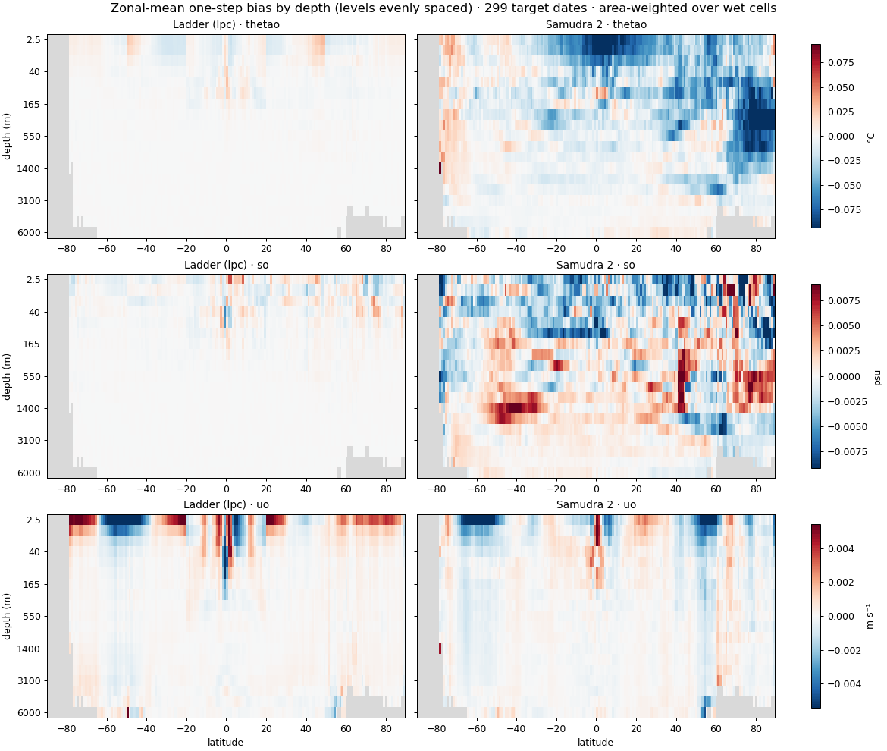
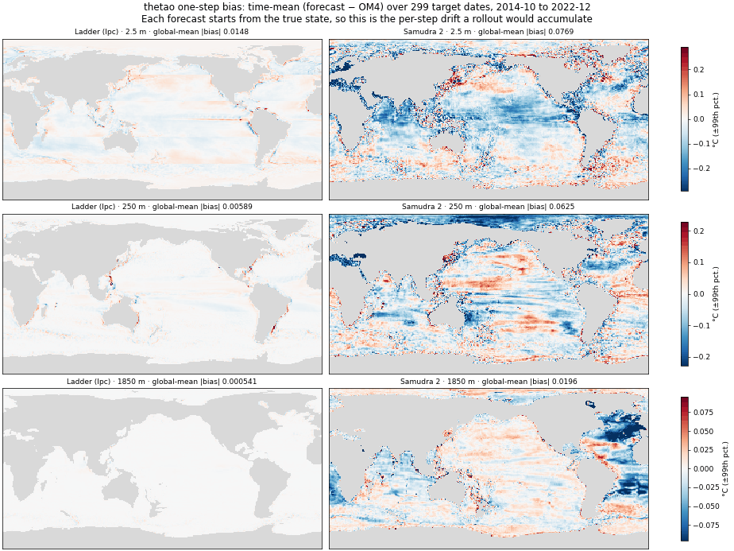
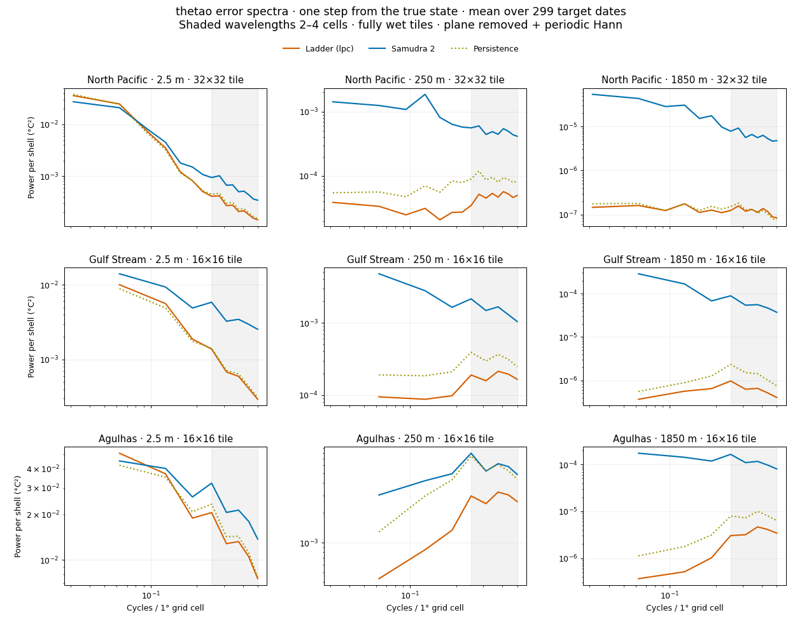
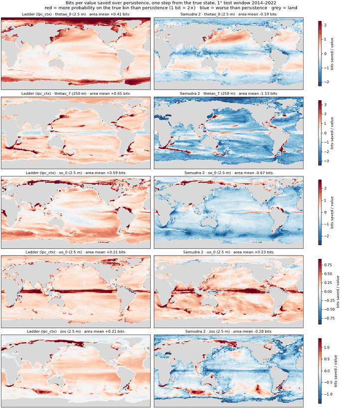
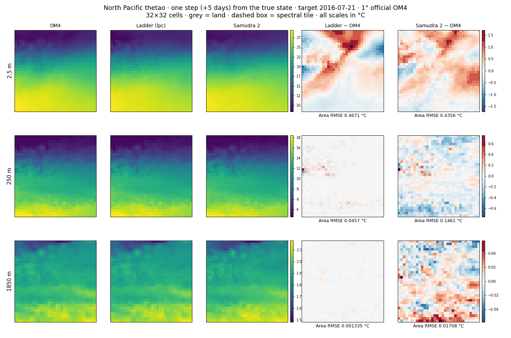

<!-- SPDX-FileCopyrightText: 2026 Samudra Authors -->
<!-- SPDX-License-Identifier: CC-BY-4.0 -->

# Where Samudra 2 loses to doing nothing: one-step maps, bias and spectra at 1°

## Experiment goals

1. **Measure what a single step of Samudra 2 does to the true ocean.** We look
   at each variable, depth, region and spatial scale, before any rollout mixes
   errors together. *Answered by findings 1–4.*
2. **Compare it against two floors that cost almost nothing.** One is
   persistence (no change). The other is the ladder, a roughly 4,600-weight
   linear predictor borrowed from image compression. *Findings 1 and 4.*
3. **Test whether the lab's known rollout failures are already visible at one
   step.** These are noisy fields, and drift toward wrong mean states.
   *Finding 3 covers noise and finding 2 covers bias.*
4. **Turn those results into figures the group can use and re-run.** That means
   maps, bias, spectra and bits in the layout of Jesse's skyline report, with
   scripts that score any checkpoint. *All findings; see "What we could do with
   this".*

Not a goal: showing that the ladder is a better ocean model. It isn't. It can't
yet be rolled out, and Samudra 2 beats it on currents.

This report puts the paper's Samudra 2 beside two reference forecasts:

- **persistence**, which predicts that nothing changes;
- **the ladder**, a small linear model borrowed from how compressors predict
  pixels.

All three forecast five days ahead from the same true ocean state, on the
official 1° OM4 data. The figures show *where* each model's errors are: by
region, by depth, by spatial scale, and as a persistent bias. The layout follows
Jesse's temperature-skyline report so the two read side by side.

Terms used throughout are introduced in the [overview](../README.md), and the
mathematics of bits in [background](background.md).

## Why this matters

The lab's stated goal is to resolve known failure modes in Samudra: *"noisy
fields, sawtooth trends, jumping to and sticking in 'attractor' mean states far
from target state"*. All three are rollout symptoms. Each one can be seeded at a
single step:

- a model that adds a little noise every step produces noisy fields;
- a model that pushes the state in the same direction every step drifts toward
  a wrong mean state.

So the first question is what one step does to the true ocean. A whole-rollout
metric can't answer it, because by then errors have mixed and compounded. A
one-step test from the true state can, and it isolates the model's own
contribution.

Two references make that test readable:

- **Persistence** is the floor. It costs nothing, and at five days the ocean
  barely changes, especially at depth. A model that does worse than persistence
  is adding error, not removing it.
- **The ladder** shows what a trivially cheap model achieves on exactly this
  task. It is about 4,600 weights in total: 20 per channel per latitude band,
  fitted by least squares in minutes on a CPU.

  If a model with millions of parameters can't match it somewhere, the gap
  there is not about capacity. It points at the loss, the training setup or the
  architecture, which are things we can change.

### What is and isn't compared

Both models solve the same problem: predict the next five-day state from the
true current and previous states, on the same grid and dates. Samudra 2 even
gets more inputs, since it also receives atmospheric forcing.

What differs is what each was optimized for:

- The ladder is fitted to this one step and nothing else. It cannot yet be
  rolled out: fed its own forecasts, it diverges after about three months (see
  the [root-cause analysis](rollout_blowup_rca.md)).
- Samudra 2 was trained on four-step rollouts and built to stay stable over
  years, which it does.

So these figures don't say the ladder is a better ocean model. They say what one
step of Samudra 2 does, measured against two floors that cost almost nothing.

## Setup

| | |
|---|---|
| Data | Official `v2026-09` 1° OM4 store (`docs/data.md`), test window 2014-10-10 to 2022-12-24 |
| Samudra 2 | The paper checkpoint `ema_ckpt.pt`, run by `one_step.py`. It emits two five-day steps per call, so it forecasts every other step: 299 target dates. Only the first step of each call is used. |
| Ladder | The `lpc` rung without forcing, fitted on 2009-10 to 2013-09 (`rollout.py`'s `Roller`), stepped once from the true state at the same 299 dates |
| Persistence | The true state at the latest input time |
| Cells | Identical wet cells for all three; area-weighted where averaged |
| Code | `onestep_figures.py` (maps, bias, spectra, RMSE) and `bits_maps.py` (bits) |

## Finding 1: below the surface, Samudra 2 is worse than persistence at every depth

**How to read it.** Global RMSE against depth for each model. Lower is better.
Persistence (dotted) is the line to beat.

Selected values (`figure-metrics.csv`):

| Variable | Depth | Ladder | Persistence | Samudra 2 |
|---|---|---:|---:|---:|
| Temperature (°C) | 2.5 m | **0.262** | 0.297 | 0.322 |
| Temperature (°C) | 250 m | **0.095** | 0.112 | 0.179 |
| Temperature (°C) | 1850 m | **0.0101** | 0.0113 | 0.0468 |
| Salinity (psu) | 2.5 m | **0.100** | 0.105 | 0.118 |
| Salinity (psu) | 1850 m | **0.0015** | 0.0018 | 0.0105 |
| `uo` (m s⁻¹) | 2.5 m | 0.053 | 0.057 | **0.047** |
| `uo` (m s⁻¹) | 250 m | 0.013 | 0.016 | **0.009** |

Across all 19 depth levels:

- **Temperature and salinity:** Samudra 2 is worse than persistence at every
  level, 19 of 19 for both. The ladder beats persistence at every level.
- **Zonal velocity:** Samudra 2 beats persistence at every level, and beats the
  ladder.

Samudra 2 learned real flow dynamics. For temperature and salinity, each of its
steps adds more error than the true five-day change contains.

## Finding 2: Samudra 2's per-step error is systematic, and it has a geography

**How to read it.** The time-mean of forecast minus OM4 over all 299 dates,
averaged around each latitude circle and shown against depth. Red means the
forecast is too warm, salty or eastward on average; blue the opposite. Every
forecast starts from the true state, so this is the push each step gives the
ocean. In a rollout, that push compounds.

**How to read it.** The same time-mean bias, mapped at 2.5 m, 250 m and 1850 m.
The global mean of |bias| is in each title.

What the plots show:

- **The ladder's temperature and salinity bias is close to zero everywhere.**
  Mean |bias| for temperature is 0.015 °C at the surface, 0.006 °C at 250 m and
  0.0005 °C at 1850 m.
- **Samudra 2's temperature bias is 5–40× larger, and it is structured:**
  - mean |bias| is 0.077 °C at the surface, 0.063 °C at 250 m and 0.020 °C at
    1850 m;
  - **a cold tropical surface**: the zonal mean reaches about −0.08 °C per step
    near the equator;
  - **a cold Arctic interior** from about 165 to 1400 m;
  - **a cold deep North Atlantic** at 1850 m, the region of North Atlantic Deep
    Water formation;
  - banded warm and cold structure at 250 m in the Pacific and Indian Oceans.
- **Samudra 2's salinity bias is also structured at depth**, for example the
  salty band near 1400 m at 40–50°S (`bias-maps-so.png`).
- **Surface velocity is the exception.** Both models carry a similar
  surface-`uo` zonal bias, for example under the Southern Ocean westerlies. The
  ladder has no forcing, so wind-driven change is invisible to it.

**Why this matters.** A fixed per-step push like this is the textbook mechanism
for a rollout settling into a wrong mean state. A step that cools the tropical
surface by 0.08 °C every five days has to be cancelled by something else, or the
rollout drifts. These maps show where to look first for the attractor behaviour
we see in rollouts.

## Finding 3: below the surface, Samudra 2's extra error spans every spatial scale

**How to read it.** Each curve is the error's power at each spatial scale.
Large scales are on the left, the grid scale (two cells) on the right, and
wavelengths of 2–4 cells are shaded. Lower is better. Persistence is dotted.

The power is averaged over all 299 dates, on fully wet tiles inside each
region: 32×32 cells in the North Pacific, 16×16 where land intrudes. The method
matches Jesse's report: remove a fitted plane, apply a periodic Hann window, and
sum into radial shells.

- **At the surface,** Samudra 2's error matches persistence at large scales and
  is above it at small scales. That is extra small-scale structure, i.e. noise.
- **At 250 m and 1850 m,** Samudra 2's error is 10–100× persistence's at every
  scale. The ladder's error is below persistence's throughout.
- **The exception is the Agulhas at 250 m,** where Samudra 2 about equals
  persistence. Strong currents there make the true change large.

So "noisy fields" is real at the surface. Below the surface the problem is
broader than noise: error at all scales, plus the bias in finding 2.

The field spectra (`spectra-field-*.png`) compare each forecast's spatial
variance with OM4's. Use them to check whether a model smooths (too little
small-scale power) or roughens (too much).

## Finding 4: in bits, Samudra 2 adds value where the ocean moves and loses it where the ocean is quiet

**How to read it.** For each cell, how many bits per value each model saves
over persistence, averaged over the test window.

- Bits score the forecast as a probability distribution: −log₂ of the
  probability it puts on the bin the truth fell in.
- One bit saved means twice the probability on the truth.
- Red is better than persistence and blue is worse.
- One currency covers temperature, salinity, velocity and SSH, so the panels
  compare directly.

| Channel | Ladder (`lpc_ctx`) | Samudra 2 | Area where Samudra 2 is worse than persistence |
|---|---:|---:|---:|
| Temperature, 2.5 m | +0.41 | −0.19 | 61% |
| Temperature, 250 m | +0.65 | −1.13 | 89% |
| Salinity, 2.5 m | +0.59 | −0.67 | 93% |
| `uo`, 2.5 m | +0.21 | +0.23 | 11% |
| SSH | +0.21 | −0.28 | 83% |

Area-weighted means, from `bits-maps.csv`.

- **Where Samudra 2 is red at 250 m:** along boundary currents and fronts —
  the Gulf Stream, Kuroshio, Agulhas, the Antarctic Circumpolar Current — and
  along the equator. That's where the true five-day change is large, and
  there it beats persistence.
- **Where it is blue:** the quiet interior, where the true change is tiny and
  any per-step noise or bias outweighs it.
- **Surface `uo`:** both models tie, and both are red almost everywhere.

The pattern suggests a direct fix to test: Samudra 2's per-step error has a
roughly fixed size, so it costs most where the ocean changes least.

**Caveat on magnitudes.** Samudra 2 outputs a single value, not a distribution.
To score it in bits, it gets one Laplace error spread per channel, fitted on
validation errors. In the quiet interior that single spread is too wide and
costs it bits. The ladder's `lpc_ctx` adapts its spread to local context.

So Samudra 2's blue areas are somewhat pessimistic. The *direction* agrees with
the RMSE and bias figures, which don't depend on a spread. The ladder maps come
from the 1° ladder run (`om4_onedeg_v2_results/`), scored on every test step.
Samudra 2's are scored on its 299 dates. Both cover the same period.

## Regional maps

These follow the layout of Jesse's report: OM4, the ladder, Samudra 2, then
each model's error, at 2.5 m, 250 m and 1850 m.

- **Date:** 2016-07-21, Jesse's target date.
- **Patches:** 32×32 cells (32°), against his 64×64 patches at ¼° (16°).
- **Colour scales:** the three field columns share one scale within each row;
  the two error columns share a symmetric one.
- **Dashed box:** the tile used for the spectra.

Area RMSE on this date (`figure-metrics.csv`):

| Region | Depth | Ladder (°C) | Samudra 2 (°C) |
|---|---|---:|---:|
| North Pacific | 2.5 m | 0.467 | **0.436** |
| North Pacific | 250 m | **0.046** | 0.146 |
| North Pacific | 1850 m | **0.0013** | 0.0171 |
| Gulf Stream | 2.5 m | **0.435** | 0.488 |
| Gulf Stream | 250 m | **0.159** | 0.275 |
| Gulf Stream | 1850 m | **0.0062** | 0.0393 |
| Agulhas | 2.5 m | 0.284 | **0.276** |
| Agulhas | 250 m | **0.146** | 0.234 |
| Agulhas | 1850 m | **0.0096** | 0.0435 |

These numbers cover a single date, so the global figures above carry the
conclusions.

The maps make the speckle visible: Samudra 2's 250 m and 1850 m error panels are
grainy, while the ladder's are nearly blank.

Every combination of region and variable is in the results folder, as
`maps-<region>-<variable>.png` for North Pacific, Gulf Stream and Agulhas, and
for `thetao`, `so` and `uo`.

**This is not Jesse's task.** His classifier predicts single points from 17×17
crops at ¼°, on one date. Here every cell at 1° is predicted from a 3×3
neighbourhood, on 299 dates. The figures are built to look the same, but the
numbers don't belong in one table.

## Implications for modeling

### A likely cause: the task asks for the whole state, in units where the change is tiny

The paper checkpoint's config has `pred_residuals: false`:

- **What it predicts:** the *full* next state, not the change from the current
  state.
- **Units:** each channel is normalized by its climatological spread
  (`OM4_stds`, the spread of the field itself).
- **Loss weighting:** the training loss is `dynamic`. It weights each channel by
  1/MSE, capped at a 20× ratio between channels, so that every channel's
  normalized error counts about equally.

In those units, the signal the model has to resolve is very different across
variables. The table compares:

- the true five-day change (persistence's RMSE);
- each model's one-step RMSE.

All values are divided by the normalization spread, so they are in the units
the training loss sees. The spreads and the persistence column are from
`normalized_scales.txt`; the model columns are from `figure-metrics.csv`.

| Channel | True 5-day change | Ladder error | Samudra 2 error |
|---|---:|---:|---:|
| Temperature, 2.5 m | 0.026 | 0.023 | 0.028 |
| Temperature, 250 m | 0.018 | 0.015 | 0.029 |
| Temperature, 1850 m | **0.007** | 0.007 | **0.030** |
| Salinity, 2.5 m | 0.037 | 0.036 | 0.042 |
| Salinity, 250 m | 0.015 | 0.013 | 0.026 |
| Salinity, 1850 m | **0.003** | 0.003 | **0.021** |
| SSH | 0.038 | — | 0.040 |
| `uo`, 2.5 m | **0.45** | 0.42 | **0.37** |
| `uo`, 250 m | 0.23 | 0.20 | 0.13 |
| `uo`, 1850 m | 0.29 | 0.27 | 0.20 |

Two patterns stand out:

- **Samudra 2's temperature and salinity error sits at about 2–4% of a spread
  at every depth.** It barely changes from 2.5 m to 1850 m, even though the true
  change shrinks fourfold for temperature and tenfold for salinity. That looks
  like a precision floor: how closely a deep network can reproduce its input
  field in these units.
- **Where the true change is below that floor, Samudra 2 loses to
  persistence.** That holds for temperature and salinity at depth, and nearly
  everywhere for SSH. Where the true change is far above it, as for velocity at
  20–45% of a spread, Samudra 2 wins.

This one mechanism accounts for findings 1 and 4: which variables lose, why
losses grow with depth, and why Samudra 2 does best where the ocean changes
most.

It also explains why the loss doesn't flag the problem:

- A deep temperature error of 0.03 normalized units looks as small as any other
  channel's error. The dynamic weighting equalizes *normalized error*, not
  *skill over persistence*.
- Nothing in the objective tells the model that at 1850 m, 0.03 is four times
  worse than doing nothing.

This is a hypothesis. It fits every number here, but it needs the ablation
below to confirm it.

### Do we need a better objective or a better task definition?

Yes, and the task definition comes first. The cheapest, most targeted fix is in
*what* the model predicts and in *what units*. A new loss function comes after
that. In order of cost:

1. **Predict the change, not the state.** Set `pred_residuals: true`, an
   existing option. The output then becomes x[t] plus a learned correction, so
   persistence is the model's default, and it no longer has to reconstruct the
   input field to beat it.
2. **Normalize the change by the spread of five-day changes (σ_Δ), not by the
   spread of the state.**
   - This is Keisler's (2022) normalization, and the same σ_Δ this experiment
     uses for its bins.
   - In these units, persistence scores exactly 1 on every channel, and
     anything below 1 is real skill. Every channel's loss then measures skill
     over doing nothing.
   - Deck slide 11's "normalized-delta" variant is essentially this.
   - One interaction to check: the dynamic loss's 20× cap could undo part of
     the reweighting. The per-channel σ_Δ ratios between surface and deep
     channels exceed 20×.
3. **Watch the bias directly.** The bias maps show steady per-step pushes,
   which is the attractor mechanism.
   - Residual prediction should shrink them, since the default output is now
     unbiased.
   - If it doesn't, a penalty on the batch-mean error per channel and region
     targets them directly.
4. **Score probabilistically.** Have the model predict a spread per cell and
   train with a Gaussian or Laplace negative log-likelihood. That is the bits
   score as a loss: see [losses from bits](losses_from_bits.md) and #981.
   - It rewards knowing *where* the ocean is quiet, which is exactly where
     Samudra 2 loses.
   - It also gives fair bits maps, without the single-spread handicap in
     finding 4.
5. **Learn the correction on top of a cheap baseline.** The ladder costs
   4,600 weights and is already ahead of persistence for temperature and
   salinity. A network trained to predict only what the ladder misses
   starts from a better default than persistence.
   - This is the most speculative idea here. The ladder's rollout instability
     would need handling first, for example by fitting it on multi-step
     targets.

Keep the multi-step part of training (`steps: 4`). It is what keeps Samudra
stable over years, which the ladder shows is not free. The proposal changes
what each step predicts and how errors are weighted, not the rollout training.

### How to test it

A four-arm ablation on the same data, splits and training budget:

| Arm | Change |
|---|---|
| A | Current setup (control) |
| B | `pred_residuals: true` |
| C | B, with targets normalized by σ_Δ |
| D | C, with a per-cell spread and NLL loss |

**What to measure for each arm:**

- **One step:** this report's figures.
  - `one_step.py`, then `onestep_figures.py` and `bits_maps.py`.
  - The pass criterion is beating persistence at all 19 levels for every
    variable.
- **Rollouts:** `samudra.metrics`, to confirm stability and long-run skill
  don't regress.
- **The bias maps:** whether per-step drift shrinks, and whether rollout drift
  moves with it.

**What would falsify the hypothesis:** arms B and C don't lift temperature and
salinity above persistence at depth. Then the floor isn't caused by full-state
prediction, and the next suspects are architecture and output resolution.

The new 2° Samudra the group plans to train would be the natural place to run
this. Per the project's rules, training runs are proposed first and not
launched from here.

## How solid this is

**Statistical noise is not a concern.** Each global number averages 299 dates
over the whole wet ocean, and the gaps are large: at 1850 m Samudra 2's
temperature RMSE is 4× persistence's. Every one of the 19 levels points the same
way for temperature, salinity and velocity.

**Alignment and data are checked.** The official 1° fields are bit-identical to
the training-era store. The persistence numbers computed here match the ladder
pipeline's own, which confirms that times and cells line up. These checks are
recorded in the [overnight report](overnight_2026-11-13.md).

**These are open:**

1. **An independent reproduction.** `one_step.py` is this experiment's harness,
   not the team's evaluation code. One-step scores for the same checkpoint
   from the team's own tooling are the bar before anyone acts on this.
2. **Other checkpoints.** Only the paper checkpoint has been run. The
   incoming successor model should be run through the same figures. That's
   cheap: `one_step.py` takes about 30 minutes on a DTN CPU, then these two
   scripts.
3. **Resolution.** Only 1° so far.
4. **The bits spread for Samudra 2,** as described in finding 4.

## What we could do with this

1. **A one-step floor in model development.** The RMSE-by-depth and bits maps
   give every checkpoint a test it should pass at every depth: beat
   persistence, and ideally the ladder. These figures turn the floor into a
   picture of where a model fails it.
2. **A target for the attractor problem.** The bias maps give the specific
   regions and depths where Samudra 2 pushes the state each step. Natural
   checks:
   - whether rollout drift in the same regions matches these per-step biases;
   - whether a training change (loss weighting, normalized-delta outputs, or
     bias penalties) shrinks them.
3. **A diagnosis of noise by scale.** The error spectra separate small-scale
   noise (the surface) from error at all scales (at depth). Those call for
   different fixes, such as smoothing or spectral losses for the first, and
   loss balancing across depths for the second.
4. **The modeling changes in "Implications for modeling" above.** Those
   include residual prediction, σ_Δ normalization and an NLL loss, each scored
   with these figures.

## Files and provenance

All figures, CSVs and logs are in `../onestep_figures_onedeg_results/`:

- **Figures:**
  - `rmse-by-depth.png`;
  - `bias-zonal.png` and `bias-maps-{thetao,so,uo}.png`;
  - `spectra-{error,field}-{thetao,so,uo}.png`;
  - `bits-maps.png`;
  - `maps-<region>-<variable>.png` (nine files).
- **Numbers:**
  - `figure-metrics.csv`: map RMSE and RMSE by depth;
  - `spectra.csv`: every plotted spectral point;
  - `bits-maps.csv`: area-mean bits saved, and the share of area worse than
    persistence;
  - `normalized_scales.txt`: the normalization spreads and the true five-day
    change in normalized units, from `normalized_scales.py`.
- **Code commits:**
  - extraction ran at `5214ff45`;
  - rendering and `bits_maps.py` ran at `f1103eac`.

  Each log's first line records its commit.
- **Machine:** the DTN, CPU only. The extraction took 16 minutes (12:32–12:48
  EST, 2026-11-13).
- **Full-resolution originals.** The committed PNGs are quantized to fit the
  repository's 250 KB limit, and `bits-maps.png` is also downscaled. For slides,
  render the originals at 200 dpi without quantization with
  `python onestep_figures.py render FIELDS.npz OUT --full` and
  `python bits_maps.py ... --full`.
- **Not committed:** the intermediate fields (`fields.npz`) and the Samudra 2
  forecasts. They stay on DTN scratch under
  `/scratch/am16581/compression_baselines/`.
