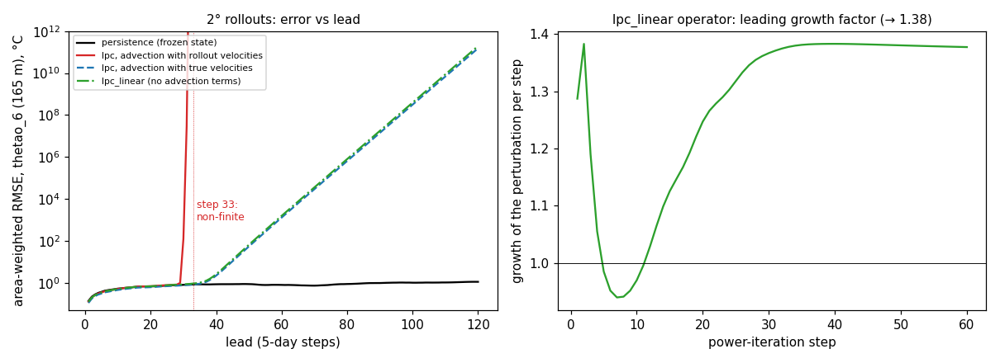

<!-- SPDX-FileCopyrightText: 2026 Samudra Authors -->
<!-- SPDX-License-Identifier: CC-BY-4.0 -->

# Root cause: why the ladder's rollouts blow up

**Status: analysis complete at 2°, 2026-11-12.** Every number comes from a file
in [`../rca_twodeg_results/`](../rca_twodeg_results/) or a log named below. The
scripts are `rollout.py`, `rca_rollout.py`, `rca_modes.py`,
`rca_vonneumann.py` and `rca_coupled.py`.

## Summary

The ladder's linear rung (`lpc`), fitted to predict one five-day step, was
rolled out autoregressively for eight years from Samudra's 2° test start. It
matches or beats persistence for about three months (18 steps), then diverges.

- **Root cause.** The fitted one-step operator amplifies small, grid-scale
  patterns that are nearly absent from the smooth training fields, so the
  least-squares fit never constrains its response to them.
  - On a uniform grid it amplifies them by up to **1.24× per step** in the
    tropics.
  - With the real coastlines, the leading unstable mode grows **1.38× per
    step**. It sits in tropical zonal velocity at 250–1,050 m, preferentially
    next to land.
- **Accelerant.** The model's two quadratic features (velocity × gradient)
  turn that exponential growth into finite-time blow-up. With them fed by the
  rollout's own velocities, the rollout becomes non-finite at step 33.
- **Ruled out:**
  - the sign of the learned advection;
  - coupling between variables and levels;
  - the forcing;
  - the advection terms as the root.

The lesson for Samudra is general: one-step skill says nothing about stability
when a model is fed its own output.



*Left: RMSE of `thetao_6` (165 m) against lead for persistence and three ladder
variants. Straight lines on this log axis are exponential growth. Right: the
per-step growth factor of the linear operator's leading mode (power iteration),
which converges to 1.38.*

---

## 1. Background, from first principles

### 1a. A rollout is an iterated map, and errors grow by its Jacobian

A one-step model F maps the current state to the next: x[n+1] = F(x[n]). A
rollout applies F to its own output again and again. Write the rollout state
as the truth plus an error, x = x* + e. To first order, the error evolves by
the model's Jacobian J:

$$e[n+1] \approx J\, e[n] \quad\Rightarrow\quad e[n] \approx J^n e[0].$$

If J has an eigenvalue with |λ| > 1, the matching pattern of error grows like
|λ|ⁿ, whatever the one-step accuracy. Training on one step minimizes the error
*added* per step. It doesn't control how existing error is *amplified*.

<details>
<summary>Worked example</summary>

- **|λ| = 1.38:** after 18 steps an error grows 1.38¹⁸ ≈ **330×**; after 100
  steps, about **9.7 × 10¹³×**.
- **|λ| = 1.24:** after 100 steps, about 2.2 × 10⁹×.

The rollout first looks fine (the initial error is tiny), then explodes. That
is the shape of the left panel.

</details>

### 1b. Von Neumann analysis of a stencil

**Setup.** On a uniform grid, a linear update built from neighbour differences
acts on each Fourier pattern e^{i(k_x x + k_y y)} separately, multiplying it by
an amplification factor G(k). The update is stable only if |G(k)| ≤ 1 for every
wavenumber k. The hardest pattern is usually the grid-scale checkerboard,
k = π: one cell up, the next down.

**One-sided difference.** For x_i ← x_i + a (x_{i+1} − x_i):

$$G(k) = 1 + a\,(e^{ik} - 1),\qquad |G(\pi)| = |1 - 2a|,$$

which is stable only for 0 ≤ a ≤ 1.

**The ladder's case.** The ladder also keeps part of the last change (weight
b), so the recurrence has two time levels:

$$x[n+1] = (1 + S + b + L + c)\,x[n] - (b + L)\,x[n-1],$$

where S, L and c are the neighbour, Laplacian-of-change and mean-anomaly terms.
`rca_vonneumann.py` computes this for one channel, and `rca_coupled.py` for all
channels together.

<details>
<summary>Worked example</summary>

- **a = 0.2:** |G(π)| = |1 − 0.4| = **0.6**. The checkerboard shrinks; stable.
- **a = −0.1:** |G(π)| = |1 + 0.2| = **1.2**. The checkerboard grows 20% per
  step; unstable.

A regression can land on either sign. Nothing in a one-step fit forces it into
the stable range for patterns it rarely sees.

</details>

### 1c. A quadratic feedback blows up in finite time

Exponential growth multiplies the error by a fixed factor each step. A
quadratic term adds something proportional to the error *squared*:

$$e[n+1] = e[n] + q\,e[n]^2 .$$

So the factor itself grows with the error. The continuous version,
de/dt = q e², has the solution e(t) = e₀ / (1 − q e₀ t), which is infinite at
the finite time t* = 1/(q e₀).

<details>
<summary>Worked example</summary>

With q = 1:
- **Starting at e = 0.1:** 0.100, 0.110, 0.122, 0.137, 0.156, 0.180. Slow at
  first.
- **Starting at e = 1:** 1, 2, 6, 42, 1806, 3.3 × 10⁶. The per-step factors are
  2, 3, 7, 43, 1807: they grow with the error.

That is the "growing growth factor" signature of the full rung's blow-up
(section 2, E7).

</details>

---

## 2. Evidence

**E1. Every variant first tracks persistence, then diverges**
(`error_curves.json`). For `thetao_6` (165 m):

| Lead (steps) | 1 | 10 | 18 | 30 | 60 | 120 |
|---|---:|---:|---:|---:|---:|---:|
| Persistence | 0.138 | 0.530 | 0.672 | 0.803 | 0.797 | 1.12 |
| `lpc`, rollout velocities | 0.126 | 0.513 | 0.676 | 125.5 | — | — |
| `lpc`, true velocities | 0.110 | 0.460 | 0.605 | 0.767 | 1,294 | 1.5 × 10¹¹ |
| `lpc_linear` (no advection) | 0.126 | 0.512 | 0.670 | 0.848 | 1,559 | 1.9 × 10¹¹ |

**E2. The advection terms are the accelerant, not the root.**
- *Rollout velocities:* the full `lpc` rung's state is non-finite at step 33
  (log `20261112-221307-ladder-rollouts.log`).
- *True velocities:* computing the advection features from the true velocities
  keeps the advection term but removes the quadratic feedback. The rollout then
  still diverges, exponentially, at about 1.35× per step over leads 35–120: 11
  decades in 85 steps (`rca_counterfactual.json`).
- *No advection:* removing the advection terms (`lpc_linear`) gives the same
  slope. Its saved float32 output first overflows at step 297, in `uo_8`.

  Correction: an earlier commit message (`bdfb663c`) said "step 73"; the float32
  output is finite at step 73 (RMSE about 10⁴ °C there).

**E3. The linear operator's leading mode** (`modes.json`, power iteration on
`lpc_linear` with a one-σ_Δ perturbation, 60 steps):
- **Growth:** 1.380 per step (mean over steps 41–60; it peaks at 1.383).
- **Variable:** 99.8% zonal velocity (`uo`).
- **Latitude:** 100% in the tropics (|lat| < 20°).
- **Depth:** 250–1,050 m, peaking at 550 m (`uo_9` 34%, `uo_8` 28%, `uo_10`
  24%).
- **Place:** largest at 97°E, 5–9°N, west of the Malay Peninsula and northern
  Sumatra, in cells with 3 land neighbours.
- **Coastal concentration:** cells next to land hold 24% of the mode, but are
  13% of wet cells.

**E4. The learned advection has the physical sign** (`rca_counterfactual.json`,
`advection_weight_signs`). The physical tendency is −u ∂T/∂x. The fitted weight
on u ∂T/∂x is negative in 195 of 231 channel-band fits, and on v ∂T/∂y in 141 of
231. The model learned real advection, not anti-advection.

**E5. A channel's own stencil, alone, is only marginally unstable**
(`vonneumann_band0.txt`; tropical band, uniform grid):

| Channel | Max \|λ\| of its own stencil |
|---|---:|
| `uo_9` | 1.006 |
| `uo_11` | 1.012 |
| `vo_9` | 1.175 |
| `thetao_6` | 0.9995 |

The one-sided east-difference weight is about +0.2, inside the stable range. So
the hypothesis "the one-sided difference alone is unstable" is **falsified**.

**E6. Grid-scale instability is in every band; coupling doesn't cause it**
(`coupled.json`). This is the spectral radius of the full 77-channel, two-level
operator on a uniform grid, maximized over wavenumber:

| Band | All coupling | Vertical only | No coupling |
|---|---:|---:|---:|
| Tropics (\|lat\| < 20°) | 1.216 | 1.215 | 1.239 |
| Mid (20–50°) | 1.016 | 1.016 | 1.018 |
| High (≥ 50°) | 1.048 | 1.048 | 1.049 |

- Every maximum sits at |k_y| = π, the grid-scale checkerboard.
- Coupling barely changes the growth; if anything it slightly stabilizes.
- **Coasts raise it.** The measured mode (1.38, E3) grows faster than any
  uniform-grid mode (at most 1.24), and it concentrates next to land. That
  raise is real, but its exact mechanism is not isolated. A candidate:
  neighbour differences that reach land are set to zero, which changes the
  stencil at coasts.

**E7. Anatomy of the blow-up in one cell** (`rca_seed_trace.json`). The first
cell where an error already beyond 1 grows tenfold in one step is `uo_11`
(1,050 m) at 10.9°S, 7°E, off the Angola–Namibia coast, at step 26. Its error
and the two largest contributions to its predicted change:

| Step | Error (m/s) | `d_0_1` (east difference) | u ∂u/∂x |
|---:|---:|---:|---:|
| 21 | −0.131 | −0.058 | −0.010 |
| 22 | −0.246 | −0.109 | −0.031 |
| 23 | −0.534 | −0.236 | −0.122 |
| 24 | −1.67 | −0.642 | −0.706 |
| 25 | −10.8 | −2.26 | −7.71 |
| 26 | −183 | −6.56 | −169 |
| 27 | +2.67 × 10⁴ | +121 | +2.68 × 10⁴ |
| 28 | −8.06 × 10⁵ | −5,860 | −8.29 × 10⁵ |

- **Steps 21–23, linear phase:** a linear term drives the error, which roughly
  doubles each step.
- **From step 24, quadratic phase:** for a velocity channel the advection
  feature is u ∂u/∂x, quadratic in the variable itself, and it takes over. Its
  contribution grows ×11, ×22, ×160: the growing growth factor of section 1c.
- **The sign flips at step 27**, an overshoot.
- **Extrapolation:** the feature reaches **2.6 × 10⁹** training standard
  deviations (training 0.01–99.99th percentiles: −0.0071 to 0.0088).

  Note: `rca_counterfactual.json` also records a "seed" at step 2. That came
  from an earlier, flawed criterion (any tenfold growth, including from a
  near-zero first-step error) and should be ignored. The seed above uses the
  corrected criterion.

---

## 3. Root cause, contributing factors, and what's ruled out

**Root cause.** Least squares on one-step targets fixes the operator's response
only for the patterns the training data contain. Smooth 2° fields contain
almost no grid-scale structure. So the fitted stencil's response to it is
unconstrained, and in every latitude band it comes out amplifying:
- by 1.02–1.24 per step on a uniform grid (E6);
- by 1.38 per step with real coastlines, in a mode of tropical zonal velocity at
  250–1,050 m that concentrates next to land (E3, E6).

Rounding errors and forecast errors seed that mode, and it grows exponentially
whatever the one-step skill (E1, E2).

**Contributing factor: quadratic features.** The features u ∂T/∂x and v ∂T/∂y
multiply two rollout outputs. Once errors reach about 1 in channel units, their
contribution grows faster than exponentially (E7), and the rollout becomes
non-finite after 33 steps instead of overflowing after 297. They also
extrapolate absurdly far beyond their training range.

**Ruled out:**
- *Mis-signed advection:* E4.
- *A single unstable term in a channel's own stencil:* E5.
- *Cross-variable or cross-level coupling:* E6.
- *The forcing:* it doesn't act on the error at all in the linear analysis,
  and the true-velocity counterfactual keeps it.
- *A bug in the rollout code:* the refactored `Roller` reproduces the earlier
  rollout to 0.0 maximum difference over 5 steps
  (`rca_counterfactual.json`, `refactor_max_abs_diff_first_5_steps`).

**Open:** the exact coastal mechanism that lifts 1.24 to 1.38 (E6).

---

## 4. What this suggests for Samudra (hypotheses, not tested)

1. **Short-horizon skill is not long-rollout stability.** A model trained on
   short targets is unconstrained in how it responds to patterns absent from
   its training inputs, and grid-scale noise is the obvious case. The ladder is
   the extreme: it trains on one step. Samudra 2 trains on a short rollout:
   `steps: 4` model calls of two five-day steps each, in the paper run's
   `config.yaml`. That constrains growth over about 40 days, but not the
   operator's spectrum beyond that.

   If the response amplifies, the result is the "noisy fields" failure. The
   deck's slide 31 shows deep-salinity artifacts already at one step, and
   Samudra 2's one-step tracer forecasts lose to persistence at every depth on
   the official data (morning summary). Both fit a model adding small-scale
   structure that isn't in the truth.
2. **Coasts and land handling deserve scrutiny.** Here the instability
   concentrates next to land. Samudra fills land with 0 after normalization
   (`masked_fill_value: 0.0`, i.e. the channel mean) and masks the loss. How
   that edge is treated may matter in the same way.
3. **A cheap stability diagnostic for neural emulators.** E3's power iteration
   needs only Jacobian–vector products, which autograd gives for Samudra. It
   would estimate the leading growth factor and mode of Samudra's one-step map
   along a trajectory, without long rollouts.
4. **Remedies to test**, on the ladder first, where they're cheap:
   - fit on multi-step rollouts rather than one step;
   - penalize grid-scale response, or the spectral radius;
   - use symmetric, dissipative stencils;
   - drop or bound the quadratic features.

## 5. Reproduce

All runs use the 2° protocol-v2 cache (`cache_om4_twodeg_v2`, official
`v2026-09` data) on the DTN, at the commits recorded in each log.

```
python rollout.py CACHE OUT --rung lpc --forcing [--max-steps 32]
python rollout.py CACHE OUT --rung lpc_linear --forcing
python rca_rollout.py CACHE OUT --steps 34 --skip-counterfactual   # seed trace (E7)
python rca_rollout.py CACHE OUT --steps 40                         # counterfactual (E2)
python rca_modes.py CACHE OUT --steps 60 --eps 1.0                 # leading mode (E3)
python rca_vonneumann.py CACHE uo_9 --band 0                       # own stencil (E5)
python rca_coupled.py CACHE OUT                                    # coupled, uniform grid (E6)
```
