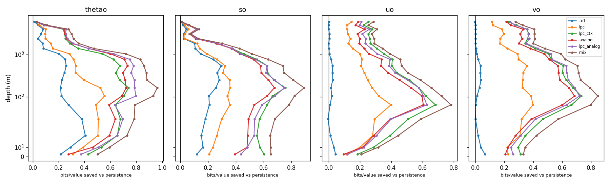
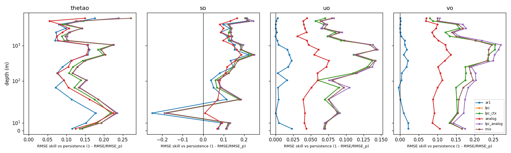
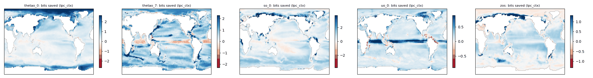

<!-- SPDX-FileCopyrightText: 2026 Samudra Authors -->
<!-- SPDX-License-Identifier: CC-BY-4.0 -->

# Report v2: OM4 2°, per-variable tolerance bins on Samudra's splits

**Status: complete, 2026-11-12.** Every number here comes from a file in
[`../om4_twodeg_v2_results/`](../om4_twodeg_v2_results/). The terms (tolerance,
σ_Δ, ε, the fine and coarse regimes, the ladder rungs) are introduced in the
[overview](../README.md); this report assumes them.

## What changed from v1, in one paragraph

v1 binned each channel over its own range of values. v2 bins each *variable*
at a tolerance of ε·σ_Δ, where σ_Δ is the spread of that variable's five-day
changes pooled over all levels (Keisler 2022). It also moves to the splits of
the 2° Samudra preset, so the test window is Samudra's 8-year inference window
rather than one year. The ladder, features, scoring sample size and
diagnostics are unchanged. v1 remains as a [frozen record](v1_om4_twodeg.md).

## Setup

- **Data:** `https://nyu1.osn.mghpcc.org/m2lines-pubs/Samudra/v2026-09/om4_twodeg/OM4.zarr`.
  Store attributes are in `results.json` under `meta.attrs`.
- **Splits** (`results.json`, `meta.split_ranges`):
  - train 2009-10-05 to 2013-09-30, 292 states;
  - validation 2013-10-05 to 2014-10-05, 74;
  - test 2014-10-10 to 2022-12-24, 600.
- **Training rows:** each channel's ladder is fit on 400,000 training rows.
- **Code:** commit `146f2e07` (`git_hash.txt`).
- **Runtimes** (`timings.tsv`) on `dtn012.hpc.nyu.edu` (Intel Xeon Platinum
  8444H, 32 cores, 251 GB; `run.log`):

  | Stage | Seconds |
  |---|---:|
  | Data cache (4.5 GB) | 171 |
  | ε sweep | 475 |
  | Full run, 77 channels | 1,656 |
  | Report | 3 |
  | Sanity checks | 21 |

### The tolerance

The tolerance per variable (`tables.md`) is:

| Variable | σ_Δ (five-day change) | Bin width ε·σ_Δ |
|---|---:|---:|
| `thetao` | 0.146 °C | 0.0183 °C |
| `so` | 0.0353 psu | 0.0044 psu |
| `uo` | 0.0224 m s⁻¹ | 0.0028 m s⁻¹ |
| `vo` | 0.0241 m s⁻¹ | 0.0030 m s⁻¹ |
| `zos` | 0.0259 m | 0.0032 m |

**ε = 1/8**, chosen by the rule in `select_eps.py`. The sweep is in
`eps_sweep/eps_selection.json`:

- **Surface: fine regime.** Halving ε adds exactly 1.00 bit of persistence cost
  on every surface channel. Model differences change by at most 0.003 bits from
  ε = 1/8 to 1/16.
- **775 m: still coarse, even at ε = 1/64.** Halving ε still changes `so_10` by
  0.15–0.22 bits and `thetao_10` by 0.02–0.19 bits.
- **An unexplained jump.** The surface converged at ε = 1/8 and 1/16, then
  `thetao_0` jumped by 0.047 bits at 1/32. Our guess is that the kernel
  bandwidth, picked from a four-value grid during validation, flips to a
  different value at that ε. That is a property of the tuning, not of the
  bins, and we have not checked it.

The channels in the coarse regime are those whose mean absolute test tendency
is under one bin (`sanity.json`, `coarse_regime_channels`): `so` at 375 m and
below, `thetao` at 775 m and below, and `uo_18` and `vo_18`.

## Headline

Bits are per wet value, over all levels weighted by wet area, with the surface
level in brackets (`tables.md`):

| Variable | Bits saved by `mix` over persistence | RMSE skill of `mix` vs persistence | Est. joint-coding gap (bits) | Bits saved, thickness-weighted |
|---|---:|---:|---:|---:|
| `thetao` | 0.64 [0.50] | 0.155 [0.141] | 0.23 [0.98] | 0.41 |
| `so` | 0.56 [0.65] | 0.127 [0.111] | 0.10 [0.19] | 0.28 |
| `uo` | 0.45 [0.21] | 0.097 [0.070] | 0.44 [1.06] | 0.34 |
| `vo` | 0.55 [0.33] | 0.180 [0.165] | 0.10 [0.55] | 0.46 |
| `zos` | 0.28 | 0.051 | 1.19 | 0.28 |

## Findings

1. **`mix` is the top rung in bits on every channel.** It is never worse than
   its best component (0 of 77; `sanity.json`).
   - `lpc_ctx` gives the largest of the parametric steps on 44 channels, and
     has the largest mixture weight on 39. `lpc_analog` has the largest weight
     on 35.
   - The context-dependent spread is still the biggest single idea in the
     ladder.
2. **The tolerance changes the depth profile, as designed.** In v1, deep tracer
   channels showed large relative savings, because their bins were narrower
   than the signal at some levels. In v2, bits saved on `thetao` and `so` fall
   toward 0 below about 1,000 m: there is little to code at 0.018 °C and
   0.0044 psu over five days. Velocities stay in or near the fine regime to the
   bottom, and keep saving 0.25–0.59 bits per value below 1,000 m. The thickness-weighted column is
   smaller than the wet-value column for every 3-D variable, because it gives
   most of its weight to those deep layers.
3. **The surface joint-coding gap is robust to the protocol.**

   | Surface | v1 gap | v2 gap | v2 bits saved by `mix` |
   |---|---:|---:|---:|
   | `thetao` | 1.02 | 0.98 | 0.50 |
   | `uo` | 1.20 | 1.06 | 0.21 |
   | `zos` | 1.20 | 1.19 | 0.28 |
   | `vo` | 0.66 | 0.55 | 0.33 |
   | `so` | 0.21 | 0.19 | 0.65 |

   - So across a different binning and an eight-times-longer test window, a
     field-level coder could still save about as much again as the whole
     per-cell ladder does at the surface, except for salinity.
   - The protocol still has no forcing. That keeps forcing the leading
     candidate explanation, and the forcing step is the next test of it.
4. **Persistence is still not hard to beat at depth, in RMSE.**

   | Deepest level | `mix` skill, v2 (v1) | `ar1` skill, v2 (v1) |
   |---|---:|---:|
   | `thetao_18` | 0.272 (0.247) | 0.176 (0.205) |
   | `so_18` | 0.209 (0.223) | 0.214 (0.220) |
   | `uo_18` | 0.080 | 0.003 |
   | `vo_18` | 0.100 | 0.000 |

   - The tracer result replicates on the new test window. Most of it is already
     in `ar1`, so the last five-day change persists at depth.
   - Velocities get their skill from spatial and cross-variable features, not
     from their own history.
5. **Open anomaly: `so_2` (22.5 m) has negative RMSE skill.**
   - Every linear rung has higher RMSE than persistence there: `lpc` 0.1057
     against 0.0888, so `mix`'s skill is −0.179. Yet every rung still saves
     bits (persistence 4.89, `mix` 4.24).
   - No other channel has negative `mix` RMSE skill in v2, and none did in v1.
   - RMSE over 8,000 sampled rows can be dominated by a few extreme rows, while
     the bits score, which is bounded per row by the floor, barely moves.
   - Next check: dump `so_2`'s per-row errors and see whether they cluster in a
     few cells, for example near-fresh coastal cells (#974).
6. **The generic blosc bound is still worse than `mix` everywhere**, by at
   least 0.38 bits (`so_17`). In v1, subtracting the land-mask cost left `mix`
   ahead on 76 of 77 channels. In v2, the subtraction goes negative on six deep
   coarse-regime channels (`thetao_17`, `thetao_18`, `so_15`–`so_18`). There
   `mix` costs at most 0.11 bits per value, while the mask-only cost at those
   levels is 0.67–3.63 bits per value, comparable to or larger than the bound
   itself. So the subtraction is not
   meaningful there.
7. **One-step compressibility ratios:**
   - tracers: 0.999–1.002;
   - velocities: 0.90–0.997, smallest at the deepest level (`vo_18` 0.903,
     `uo_18` 0.933), meaning the `lpc` forecasts there are smoother than truth.
   - As before, this diagnostic is meant for rollouts.
8. **`mix` optimizes bits, not RMSE.**
   - Its mean has higher RMSE than the best single component on 60 of 77
     channels.
   - Apart from `so_2` (finding 5; 18.9% vs `analog`), the excess is under 4%.

## v1 against v2

RMSE does not depend on the bins, so RMSE skill compares directly. v1 tested on
2015; v2 tests on 2014-10 to 2022-12. Unweighted means over levels (the second
table in each `tables.md`):

| Variable | RMSE skill of `mix`, v1 | RMSE skill of `mix`, v2 | Bits saved, v1 | Bits saved, v2 |
|---|---:|---:|---:|---:|
| `thetao` | 0.154 | 0.158 | 0.82 | 0.60 |
| `so` | 0.145 | 0.134 | 0.66 | 0.51 |
| `uo` | 0.083 | 0.096 | 0.45 | 0.43 |
| `vo` | 0.155 | 0.175 | 0.54 | 0.53 |
| `zos` | 0.041 | 0.051 | 0.23 | 0.28 |

- **Point-forecast skill is stable** across protocols.
- **Bits saved differ** most for the tracers, because v1's narrow deep bins
  inflated their deep savings (finding 2). Velocities, already in the fine
  regime in v1, barely move.
- **Surface bits saved are nearly the same in both runs:** 0.47 vs 0.50 for
  `thetao`, 0.66 vs 0.65 for `so`, 0.24 vs 0.21 for `uo`, 0.31 vs 0.33 for
  `vo`. That fits the theory: in the fine regime, the bin width shifts both
  models equally and the difference stays.

## Checks (`sanity.py` → `sanity.json`)

- **σ_Δ and bin widths:** recomputed independently, they match the run to
  3 × 10⁻¹⁵ (relative).
- **Persistence by hand:** recomputed with plain numpy on `thetao_0`, `so_10`,
  `uo_18` and `zos`, including the floor. It matches the run's full-field bits
  to within 0.001 bits.
- **Sampling:** the 8,000-row sample and the full field differ by at most 0.070
  bits on any cheap rung (`thetao_8`).
- **Bits:** `mix` is never worse than its best component.

## Environment

Python 3.12 with numpy 1.26.4, xarray 2025.1.2, zarr 2.18.7, numcodecs 0.15.1,
fsspec 2025.5.1, aiohttp 3.11.16, dask 2025.2.0, cftime 1.6.4.post1, pandas
2.2.3, scikit-learn 1.9.1, scipy 1.17.1 and matplotlib 3.10.1.
