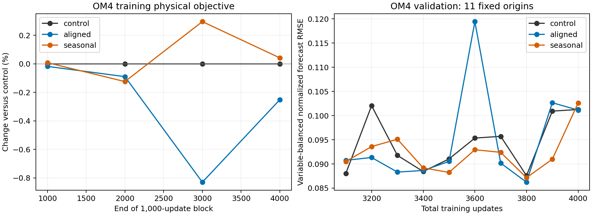

<!-- SPDX-FileCopyrightText: 2026 Samudra Authors -->
<!-- SPDX-License-Identifier: CC-BY-4.0 -->

# Did the earlier observation experiment also improve OM4 performance?

**Only weakly and inconsistently.** The earlier aligned and seasonal KE runs
did not show a substantial reduction of the OM4 training physical objective.
Saved OM4 validation forecasts show small improvements in some comparisons,
but the all-field ranking changes with checkpoint. This narrows the apparent
disagreement with the current full-state forecasting experiment.

## OM4 training examples

Downloaded the original `events.jsonl` and manifests from Beta for U-global,
U-aux01, and U-aux01-seasonal. Each has 4,000 actual optimizer updates, exactly
2,000 on OM4 and 2,000 on observations. All per-update task counts, task choices,
and learning rates match. The manifests agree on seed 1729, batch accumulation
8, OM4 source path, normalization arrays, data/grid/statistics hashes, and
observation training/validation months. Sample indices and missingness seeds
are deterministic functions of task count and seed in the training code.
The first OM4 physical objective agrees across all three to within 2e-8.

For auxiliary runs, use the logged `physical_objective = loss - 0.01 *
accessory_mse`; for control, use `loss`. Arithmetic was checked for every OM4
update. Negative changes below mean lower loss.

| Total-update block | OM4 updates | Control physical objective | Aligned change | Seasonal change |
| --- | ---: | ---: | ---: | ---: |
| 1–1,000 | 782 | 0.05442365 | -0.018% | +0.008% |
| 1,001–2,000 | 593 | 0.01310015 | -0.090% | -0.125% |
| 2,001–3,000 | 407 | 0.01094575 | -0.830% | +0.296% |
| 3,001–4,000 | 218 | 0.01143023 | -0.252% | +0.042% |

These are losses measured while weights change, on matched sampled training
examples. The physical objective combines six-lead forecast MSE, 0.1 times
initializer reconstruction loss, and 0.1 times surface-completion loss. It is
**not a separately logged forecast-only training RMSE**, nor a frozen-checkpoint
training-set evaluation. The small aggregate changes do not exclude offsetting
changes among these components.

## Existing held-out OM4 diagnostics

The runs also logged forecasts from 11 fixed OM4 validation origins. `full_mse`
is the area-weighted normalized squared error averaged over six forecast leads
and balanced equally across the five variable groups (thetao, so, uo, vo, zos).
It excludes reconstruction, completion, and auxiliary losses. These forecasts
start from the learned surface-history initializer. They do not start from the
complete true OM4 state used in the current experiment.

| Comparison | Aligned all-field RMSE change | Seasonal all-field RMSE change |
| --- | ---: | ---: |
| Matched update 3,800 | -1.54% | -0.48% |
| Matched update 4,000 | -0.12% | +1.33% |
| Mean MSE over updates 3,100–4,000, every 100, then square root | +1.10% | -2.12% |

Temperature/salinity forecast RMSE is somewhat more favorable: -1.12% aligned
and -1.96% seasonal over the same last ten checkpoints; at update 4,000 these
are -4.66% and -3.01%. The validation cohort is small. Checkpoints are correlated
and are not independent training replicates; these summaries are descriptive.

Checkpoint selection matters: the observation-selected models were U-global
at 3,800, aligned at 4,000, and seasonal at 3,800. Comparing those selected
artifacts gives OM4 all-field RMSE changes of **+15.49% aligned and -0.48%
seasonal**. The aligned deterioration is much smaller when training progress
is matched, as the table shows. An observation-selected gain does not imply
an OM4-selected gain.

## Implications for the apparent discrepancy

- Both experiments use quarter-degree **OM4** surface subcell velocity-variance
  targets; the earlier auxiliary loss is applied only on OM4 updates. It is
  not supervised by observed KE.
- The earlier reported -1.6% aligned / -3.2% seasonal gains refer to a composite
  of observation integrated errors and spectral errors. They are not reductions
  in the current experiment's global 77-channel forecast RMSE. There were real
  component improvements, especially SST and deep OHC, but not a uniform gain.
- The earlier model also learns an initializer from incomplete surface history.
  Auxiliary gradients can alter that initializer as well as the evolution
  network. Seasonal initialized-persistence composite already improves by about
  2.7% over control. That is compatible with better initialization or
  regularization, but does not isolate the cause of the evolved forecast gain.
- Auxiliary strength was not matched between experiments. The current
  coefficient was calibrated to 10% initial shared-backbone gradient norm;
  separate main/auxiliary gradient norms were not recorded in the earlier pilot.
  Its late aligned auxiliary/physical scalar-loss ratio was 27.2%. The current
  final logged aligned batch is about 0.24%, but those use different physical
  objectives and aggregation, and a single batch versus a block mean. Scalar
  ratios cannot establish the relative influence on optimization.
- A regularizer can help held-out observations without reducing OM4 training
  loss. Conversely, this single-seed evidence does not establish a reproducible
  benefit. No disconnected-gradient or target-provenance bug was found in the
  inspected paths; this audit does not rule out every implementation error.

The supported interpretation is a modest, task- and checkpoint-dependent
earlier observation gain, rather than an established general OM4 RMSE benefit
that the current experiment failed to reproduce. No new training was launched
for this audit.

## Reproduction and provenance

[Summary CSV](previous-om4-summary.csv),
[extracted evidence bundle](previous-om4-evidence.json.gz), and
[analysis script](../audit_previous_om4.py). The bundle includes training losses,
OM4 validation events, manifests, selected-checkpoint records, original log
SHA-256s, and absolute runtime paths. The script verifies update matching,
shared normalization/data contracts, and auxiliary subtraction before producing
the table and figure. Decompress the evidence JSON and run the script with its
path and an output directory.

| Arm | Source commit | Runtime suffix under `/projects/ny/lz1955/multiscale/jrusak/runs/` |
| --- | --- | --- |
| Control | `ba22420144ef7576c324c40f74bae614ab77c1d4` | `2026-10-02-extent-om4/runtime-v2/U-global` |
| Aligned | `b14ce8acd0ddf77b42b6341b25cdfe242dc8eec6` | `2026-10-03-extent-representation/U-aux01` |
| Seasonal | `558d45cac2294f691d1d73a47db1783df1850c80` | `2026-10-04-extent-accessory-controls/U-aux01-seasonal` |

Code definitions inspected: `observation_joint.py:om4_objective/train_update`,
`extent_training.py:emit`, `initializer_wave.py:score`, and
`surface_state.py:balanced_loss` in the earlier experiment workspace.
The earlier observation scores and persistence comparison are recorded in
`docs/experiments/observation-d/extent-accessory-controls-2026-10-04.md` there.
