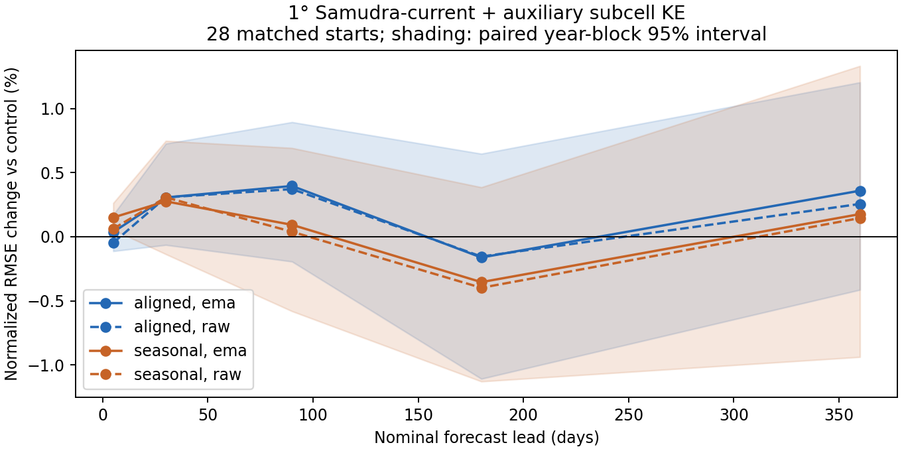
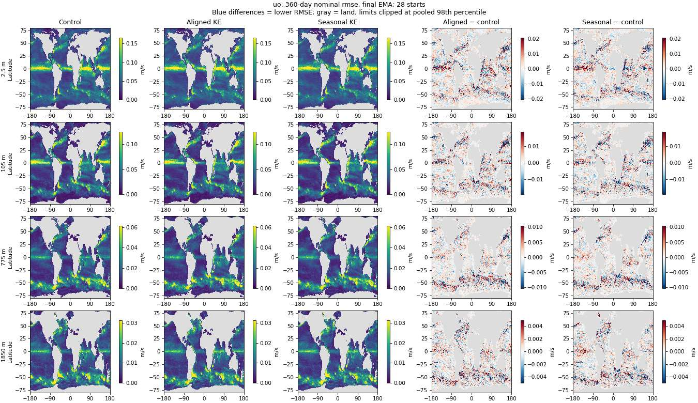

<!-- SPDX-FileCopyrightText: 2026 Samudra Authors -->
<!-- SPDX-License-Identifier: CC-BY-4.0 -->

# Auxiliary subcell KE: first-wave results

**No clear improvement in global forecast RMSE in this seed-15 pilot.**
Both aligned and seasonal supervision change global errors by less than 0.4%
across the five sampled leads. Regional gains in the Kuroshio and Gulf Stream
are offset by increased tropical errors. The raw-checkpoint sensitivity agrees
with this pattern. The [earlier-pilot OM4 audit](OM4-AUDIT.md) finds that its
observation-score gain did not establish a consistent OM4-wide forecast gain.

## Matched quarterly forecasts

Final epoch-70 EMA, 28 starts (four per year, 2015–2021). The primary score is
`sqrt(mean_channel(mean_start(area-weighted normalized squared error)))`, with
equal weights on 77 channels and each channel's original wet mask. Frozen
training standard deviations normalize channels; DynamicLoss weights do not
enter evaluation. Negative change means lower RMSE.

| Nominal lead | Control RMSE | Aligned change (95% interval) | Seasonal change (95% interval) |
| --- | ---: | ---: | ---: |
| 5 days | 0.177251 | +0.04% [-0.11, +0.17] | +0.15% [+0.05, +0.26] |
| 30 days | 0.316760 | +0.31% [-0.06, +0.73] | +0.28% [-0.14, +0.75] |
| 90 days | 0.384914 | +0.40% [-0.19, +0.89] | +0.09% [-0.58, +0.69] |
| 180 days | 0.429124 | -0.16% [-1.11, +0.65] | -0.35% [-1.13, +0.39] |
| 360 days | 0.457900 | +0.36% [-0.41, +1.20] | +0.18% [-0.94, +1.33] |

Intervals use 2,000 paired bootstrap samples of the seven initialization years,
keeping each year's four quarters together. They describe date variability,
**not training-seed uncertainty**. Forecasts overlap, the number of years is
small, and regional/variable comparisons are descriptive and unadjusted for
multiple comparisons. All global intervals include zero except the small
five-day seasonal degradation. Only one training seed was run.

## Where errors change

At nominal 360 days, the all-channel regional score changes as follows:

| Region | Aligned | Seasonal |
| --- | ---: | ---: |
| Gulf Stream | -1.44% | -2.69% |
| Kuroshio | -3.49% | -4.51% |
| ACC | +0.25% | +0.41% |
| Tropics | +1.46% | +1.93% |
| Rest | -0.46% | -1.71% |

Boxes: Gulf Stream 25–50°N, 80–40°W; Kuroshio 25–45°N, 125–180°E;
ACC 65–40°S; tropics 20°S–20°N; rest excludes those four boxes. These are broad
regional definitions, not dynamically diagnosed current boundaries.

Maps use physical units and original per-channel wet support, with shared
control/treatment color scales and a shared symmetric difference scale per
variable/depth. In RMSE maps, differences are treatment minus control; blue means lower RMSE.
Limits clip at the pooled 98th percentile; scalar metrics include all valid cells.
The map atlas covers nominal 30/180/360-day leads and signed 360-day bias, at
2.5, 105, 775 and 1850 m (nearest available levels to surface/100/700/2000 m),
plus SSH. Full precision scores for all 77 channels are in the four `channels-{ema,raw}-{aligned,seasonal}.csv.gz` files.

## Continuous rollout is a separate diagnostic

The matched continuous rollout has 598 forecast dates, beginning October 20,
2014 and ending December 24, 2022. It is not repeatedly reinitialized.

| EMA model | Trajectory normalized RMSE | Change | RMSE of time-mean error | Change |
| --- | ---: | ---: | ---: | ---: |
| Control | 0.469376 | +0.00% | 0.138648 | +0.00% |
| Aligned | 0.473715 | +0.92% | 0.143608 | +3.58% |
| Seasonal | 0.466621 | -0.59% | 0.137028 | -1.17% |

The seasonal target shows a small continuous-rollout gain; aligned targets
worsen both diagnostics. These are long-trajectory and mean-bias measures,
not the quarterly forecast metric above. Seasonal raw-checkpoint time-mean
error worsens, so the small EMA mean-bias improvement is not checkpoint-robust.
There is no evidence here that time-aligned KE anomalies beat a seasonal target.

## Completed observation evaluation

Grace CPU job **130049** completed all six continuous-rollout comparisons in
43m19s, exit 0. Published five-day OISST/DUACS/ARGO-IAP products and the original
per-channel model wet masks were used. These scores compare a continuous
2014–2022 trajectory with observations; they are not the independently
initialized, through-day-30 observation composite from the earlier pilot.

Negative changes mean lower error. Primary final-EMA results:

| Observation metric | Control RMSE | Aligned change (paired 95% interval) | Seasonal change (paired 95% interval) |
| --- | ---: | ---: | ---: |
| SST | 0.887820 °C | -0.38% [-0.56, -0.20] | +1.25% [+0.59, +1.93] |
| Geostrophic velocity vector | 0.194215 m/s | +0.18% [+0.07, +0.30] | +0.11% [+0.01, +0.22] |
| Instantaneous surface EKE | 0.045499 m²/s² | -0.05% [-0.09, -0.01] | -0.01% [-0.05, +0.03] |
| OHC 0–700 m | 4.102874 GJ/m² | +0.01% [-0.22, +0.26] | -0.52% [-0.69, -0.34] |
| OHC 700–2000 m | 2.701223 GJ/m² | -0.13% [-0.30, +0.05] | -0.89% [-1.15, -0.59] |

The primary reduction is the square root of equally weighted annual MSEs.
SST/velocity/EKE use 2015–2022; OHC uses 2015–2021 because 2022 lacks a complete
year of shared monthly coverage. The six models have matching metric dates,
sample counts, grid shapes, and paired-cell counts. Reconstructed annual-MSE
aggregates reproduce every primary score. Intervals use 10,000 **paired**
calendar-year resamples, recomputing the treatment/control RMSE ratio each time.
They measure variation across these years, not seed uncertainty; adjacent years
on one continuous trajectory may remain dependent. No multiplicity adjustment
was applied. Individual model intervals in the raw table are not substituted
for paired difference intervals.

Raw checkpoints give the same direction for aligned SST (-0.63%), seasonal
SST (+0.84%), and seasonal OHC (-0.39% shallow, -0.69% intermediate). These are
small, mixed changes, not a broad observation improvement. The seasonal upper
700-m OHC residual-variance map RMSE also worsens by 26.7% (pattern correlation
0.695 to 0.616), despite the small improvement in its total OHC RMSE. The two
diagnostics measure different properties of the trajectory.

[All 306 metric rows](observation-metrics.csv),
[paired comparisons including raw checkpoints](observation-summary.csv),
[completion/provenance receipt](observation-provenance.json.gz), and
[reproducible summary script](../summarize_observations.py).
Downloaded metrics and completion receipt match remote SHA-256s.

## Provenance

- Control: Beta 210664, W&B `uaei2vbr`, source `a20c44484`.
- Aligned: Beta 211905, W&B `b2dudv2l`, 70 epochs, exit 0, 4h22m13s.
- Seasonal: Beta 211906, W&B `9idy3li1`, 70 epochs, exit 0, 4h27m24s.
- Both treatments: source `2506c0805`, fixed auxiliary coefficient
  `0.0340550269485343`, same training recipe and seed as control.
- Matched evaluation: Beta **211962**, source `87a4246e2`, all six full
  evaluations and both smoke checks completed, exit 0, 31m03s.
- Primary checkpoints: final EMA; sensitivity: raw epoch 70. No test-based
  checkpoint selection or coefficient tuning.
- Calendar: six quarterly initializations cross an extra source-calendar day;
  some nominal 90/180/360-day leads are 91/181/361 days. All comparisons use
  identical actual timestamps, recorded in the evaluation receipts.
- Verified common masks, coordinates, standard deviations, evaluation script
  and all quarterly/continuous dates across all six outputs. Regression tests
  cover both output slots, area/mask weighting, scalar/map consistency, and
  paired year resampling. Continuous scalar and spatial MSE agree numerically.
- Full errors and continuous Zarr stores remain on Beta under
  `/projects/ny/lz1955/multiscale/jrusak/runs/current-ke-aux-20261010/evaluations-211962`.
- Observation scoring: Grace CPU job **130049**, submitted through Alpha,
  completed all six masked continuous rollouts against the published five-day
  DUACS/OISST/ARGO products used by the earlier control study. The first pass
  (130046) correctly rejected local daily-product timestamps before scoring;
  its failed attempt is preserved separately.
  The completion callback was delivered and the output collected and verified.
  These observation scores are distinct from OM4 forecast RMSE.

No further training seeds have been launched. The current evidence supports a
regional tradeoff, not adopting this auxiliary loss as a general improvement.

## Figures

Full-resolution PNG figures are retained in the local `.LOCAL/ke-analysis/figures`
directory and the runtime artifact archive. The portable atlas below is checked
into this experiment record.

| Field | 30-day RMSE | 180-day RMSE | 360-day RMSE | 360-day bias |
| --- | --- | --- | --- | --- |
| thetao | [map](maps/thetao-rmse-30d.jpg) | [map](maps/thetao-rmse-180d.jpg) | [map](maps/thetao-rmse-360d.jpg) | [map](maps/thetao-bias-360d.jpg) |
| so | [map](maps/so-rmse-30d.jpg) | [map](maps/so-rmse-180d.jpg) | [map](maps/so-rmse-360d.jpg) | [map](maps/so-bias-360d.jpg) |
| uo | [map](maps/uo-rmse-30d.jpg) | [map](maps/uo-rmse-180d.jpg) | [map](maps/uo-rmse-360d.jpg) | [map](maps/uo-bias-360d.jpg) |
| vo | [map](maps/vo-rmse-30d.jpg) | [map](maps/vo-rmse-180d.jpg) | [map](maps/vo-rmse-360d.jpg) | [map](maps/vo-bias-360d.jpg) |
| zos | [map](maps/zos-rmse-30d.jpg) | [map](maps/zos-rmse-180d.jpg) | [map](maps/zos-rmse-360d.jpg) | [map](maps/zos-bias-360d.jpg) |

Example: zonal velocity across four depths.

