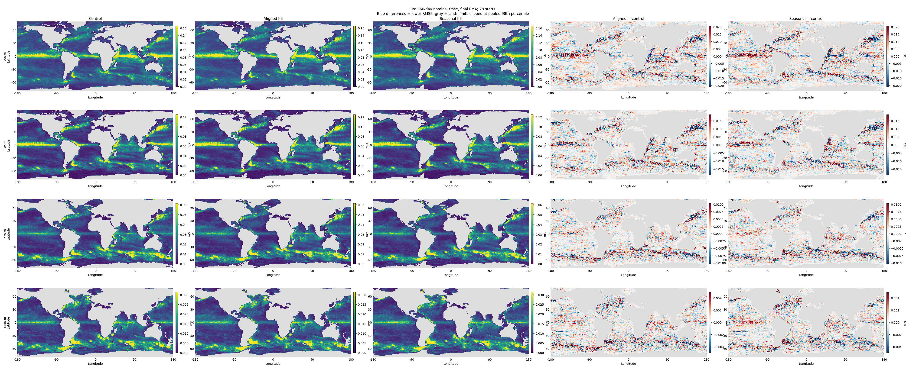

<!-- SPDX-FileCopyrightText: 2026 Samudra Authors -->
<!-- SPDX-License-Identifier: CC-BY-4.0 -->

# Auxiliary subcell KE: first-wave results

**No clear improvement in global forecast RMSE in this seed-15 pilot.**
Both aligned and seasonal supervision change global errors by less than 0.4%
across the five sampled leads. Regional gains in the Kuroshio and Gulf Stream
are offset by increased tropical errors. The raw-checkpoint sensitivity agrees
with this pattern. The [earlier-pilot OM4 audit](OM4-AUDIT.md) finds that its
observation-score gain did not establish a consistent OM4-wide forecast gain.

## What “aligned” and “seasonal” mean

Both conditions add a training-only prediction task for **surface spatial
subcell kinetic-energy variance**. The target is derived from quarter-degree
OM4 five-day-mean surface velocities inside each 1° cell:

```text
q(x,t) = 0.5 * (area_mean(u² + v²) - area_mean(u)² - area_mean(v)²)
z(x,t) = (log1p(q(x,t) / scale) - log_mean) / log_std
```

The area averages use spherical overlaps and common wet U/V support, with at
least 50% native wet coverage. This measures velocity variation within a coarse
cell; using five-day-mean velocities means it does not include all unresolved
kinetic energy. The transform's scale, mean, and standard deviation are frozen
training-only statistics.

| Condition | Target supplied to the auxiliary head |
| --- | --- |
| **Control** | No auxiliary loss; the original physical forecasting objective. |
| **Aligned KE** | The date-specific transformed variance `z(x,t)` at the exact future timestamp of each physical forecast label. This retains year-specific and other time-varying target information. |
| **Seasonal KE** | Each cell's mean `z(x,t)` over all training dates in the target's calendar month. Every January shares one target map, every February another, and so on. It retains geographic and monthly seasonal structure while removing year-specific target variability. |

The seasonal average is taken **after the log transform and standardization**;
it is not the transformed average of raw `q`. Neither condition uses held-out
target values or supplies fine-grid fields as model inputs.

A linear 1×1 head on the final U-Net features predicts two target maps per
autoregressive call, one per output state. Its area-weighted squared error is
averaged over examples, both output slots, and all four calls (eight future
states). Both conditions optimize:

```text
L_total = L_physical + 0.0340550269485343 * L_auxiliary
```

The physical objective and its four-call sum are unchanged. The coefficient
was fixed using aligned targets so the median initial auxiliary backbone
gradient norm was 10% of the physical gradient norm over four training batches;
the same coefficient is used for seasonal targets. It is not adjusted during
training. Auxiliary predictions are neither fed back into the forecast state
nor used at inference: any RMSE effect comes through changes to the shared
model weights.

See the [target construction and calibration record](../README.md) and
[implemented target transforms](../../../src/samudra/auxiliary_ke.py).

## Matched quarterly forecasts

Final epoch-70 EMA, 28 starts (four per year, 2015–2021). The primary score is
`sqrt(mean_channel(mean_start(area-weighted normalized squared error)))`, with
equal weights on 77 channels and each channel's original wet mask. Frozen
training standard deviations normalize channels; DynamicLoss weights do not
enter evaluation. Negative change means lower RMSE.

| Nominal lead | Control RMSE | Aligned change (95% interval) | Seasonal change (95% interval) |
| --- | ---: | ---: | ---: |
| 5 days | 0.177251 | +0.04% [-0.11, +0.17] | +0.15% [+0.05, +0.26] |
| 30 days | 0.316760 | +0.31% [-0.06, +0.73] | +0.28% [-0.14, +0.75] |
| 90 days | 0.384914 | +0.40% [-0.19, +0.89] | +0.09% [-0.58, +0.69] |
| 180 days | 0.429124 | -0.16% [-1.11, +0.65] | -0.35% [-1.13, +0.39] |
| 360 days | 0.457900 | +0.36% [-0.41, +1.20] | +0.18% [-0.94, +1.33] |

Intervals use 2,000 paired bootstrap samples of the seven initialization years,
keeping each year's four quarters together. They describe date variability,
**not training-seed uncertainty**. Forecasts overlap, the number of years is
small, and regional/variable comparisons are descriptive and unadjusted for
multiple comparisons. All global intervals include zero except the small
five-day seasonal degradation. Only one training seed was run.

## Where errors change

At nominal 360 days, the all-channel regional score changes as follows:

| Region | Aligned | Seasonal |
| --- | ---: | ---: |
| Gulf Stream | -1.44% | -2.69% |
| Kuroshio | -3.49% | -4.51% |
| ACC | +0.25% | +0.41% |
| Tropics | +1.46% | +1.93% |
| Rest | -0.46% | -1.71% |

Boxes: Gulf Stream 25–50°N, 80–40°W; Kuroshio 25–45°N, 125–180°E;
ACC 65–40°S; tropics 20°S–20°N; rest excludes those four boxes. These are broad
regional definitions, not dynamically diagnosed current boundaries.

The lossless PNG maps render each grid cell as an exact **2×2 square-pixel**
block, with nearest-neighbor rendering and pixel-aligned panel boundaries.
Every map panel is 720×320 pixels (360 columns × 160 displayed latitude rows).
The renderer verifies panel dimensions and uniform pixels within every cell.

Maps use physical units and original per-channel wet support, with shared
control/treatment color scales and a shared symmetric difference scale per
variable/depth. In RMSE maps, differences are treatment minus control; blue means lower RMSE.
Limits clip at the pooled 98th percentile; scalar metrics include all valid cells.
The map atlas covers nominal 30/180/360-day leads and signed 360-day bias, at
2.5, 105, 775 and 1850 m (nearest available levels to surface/100/700/2000 m),
plus SSH. Full precision scores for all 77 channels are in the four `channels-{ema,raw}-{aligned,seasonal}.csv.gz` files.

## Continuous rollout is a separate diagnostic

The matched continuous rollout has 598 forecast dates, beginning October 20,
2014 and ending December 24, 2022. It is not repeatedly reinitialized.

| EMA model | Trajectory normalized RMSE | Change | RMSE of time-mean error | Change |
| --- | ---: | ---: | ---: | ---: |
| Control | 0.469376 | +0.00% | 0.138648 | +0.00% |
| Aligned | 0.473715 | +0.92% | 0.143608 | +3.58% |
| Seasonal | 0.466621 | -0.59% | 0.137028 | -1.17% |

The seasonal target shows a small continuous-rollout gain; aligned targets
worsen both diagnostics. These are long-trajectory and mean-bias measures,
not the quarterly forecast metric above. Seasonal raw-checkpoint time-mean
error worsens, so the small EMA mean-bias improvement is not checkpoint-robust.
There is no evidence here that time-aligned KE anomalies beat a seasonal target.

## Completed observation evaluation

Grace CPU job **130049** completed all six continuous-rollout comparisons in
43m19s, exit 0. Published five-day OISST/DUACS/ARGO-IAP products and the original
per-channel model wet masks were used. These scores compare a continuous
2014–2022 trajectory with observations; they are not the independently
initialized, through-day-30 observation composite from the earlier pilot.

Negative changes mean lower error. Primary final-EMA results:

| Observation metric | Control RMSE | Aligned change (paired 95% interval) | Seasonal change (paired 95% interval) |
| --- | ---: | ---: | ---: |
| SST | 0.887820 °C | -0.38% [-0.56, -0.20] | +1.25% [+0.59, +1.93] |
| Geostrophic velocity vector | 0.194215 m/s | +0.18% [+0.07, +0.30] | +0.11% [+0.01, +0.22] |
| Instantaneous surface EKE | 0.045499 m²/s² | -0.05% [-0.09, -0.01] | -0.01% [-0.05, +0.03] |
| OHC 0–700 m | 4.102874 GJ/m² | +0.01% [-0.22, +0.26] | -0.52% [-0.69, -0.34] |
| OHC 700–2000 m | 2.701223 GJ/m² | -0.13% [-0.30, +0.05] | -0.89% [-1.15, -0.59] |

The primary reduction is the square root of equally weighted annual MSEs.
SST/velocity/EKE use 2015–2022; OHC uses 2015–2021 because 2022 lacks a complete
year of shared monthly coverage. The six models have matching metric dates,
sample counts, grid shapes, and paired-cell counts. Reconstructed annual-MSE
aggregates reproduce every primary score. Intervals use 10,000 **paired**
calendar-year resamples, recomputing the treatment/control RMSE ratio each time.
They measure variation across these years, not seed uncertainty; adjacent years
on one continuous trajectory may remain dependent. No multiplicity adjustment
was applied. Individual model intervals in the raw table are not substituted
for paired difference intervals.

Raw checkpoints give the same direction for aligned SST (-0.63%), seasonal
SST (+0.84%), and seasonal OHC (-0.39% shallow, -0.69% intermediate). These are
small, mixed changes, not a broad observation improvement. The seasonal upper
700-m OHC residual-variance map RMSE also worsens by 26.7% (pattern correlation
0.695 to 0.616), despite the small improvement in its total OHC RMSE. The two
diagnostics measure different properties of the trajectory.

[All 306 metric rows](observation-metrics.csv),
[paired comparisons including raw checkpoints](observation-summary.csv),
[completion/provenance receipt](observation-provenance.json.gz), and
[reproducible summary script](../summarize_observations.py).
Downloaded metrics and completion receipt match remote SHA-256s.

## Residual-anomaly errors against OM4

Grace CPU analysis **137491** completed in 10m37s, exit 0, using the saved
final-EMA control, aligned, and seasonal continuous rollouts. The comparison
covers all **598 dates, October 20, 2014–December 24, 2022**, on the original
per-channel wet support, with no temporal or spatial interpolation.

For each model and OM4 independently, at each cell, subtract the field's own
pentad climatology and then its own fitted linear trend including an intercept,
using the production `detrended_deseasonalized` kernel in float64. This removes
the own mean state as well as the seasonal cycle and trend. Climatologies and
trends are fitted over the complete common rollout; this is a retrospective
diagnostic. The mapped quantity is:

```text
residual_RMSE(x) = sqrt(mean_time((model_residual(x,t) - OM4_residual(x,t))**2))
```

It measures errors in the residual fluctuations, including their timing.
It is distinct from the RMSE between variance maps. Averaging signed residual
errors would give nearly zero by construction and is not used here.

The all-channel regional score normalizes each channel by its original training
standard deviation, area-averages MSE on that channel's wet support, averages
across channels, and takes the square root. Negative change means lower RMSE.

| Region | Aligned residual RMSE change | Seasonal residual RMSE change |
| --- | ---: | ---: |
| Global | +0.79% | -0.35% |
| Gulf Stream | +1.73% | -3.17% |
| Kuroshio | +6.15% | +4.28% |
| ACC | +1.06% | +0.36% |
| Tropics | +1.55% | +0.52% |
| Rest | -2.43% | -3.70% |

Global normalized residual RMSE is **0.412379 control, 0.415646 aligned,
0.410935 seasonal**. Seasonal gains in the Gulf Stream include surface u
(-2.88%), v (-3.64%), and SSH (-1.53%); its surface temperature and salinity
errors there increase by 2.20% and 3.88%. Kuroshio surface errors increase for
both treatments. Across global channel scores, aligned improves 6/77 channels,
and seasonal improves 28/77; those counts do not weight effect magnitudes.
The maps show local changes within these broad boxes.

These are errors along one continuous free trajectory, whose phase can diverge
from OM4 over years. The earlier regional table instead describes one-year
forecasts from 28 quarterly initializations; the Kuroshio improvement in that
table does not persist in this full-trajectory diagnostic. These regional
changes are descriptive, with no seed or temporal uncertainty intervals.
Mean-state, seasonal-cycle, and trend errors are intentionally excluded.

Residual RMSE can also fall when a free-running model damps fluctuations.
The channel CSV therefore includes gold, control, and treatment residual
standard deviations. For example, global surface-temperature residual standard
deviation is 0.5332 °C in OM4 and 0.4058/0.4090/0.4123 °C in control/aligned/
seasonal. All three underrepresent that variability; neither auxiliary run's
surface-temperature residual RMSE improves globally.

All 77 physical channels were scored. Saved physical forecasts reproduce the
original normalized raw MSE maps within the declared floating-point tolerance:
maximum absolute discrepancies are 1.17e-5 control, 9.49e-6 aligned, and 1.22e-5
seasonal. Recomputed global raw scores reproduce the earlier continuous-rollout
scores. All output moments are finite and nonnegative on original wet cells;
metadata and downloaded arrays pass SHA-256 readback verification. Tests
exclude pure mean/seasonal differences but penalize wrong-phase anomalies even
when their variances match. The shared renderer reproduces the original SSH
PNG exactly and checks integer panel bounds and constant 2×2-pixel cells.

The first pass (137485) rejected a two-dimensional versus one-dimensional
coordinate representation before scoring. The successful retry verifies their
broadcast equivalence. No training or model inference was rerun.

| Field | Full-rollout residual-anomaly RMSE and treatment differences |
| --- | --- |
| Temperature | [lossless PNG](maps/thetao-residual-rmse-rollout.png) |
| Salinity | [lossless PNG](maps/so-residual-rmse-rollout.png) |
| Zonal velocity | [lossless PNG](maps/uo-residual-rmse-rollout.png) |
| Meridional velocity | [lossless PNG](maps/vo-residual-rmse-rollout.png) |
| SSH | [lossless PNG](maps/zos-residual-rmse-rollout.png) |

Each atlas shows control, aligned, seasonal, aligned-minus-control, and
seasonal-minus-control. Blue differences mean lower RMSE. Displayed depths
are 2.5, 105, 775, and 1850 m, plus surface SSH. Scales are shared across
conditions for each channel, clipped at the pooled 98th percentile as above.
Scalar scores retain all wet cells, including outside the displayed ±80° band.

[Regional and variable summaries](residual-summary.csv),
[all channel scores and residual standard deviations](residual-channels.csv),
[execution/data provenance](residual-provenance.json.gz), and
[reproducible analysis](../residual_maps.py). Full MSE/variance arrays remain
with the saved forecasts under `residual-maps-137491` on project storage.

## Provenance

- Control: Beta 210664, W&B `uaei2vbr`, source `a20c44484`.
- Aligned: Beta 211905, W&B `b2dudv2l`, 70 epochs, exit 0, 4h22m13s.
- Seasonal: Beta 211906, W&B `9idy3li1`, 70 epochs, exit 0, 4h27m24s.
- Both treatments: source `2506c0805`, fixed auxiliary coefficient
  `0.0340550269485343`, same training recipe and seed as control.
- Matched evaluation: Beta **211962**, source `87a4246e2`, all six full
  evaluations and both smoke checks completed, exit 0, 31m03s.
- Primary checkpoints: final EMA; sensitivity: raw epoch 70. No test-based
  checkpoint selection or coefficient tuning.
- Calendar: six quarterly initializations cross an extra source-calendar day;
  some nominal 90/180/360-day leads are 91/181/361 days. All comparisons use
  identical actual timestamps, recorded in the evaluation receipts.
- Verified common masks, coordinates, standard deviations, evaluation script
  and all quarterly/continuous dates across all six outputs. Regression tests
  cover both output slots, area/mask weighting, scalar/map consistency, and
  paired year resampling. Continuous scalar and spatial MSE agree numerically.
- Full errors and continuous Zarr stores remain on Beta under
  `/projects/ny/lz1955/multiscale/jrusak/runs/current-ke-aux-20261010/evaluations-211962`.
- Observation scoring: Grace CPU job **130049**, submitted through Alpha,
  completed all six masked continuous rollouts against the published five-day
  DUACS/OISST/ARGO products used by the earlier control study. The first pass
  (130046) correctly rejected local daily-product timestamps before scoring;
  its failed attempt is preserved separately.
  The completion callback was delivered and the output collected and verified.
  These observation scores are distinct from OM4 forecast RMSE.

No further training seeds have been launched. The current evidence supports a
regional tradeoff, not adopting this auxiliary loss as a general improvement.

## Figures


The full-resolution lossless PNG atlas below is checked into this experiment
record and retained locally in `.LOCAL/ke-analysis/figures`. Open the PNG at its
native resolution to see the exact cell-to-pixel mapping.

| Field | 30-day RMSE | 180-day RMSE | 360-day RMSE | 360-day bias |
| --- | --- | --- | --- | --- |
| thetao | [map](maps/thetao-rmse-30d.png) | [map](maps/thetao-rmse-180d.png) | [map](maps/thetao-rmse-360d.png) | [map](maps/thetao-bias-360d.png) |
| so | [map](maps/so-rmse-30d.png) | [map](maps/so-rmse-180d.png) | [map](maps/so-rmse-360d.png) | [map](maps/so-bias-360d.png) |
| uo | [map](maps/uo-rmse-30d.png) | [map](maps/uo-rmse-180d.png) | [map](maps/uo-rmse-360d.png) | [map](maps/uo-bias-360d.png) |
| vo | [map](maps/vo-rmse-30d.png) | [map](maps/vo-rmse-180d.png) | [map](maps/vo-rmse-360d.png) | [map](maps/vo-bias-360d.png) |
| zos | [map](maps/zos-rmse-30d.png) | [map](maps/zos-rmse-180d.png) | [map](maps/zos-rmse-360d.png) | [map](maps/zos-bias-360d.png) |

Example: zonal velocity across four depths.


