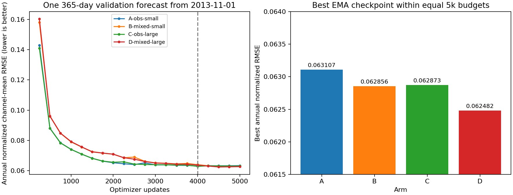

<!-- SPDX-FileCopyrightText: 2026 Samudra Authors -->
<!-- SPDX-License-Identifier: CC-BY-4.0 -->

# Deterministic observation forecast: A–D screen results

D, the mixed OM4/observation model with the larger initializer, achieved the lowest
validation score: 0.06248198 at update 4,500. This is 0.60% below B, the mixed
model with the smaller initializer, and 0.99% below A, the observation-only small
model. All four screens completed 4,000 main updates and a 1,000-update
observation-only cooldown. These are single-seed results selected on one annual
validation forecast; the differences do not establish a generalization advantage.

## Protocol and metric

Each run uses the full Samudra evolution U-Net, direct eight-channel ERA5
conditioning, replay, seed 1729 and eight examples per optimizer update. The initializer maps 19 prior five-day surface/forcing samples into two physical
ocean states, which the evolution U-Net advances autoregressively. The
small initializer has channel widths at its four U-Net levels of 128/192/256/384; the large initializer uses
280/380/480/520. Total parameter counts are 117.47M and 169.77M, respectively.
The [campaign specification](README.md) records the architecture, data and losses.
OM4 is simulated ocean data. Observation targets are OISST SST, DUACS absolute
dynamic topography (SSH), and IAP monthly gridded temperature/salinity. Observation
training spans May 1993–July 2013; OM4 uses eligible windows from 1975–July 2013.
The prepared grid is one degree. Future ERA5 forcing is prescribed: these are
reanalysis-conditioned forecasts, not a test of forcing available at issuance.
The eight forcing fields and data-window rules are listed in the campaign specification.
Replay normally combines four fresh windows with four windows continued from
stored, detached forecast states; it extends the trained lead-time distribution. Mixed runs alternate OM4 and observation optimizer updates
until the cooldown. They therefore use 2,000 OM4 and 3,000 observation updates;
pure-observation runs use 5,000 observation updates. Optimizer budgets match,
but observation exposure differs by design.

The selection metric is `rollout_val/365d/normalized_rmse/channel_mean`; lower is
better. Evaluation starts on 2013-11-01 and forecasts 73 five-day steps. For each
channel, the evaluator computes area-weighted spatial RMSE over available target
support, averages it over target times, and divides by the channel's fixed state
normalization standard deviation. The final score equally averages 29 channels:
SST and SSH at five-day cadence plus 27 monthly profile channels across 12 complete
months. The profile channels are temperature levels 1–13 and salinity levels
0–13 (2.5–1850 m across levels 0–13), scored where the gridded products have valid
wet targets. It is not a pooled space-time RMSE. Each run selects the best exponential
moving average (EMA) checkpoint from 20 annual validations, including the cooldown.
The endpoint column below uses the same metric at update 5,000.

## Results

| Arm | Main training data | Initializer | Best score ↓ | Best update | Endpoint score ↓ |
| --- | --- | --- | ---: | ---: | ---: |
| A | observations | small | 0.06310717 | 4,000 | 0.06336264 |
| B | alternating OM4/observations | small | 0.06285620 | 4,500 | 0.06300442 |
| C | observations | large | 0.06287290 | 4,000 | 0.06306339 |
| D | alternating OM4/observations | large | 0.06248198 | 4,500 | 0.06269769 |

Within this screen, mixing lowers the best score by 0.40% for the small initializer
and 0.62% for the large initializer. Increasing initializer size lowers it by
0.37% for observation-only training and 0.60% for mixed training. These comparisons
use one seed and share the validation origin used for checkpoint and arm selection.
No independent held-out evaluation or uncertainty interval has been completed.

The channel groups do not improve uniformly. At each arm's selected checkpoint, the physical RMSE columns use the same spatial
and time averaging as the selection score:

| Arm | SST RMSE (°C) ↓ | SSH RMSE (m) ↓ | Monthly profile normalized mean ↓ |
| --- | ---: | ---: | ---: |
| A | 0.49310 | 0.061701 | 0.062412 |
| B | 0.49598 | 0.060922 | 0.062177 |
| C | 0.49471 | 0.061548 | 0.062163 |
| D | 0.49525 | 0.060350 | 0.061810 |

D improves the profile and SSH metrics relative to A, while its SST error is
slightly higher. All arms use replay; E, the no-replay arm, was cancelled before
allocation and is excluded. This experiment cannot isolate replay's effect.
There is no completed persistence or previously published-model comparison here.

## Execution and audit

All training used frozen runtime [`7bef723`](https://github.com/m2lines/Samudra/commit/7bef723),
the [qualified container and resume checks](scaling.md), Rust loading
with asynchronous prefetch, and NCCL peer-to-peer communication disabled. A and B
began on four GPUs and resumed on two after administrator cancellations. Audited
checkpoint migrations checked model, optimizer, EMA, RNG, and replay payloads
and preserved global batch eight. Completion audits checked finite checkpoint
tensors, update counts, exposure totals, and complete validation support.
C and D remained on four GPUs. These recovery paths do not establish bitwise
equivalence between two- and four-GPU training. The administrator cancellations
have no confirmed cause in the available accounting records.

| Arm | Slurm jobs | Resume point | Allocated GPU-hours |
| --- | --- | ---: | ---: |
| A | 21956934_1 → 21992838 | 2,825; four to two GPUs | 16.44 |
| B | 21956934_2 → 21998896 | 3,075; four to two GPUs | 15.42 |
| C | 21956934_3 | uninterrupted | 20.32 |
| D | 21956934_0 → 21978353_0 | 4,075; four GPUs retained | 19.12 |

The screen attempts consumed 71.30 allocated GPU-hours, including interrupted
work. This excludes engineering qualification, CPU audits, queue time and winner
continuation. B also survived a preemption after migration; its repeated-update
non-timing metrics matched exactly. D repeated three updates from its saved
checkpoint. All arms have 5,000 unique training updates, finite metrics, complete
29-channel annual evaluations and audited best/endpoint checkpoints. Evidence is
stored under [screen receipts](receipts/screens-v1/), including D's final CPU audit
job `22026147`. Machine-readable scores are in [scores.csv](receipts/four-arm-report/scores.csv).

## Winner continuation

Job `22026510` was submitted on 2026-11-05 at 21:37 ET and was pending at the report
snapshot. It requests four RTX6000 GPUs on normal lzanna or preemptible capacity,
with requeue and checkpoint recovery. Its input is D's uncooled update-4,000
`main.pt`, verified identical to `main-4000.pt`, rather than the selected cooled
checkpoint. The fork retains model, optimizer, replay and EMA state.

The main continuation keeps alternating OM4 and observation updates to 16,000,
saves uncooled checkpoints at
8,000, 12,000 and 16,000, then runs the final 1,000-update observation-only cooldown.
Two independent 1,000-update cooldown branches at 8,000 and 12,000 remain to run
after the main job; they read immutable snapshots and cannot change its trajectory.
Including the completed 4k cooldown, this gives 20,000 total optimizer updates
for the winning campaign: 16k main plus four 1k cooldowns. Remaining work is 15k
updates. [Continuation configurations](configs/continuation-v1/) preserve global
batch eight and four-GPU layout; [the launcher](continue_torch.sbatch) uses the
same frozen runtime. Monitoring is attached through CPU callback job `22026547`.

Recent D cooldown steps took about 3.3 seconds with near-zero data wait. Multiplying
15,000 remaining updates by that observation-only step time gives 13.75 hours of
compute if all remaining jobs execute serially; a 30% allowance gives about
18 hours. The two independent cooldown branches may overlap when resources permit. This is a planning estimate, not a
completion ETA: mixed main-training costs, repeated validation, preemption, branch
scheduling and queue delay can change elapsed time. The A–D results above are
complete independently of this continuation.
