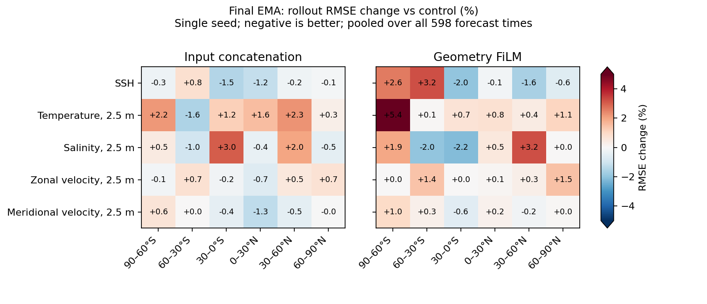

<!-- SPDX-FileCopyrightText: 2026 Samudra Authors -->
<!-- SPDX-License-Identifier: CC-BY-4.0 -->

# Result: no clear benefit from geometry FiLM in this single-seed pilot

All three scratch runs completed 70 epochs, and all six final-checkpoint
rollouts completed 598 forecast times with zero nonfinite wet-cell predictions.
FiLM worsens final 360-day validation RMSE by 1.23% and does not improve the
reported final-EMA global surface errors. Concatenation improves validation
RMSE by 1.14%, but its long-rollout changes are small and mixed. This is one
seed and one grid, without an estimate of seed-to-seed variability: neither
small gain nor small regression should be treated as reproducible.

## Fixed validation metric

Final epoch-70, 360-day normalized channel-mean rollout RMSE from the completed
W&B summaries (identical validation dates and metric in all arms; lower is better):

| Arm | RMSE | Change vs control |
| --- | ---: | ---: |
| Control | 0.286620 | — |
| Input concatenation | 0.283352 | -1.14% |
| Geometry FiLM | 0.290142 | +1.23% |

Dynamic weighted validation loss is not used to rank the arms. We report the
fixed final checkpoint rather than picking different best epochs for each arm.

## Long-rollout physical errors

Errors below pool squared error over all 598 forecast times, using Gaussian
quadrature area weights and each channel's fixed wet mask, then take the square
root. Surface temperature, salinity and velocity refer to the 2.5 m level.
They compare predictions to held-out OM4, not observations. Final EMA:

| Quantity | Control | Concatenation | FiLM |
| --- | ---: | ---: | ---: |
| SSH RMSE (m) | 0.046775 | 0.046716 (-0.13%) | 0.047027 (+0.54%) |
| Temperature RMSE (°C) | 0.575632 | 0.581082 (+0.95%) | 0.579342 (+0.64%) |
| Salinity RMSE (data units) | 0.240071 | 0.241633 (+0.65%) | 0.240781 (+0.30%) |
| Zonal velocity RMSE (m/s) | 0.071750 | 0.071692 (-0.08%) | 0.072015 (+0.37%) |
| Meridional velocity RMSE (m/s) | 0.062530 | 0.062148 (-0.61%) | 0.062531 (+0.002%) |

Raw epoch-70 agrees on the lack of a broad improvement: FiLM changes SSH,
temperature, salinity, zonal velocity and meridional velocity RMSE by +0.52%,
-0.33%, +0.26%, +1.00% and +0.82%, respectively. The small raw-temperature gain
reverses for EMA. Full raw/EMA numbers are in `surface-global.csv`; every channel
and latitude band is included in the compressed summary tables.

The first 360 days of the held-out EMA rollout also do not show a FiLM gain:
temperature RMSE increases 2.33% and SSH 1.42%. These differ from validation
because they use a different initialization/time period and physical surface
metrics rather than the validation normalized aggregate.

## Latitude and drift

FiLM's SSH effect changes sign with latitude: -1.96% in 30°S–0° and -1.60% in
30–60°N, but +3.22% in 60–30°S and +2.58% south of 60°S. Temperature RMSE is worse
in every latitude band for EMA, including +5.41% south of 60°S. There is no
consistent polar or transport-related improvement in these diagnostics.
Velocity error is only a diagnostic; no direct transport/conservation budget
was evaluated.

All six rollouts remain numerically finite. This does not establish physical
stability: final-EMA mean surface-temperature bias is -0.1788°C for control,
-0.1951°C for concatenation, and -0.2024°C for FiLM. Over the last 365 days those
biases are -0.2191°C, -0.2494°C and -0.2627°C. FiLM's last-year temperature RMSE
is 0.68% lower despite its larger cold bias, illustrating why finite values or
one error score alone cannot establish improved stability.

## Compute and elapsed time

| Arm | Parameters | Synthetic compute/call sequence | Peak allocated memory | Training elapsed | Total job |
| --- | ---: | ---: | ---: | --- | --- |
| Control | 84,002,154 | 0.374413 s | 8.115 GiB | 7:35:36 | 7:52:00 |
| Concatenation | 84,008,474 | 0.380729 s (+1.69%) | 8.122 GiB (+0.08%) | 6:27:21 | 6:41:14 |
| FiLM | 84,124,874 | 0.400740 s (+7.03%) | 9.986 GiB (+23.05%) | 6:04:12 | 6:19:32 |

The compute microbenchmark is batch 4, four autoregressive calls plus backward,
five measured samples after three warmups; it excludes optimizer, DDP and data
I/O. Each ran on its job's B200 host, so these are indicative overhead estimates,
not a repeated same-device benchmark. FiLM adds 0.146% parameters.

Actual median training-epoch times were 344/296/265 seconds. Mean logged batch
data-wait times were 0.798/0.697/0.593 seconds for control/concat/FiLM. The jobs
ran concurrently on different hosts with different data-wait behavior. Their
wall-time ordering is therefore not evidence that FiLM is computationally
faster; the microbenchmark shows additional model compute. Timing details are
in `runtime.csv`.

## Provenance and limits

- Control: Beta 216666, [W&B 6j1z2mwc](https://wandb.ai/ocean_emulators/default/runs/6j1z2mwc).
- Concatenation: Beta 216667, [W&B n1isefmm](https://wandb.ai/ocean_emulators/default/runs/n1isefmm).
- FiLM: Beta 216668, [W&B iql347y1](https://wandb.ai/ocean_emulators/default/runs/iql347y1).
- All three Slurm jobs: COMPLETED, exit 0:0. Control finished October 24 at 18:12 EDT.
- Runtime source commit `4462fa1f4`; geometry implementation `05c490f55`.
- Same pinned container, native loader, project-storage dataset, seed 15,
  initialization of common weights, raw `tau_hfds`, 70 epochs and effective batch
  32. Resolved configs were compared and match after removing arm identity,
  evaluation-config path and geometry mode.
- Historical reference is PR #915 control job 210664. The fresh comparison uses
  current code and the shared non-overlapping train end 2013-09-30; it is not a
  bitwise reproduction of the historical run. See the experiment README.
- 31 downloaded artifacts were verified against remote SHA-256 checksums,
  recorded in `SHA256SUMS`. All six latitude tables have 319,930 data rows,
  598 rows per channel/band and finite metrics. These checks cover the metric
  files, logs and configuration artifacts, not a full download/read-back of the
  six prediction Zarr stores. Metrics themselves read all forecast values.
- Full outputs remain under
  `beta:/projects/ny/lz1955/multiscale/jrusak/runs/geometry-film-1deg-20261023`.
  Downloaded raw metrics are local under `.LOCAL/geometry-results` (not committed).
  `summarize.py` regenerates the committed tables/figure from those inputs.

No additional seeds or resolutions are launched. This pilot does not justify
promoting FiLM to a default. A future confirmation would need matched seeds and,
for the proposed physical-geometry interpretation, multiple resolutions.
