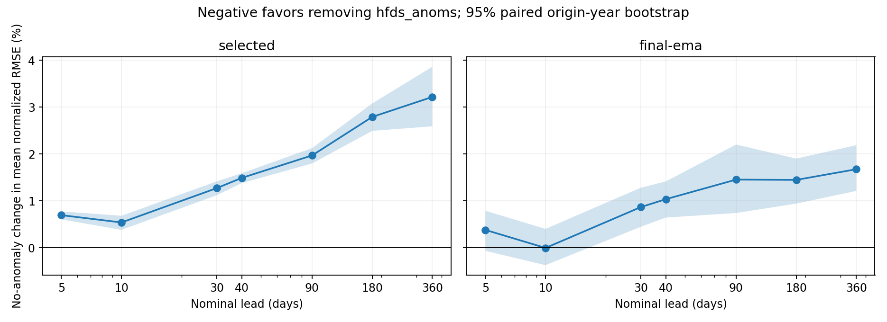
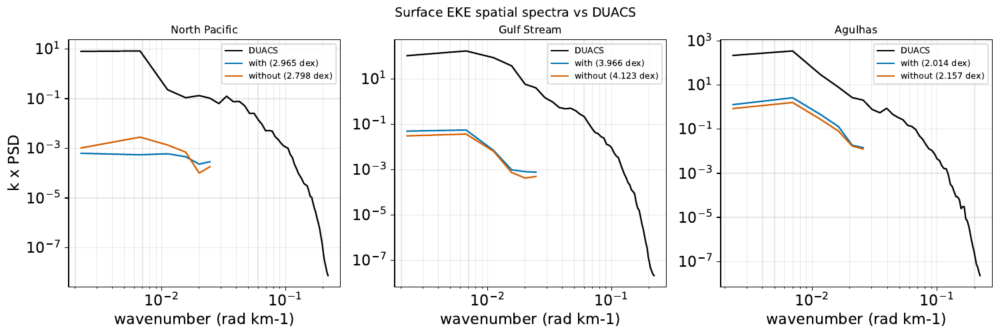
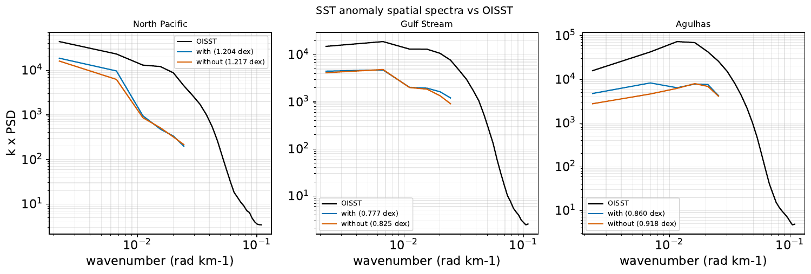
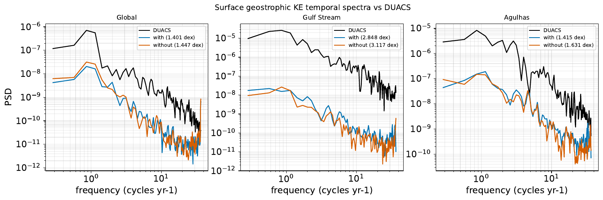

# Matched 1° Samudra: remove hfds anomalies?

Experiment/results record; **not intended to merge**. Tracks [#951](https://github.com/m2lines/Samudra/issues/951), under [Train Train #950](https://github.com/m2lines/Samudra/issues/950). Decision pending in the originating chat. No subsequent experiment has been launched.

## Recommendation

**Retain hfds_anoms for now.** Removing it raises primary mean normalized forecast RMSE by 0.54% at 10 days and 3.22% at 360–361 days. The final-epoch EMA sensitivity also worsens at the year-long horizon (+1.68%). Every variable group worsens at that horizon in both selections. Observation metrics change by less than 0.7% and have mixed signs. Loader simplification may still justify a deliberate accuracy tradeoff, but this run does not establish removal as accuracy-neutral.

This is one training seed per arm. Temporal uncertainty below does not estimate training-seed variability or establish a general causal effect. Same seed does not mean identical initialization because adding an input channel changes the first convolution shape.

## Matched protocol

Frozen source `f1e713220`; 1° unfiltered OM4 `om4_onedeg_v3`; ConvNeXt U-Net widths 280/380/480/520, InstanceNorm, bf16, two input and output states, four autoregressive calls, no residual prediction and no autoregressive gradient detach. Both arms use the CPU loader, dynamic MSE limit 20, Adam LR 0.0006 with cosine schedule, 70 epochs, seed 15, microbatch 4 × accumulation 8 (effective batch 32), one GPU. Only forcing selection and experiment names differ: `tau_hfds_hfds_anom` versus `tau_hfds` (ordinary hfds remains in both).

Train 1975-01-03–2013-09-30; validation 2013-10-05–2014-10-05. Primary checkpoint: native best validation 360-day rollout RMSE; sensitivity: final epoch-70 EMA. Resolved configs are in [results/configs](results/configs). Original normalization is retained across Engaging and Torch. Native anomaly preprocessing uses full-source day-of-year climatology and global normalization, including held-out forcing climatology: this tests the existing feature, not training-only anomaly preprocessing. Both arms use the same experiment-local native-Torch fallback for CUDA 1×1 convolution following the initial runtime failure.

Continuous evaluation spans 2014-10-10–2022-12-24. Additionally, 28 quarterly origins (2015–2021) per checkpoint/arm give 112 rollouts and 72 target records each. All timestamps match across arms and selections. Native inference and saved physical-unit predictions were retained. Rollout jobs 20884541_0–3 and scoring jobs 20886080_0–1 all completed 0:0. Full continuous evaluation has 538 finite scalar metrics per checkpoint/arm. Both native visualization pipelines completed all 29 requested non-movie steps.

## Forecast comparison

Score each channel using cosine-latitude ocean-area-weighted RMSE, divided by its original training standard deviation; then equally average 77 channels and origins. This is an equal-channel normalized score, not the training DynamicLoss objective. Raw per-channel RMSE and signed bias are retained. Positive changes mean removal is worse.

Quarterly starts are resampled together in seven paired origin-year blocks (10,000 bootstrap draws, seed 15); intervals describe temporal sampling only. Overlapping forecast windows and neighboring years can remain correlated, so these are not independent-seed confidence intervals. Nominal 5/10/30/40-day leads are exact; 90/180/360-day positions have actual elapsed ranges 90–91/180–181/360–361 days. No 365-day claim is made.

| Nominal lead | Selected change (95% temporal interval) | Final EMA change (95% temporal interval) |
|---|---:|---:|
| 5 days | +0.70% [+0.61, +0.78] | +0.38% [-0.06, +0.79] |
| 10 days | +0.54% [+0.38, +0.68] | -0.00% [-0.37, +0.40] |
| 30 days | +1.27% [+1.12, +1.42] | +0.87% [+0.45, +1.28] |
| 40 days | +1.49% [+1.38, +1.59] | +1.04% [+0.64, +1.42] |
| 90 days | +1.97% [+1.80, +2.13] | +1.45% [+0.74, +2.20] |
| 180 days | +2.79% [+2.49, +3.08] | +1.45% [+0.94, +1.90] |
| 360 days | +3.22% [+2.59, +3.86] | +1.68% [+1.21, +2.19] |

Year-long breakdown (same aggregation within each variable; temperature/salinity/currents have 19 depth channels, SSH one):

| Variable | Selected change | Final EMA change |
|---|---:|---:|
| thetao | +1.93% | +1.05% |
| so | +0.82% | +0.68% |
| uo | +2.90% | +1.46% |
| vo | +3.82% | +1.99% |
| zos | +2.32% | +0.59% |

Full [lead summary](results/lead_summary.csv), [selected channel/depth summary](results/scores/selected/channel_summary.csv), [EMA channel/depth summary](results/scores/final-ema/channel_summary.csv), and per-origin CSVs under `lead_metrics/` in each score directory retain raw RMSE, bias, normalized RMSE, actual elapsed days and checkpoint hashes. All 60,368 channel/origin/lead rows are finite. Per-origin receipts are under [results/origins](results/origins).

## Full observation comparison

Native continuous-rollout metrics against DUACS velocity/EKE, OISST SST, and ARGO-IAP heat content. Primary complete-year coverage is 2015–2022 for velocity/EKE/SST (8 years), but 2015–2021 for OHC (7 years); incomplete 2022 OHC is excluded. These continuous trajectories answer a different question from reinitialized year-long forecasts.

| Metric | Selected RMSE change | Final EMA RMSE change |
|---|---:|---:|
| DUACS velocity | +0.081% | +0.176% |
| DUACS EKE | +0.099% | +0.006% |
| OISST SST | -0.084% | -0.657% |
| OHC 0–700 m | +0.250% | -0.585% |
| OHC 700–2000 m | -0.229% | -0.323% |

[Observation summary](results/observation_summary.csv) includes absolute scores and paired annual-block intervals. Those intervals concern the mean annual RMSE ratio, which differs slightly from the pooled native complete-period RMSE ratio shown above. Original annual/pooled scores, coverage and uncertainty are preserved in each `results/viz/*/Figures_observations/observation_metrics.csv`; the full native scalar suites and separate observation tables are in [results/evaluations](results/evaluations).

## Visualization and reproducibility

Native metrics are in [selected](results/viz/selected/Metrics) and [final EMA](results/viz/final-ema/Metrics). Full artifact inventory: [results/viz/artifact_inventory.tsv](results/viz/artifact_inventory.tsv). The original PDFs and all map/time-series/variance diagnostics remain at `/scratch/jr7309/om4-hfds-ablation-20261021/viz/{selected,final-ema}` on Torch; compact spectral previews are included below. Visualization receipts establish completion, not improvement.

Training runs: [with](https://wandb.ai/ocean_emulators/default/runs/acmr2qtx), [without](https://wandb.ai/ocean_emulators/default/runs/subv2ses). Native quarterly W&B logging resets lead counters at each origin and drops subsequent nonmonotonic history; the comparison therefore uses verified saved predictions and per-origin receipts, not incomplete W&B history.

Source outputs and checkpoints: `/orcd/pool/008/jrusak/om4-hfds-ablation-20261021` on Engaging. Verified Torch copy: `/scratch/jr7309/om4-hfds-ablation-20261021`; 1,077 transferred files passed full SHA256 readback, and normalization was separately copied/verified. Container: `ghcr.io-m2lines-ocean-emulator-physicsnemo-26.05-23587a12baeb0f39e90a69c2560a5c6a5ddbed21.sif`. No weights or large prediction stores are committed here.

Recompute table/plot summaries from checked-in score CSVs using `uv run --no-project --with numpy --with pandas --with matplotlib python experiments/hfds-anomaly/analyze_results.py` from the repo root. `score_origins.py` documents scoring; `multi_origin.py` documents the rollout initialization and timestamp protocol.

### Spectra

Both models substantially underrepresent observed EKE and temporal KE power; their differences are smaller than that shared deficit. The native score is RMS log10 power error (dex, lower is better), interpolated over the frequency/wavenumber domain both curves cover. It does not penalize the 1° model for the observation-only high-wavenumber tail. These are native diagnostics, not proof of resolution-independent calibration.

Selected-checkpoint EKE spatial scores (with → without): North Pacific 2.965 → 2.798 dex (improves), Gulf Stream 3.966 → 4.123 and Agulhas 2.014 → 2.157 (worsen). SST anomaly spatial scores worsen in all three regions: 1.204 → 1.217, 0.777 → 0.825, 0.860 → 0.918. Temporal KE scores also worsen in all regions: global 1.401 → 1.447, Gulf Stream 2.848 → 3.117, Agulhas 1.415 → 1.631.

Final EMA: EKE spatial and temporal KE scores worsen in all regions; SST anomaly spatial scores are mixed (North Pacific 1.263 → 1.295, Gulf Stream 0.827 → 0.828, Agulhas 0.992 → 0.959). Overall, spectra supply no consistent compensating gain from removing the anomaly input. Twelve original PDFs, including interannual bands for both selections, are preserved in the two `Figures_observations` directories.

Final EMA previews: [EKE](results/spectra/final-ema-eke_spatial_spectra_vs_duacs.png), [SST anomalies](results/spectra/final-ema-ssta_spatial_spectra_vs_oisst.png), [temporal KE](results/spectra/final-ema-ke_temporal_spectra_vs_duacs.png).
