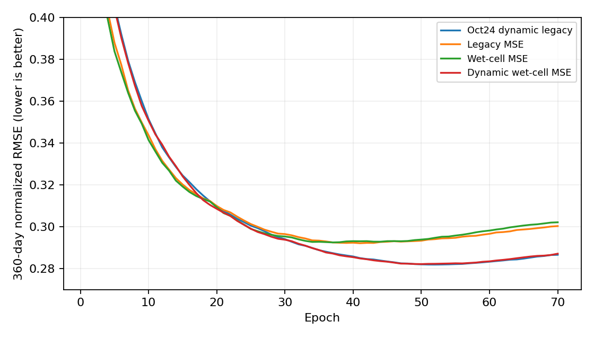

<!-- SPDX-FileCopyrightText: 2026 Samudra Authors -->
<!-- SPDX-License-Identifier: CC-BY-4.0 -->

# Matched 1° loss comparison, completed November 8, 2026

Dynamic wet-cell MSE closely matched the October 24 legacy-dynamic control on
360-day validation: +0.09% at each run's selected epoch and +0.19% at epoch 70.
Both static objectives performed worse. The static wet-cell run had errors 0.13% and 0.60% above the static legacy
run, respectively. This single-seed
experiment provides no evidence of an accuracy improvement from the denominator
fix. The small differences between the two dynamic runs do not establish a
reproducible ranking.

All three fresh runs completed 70 epochs and the configured post-training
sweep of final raw and final EMA checkpoints. The matched control is
[October 24, 6j1z2mwc](https://wandb.ai/ocean_emulators/default/runs/6j1z2mwc).
The January official v2 run is not used for numerical comparison.

| Objective | W&B | Best 360-day RMSE | Epoch | Epoch-70 EMA RMSE | Change vs control, final |
|---|---|---:|---:|---:|---:|
| Oct24 dynamic legacy MSE, cap 20 | [6j1z2mwc](https://wandb.ai/ocean_emulators/default/runs/6j1z2mwc) | 0.281945 | 52 | 0.286620 | reference |
| Static legacy MSE | [39pgb6sm](https://wandb.ai/ocean_emulators/default/runs/39pgb6sm) | 0.292153 | 41 | 0.300339 | +4.79% |
| Static wet-cell MSE | [h1and7h1](https://wandb.ai/ocean_emulators/default/runs/h1and7h1) | 0.292539 | 37 | 0.302146 | +5.42% |
| Dynamic wet-cell MSE, cap 20 | [bbaw6yyn](https://wandb.ai/ocean_emulators/default/runs/bbaw6yyn) | 0.282196 | 50 | 0.287157 | +0.19% |

Legacy MSE zeroes land errors and divides each channel’s squared-error sum by
all batch/grid entries. Wet-cell MSE divides by wet entries only. Neither loss
uses cell-area weights. Dynamic MSE multiplies channel losses by smoothed
inverse-loss weights; cap 20 limits the ratio of new target weights, with
1/25 smoothing per update.

Lower is better. The score is `rollout_val/360d/normalized_rmse/channel_mean`:
spatial area-weighted RMSE on wet cells in normalized units, averaged equally
over prognostic channels and target times. All four histories contain 70
validation records. Selection minimizes this same EMA score; final comparisons
use epoch 70 for every run. The validation interval starts October 5, 2013.
This is one continuous rollout per epoch from the same two-state initialization
(October 5 and 10, 2013), with five-day output states starting October 15.
The score averages output times within 360 days of the first initialization
state, rounded down to complete two-output model calls; it is not an endpoint
error at day 360. Training-loss values are not comparable across objectives.

Physical-unit 360-day RMSE at epoch 70, evaluated with EMA:

| Objective | Temperature (°C) | Salinity (psu) | Eastward velocity (m/s) | Northward velocity (m/s) | SSH (m) |
|---|---:|---:|---:|---:|---:|
| Oct24 dynamic legacy | 0.262878 | 0.061001 | 0.026900 | 0.025682 | 0.036413 |
| Static legacy | 0.327422 | 0.077619 | 0.027796 | 0.026266 | 0.043792 |
| Static wet-cell | 0.339753 | 0.079650 | 0.028278 | 0.026518 | 0.045043 |
| Dynamic wet-cell | 0.268725 | 0.062400 | 0.027032 | 0.025750 | 0.037385 |

The four 3D-variable columns average per-depth RMSE equally; they are not
volume-pooled errors. [Physical/depth CSV](results/physical-depth.csv) contains
all logged depths and thickness-weighted depth bands for both selected and
final epochs. Bands are upper <700 m, middle 700–2000 m, and deep ≥2000 m.

The configured independent evaluation period is October 10, 2014 through
December 24, 2022, with 25 model calls per chunk. Its time-mean field RMSE is
shown separately; this measures error in the temporal mean field, not mean
forecast RMSE over the trajectory. Values are normalized and averaged over
prognostic channels. The chunks remain autoregressively connected without
reference-state resets. Physical and time-mean spatial errors use wet-cell
area weighting.

| Objective | Final EMA time-mean RMSE | Final raw time-mean RMSE |
|---|---:|---:|
| Oct24 dynamic legacy | 0.113930 | 0.114426 |
| Static legacy | 0.118427 | 0.117508 |
| Static wet-cell | 0.118846 | 0.120050 |
| Dynamic wet-cell | 0.116372 | 0.115734 |

These are `inference/time_mean_norm/rmse/channel_mean` from the retained
[sweep summaries](results/). Dynamic wet-cell is 2.14% above the control for
final EMA time-mean RMSE. We do not use `val/reduced/normalized_rmse/channel_mean`
or the inference `mean_step_20` normalized aggregate for ranking: those logged
aggregates also average derived ocean heat content computed from normalized
temperature, carrying its large dimensional factors into a nominally
normalized score. The dedicated rollout score restricts the average to
prognostic channels. The valid fixed rollout
and time-mean scores above are separate metrics.

## Matching and execution evidence

All fresh arms use the Oct24 model/trainer/stepper/loader source
`4462fa1f4179193820ba1e867cded56de9076ac7` plus the loss fix from PR #965,
executed as frozen source overlay `4ea4ed7d9735e7c90a2484dc28c5232c266995e0`.
The matched scientific settings are documented in [README](README.md) and the
committed train/eval configurations. CPU job `22134521` passed configuration
identity/data checks and 12 loss tests. Four-GPU probe `22134523` completed an
optimizer update for every arm with finite losses. The only intended scientific
change is the objective. Paths, W&B names, and checkpoint recovery differ for
operational reasons.

The control used four GB200 GPUs. Fresh runs began on Torch RTX GPUs and resumed
on H200/B200 allocations after CUDA illegal-memory failures. NCCL P2P was disabled
for all fresh arms after an initial collective timeout. Preemptions required
checkpoint resumes, and interrupted post-training predictions were archived
before restarting evaluation. These hardware, transport, and interruption
histories prevent a bitwise loss-only experiment. They also prevent interpreting
small single-seed differences as causal evidence; repeated seeds were not run.
Repeated partial-epoch W&B steps were discarded by W&B after resume; all 70
per-epoch fixed-score records were retained.

Final successful Slurm tasks: `22352201_0` (legacy evaluation), `22213958_1`
(wet-cell training/evaluation), and `22352201_2` (dynamic evaluation), all exit
`0:0`. The legacy and dynamic evaluation jobs resumed completed epoch-70
checkpoints with start epoch 71 and performed no extra training. All six final
sweep entries have finite metrics. [Slurm history](results/slurm-history.txt)
retains the unsuccessful attempts and preemptions; elapsed time on a successful
retry alone is not total training time.

Artifacts remain under
`torch:/scratch/jr7309/runs/issue964-oct24-loss-20261106/outputs/`.
Control evaluation was read from
`beta:/projects/ny/lz1955/multiscale/jrusak/runs/geometry-film-1deg-20261023/output/geometry-control-seed15/evals/summary.json`.
[Comparison CSV](results/comparison.csv), compressed W&B configuration/history
snapshots, evaluation summaries, and [analysis script](analyze.py) accompany
this report. This is an experiment/results record, not intended to merge.
