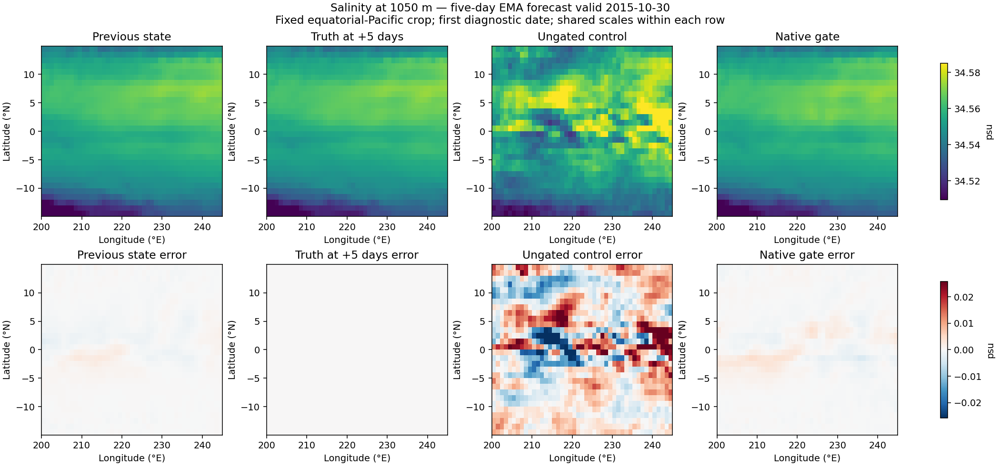
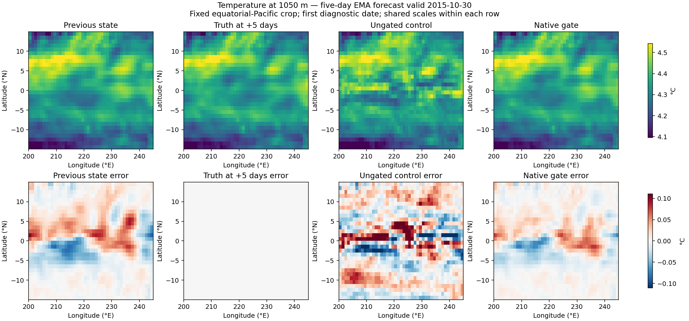
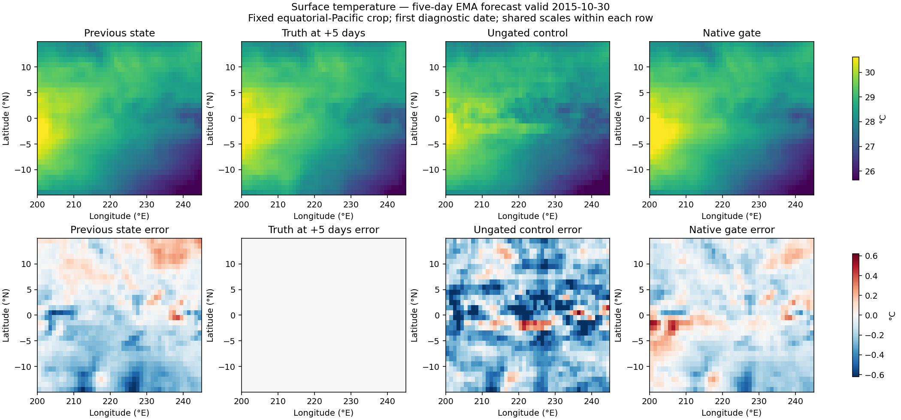

<!-- SPDX-FileCopyrightText: 2026 Samudra Authors -->
<!-- SPDX-License-Identifier: CC-BY-4.0 -->

# Native gate: completed training and field diagnostics

Training completed all 70 epochs and both post-training checkpoint evaluations.
The comparison uses the existing matched ungated control.

| 360-day normalized channel-mean RMSE | Control | Gated | Change |
|---|---:|---:|---:|
| Epoch 70 | 0.285536844 | 0.293079816 | +2.64% |
| Best validation checkpoint | 0.282532734 (epoch 53) | 0.286826903 (epoch 45) | +1.52% |

This single seed does not establish an improvement in rollout skill.
The dynamic training losses are not used for comparison. Full validation
histories and raw/EMA post-evaluation summaries accompany this report.
The eval `time_mean_norm/rmse` metric measures time-mean-field error and
must not be confused with the 360-day validation trajectory metric above.

The diagnostic evaluation compared epoch 70 raw/EMA gated and control
checkpoints at 16 fixed held-out dates, 5/10-day leads, all 77 channels. It measured physical RMSE, persistence, and mask-aware center-minus-four-neighbor
high-pass error and saved fields including the previous state. No new training.
Diagnostics completed successfully.

## Matched short-range results

EMA checkpoints, 16 fixed held-out dates. Ratios are square roots of pooled
area-weighted normalized MSE; channels receive equal weight. Values below 1
favor the native gate. These are final epoch 70 checkpoints, not the independently
selected best checkpoints used in the validation row above.

| Field family | 5-day RMSE ratio | 10-day RMSE ratio | 5-day high-pass RMSE ratio |
|---|---:|---:|---:|
| All 77 channels | 0.96703 | 0.98506 | 0.94439 |
| U | 0.97707 | 0.99405 | 0.94916 |
| V | 0.96918 | 0.98336 | 0.94856 |
| Temperature | 0.42374 | 0.60097 | 0.43295 |
| Salinity | 0.48376 | 0.65401 | 0.51068 |
| SSH | 0.80087 | 0.88844 | 0.57540 |

Raw checkpoints agree (all-channel 5-day ratio 0.96676). Physical 5-day EMA RMSE:
SST 0.32583 → 0.22161 °C; SSH 0.02716 → 0.02175 m; temperature at 1050 m
0.06026 → 0.02648 °C; salinity at 1050 m 0.01671 → 0.00369 psu. Deep salinity
high-pass error falls 0.01113 → 0.00343 psu, a 69.2% reduction across these dates.

This is more than copying the last state: relative to persistence, gated 5-day
family RMSE is 24.5% lower for temperature, 9.7% lower for salinity, 15.7% lower for SSH.
The all-channel score remains dominated by velocity normalized errors.

Figures use the first saved diagnostic date (2015-10-30 target), the fixed
30 × 45 equatorial-Pacific crop (row 75, column 200), previous state, truth, control,
and gated fields. No search for a favorable date/crop. This differs in date from
the earlier frozen-checkpoint correction examples; compare only within this figure.
Scales are shared within rows, clipped at 1st/99th percentiles for fields and symmetric
99th-percentile errors; no spatial smoothing. The quantitative table uses all wet
cells and 16 dates, not the plotted crop. Matched truth, previous-state maps,
coordinates, test dates, persistence metrics and truth high-pass energies agree exactly;
all downloaded map arrays and reported errors are finite.

Conclusion: native joint training substantially improves short-range T/S/SSH
and small-scale errors, but does not improve the matched 360-day validation score.
Both models already use four-call, 40-day training, so merely adding a short
unroll is not a new intervention. Longer-horizon objectives or targeted gate
ablations would be next hypotheses, not established fixes. One seed only.
Two new from-scratch arms are now submitted: a direct linear gate and a nonlinear
gate, both receiving final decoder features, the latest state, and both candidate
output fields. Their results are pending; the completed results here are for the
original feature-conditioned gate.

## Continuous 5-day and 360-day endpoint fields

See the [paired field and error-map gallery](rollout-maps/README.md) for seven
fields, global views, and fixed regional crops from one continuous rollout.

## Example fields

Per-date diagnostics are stored as one gzip-compressed JSON file per model
(`one-call-*.json.gz`), with shared channel/lead metadata in `one-call-metadata.json`.
