<!-- SPDX-FileCopyrightText: 2026 Samudra Authors -->
<!-- SPDX-License-Identifier: CC-BY-4.0 -->

# Continuous rollout: day 5 and day 360

Final epoch-70 EMA checkpoints, identical initial state on 2015-10-25.
Separate panels show day 5 (2015-10-30) and day 360 (2016-10-19).
Field columns: truth, ungated control, native feature-conditioned gate.
Error columns: control minus truth, gate minus truth. The model feeds back its own predictions throughout 36 two-output
calls; the 360-day panel is not a fresh one-step forecast.

Fields share color limits across models within each row (pooled 1st–99th percentiles).
Errors use a shared symmetric 99th-percentile absolute-error limit within each row.
Limits change between lead times; compare color bars before comparing error magnitude.
All figures are lossless PNGs with square, whole-pixel grid cells and no
interpolation: global maps use 360 × 180 pixels (one pixel per cell), regional maps
use 270 × 180 pixels (6 × 6 pixels per cell). Colorbars do not resize map axes.
Open an image at native size to avoid browser rescaling; coordinates label the
array grid, with uniform cell spacing in the image. No spatial smoothing.
Regional crops use the same fixed equatorial-Pacific indices as the earlier examples.
These are illustrative fields from one origin, not the multi-date aggregate evaluation.

| Global area-weighted RMSE | Day 5 control | Day 5 gate | Day 360 control | Day 360 gate |
|---|---:|---:|---:|---:|
| SSH (m) | 0.02552 | 0.01988 | 0.04595 | 0.05824 |
| Surface temperature (°C) | 0.31212 | 0.21252 | 0.55362 | 0.74117 |
| Surface salinity (psu) | 0.11139 | 0.08506 | 0.24117 | 0.30946 |
| Surface U (m/s) | 0.04124 | 0.04086 | 0.06858 | 0.07234 |
| Surface V (m/s) | 0.03845 | 0.03695 | 0.06706 | 0.06972 |
| Temperature at 1050 m (°C) | 0.06027 | 0.02883 | 0.17215 | 0.18817 |
| Salinity at 1050 m (psu) | 0.01595 | 0.00421 | 0.02973 | 0.02935 |

The gate reduces short-range texture errors, especially in deep T/S. That benefit
is not a general improvement in 360-day endpoint skill: most displayed global fields
are worse, while deep salinity and some regional fields remain better.
Full-precision global and regional metrics are in [map-metrics.json](map-metrics.json).

## Surface temperature

### Global, day 5

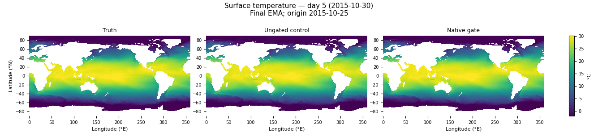

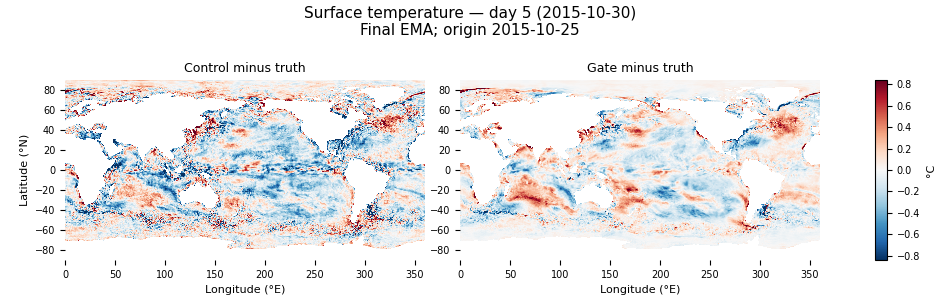

### Global, day 360

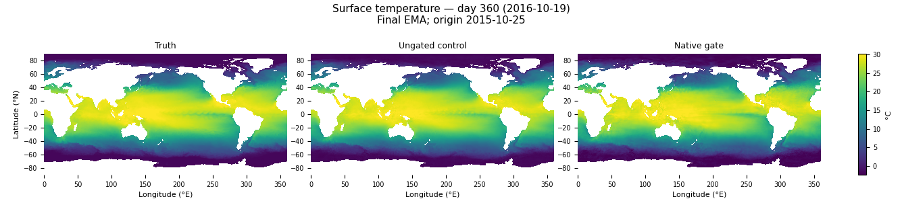

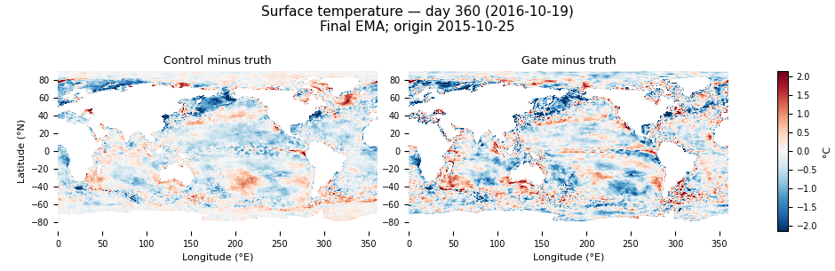

### Regional, day 5

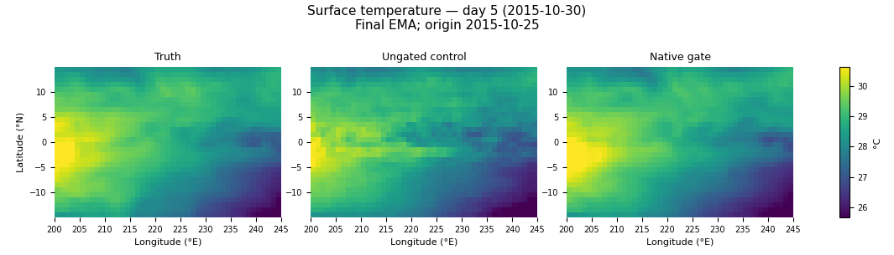

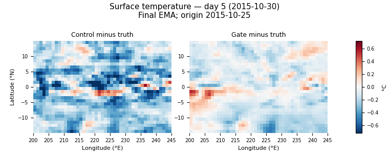

### Regional, day 360

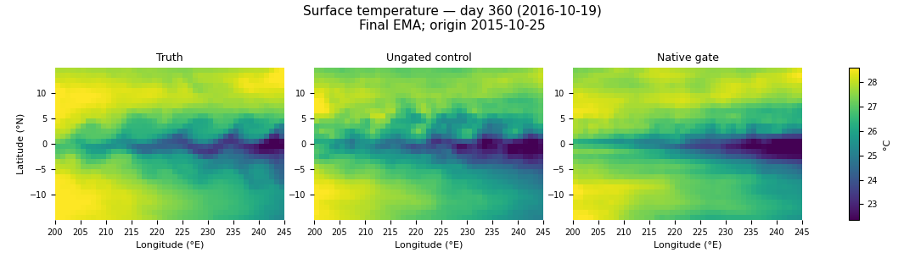

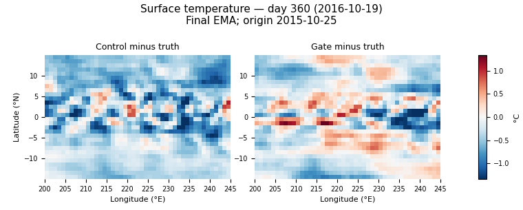

## Salinity at 1050 m

### Global, day 5

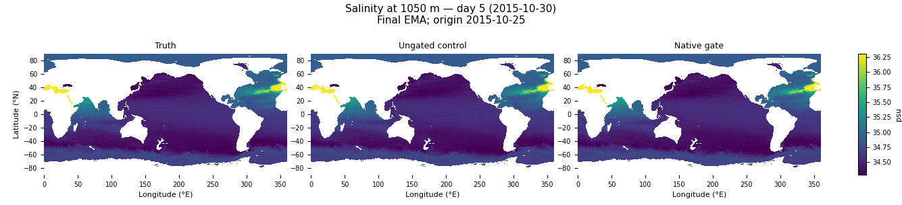

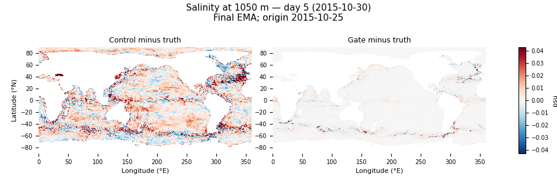

### Global, day 360

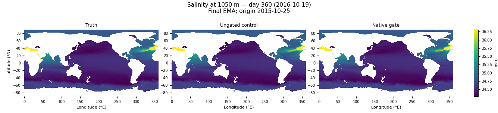

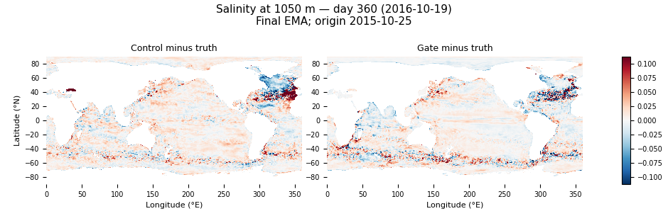

### Regional, day 5

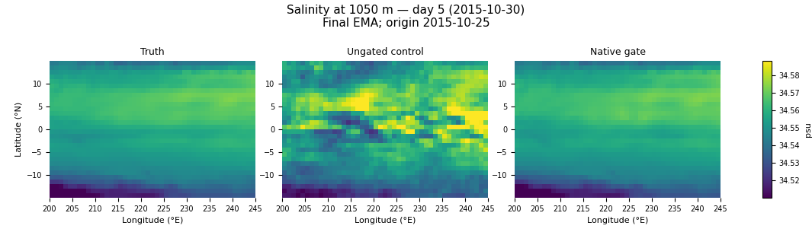

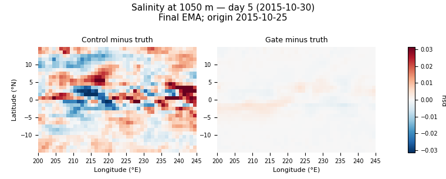

### Regional, day 360

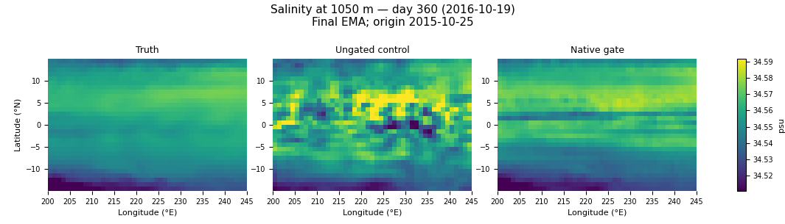

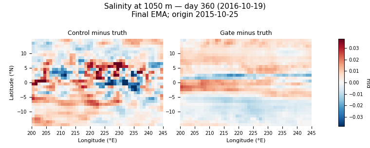

## Temperature at 1050 m

### Global, day 5

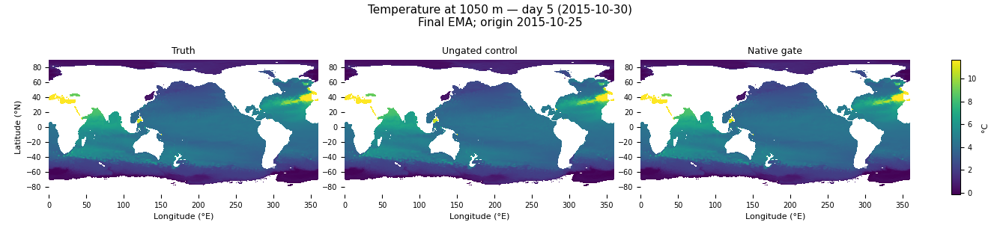

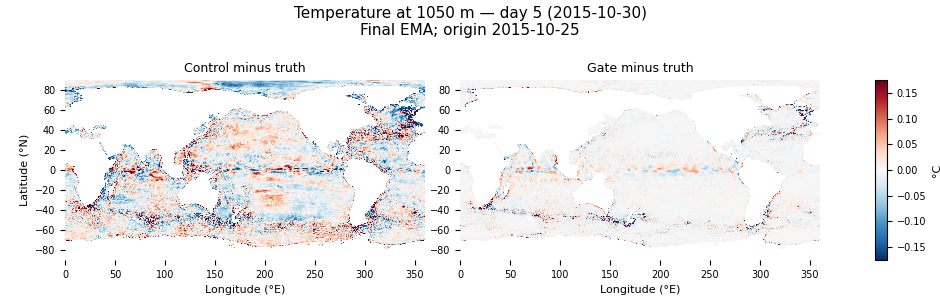

### Global, day 360

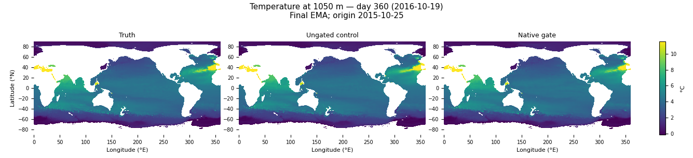

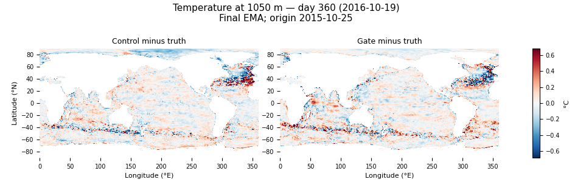

### Regional, day 5

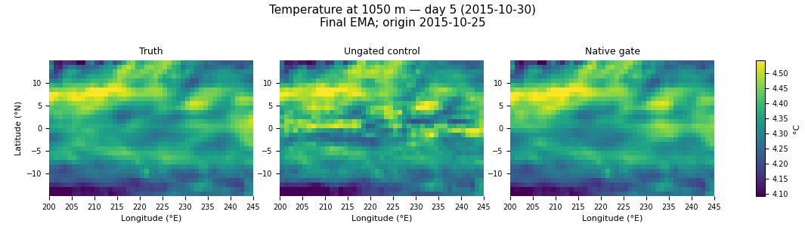

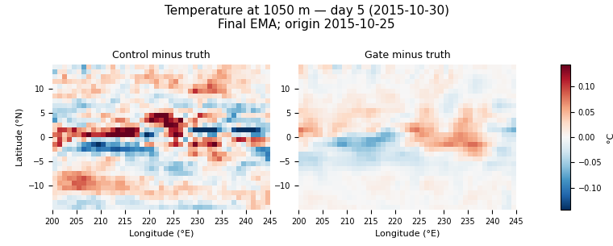

### Regional, day 360

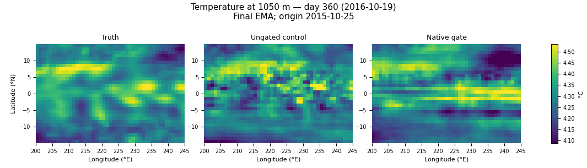

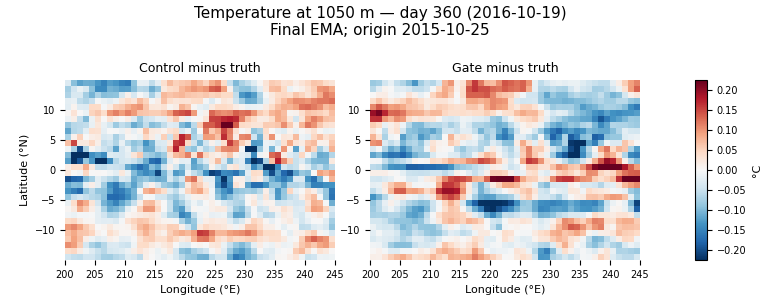

## SSH

### Global, day 5

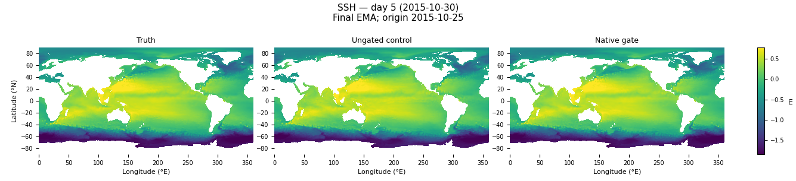

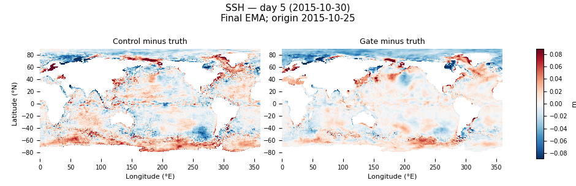

### Global, day 360

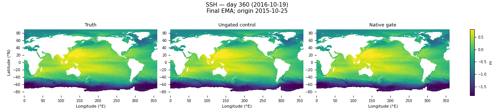

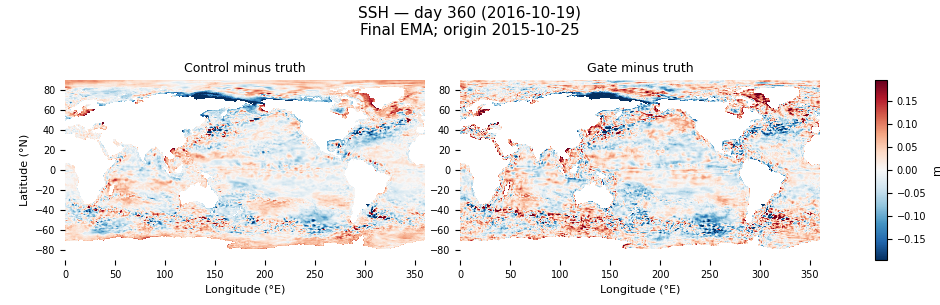

## Surface salinity

### Global, day 5

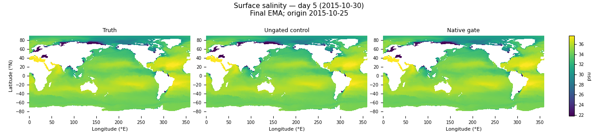

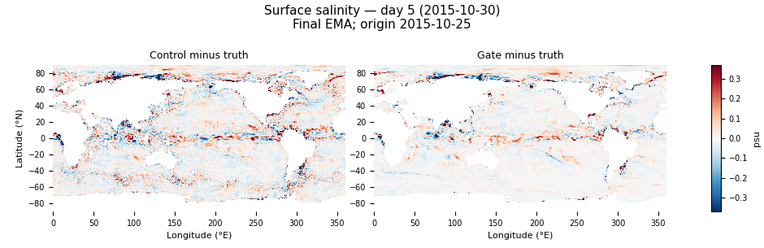

### Global, day 360

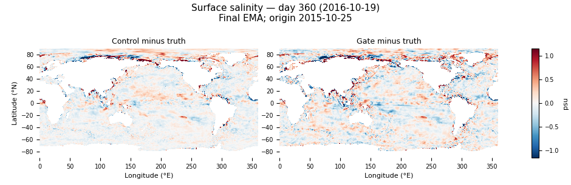

## Surface U

### Global, day 5

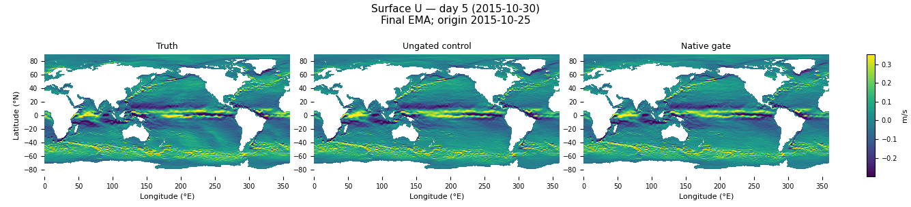

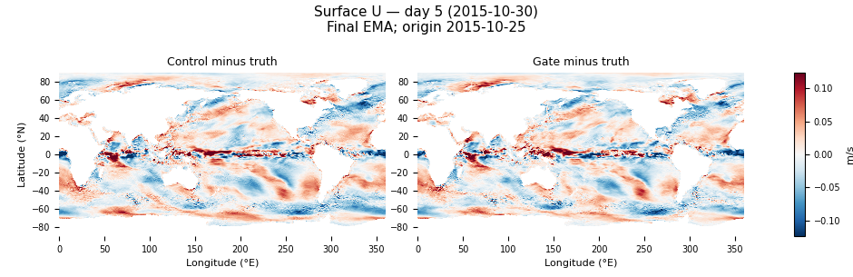

### Global, day 360

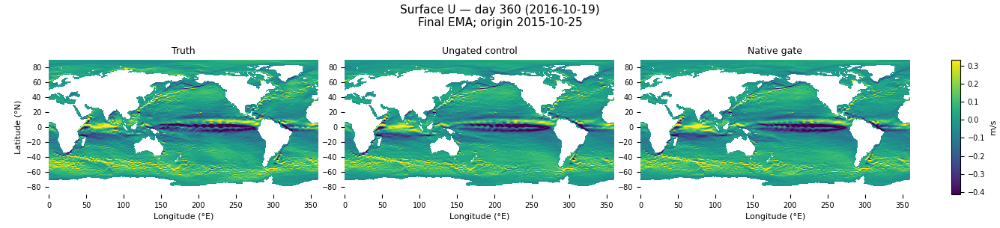

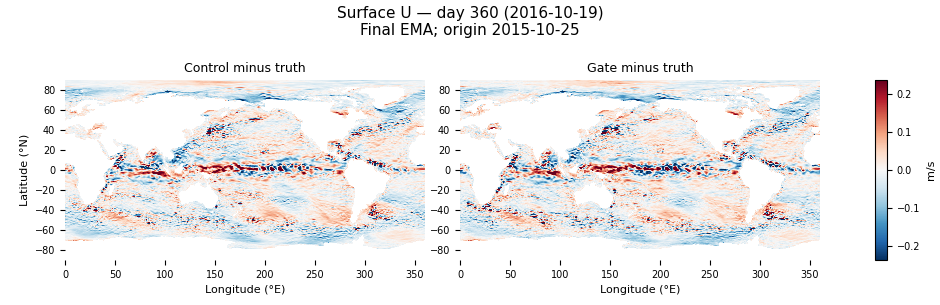

## Surface V

### Global, day 5

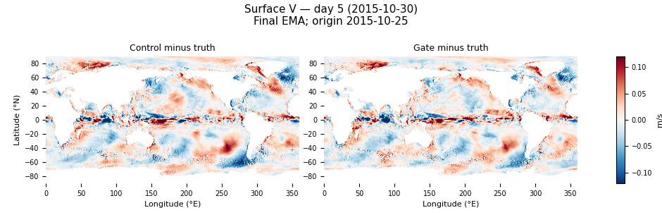

### Global, day 360

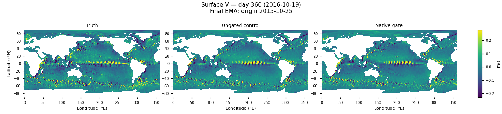

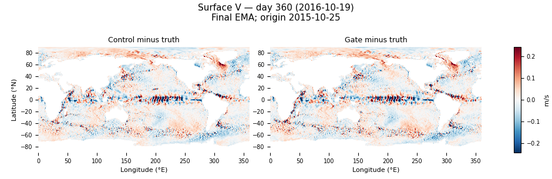

