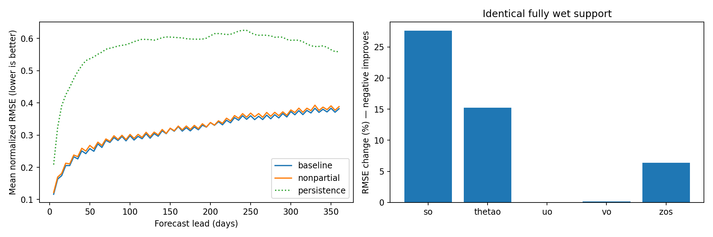

<!-- SPDX-FileCopyrightText: 2026 Samudra Authors -->
<!-- SPDX-License-Identifier: CC-BY-4.0 -->

# Result: masking partial cells worsened this matched comparison

On identical fully wet cells, the model trained with partial cells treated as land had **1.75% higher mean normalized RMSE**: 0.319839 versus 0.314326 for the original-mask baseline. Persistence scored 0.572026. Lower is better. This metric averages spatial area-weighted RMSE divided by the original training standard deviation equally over nonempty channels, 72 forecast lead times, and four independent 360-day origins. The treatment was worse at every origin: +2.10% (2015), +2.08% (2017), +0.73% (2019), and +2.14% (2021).

| Variable | Treatment RMSE change |
| --- | ---: |
| Temperature | +15.24% |
| Salinity | +27.61% |
| Zonal velocity | +0.06% |
| Meridional velocity | +0.15% |
| Sea surface height | +6.37% |

Variable percentages compare the time/origin/depth means of normalized RMSE within each variable. They are not averaged to produce the overall percentage. The strict mask retains no 6,000 m cells; those channels are excluded from both scores. Every scored prediction was finite. This single-seed result gives no evidence that discarding partial cells improves fully wet-cell prediction under this protocol. It does not isolate target removal from the accompanying loss-weight and boundary-context changes, or establish observational accuracy.

Both models reached epoch 70; evaluation used their final EMA checkpoints. Initial parameter hashes matched, and model architecture, normalization statistics, seed, training windows, effective batch, and scientific settings matched. The producer revision was `3953f230949acef2cda53a0d324b1b2960764db1`.

The baseline job `223702_0` hit its six-hour limit during epoch 66. Job `224883_0` resumed the epoch-65 raw checkpoint, including optimizer and training progress, completed epoch 70, and evaluated all four origins in 28m46s. It resumed the same [W&B run](https://wandb.ai/ocean_emulators/default/runs/y2ppqw89). The treatment job `223702_1` completed training and evaluation in 5h44m37s, with [W&B run nh2giow2](https://wandb.ai/ocean_emulators/default/runs/nh2giow2). Both used standard QoS and four GPUs; the recovery requested two hours.

The JSON summaries, origin CSV, and channel/lead summaries are committed here. Full per-origin/per-lead/per-channel CSVs and predictions remain under `beta:/projects/ny/lz1955/multiscale/jrusak/runs/om4-nonpartial-v2-20261105/{scores,eval}`. The parent experiment README defines mask generation and the training/evaluation protocol.
