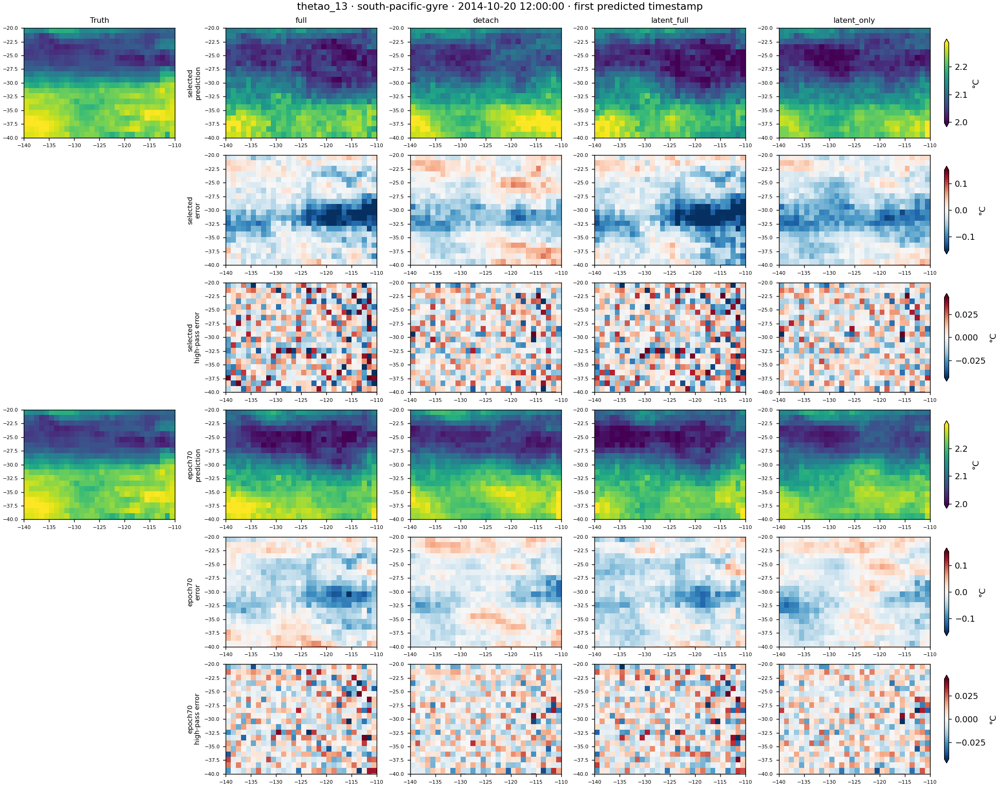

# Spatial maps and epoch-70 EMA comparison

Included completed arms: full, detach, latent_full, latent_only.

Six held-out origins; block MSE averages both output timestamps and all 77 channels. Epoch-70 values use the `ema` state in `latest.pt`, not its raw `model` weights. Selected values use `best-ema.pt`.

| Arm | Selected epoch | Selected days 5/10 | Epoch70 days 5/10 | Selected days715/720 | Epoch70 days715/720 |
|---|---:|---:|---:|---:|---:|
| full | 29 | 0.0513372 | 0.0499552 | 0.212812 | 0.248335 |
| detach | 30 | 0.0511436 | 0.0532854 | 0.16848 | 0.192046 |
| latent_full | 31 | 0.0508954 | 0.0500673 | 0.212149 | 0.250385 |
| latent_only | 31 | 0.0505495 | 0.0536651 | 0.167137 | 0.193438 |

## What changes at epoch 70?

At days 715/720, epoch-70 EMA error is higher than validation-selected EMA error for all four arms: full +16.69%, detach +13.99%, latent_full +18.02%, and latent_only +15.74%. The detachment advantage remains at epoch 70: detach is 22.67% below full; latent_only is 22.11% below full. At this endpoint latent_only is 0.72% worse than detach, so the small selected-checkpoint advantage of latent_only is not stable across checkpoint choices.

First-block scalar error and long-lead rollout error need not move together. Full and latent_full improve their all-channel days-5/10 score at epoch 70, while detach and latent_only worsen it. In the displayed South Pacific 1850 m temperature cutout, however, every arm has lower first-timestamp error and high-pass error at epoch 70. Full's local RMSE falls from 0.05974 to 0.04368 °C and high-pass-error RMS from 0.01955 to 0.01542 °C; detach falls from 0.04266 to 0.03307 °C and from 0.01542 to 0.01290 °C. The truth's local high-pass RMS is 0.01057 °C. These local, single-origin values do not replace the six-origin global scores.

## Verification

All four Slurm array tasks in `26429563` completed with exit code 0. All eight evaluation directories have completion markers. Re-evaluation of every selected checkpoint reproduced its previously published checkpoint SHA256 and entire numerical records array exactly. [Verification and artifact checksums](verification.json) retain checkpoint paths, state keys, SHA256 values, and downloaded map-file checksums. Full map arrays remain in personal Engaging scratch under `om4-temporal-memory-20261016/checkpoint-comparison/`; raw NPZ arrays are not committed to Git.

## Maps

Field codes: `thetao` = temperature, `so` = salinity, `uo`/`vo` = zonal/meridional velocity, `zos` = SSH. Depth suffixes `_0`, `_13`, and `_16` mean 2.5 m, 1850 m, and 4000 m respectively.

Maps show the first output timestamp, 2014-10-20 12:00:00, for held-out origin 0 (inputs 2014-10-10 12:00:00 and 2014-10-15 12:00:00). These single-origin maps illustrate spatial structure; the score table above uses all six origins.

The cutouts are fixed interior-ocean boxes chosen geographically before inspecting treatment outputs: South Pacific 140–110°W, 40–20°S; North Pacific 160–130°W, 20–40°N. They are intended to sample quiet gyre interiors, not asserted to be the globally quietest regions. CSV diagnostics report actual truth roughness and errors within each box.

Each image compares selected and epoch-70 EMA predictions, signed errors, and high-pass errors. Physical-value scales are shared across truth and every arm/checkpoint; signed-error and high-pass-error scales are separately shared. Limits use pooled 1st/99th percentiles (values outside them saturate). Gray denotes land, below-bottom cells, or excluded high-pass stencils. High-pass = center minus four-neighbor mean; longitude is periodic and stencils touching land/latitude edges are excluded. No smoothing or spatial regridding is applied.

- [thetao_0 — global](thetao_0-global.png)
- [thetao_0 — south-pacific-gyre](thetao_0-south-pacific-gyre.png)
- [thetao_0 — north-pacific-gyre](thetao_0-north-pacific-gyre.png)
- [thetao_13 — global](thetao_13-global.png)
- [thetao_13 — south-pacific-gyre](thetao_13-south-pacific-gyre.png)
- [thetao_13 — north-pacific-gyre](thetao_13-north-pacific-gyre.png)
- [thetao_16 — global](thetao_16-global.png)
- [thetao_16 — south-pacific-gyre](thetao_16-south-pacific-gyre.png)
- [thetao_16 — north-pacific-gyre](thetao_16-north-pacific-gyre.png)
- [so_0 — global](so_0-global.png)
- [so_0 — south-pacific-gyre](so_0-south-pacific-gyre.png)
- [so_0 — north-pacific-gyre](so_0-north-pacific-gyre.png)
- [so_13 — global](so_13-global.png)
- [so_13 — south-pacific-gyre](so_13-south-pacific-gyre.png)
- [so_13 — north-pacific-gyre](so_13-north-pacific-gyre.png)
- [zos — global](zos-global.png)
- [zos — south-pacific-gyre](zos-south-pacific-gyre.png)
- [zos — north-pacific-gyre](zos-north-pacific-gyre.png)
- [uo_13 — global](uo_13-global.png)
- [uo_13 — south-pacific-gyre](uo_13-south-pacific-gyre.png)
- [uo_13 — north-pacific-gyre](uo_13-north-pacific-gyre.png)
- [vo_13 — global](vo_13-global.png)
- [vo_13 — south-pacific-gyre](vo_13-south-pacific-gyre.png)
- [vo_13 — north-pacific-gyre](vo_13-north-pacific-gyre.png)

These are paired-seed exploratory results. Final-epoch weights are a separately reported comparison, not a replacement for the predeclared validation-selected endpoint.
