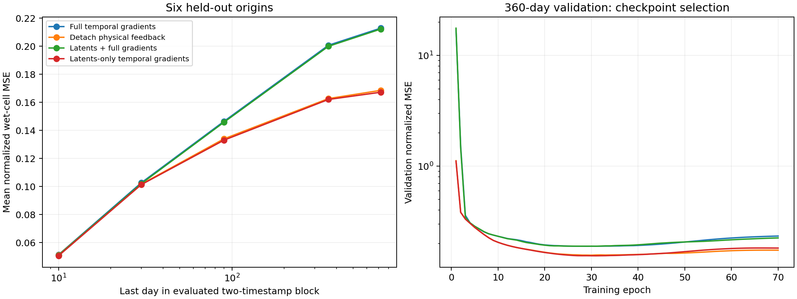

# Four-arm temporal-memory experiment

All four arms completed 70 epochs and final evaluations on Engaging. One paired random seed (15), fixed normalized wet-cell MSE, 1° OM4, four autoregressive calls with two timestamps per call. EMA checkpoint selection used the lowest 360-day validation MSE; held-out evaluation used six origins and 72 calls.

## Held-out results

Each number averages all 77 channels and both timestamps in the indicated block, then six origins. Day 720 denotes the days 715/720 block, not a cumulative loss.

| Arm | Selected epoch | Days 5/10 | Days 355/360 | Days 715/720 | Change vs full at 720 |
|---|---:|---:|---:|---:|---:|
| Full temporal gradients | 29 | 0.051337 | 0.200620 | 0.212812 | +0.00% |
| Detach physical feedback | 30 | 0.051144 | 0.162619 | 0.168480 | -20.83% |
| Latents + full gradients | 31 | 0.050895 | 0.199886 | 0.212149 | -0.31% |
| Latents-only temporal gradients | 31 | 0.050549 | 0.161990 | 0.167137 | -21.46% |

## First-block high-frequency error

Percentage change in normalized high-pass error MSE versus full gradients, averaged across group channels and six origins. The stencil is center minus its four-neighbor mean on all-wet interiors; it is not a sharp spectral band.

| Arm | Deep temperature | Deep salinity | SSH |
|---|---:|---:|---:|
| Full temporal gradients | +0.0% | +0.0% | +0.0% |
| Detach physical feedback | -28.0% | -33.2% | -34.3% |
| Latents + full gradients | -5.3% | -5.5% | -5.0% |
| Latents-only temporal gradients | -29.9% | -35.5% | -36.6% |

## Latent reset control

Resetting latent state to zero before every forecast call leaves the first call unchanged, but increases day-720 MSE:

- latent_full: 0.212149 → 0.218937 (+3.20%).
- latent_only: 0.167137 → 0.213829 (+27.94%).

## Interpretation and limits

Detaching physical feedback beats full gradients at day720 in 6/6 paired origins. Latent-only temporal gradients improve mean day720 MSE by 0.80% relative to detachment alone. That small difference needs replication; six correlated ocean origins do not substitute for independent training seeds.

The results support a harmful contribution from temporal gradients through physical outputs in this setup. They do not prove that the network deliberately stores historical information in texture. The single-example experiment produced residual texture without temporal feedback, so BPTT is not necessary for all such artifacts. The reset control shows functional dependence on carried latent state, but resetting it also creates an out-of-training-distribution intervention and does not establish what information it encodes.

Checkpoints selected at epochs29–31, although every arm completed70epochs; this is the predeclared validation-selected comparison, not final-epoch weights. Latent arms have extra parameters and no matched nonpersistent-parameter control. Batch size/normalization and fixed-MSE training differ from the official dynamic-loss training. No claim of statistical significance or generality to quarter-degree models is made.

## Provenance

Original array26067267 and scratch continuation26280150 all completed. Runtime Python3.12/PyTorch2.9.1+cu128, one L40S per arm, FP32. Code snapshot code-v4; scratch root ~/orcd/scratch/om4-temporal-memory-20261016. Per-arm configs,70validation records, heldout metrics, and selected-checkpoint SHA256 values accompany this report. No GPU execution was used to generate this report.

- [full W&B](https://wandb.ai/ocean_emulators/default/runs/om4mem-full-15-20261016); selected checkpoint SHA256 `b8b7ba147316f470c277dd550ff4354ef5c649cf405380a5cc0985bfe188d2df`.
- [detach W&B](https://wandb.ai/ocean_emulators/default/runs/om4mem-detach-15-20261016); selected checkpoint SHA256 `1520f529f46bedb32b88feccb029dfcc6ffdda3b06472ead9b4558c143c65d59`.
- [latent_full W&B](https://wandb.ai/ocean_emulators/default/runs/om4mem-latent_full-15-20261016); selected checkpoint SHA256 `7b3206ecd33ae55e87c5829ca8695905e153ce469eae1a999022fc9b1a819cf8`.
- [latent_only W&B](https://wandb.ai/ocean_emulators/default/runs/om4mem-latent_only-15-20261016); selected checkpoint SHA256 `535fb8faeb04299476bc8a4f8d6b4343a10c763d8c516f65debc8db350b9d262`.
