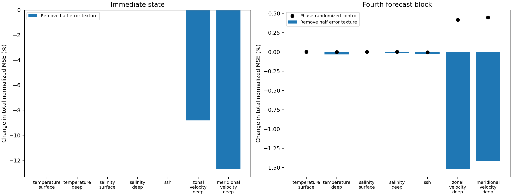
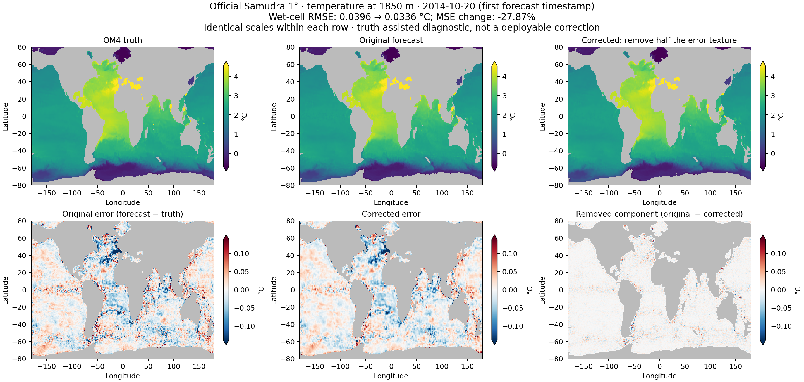

# OM4 temporal-memory diagnostics

Analyzed 6 held-out origins using official 1° run `uw49dzuq`, training run `3o112ot4`, epoch-70 EMA checkpoint.

Checkpoint SHA-256: `ff6160cb7e2a2b5b8ee2c5731c16bd114a1bb5a267245cc5ed766fb00c7f797a`.

Archived prediction replay passed the preset normalized RMS threshold of 0.001. The raw replay summary in provenance combines different physical units and must not be interpreted as normalized RMS or a single physical-unit error.

Model is in evaluation mode with fixed BatchNorm statistics. Gradients below describe the trained model, not gradients recorded during its original training.

Each model call predicts two five-day timestamps. The intervention changes both timestamps in the first predicted block, then continues with unchanged forcing.

The error texture is center minus the four-neighbor mean, restricted to all-wet stencils. This is a local high-frequency diagnostic, not a sharp spectral projection. Truth is used only for diagnostic interventions. This is not a deployable correction.

The table removes half the error texture (alpha=0.5). MSE is the total normalized wet-cell loss, averaged equally across all 77 channels and both output timestamps, not just the intervened group. The fourth block covers lead days 35 and 40 after the last input timestamp. Percent changes are averaged over origins relative to each unmodified rollout. Negative means better. The randomized control matches per-plane perturbation norm; remasking can alter its spectrum. CSV and per-origin JSON retain all amplitudes and controls.

| Intervened group | Immediate MSE Δ% | Fourth-block MSE Δ% | Random control Δ% | Future worse origins | Opposed gradient signs: fixed / archived |
|---|---:|---:|---:|---:|---:|
| temperature_surface | -0.004322 | -0.001809 | 0.0007511 | 3/6 | 0 / 0 |
| temperature_deep | -0.03528 | -0.03408 | -0.0007376 | 1/6 | 0 / 0 |
| salinity_surface | -0.01352 | 0.000844 | 0.0001745 | 4/6 | 2 / 0 |
| salinity_deep | -0.01994 | -0.0106 | 0.0001581 | 1/6 | 0 / 0 |
| ssh | -0.006208 | -0.02492 | -0.003607 | 0/6 | 0 / 0 |
| zonal_velocity_deep | -8.811 | -1.522 | 0.4175 | 0/6 | 0 / 0 |
| meridional_velocity_deep | -12.68 | -1.412 | 0.4465 | 0/6 | 0 / 0 |

Opposed signs means the immediate loss favors removing the error texture while future loss locally favors preserving it. This is evidence of a tradeoff; it does not distinguish stored historical information from compensation for imperfect dynamics.

The randomized and truth-restart controls, sensitivity to intervention amplitude, and consistency across origins must be examined before interpreting a future-error increase as dependence on a specific signal. Six origins do not establish broad generality.

Interpretation: these interventions do not show a consistent need to preserve erroneous texture for future skill in this checkpoint. Deep temperature, deep salinity, and SSH removal improves mean fourth-block total MSE; surface salinity worsens it by only 0.000844 percent. Opposed immediate/future gradient signs occur in 2 of 6 surface salinity cases under fixed MSE, but none under archived weights. This is not evidence that temporal training gradients caused or did not cause the artifacts. Small global loss changes can also hide larger channel-specific effects. This 1-degree result does not establish the mechanism of the quarter-degree texture in the viewer.

The four new matched-training arms are a separate experiment; no training comparison is implied by these checkpoint diagnostics.

## Within-channel effects and before/after maps

The small percentages above use total loss across all 77 channels. Computing
MSE within each intervened group instead gives the following mean relative
changes across six origins (alpha=0.5, normalized wet-cell MSE):

| Group | Immediate group MSE change | Days 35–40 group MSE change |
|---|---:|---:|
| Deep temperature (1050–6000 m) | −24.35% | −1.92% |
| Deep salinity (1050–6000 m) | −18.12% | −0.88% |
| SSH | −10.11% | −0.052% |

Deep-temperature immediate improvements range from 22.40% to 26.35% across
origins; days 35–40 improvements range from 1.81% to 2.19%. This is a substantial
fractional immediate improvement, despite the small effect on total loss.

The figure uses the first forecast timestamp, 2014-10-20, at a fixed example
depth of 1850 m. Wet-cell physical RMSE is 0.03957°C before and 0.03361°C after,
a 27.87% MSE reduction for this particular timestamp/depth. Scales are shared
within rows. Gray denotes masked cells; colors saturate at the displayed limits.
The intervention uses truth to remove half the high-frequency error; it is not
ordinary smoothing of the prediction alone.

Reproduce this analysis with `visualize_correction.py`; numerical group summaries
are in `group-correction-summary.json`.
