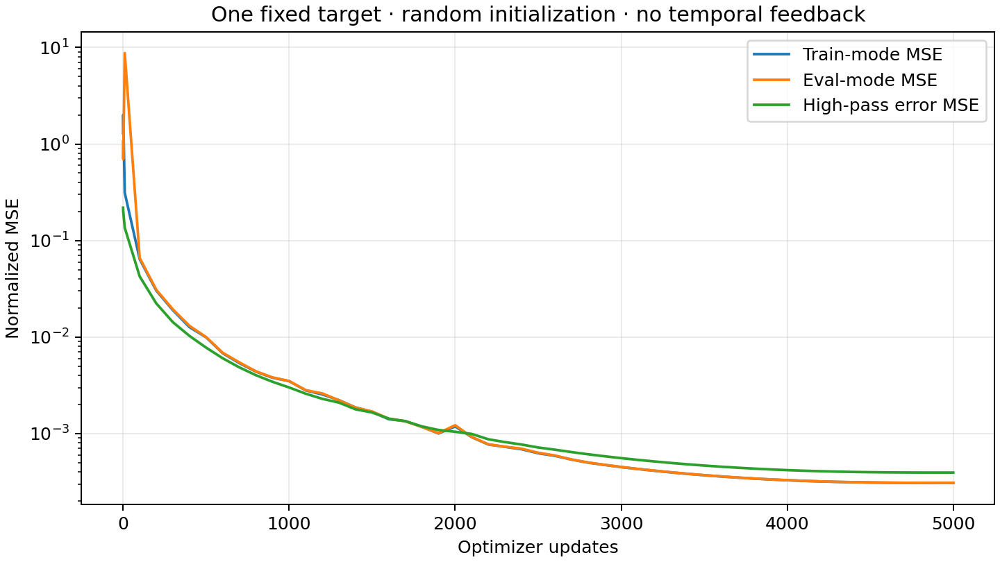
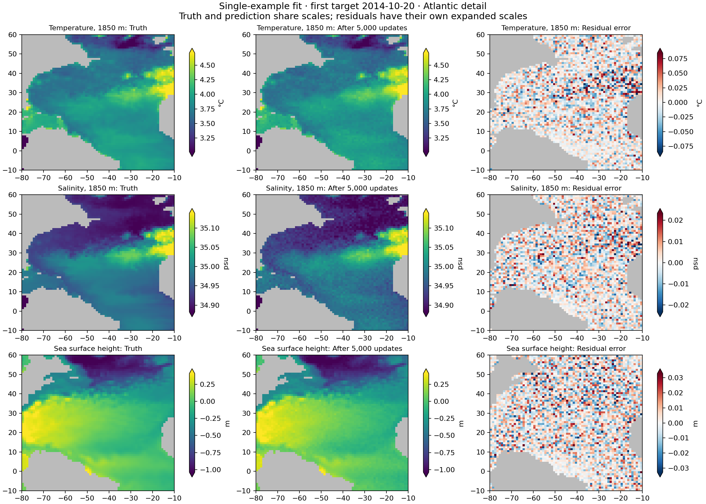

# Single-example v2 fitting test

Torch job20119912 completed5000 updates in908.5seconds of measured training
(15m24s allocation), exit0. GPU utilization was approximately99–100% after startup.
Random seed15, pinned official1degree v2 architecture, two input timestamps,
loss on only the first output timestamp (2014-10-20), no temporal feedback.
Adam, FP32, fixed normalized wet-cell MSE, cosine LR6e-4 to1e-7.

Evaluation MSE fell from1.067596 to0.000308597 (about3460fold). Final train-mode
MSE0.000308319 is very close, so the aggregate residual is not mainly a
BatchNorm train/eval discrepancy. High-pass error MSE remains0.000394649;
this local-curvature metric is not a disjoint spectral share of total MSE.

Final global wet-cell physical RMSE: temperature1850m0.02552°C,
salinity1850m0.007342psu, SSH0.01155m. The Atlantic detail shows fine-grained,
checkerboard-like residuals in all three. Truth and fitted predictions share
scales; residual maps use expanded independent scales.

This establishes that high-frequency residual texture can persist in this
architecture/test without temporal backpropagation. It does not establish the
same cause as the official rollout artifacts, nor prove the architecture cannot
fit the example more closely. The5000-step schedule ended with very small LR;
near-flat final loss is not a proof of an irreducible error floor. The requested
near-zero-error fit was not achieved by this run. A longer optimization test or
an architecture/decoder control would be needed to distinguish those causes.

Raw history, protocol, saved maps and physical-summary.json accompany this report.
