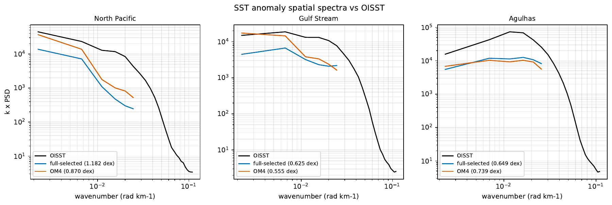
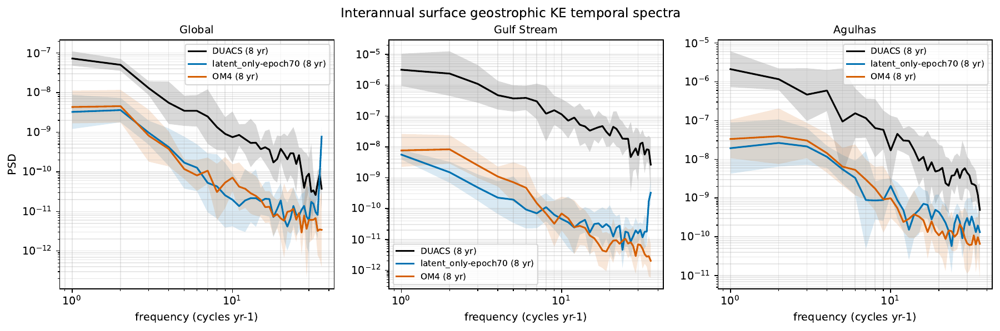

# Standard observation metrics and spectra: original four arms

All eight evaluations completed successfully (Engaging array `26441360`, 28–43 minutes per task). These compare each validation-selected EMA checkpoint with its epoch-70 EMA checkpoint, using the repository observation suite and identical reference products. Fine-latent arms are not included in these results.

## Protocol and interpretation

One autoregressive rollout per checkpoint, initialized from 2014-10-10 and 2014-10-15, predicts 599 five-day timestamps from 2014-10-20 through 2022-12-29. Scores and spectra use the common 2015–2022 window, eight complete calendar years. This is a single-origin, eight-year observation comparison, distinct from the six-origin 720-day comparison against OM4. It does not increase the number of training seeds.

DUACS and OISST overlap ends on 2022-12-24; the primary surface scores use 583 five-day samples. Monthly ARGO-IAP ends at the December 2022 monthly timestamp, 2022-12-01. The suite aggregates complete years and reports calendar-year bootstrap intervals in each full CSV. Those intervals measure temporal variation, not training-seed uncertainty.

Geostrophic velocity and KE/EKE are derived from model sea-surface height, rather than the model’s U/V channels. SST is the 2.5 m temperature level. OHC integrates temperature and the prescribed model layer thicknesses over 0–700 m and 700–2000 m. Physical units and depth-dependent wet masks are restored before analysis; dry cells are NaN. Pointwise observation comparisons interpolate to observation grids; spatial spectra use each field’s native grid. These standard spectra cover surface EKE, SST anomalies, and surface KE temporal variability, not deep-temperature or deep-salinity spectra.

## Primary scores

Lower is better. OHC columns below are in **10⁹ J m⁻²**; the full CSV stores J m⁻².

| Arm / checkpoint | Geostrophic velocity RMSE (m/s) | EKE RMSE (m²/s²) | SST RMSE (°C) | OHC 0–700 m | OHC 700–2000 m |
|---|---:|---:|---:|---:|---:|
| full-selected | 0.197459 | 0.045579 | 1.018846 | 4.035498 | 2.648534 |
| full-epoch70 | 0.196220 | 0.045607 | 0.976642 | 4.034701 | 2.648769 |
| detach-selected | 0.196138 | 0.045570 | 0.962486 | 4.045745 | 2.661025 |
| detach-epoch70 | 0.195700 | 0.045673 | 0.999873 | 4.062546 | 2.689289 |
| latent_full-selected | 0.197177 | 0.045563 | 1.011454 | 4.010458 | 2.634858 |
| latent_full-epoch70 | 0.196045 | 0.045600 | 0.970464 | 4.043818 | 2.656263 |
| latent_only-selected | 0.195936 | 0.045584 | 0.980650 | 4.052216 | 2.651365 |
| latent_only-epoch70 | 0.195492 | 0.045676 | 0.997299 | 4.076846 | 2.704596 |
| OM4 | 0.193975 | 0.045142 | 0.766418 | 4.128550 | 2.670338 |

Selected-checkpoint detachment improves SST RMSE versus full (0.9625 vs 1.0188 °C, −5.5%), but the epoch-70 ordering reverses: full 0.9766 vs detach 0.9999 °C. Thus the large 720-day OM4-state advantage does not translate uniformly into better eight-year observation scores. All learned models have worse surface velocity, instantaneous EKE, and SST errors than the OM4 baseline; OHC differences are small and sometimes favor learned models. OHC ranking should be interpreted alongside the suite’s bathymetry/partial-column diagnostics in the full CSV, not as a standalone broad improvement.

## Spectra

Spatial spectra cover North Pacific, Gulf Stream, and Agulhas; temporal spectra cover Global, Gulf Stream, and Agulhas. Each link contains three panels, model and OM4 curves, and the same observation reference. Ordinary panels report log10 spectral RMSE in dex; interannual panels show eight-year spread. Rounded printed spectral scores are collected in [spectral-scores.csv](spectral-scores.csv).

- **full / selected**: [metrics CSV](full/selected/observation_metrics.csv), [provenance](full/selected/provenance.json); [eke_spatial_spectra_interannual](full/selected/spectra/eke_spatial_spectra_interannual.pdf), [eke_spatial_spectra_vs_duacs](full/selected/spectra/eke_spatial_spectra_vs_duacs.pdf), [ke_temporal_spectra_interannual](full/selected/spectra/ke_temporal_spectra_interannual.pdf), [ke_temporal_spectra_vs_duacs](full/selected/spectra/ke_temporal_spectra_vs_duacs.pdf), [ssta_spatial_spectra_interannual](full/selected/spectra/ssta_spatial_spectra_interannual.pdf), [ssta_spatial_spectra_vs_oisst](full/selected/spectra/ssta_spatial_spectra_vs_oisst.pdf)
- **full / epoch70**: [metrics CSV](full/epoch70/observation_metrics.csv), [provenance](full/epoch70/provenance.json); [eke_spatial_spectra_interannual](full/epoch70/spectra/eke_spatial_spectra_interannual.pdf), [eke_spatial_spectra_vs_duacs](full/epoch70/spectra/eke_spatial_spectra_vs_duacs.pdf), [ke_temporal_spectra_interannual](full/epoch70/spectra/ke_temporal_spectra_interannual.pdf), [ke_temporal_spectra_vs_duacs](full/epoch70/spectra/ke_temporal_spectra_vs_duacs.pdf), [ssta_spatial_spectra_interannual](full/epoch70/spectra/ssta_spatial_spectra_interannual.pdf), [ssta_spatial_spectra_vs_oisst](full/epoch70/spectra/ssta_spatial_spectra_vs_oisst.pdf)
- **detach / selected**: [metrics CSV](detach/selected/observation_metrics.csv), [provenance](detach/selected/provenance.json); [eke_spatial_spectra_interannual](detach/selected/spectra/eke_spatial_spectra_interannual.pdf), [eke_spatial_spectra_vs_duacs](detach/selected/spectra/eke_spatial_spectra_vs_duacs.pdf), [ke_temporal_spectra_interannual](detach/selected/spectra/ke_temporal_spectra_interannual.pdf), [ke_temporal_spectra_vs_duacs](detach/selected/spectra/ke_temporal_spectra_vs_duacs.pdf), [ssta_spatial_spectra_interannual](detach/selected/spectra/ssta_spatial_spectra_interannual.pdf), [ssta_spatial_spectra_vs_oisst](detach/selected/spectra/ssta_spatial_spectra_vs_oisst.pdf)
- **detach / epoch70**: [metrics CSV](detach/epoch70/observation_metrics.csv), [provenance](detach/epoch70/provenance.json); [eke_spatial_spectra_interannual](detach/epoch70/spectra/eke_spatial_spectra_interannual.pdf), [eke_spatial_spectra_vs_duacs](detach/epoch70/spectra/eke_spatial_spectra_vs_duacs.pdf), [ke_temporal_spectra_interannual](detach/epoch70/spectra/ke_temporal_spectra_interannual.pdf), [ke_temporal_spectra_vs_duacs](detach/epoch70/spectra/ke_temporal_spectra_vs_duacs.pdf), [ssta_spatial_spectra_interannual](detach/epoch70/spectra/ssta_spatial_spectra_interannual.pdf), [ssta_spatial_spectra_vs_oisst](detach/epoch70/spectra/ssta_spatial_spectra_vs_oisst.pdf)
- **latent_full / selected**: [metrics CSV](latent_full/selected/observation_metrics.csv), [provenance](latent_full/selected/provenance.json); [eke_spatial_spectra_interannual](latent_full/selected/spectra/eke_spatial_spectra_interannual.pdf), [eke_spatial_spectra_vs_duacs](latent_full/selected/spectra/eke_spatial_spectra_vs_duacs.pdf), [ke_temporal_spectra_interannual](latent_full/selected/spectra/ke_temporal_spectra_interannual.pdf), [ke_temporal_spectra_vs_duacs](latent_full/selected/spectra/ke_temporal_spectra_vs_duacs.pdf), [ssta_spatial_spectra_interannual](latent_full/selected/spectra/ssta_spatial_spectra_interannual.pdf), [ssta_spatial_spectra_vs_oisst](latent_full/selected/spectra/ssta_spatial_spectra_vs_oisst.pdf)
- **latent_full / epoch70**: [metrics CSV](latent_full/epoch70/observation_metrics.csv), [provenance](latent_full/epoch70/provenance.json); [eke_spatial_spectra_interannual](latent_full/epoch70/spectra/eke_spatial_spectra_interannual.pdf), [eke_spatial_spectra_vs_duacs](latent_full/epoch70/spectra/eke_spatial_spectra_vs_duacs.pdf), [ke_temporal_spectra_interannual](latent_full/epoch70/spectra/ke_temporal_spectra_interannual.pdf), [ke_temporal_spectra_vs_duacs](latent_full/epoch70/spectra/ke_temporal_spectra_vs_duacs.pdf), [ssta_spatial_spectra_interannual](latent_full/epoch70/spectra/ssta_spatial_spectra_interannual.pdf), [ssta_spatial_spectra_vs_oisst](latent_full/epoch70/spectra/ssta_spatial_spectra_vs_oisst.pdf)
- **latent_only / selected**: [metrics CSV](latent_only/selected/observation_metrics.csv), [provenance](latent_only/selected/provenance.json); [eke_spatial_spectra_interannual](latent_only/selected/spectra/eke_spatial_spectra_interannual.pdf), [eke_spatial_spectra_vs_duacs](latent_only/selected/spectra/eke_spatial_spectra_vs_duacs.pdf), [ke_temporal_spectra_interannual](latent_only/selected/spectra/ke_temporal_spectra_interannual.pdf), [ke_temporal_spectra_vs_duacs](latent_only/selected/spectra/ke_temporal_spectra_vs_duacs.pdf), [ssta_spatial_spectra_interannual](latent_only/selected/spectra/ssta_spatial_spectra_interannual.pdf), [ssta_spatial_spectra_vs_oisst](latent_only/selected/spectra/ssta_spatial_spectra_vs_oisst.pdf)
- **latent_only / epoch70**: [metrics CSV](latent_only/epoch70/observation_metrics.csv), [provenance](latent_only/epoch70/provenance.json); [eke_spatial_spectra_interannual](latent_only/epoch70/spectra/eke_spatial_spectra_interannual.pdf), [eke_spatial_spectra_vs_duacs](latent_only/epoch70/spectra/eke_spatial_spectra_vs_duacs.pdf), [ke_temporal_spectra_interannual](latent_only/epoch70/spectra/ke_temporal_spectra_interannual.pdf), [ke_temporal_spectra_vs_duacs](latent_only/epoch70/spectra/ke_temporal_spectra_vs_duacs.pdf), [ssta_spatial_spectra_interannual](latent_only/epoch70/spectra/ssta_spatial_spectra_interannual.pdf), [ssta_spatial_spectra_vs_oisst](latent_only/epoch70/spectra/ssta_spatial_spectra_vs_oisst.pdf)

### Representative figures

## Verification and provenance

All eight OM4-baseline metric tables are exactly identical. All checkpoints share exactly the same timestamps, initial times, metric window, observation manifests, and metrics-source hash. Every exported rollout passed comparisons to its existing first-720-day origin-0 MSE at calls 1, 3, 9, 36, and 72. All reported metric values are finite; each ordinary spectral PDF contains three finite model and three finite OM4 scores, and all interannual legends identify eight years. Representative rendered figures were inspected.

Public observation sources are `s3://m2lines-pubs/Samudra/v2026-07/obs/{duacs,oisst,argo-iap}.zarr` at `https://nyu1.osn.mghpcc.org`. Exact source dimensions and coverage appear in each provenance JSON. Metrics source SHA256: `136a8adafff29657de6d1d0b2473ab1763598f86d1ac159e7120c19956fd816b`. Export array: `26440786`; recovered observation-staging job: `26441338`. Staging recovery aligned sliced time chunks before safe Zarr writes; it changed no samples.

[Primary comparison CSV](primary-comparison.csv) · [verification](verification.json). Full rollout arrays remain in personal Engaging scratch under `om4-temporal-memory-20261016/standard-suite/rollouts/`, outside Git.
