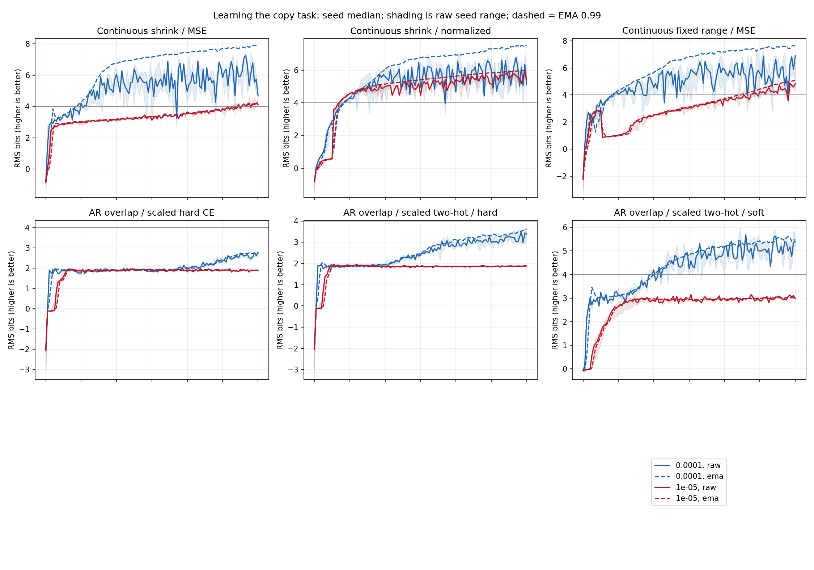
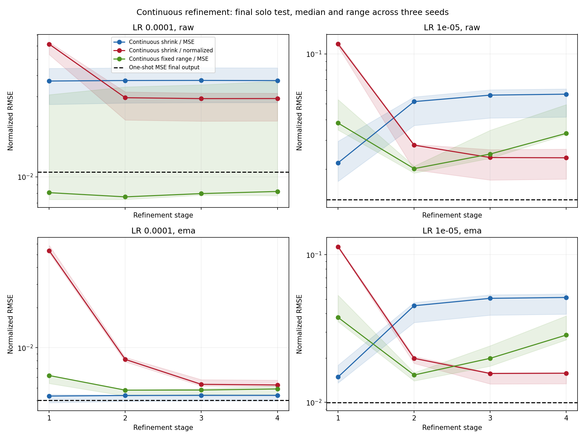
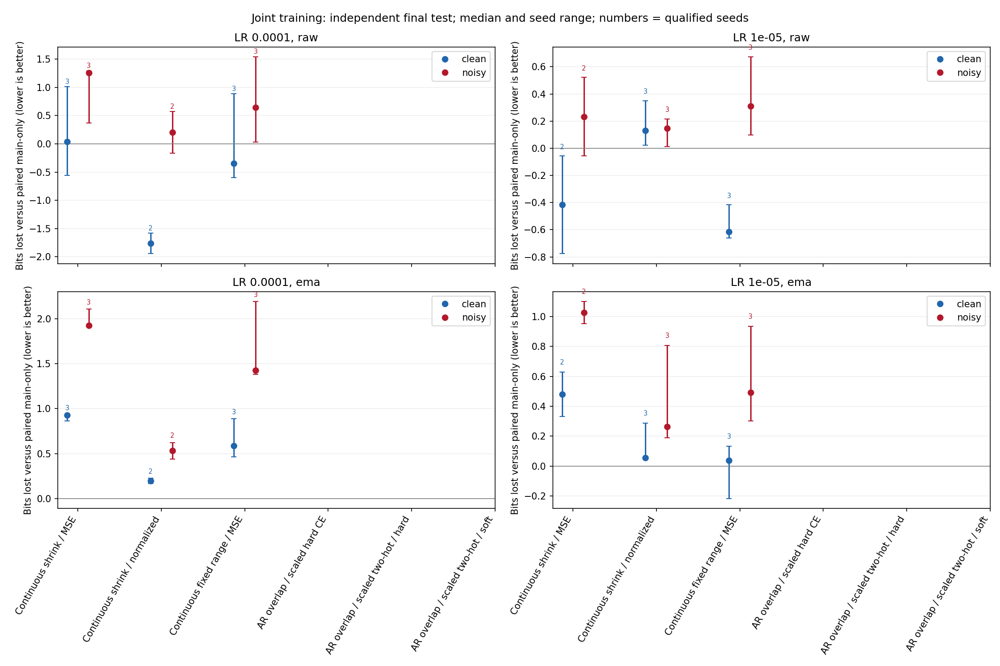
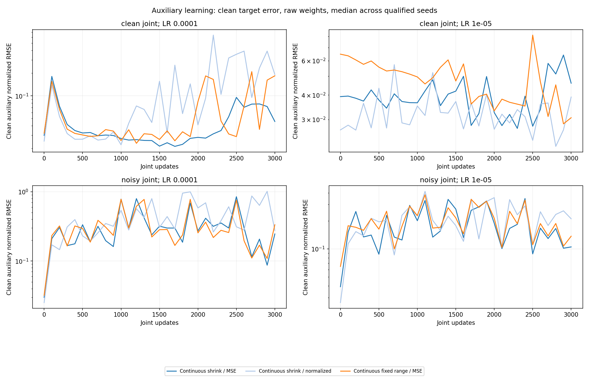
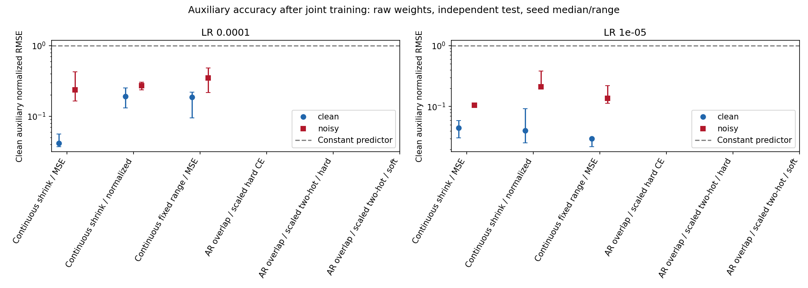
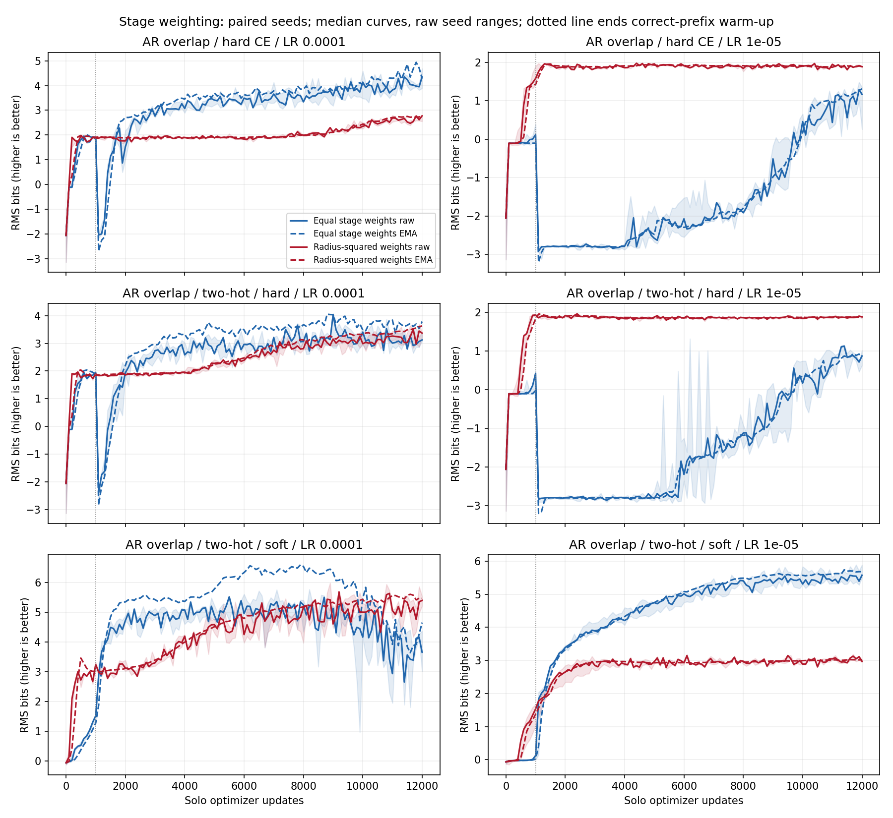
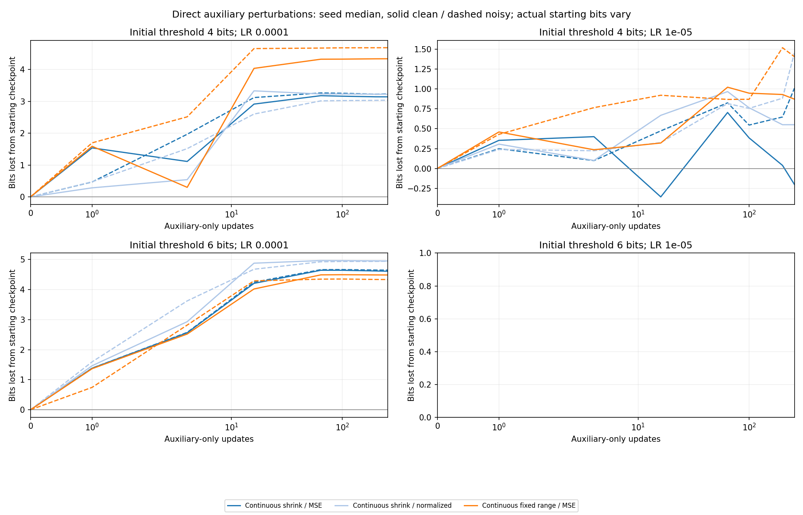

<!-- SPDX-FileCopyrightText: 2026 Samudra Authors -->
<!-- SPDX-License-Identifier: CC-BY-4.0 -->

# Continuous refinement and scale-weighted categorical losses

Continuous refinement learned useful late corrections when trained on
scale-normalized residuals. At LR 1e-5 its median raw error fell from 0.115 after
the first prediction to 0.0235 after the fourth. Ordinary shrinking-output MSE
instead worsened from 0.0218 to 0.0570. Normalized refinement also had a smaller
EMA copy penalty during noisy joint training than ordinary shrinking MSE on
all four seed/LR pairs where both qualified. Raw endpoint comparisons were less
consistent. This is evidence that the training objective matters; it does not
establish that recycling always improves precision.

The fixed-range control learned copying too. It did not consistently beat
shrinking refinement. Giving later categorical predictions less loss weight
changed solo learning, with opposite effects at the two learning rates for the
soft decoder. None of the 18 weighted categorical bundles passed the auxiliary
qualification gate, so this extension cannot compare their joint-training
interference against equal stage weighting.

All 36 scientific bundles completed on L40S GPUs with exit 0:0 and no restarts
or retries: 36 solo runs, 48 joint/control continuations, and 78 direct
perturbation/control probes. Including six GPU smoke tests, allocation was
**2.158 GPU-hours**. This is an experiment/results record, not intended to merge.

## What was compared

A width-128, depth-4 transformer receives four independent synthetic periodic
fields and copies the temperature at a query position already included in its
input. Every method sees the same 16-bit fixed-point scalar target and input:
normalized range [-8,8), spacing 1/4096. Normalization uses the generator's fixed
analytic standard deviation, approximately 0.1292985189. Input values return to
physical scale before entering the transformer. The auxiliary predicts
`(0.1-S)/scale` for a second input field S with the same distribution. Its noisy
labels add fresh independent Gaussian noise with standard deviation one in
normalized units. All auxiliary evaluation uses the clean target.

Each sample has 128 positions with four fields T,S,u,v, built from Fourier modes
1-4 and 12-15. T/S fine-mode amplitude is 0.125 relative to coarse modes; u/v
fine-mode amplitude is one. Tokens contain four field values and four
sine/cosine position features. Two query tokens contain the selected position
and its field values, with different learned roles. All 130 tokens attend
together; the first query feeds copying and the second feeds the auxiliary.
Here `scale` is the same fixed analytic standard deviation used to normalize
temperature. Every RMSE in this report is in those normalized units.

The transformer runs once. A small shared decoder receives its representation,
the current estimate, current radius and refinement level, then makes four
successive predictions. Continuous variants predict a tanh-bounded correction
q and update `estimate += radius*q`. Shrinking variants use radii
8,1,1/8,1/64; the fixed-range control uses radius eight throughout. The current
estimate is detached between stages. Each stage still trains the shared
representation and decoder. The first 1,000 solo updates use correct-prefix
warm-up; all later training and every evaluation use model-generated prefixes.

Ordinary continuous loss is the mean of four updated-estimate squared errors.
Normalized loss divides each squared error by that stage's radius squared.
With a fixed radius the two differ only by a global constant, removed by the
initial gradient calibration, so only one fixed-range control was run.
Categorical overlapping refinement predicts 16 asinh-spaced centers at each
stage. Its added loss weights are `1,1/64,1/4096,1/262144`, instead of equal
weights. These change the relative importance of late-stage precision without
changing the decoder geometry or target distributions. CE with these weights
is not numerically equivalent to scalar MSE.

All runs use batch 64, 12,000 solo updates, AdamW with zero weight decay, FP32,
three initialization seeds and the listed constant learning rate. Overall
main-loss coefficients were calibrated once on initial shared-gradient norms,
then frozen. Specifically, `joint_loss = alpha*copy_loss + auxiliary_MSE`; the
auxiliary coefficient is one and is not separately calibrated. Alpha matches
the initial shared-backbone gradient norm to a seed-matched random linear MSE
reference over four fixed batches, with correct-prefix states; decoder and
auxiliary-head parameters are excluded from that norm. Alpha is identical in
main-only, clean-joint and noisy-joint branches for a given bundle. After fitting
only the auxiliary linear head, qualified runs fork
into main-only, clean-joint and noisy-joint continuations for 3,000 updates.
Optimizer and EMA reset at forks; EMA decay is 0.99. Details are in the
[extension protocol](../ENCODING_EXTENSION.md) and [base protocol](../ENCODING.md).

Copy precision is RMS bits, `-log2(normalized RMSE)`; higher is better. It is
not a worst-case bound or the number of exactly recovered target bits. Bits lost
is `log2(RMSE_joint/RMSE_paired_main-only)`; positive is degradation. Compute each
contrast within encoding, LR, seed and raw/EMA view before aggregation. All
headline scores use final checkpoints on the independent 8,192-example test set,
not the best validation checkpoint. Tables give seed medians; figure shading
and error bars give seed ranges, not confidence intervals. Learning curves use
the fixed 512-example validation set; endpoint tables use the larger test set.

Original-wave controls share the same field/data and noise streams, seeds,
learning rates, update budgets, batch size, backbone, calibration rule and
evaluation examples. Stage-weighted categorical pairs share decoder parameter
counts and initialization too. Continuous variants share their one-output
decoder architecture with each other; categorical heads emit 16 logits, while
one-shot MSE lacks the six state/level input features. These decoder parameter
count differences are recorded and are not controlled away.

## Solo learning and the four refinements

| Encoding | LR 1e-4 raw / EMA bits | Copy / aux / joint gates | LR 1e-5 raw / EMA bits | Copy / aux / joint gates |
| --- | ---: | ---: | ---: | ---: |
| Continuous shrinking, ordinary MSE | 4.74 / 7.83 | 3 / 3 / 3 | 4.13 / 4.28 | 2 / 3 / 2 |
| Continuous shrinking, normalized residual | 5.10 / 7.57 | 2 / 3 / 2 | 5.41 / 5.99 | 3 / 3 / 3 |
| Continuous fixed range, ordinary MSE | 6.93 / 7.67 | 3 / 3 / 3 | 4.92 / 5.13 | 3 / 3 / 3 |
| Weighted hard CE, hard decode | 2.74 / 2.74 | 0 / 0 / 0 | 1.92 / 1.92 | 0 / 0 / 0 |
| Weighted two-hot CE, hard decode | 3.18 / 3.49 | 0 / 0 / 0 | 1.90 / 1.91 | 0 / 0 / 0 |
| Weighted two-hot CE, soft decode | 5.52 / 5.53 | 3 / 0 / 0 | 2.98 / 3.04 | 0 / 0 / 0 |

Gate counts are out of three and use raw weights. Copying must sustain at least
four bits for the final three validations. The auxiliary linear-head fit must
have normalized RMSE below 0.2 on a separate validation set. Joint training
requires both; the auxiliary counts above include all seeds. A final test score
above four bits does not imply the sustained validation gate passed. The fitted
auxiliary head reads the second query representation with the backbone frozen;
its failure is a limitation of this qualification protocol, not proof that
joint learning from scratch is impossible.

At LR 1e-5, raw median stage errors were:

| Continuous objective | Stage 1 | Stage 2 | Stage 3 | Stage 4 |
| --- | ---: | ---: | ---: | ---: |
| Shrinking, ordinary MSE | 0.0218 | 0.0514 | 0.0563 | 0.0570 |
| Shrinking, normalized residual | 0.1151 | 0.0280 | 0.0235 | 0.0235 |
| Fixed range, ordinary MSE | 0.0381 | 0.0201 | 0.0247 | 0.0330 |

The normalized model uses later predictions to correct a coarse first answer.
The other two can damage an already better intermediate estimate. Thus more
refinement steps are not automatically better. The figure also shows EMA and
seed ranges. One-shot MSE from the original wave remains a strong reference:
its final solo precision is 6.55/7.95 raw/EMA bits at LR 1e-4 and 6.25/6.65 at
LR 1e-5, above most of these median refinement scores. The non-shrinking control
shows that the imposed zoom schedule is not necessary for learning copying.

## Joint training and continuous loss scaling

| Continuous objective | LR | Qualified seeds | Clean joint: raw / EMA bits lost | Noisy joint: raw / EMA bits lost | Noisy joint: raw / EMA copy bits |
| --- | ---: | ---: | ---: | ---: | ---: |
| Shrinking, ordinary MSE | 1e-4 | 3 | 0.04 / 0.93 | 1.26 / 1.93 | 6.02 / 6.17 |
| Shrinking, ordinary MSE | 1e-5 | 2 | -0.42 / 0.48 | 0.23 / 1.03 | 4.49 / 4.64 |
| Shrinking, normalized residual | 1e-4 | 2 | -1.77 / 0.20 | 0.20 / 0.53 | 5.37 / 7.25 |
| Shrinking, normalized residual | 1e-5 | 3 | 0.13 / 0.06 | 0.15 / 0.26 | 5.86 / 5.95 |
| Fixed range, ordinary MSE | 1e-4 | 3 | -0.35 / 0.59 | 0.64 / 1.42 | 5.73 / 6.34 |
| Fixed range, ordinary MSE | 1e-5 | 3 | -0.61 / 0.04 | 0.31 / 0.49 | 4.56 / 5.00 |

Different gate counts mean table medians are not always over the same seeds.
On common qualified seeds, normalized shrinking refinement reduces the EMA
noisy-joint penalty versus ordinary shrinking MSE by 1.30 and 1.67 bits at
LR 1e-4 (seeds 11,33), and by 0.91 and 0.69 bits at LR 1e-5 (seeds 22,33).
Its final noisy-joint EMA copy accuracy also improves on each of those pairs.
Raw penalties improve in three of these four comparisons; the remaining
comparison worsens by 0.07 bit. See [paired contrasts](matched-contrasts.csv).

Against one-shot MSE, normalized refinement reduces noisy-joint EMA penalties
on all five common qualified pairs. Its absolute accuracy is mixed: it gains
0.28 and 0.45 EMA bits at LR 1e-4, but loses 0.14,0.67,0.35 bits at LR 1e-5.
Retention of a method's own baseline and final precision are separate outcomes.
No comparison here matches starting precision across decoder families.

Clean auxiliary errors under noisy training are approximately 0.037-0.050 for
EMA across the continuous variants. Raw errors are larger and variable,
approximately 0.10-0.48. Main and auxiliary performance must therefore be read
in the same weight view. The fitted head norms and calibrated loss coefficients
vary across models; they are included in [qualification.csv](qualification.csv).
The calibration equalizes an initial gradient norm only, and subsequent gradient
norms and cosines are in [gradients.csv.gz](gradients.csv.gz). These data do not
by themselves identify a unique gradient-noise mechanism.

## Downweighting late categorical predictions

The table gives the median within-seed change in final solo bits after replacing
equal CE weights with radius-squared weights. Positive means improved precision.

| Decoder | LR 1e-4 raw / EMA gain | LR 1e-5 raw / EMA gain |
| --- | ---: | ---: |
| Hard CE, hard decode | -1.31 / -1.73 | +0.80 / +0.62 |
| Two-hot CE, hard decode | +0.14 / -0.01 | +1.00 / +0.94 |
| Two-hot CE, soft decode | +1.64 / +0.94 | -2.23 / -2.34 |

The soft decoder's lower-LR result shows why the stage breakdown matters. With
radius-squared weighting, raw median error is about 0.0378 after stage one but
0.126 after stage four. Under equal weights it improves from about 0.129 to
0.0259. Strong downweighting can let later predictions degrade a good first
estimate. At the higher LR, weighting instead improves soft-decoder final
accuracy. The effect changes with learning rate under the tested fixed budget. No
training-budget sweep was performed.

None of the weighted categorical variants passed the auxiliary head gate.
The high-LR soft variant passed the copy gate in all three seeds, but its
auxiliary fitted-head RMSE was 0.256-0.275, above 0.2. Consequently no weighted
categorical joint continuation was launched. Missing comparisons cannot be
interpreted as resistance to interference. The geometry and hard quantization
limits are unchanged from the [original wave](../encoding_results/README.md).
Continuous predictions and soft probability decoding have no discrete output
floor, but still require accurate learned continuous values.

## Direct auxiliary-only perturbations

Twenty-six milestone checkpoints passed auxiliary qualification, giving three
trajectories each: main-only, clean auxiliary-only and noisy auxiliary-only.
Each begins with the same fitted auxiliary head and raw backbone, fresh Adam
and EMA, the bundle learning rate, and paired data/noise streams. Auxiliary-only
updates train the shared backbone and auxiliary head; the copy decoder receives
no gradient. The main-only control measures the improvement forgone as well as
damage caused by removing the main loss. This gives 78 probe trajectories. At the six-bit threshold and LR 1e-4, normalized
continuous refinement still lost 5.23-6.08 bits relative to its paired main-only
control after 256 noisy auxiliary-only updates. Its actual pre-probe precision
was 6.18-6.48 bits on the separate preparation validation set. Other continuous
variants also lost several bits. Improved joint retention does not make the
copy function immune when its restoring loss is removed.

Milestones are the first checkpoints sustaining four/six raw bits for three
validations. Their training ages and actual preparation precision differ, so
these are threshold-based probes rather than exact precision matches. The
per-kind raw archives preserve parent steps, fitted heads and initial errors.
Auxiliary probes record steps 1,4,16,64 in addition to the regular cadence;
main-only controls record 0,100,200,256. Early unmatched control penalties remain
blank rather than interpolated. The plotted quantity is loss from the starting
checkpoint; the endpoint CSV also contains paired main-only penalties.

## Artifacts and execution

- Training source: `0acba0807249331d78a9e87da56502cbaf62fa84`; original controls:
  `fe088a48937cdda6396d3fccfef31711e5e3165e`. All eleven old variants were checked
  for identical predictions/losses on fixed CPU test batches in the extended source before launch. The
  old jobs continued using their original immutable archive.
- Smoke array `22485156`; scientific array `22487215`; CPU callback jobs
  `22485194` and `22487246`. All GPU tasks completed 0:0 with zero restarts.
- Scientific GPU allocation was 7,614 seconds; smoke allocation was 155 seconds.
  Total: 2.158 GPU-hours. Measured trajectory time was 6,921.8 seconds; allocation
  additionally includes setup, auxiliary fitting and other overhead. No retries.
- Outputs: `/scratch/jr7309/precision-encoding-extension-20261109`.
  W&B group: `precision-encoding-extension-20261109`, project
  `ocean_emulators/samudra`; online mode and L40S identity verified in every log.
- [Provenance and hashes](provenance.json), [Slurm accounting](accounting.psv),
  [qualification](qualification.csv), [final test metrics](test-metrics.csv),
  [test summaries](test-summary.csv), [matched contrasts](matched-contrasts.csv),
  [original control metrics](original-control-test-metrics.csv), and per-kind
  `curves-*.csv.gz` / `raw-*.json.gz` preserve machine-readable evidence.
- The inherited [perfect-target audit](oracle-test-distribution.csv) covers the
  original eleven decoder geometries; weights do not alter those geometries.
  It is not a learned-model precision result. Continuous refinement has no
  additional hard quantization stage.

The shared parser validates phase completion and identical initial errors for
paired branches. The extension parser refuses duplicate comparison keys and
compares only seed/LR/view/phase pairs present in both methods. Source manifests,
calibration, qualification, actual auxiliary accuracy, output parameter counts,
finite budget, and three-seed variability limit causal claims. These experiments
compare decoder/objective packages; continuous versus categorical choices also
change loss shape, unreachable-target treatment and warm-up behavior.
