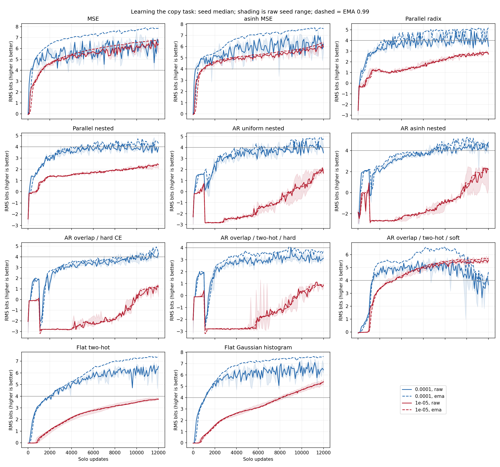
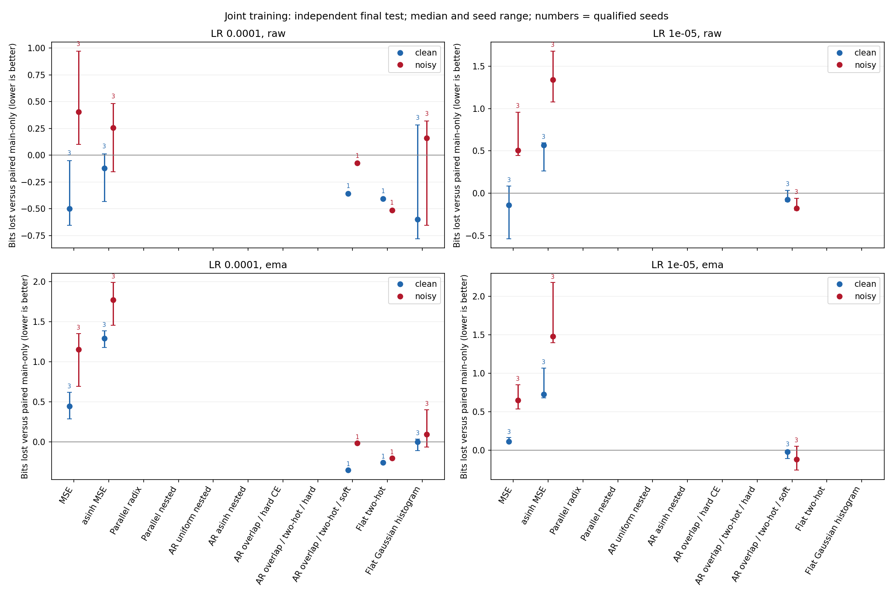
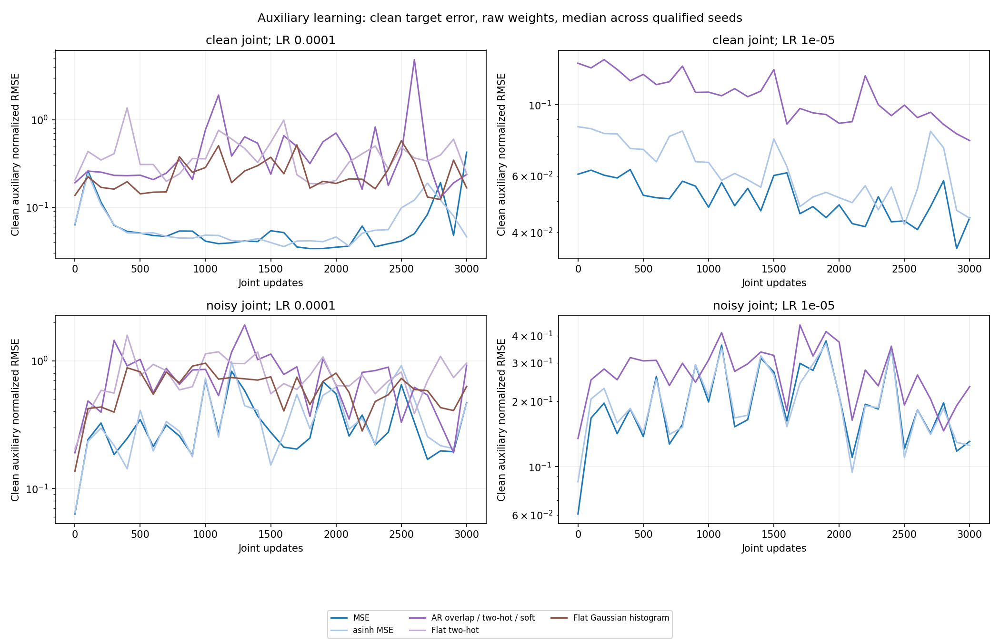
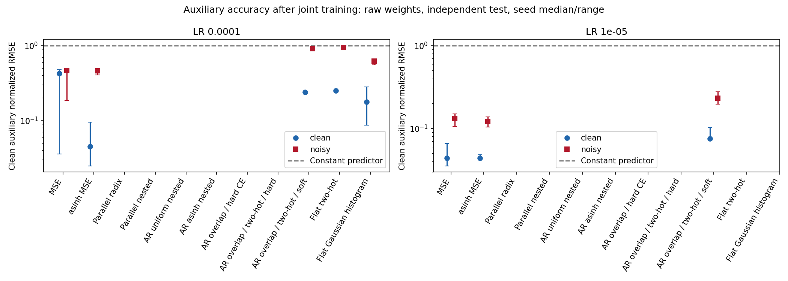
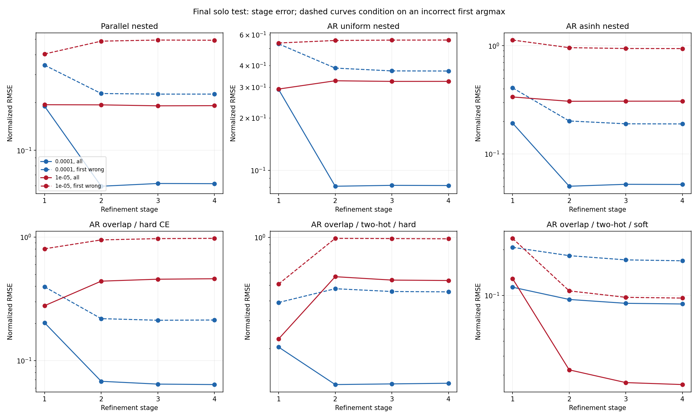
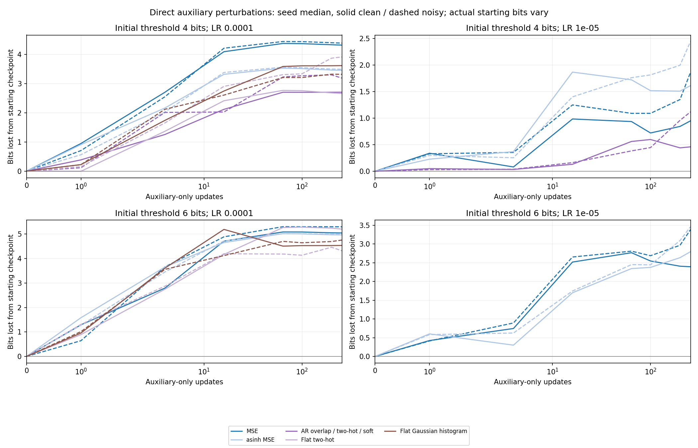

<!-- SPDX-FileCopyrightText: 2026 Samudra Authors -->
<!-- SPDX-License-Identifier: CC-BY-4.0 -->

# Scalar encodings and copy precision

Soft autoregressive refinement retained its own copy accuracy during noisy joint
training at learning rate 1e-5, but remained less precise than ordinary MSE.
The Gaussian histogram also had a smaller EMA copy penalty than MSE at 1e-4.
All hard categorical variants failed the joint qualification gate. This wave
therefore provides evidence about probability-decoded outputs, but no qualified
test of protection from hard classification margins. No method demonstrated
lossless copying of the 16-bit target: the highest rounded-word accuracy among
final solo raw/EMA evaluations was 3.69%, and the highest exact-value accuracy
was 0.45%. These maxima come from different evaluations.

All 66 scientific bundles completed successfully on L40S GPUs: 66 solo runs,
60 joint/control continuations, and 108 auxiliary perturbation/control probes.
Twenty bundles passed both qualification gates. Total allocation including the
11 GPU smoke tests was **2.976 GPU-hours**, with no restarts or retries.
This is an experiment/results record and is not intended to merge.

## Comparison and metric

The input contains four independent synthetic periodic fields. The transformer
copies the temperature value already present at a query position. Temperature is
normalized by its fixed analytic standard deviation, quantized to a common
16-bit fixed-point grid on [-8,8), with normalized spacing 1/4096, then returned
to physical scale for the input. Sixteen bits here describe the target word;
RMS bits below measure error relative to the fixed standard deviation.
The auxiliary predicts `(0.1-S)/scale`, where S is a second independent field
with the same distribution as the original temperature and scale is their
fixed analytic standard deviation, approximately 0.1292985189. Both fields are
present in the same query. Noisy auxiliary labels add fresh independent standard-normal noise in
normalized units. Evaluation always uses the clean auxiliary target.

The backbone runs once; autoregressive variants apply a small conditioned head
four times. All variants use the same width-128, depth-4 transformer, batch size 64,
12,000 solo updates, AdamW without weight decay, FP32, and three initialization
seeds. Main-loss coefficients were fixed after initial shared-gradient norm
calibration; they are not equal numerical coefficients or guaranteed equal
weights later in training. Qualified models receive 3,000 additional updates in
paired main-only, clean-joint, and noisy-joint arms. Full definitions, curricula,
and geometry are in the [protocol](../ENCODING.md). EMA uses decay 0.99 and
starts from the raw weights at each phase; optimizer and EMA reset at forks.
Reported scores use final checkpoints, not the best checkpoint on validation.

Radix predicts four independent base-16 digits. Nested encodings subdivide the
current interval into 16 bins four times, with uniform or asinh spacing; the
parallel variant predicts all four indices from the same representation. AR
means autoregressive: each later head receives the center/radius chosen earlier.
Overlapping variants select one of 16 asinh-spaced centers and divide the current
radius by eight at each stage, starting at center zero and radius eight. Hard
decoding chooses argmax; soft decoding uses the probability-weighted center.
Two-hot CE assigns distance-weighted mass to the two surrounding centers. Flat
encodings use one 64-bin distribution, without refinement.

Copy precision is RMS bits, `-log2(normalized RMSE)`, so higher is better.
It is not a worst-case error guarantee. Bits lost is
`log2(RMSE_joint/RMSE_paired_main-only)`: positive means worse copying;
negative means better copying at the same continuation budget. Each contrast is
computed within seed, LR, encoding, and raw/EMA view before aggregation. Tables
show medians; figures show seed ranges where indicated. Three-seed ranges are
not confidence intervals. All headline scores use the fixed independent
8,192-example test set; qualification uses separate validation examples.

## Learning the copy task and qualification

The following table gives final solo precision and the number of seeds passing
each gate, out of three. The copy gate requires at least four raw RMS bits in
each of the last three validations. The auxiliary gate requires normalized RMSE
below 0.2 after fitting only its linear head on separate calibration data with
the backbone frozen. The head reads the second query representation of the
same shared transformer. Auxiliary gate counts include all seeds, including
those failing the copy gate. Joint
training requires both. A final test score above four bits does not imply the
sustained validation gate passed.

| Encoding | LR 1e-4 raw / EMA bits | Copy / aux / joint gates | LR 1e-5 raw / EMA bits | Copy / aux / joint gates |
| --- | ---: | ---: | ---: | ---: |
| MSE | 6.55 / 7.95 | 3 / 3 / 3 | 6.25 / 6.65 | 3 / 3 / 3 |
| asinh MSE | 6.29 / 7.68 | 3 / 3 / 3 | 6.01 / 6.42 | 3 / 3 / 3 |
| Parallel radix | 3.70 / 4.67 | 1 / 0 / 0 | 2.75 / 2.85 | 0 / 0 / 0 |
| Parallel nested | 4.02 / 4.39 | 0 / 0 / 0 | 2.39 / 2.43 | 0 / 0 / 0 |
| AR uniform nested | 3.61 / 4.62 | 0 / 0 / 0 | 1.63 / 1.95 | 0 / 0 / 0 |
| AR asinh nested | 4.26 / 4.54 | 0 / 0 / 0 | 1.70 / 2.22 | 0 / 0 / 0 |
| AR overlap / hard CE | 3.97 / 4.40 | 0 / 0 / 0 | 1.12 / 1.31 | 0 / 0 / 0 |
| AR overlap / two-hot / hard | 3.05 / 3.69 | 0 / 0 / 0 | 0.90 / 0.97 | 0 / 0 / 0 |
| AR overlap / two-hot / soft | 3.51 / 4.58 | 1 / 3 / 1 | 5.27 / 5.38 | 3 / 3 / 3 |
| Flat two-hot | 5.88 / 6.24 | 3 / 1 / 1 | 3.64 / 3.66 | 0 / 0 / 0 |
| Flat Gaussian histogram | 6.33 / 7.39 | 3 / 3 / 3 | 4.76 / 4.75 | 3 / 0 / 0 |

Ordinary MSE and asinh-MSE qualified at both learning rates. Every hard
categorical family failed the auxiliary representation gate; most also failed
the sustained copy gate. Their missing joint results are not evidence of
resistance to interference. The flat two-hot model at 1e-4 copied well but only
one seed exposed S sufficiently well for the fitted auxiliary head. The
Gaussian histogram at 1e-5 passed the copy gate but failed all auxiliary fits.
These are qualification limitations of this protocol, not evidence that an
auxiliary could never be learned with joint training from scratch.

Autoregressive hard models show a drop when the 1,000-step correct-prefix warm-up
ends. At 1e-5 many recover slowly within the fixed budget. These results do not
establish an architecture-independent ranking of scalar encodings.

## Copying during joint training

| Encoding | LR | Seeds | Clean joint: raw / EMA bits lost | Noisy joint: raw / EMA bits lost | Noisy joint: raw / EMA copy bits |
| --- | ---: | ---: | ---: | ---: | ---: |
| MSE | 0.0001 | 3 | -0.50 / 0.45 | 0.40 / 1.15 | 6.67 / 7.01 |
| MSE | 1e-05 | 3 | -0.14 / 0.12 | 0.50 / 0.65 | 5.93 / 6.30 |
| asinh MSE | 0.0001 | 3 | -0.12 / 1.29 | 0.26 / 1.77 | 6.12 / 6.14 |
| asinh MSE | 1e-05 | 3 | 0.57 / 0.73 | 1.34 / 1.48 | 5.05 / 5.13 |
| AR overlap / two-hot / soft | 0.0001 | 1 | -0.36 / -0.35 | -0.07 / -0.02 | 4.34 / 4.44 |
| AR overlap / two-hot / soft | 1e-05 | 3 | -0.08 / -0.02 | -0.18 / -0.12 | 5.53 / 5.65 |
| Flat two-hot | 0.0001 | 1 | -0.41 / -0.26 | -0.51 / -0.20 | 6.10 / 6.59 |
| Flat Gaussian histogram | 0.0001 | 3 | -0.60 / -0.00 | 0.16 / 0.09 | 6.70 / 7.44 |

At 1e-5, soft autoregressive two-hot refinement has raw noisy-joint penalty
**-0.18[-0.20,-0.06] bits** across three seeds, compared with
**+0.50[+0.45,+0.96]** for MSE. Its noisy-joint copy precision is lower:
5.53 raw bits versus 5.93 for MSE, and 5.65 EMA bits versus 6.30. It retains its own
baseline more effectively at the accuracy it reaches; this is not matched
starting-precision evidence that it preserves arbitrary accuracy better.

At 1e-4, the Gaussian histogram's EMA noisy-joint penalty is
**+0.09[-0.07,+0.40] bits**, compared with MSE's
**+1.15[+0.70,+1.35]**. Gaussian EMA copy precision is 7.44[6.92,7.47] bits versus
7.01[6.75,7.41] for MSE.
The raw comparison is less distinct: noisy-joint precision is
6.70[6.14,7.14] versus 6.67[6.02,7.19] bits. The Gaussian output is a probability-weighted mean and remains
continuous, so this result does not demonstrate hard-bin margin protection.

Auxiliary accuracy is not matched across these methods. At 1e-4 the median clean
auxiliary error under noisy training is 0.083 for Gaussian EMA and 0.047 for MSE
EMA. At 1e-5 it is 0.078 for soft autoregressive EMA and 0.051 for MSE EMA. Some of
the copy-retention difference may reflect different allocation of learning to
the auxiliary. Raw auxiliary errors are noisier and larger; both are preserved
in [test metrics](test-metrics.csv).

## What the four refinements learn

These diagnostics use the final solo checkpoints with raw weights. At 1e-5,
soft autoregressive refinement reduces median raw normalized RMSE across
its four stages from 0.129 to 0.0324,0.0267, and 0.0259. Later refinements therefore
help in this trained model. Hard overlapping refinement at 1e-4 gives
0.202,0.0679,0.0644,0.0639: most improvement comes from the second prediction.
By the fourth prediction, the target is outside the current range for 57.6% of
examples for hard overlap and 93.9% for hard asinh-nested decoding at 1e-4
(seed medians). The current range is center plus/minus radius before that
stage. This observed reachability difference also changes subdivision geometry
and radius reduction, so it does not isolate overlap alone. Learned late-stage
precision is limited in both configurations. Dashed curves condition on an incorrect first argmax; for soft
outputs, an incorrect argmax does not necessarily mean a poor weighted mean.

Perfect-target decoding supplies the correct categorical target distribution
at every stage and follows the specified decoder, without network errors.
On the actual test distribution it gives 11.17 RMS bits for
hard overlap,13.59 for asinh-nested FP32, and 13.00 for uniform nested midpoint
decoding. These reference accuracies are well above the trained hard models.
The uniform nested decoder's midpoints differ from the fixed-point target grid
by half a step. Radix recovers every word exactly under perfect digit prediction.
Flat two-hot and soft autoregressive decoding can interpolate to the target;
this relies on continuous probability precision. The Gaussian perfect-target
reference has RMSE 0.00407 (7.94 bits) because smoothing in asinh space and mean
decoding in scalar space introduce bias. These are decoder-reference errors,
not universal lower bounds on learned RMSE. See the
[FP32/FP64 test-distribution audit](oracle-test-distribution.csv) and
[uniform-over-words audit](../encoding_audit.json).

## Direct auxiliary perturbations

Milestones are the third checkpoint in the first post-warm-up sequence of
three validations sustaining at least four or six raw RMS bits. Unreached
milestones and failed auxiliary fits produce no probe; all three seeds support
each numerical comparison in this paragraph. The soft decoder is not immune to
updates that omit the copy objective. At the
four-bit milestone and LR 1e-5, 256 noisy auxiliary-only updates lose a median 1.12
bits from its starting point, versus 1.86 for MSE. Actual starting precision and
training ages differ. At the six-bit milestone and LR 1e-4, the Gaussian
histogram loses 4.75 bits and MSE loses 5.30. These probes use newly fitted
auxiliary heads and fresh Adam state. They isolate update-induced damage,
without establishing that irreducible noise is its only cause.

Probe main-only controls were logged at 0,100,200,256 updates; auxiliary-only arms
also have 1,4,16,64. Paired penalties are left blank at steps without an observed
control. No control curve was interpolated. The probe figure uses loss from the
starting checkpoint, which is observed at every plotted step.

## Limits and artifacts

The fitted auxiliary head norms range from 4.1 to 154.4 across final solo models.
These norm differences may change coupling through the shared representation;
they are not measurements of condition numbers or feature covariance. Clean/noisy forks within a
bundle share the exact same fitted head and initial copy output. Shared-gradient
norms and main/auxiliary cosines are measured on one fixed diagnostic batch at
initialization, every 1,000 updates, and endpoints. They do not estimate gradient
noise covariance. Raw and EMA conclusions differ, and the loss coefficients were
not swept. Decoder sizes also differ: total parameters are 839,426 for MSE,
847,553 for radix, and 842,129 for autoregressive overlap.

The subsequent continuous-refinement and scale-weighted categorical extension
is a separate wave. Its results are not included here.

- [Qualification, loss coefficients, and head norms](qualification.csv)
- [Per-seed independent test metrics](test-metrics.csv) and [summaries](test-summary.csv)
- [Shared-gradient diagnostics](gradients.csv.gz)
- Per-encoding `curves-*.csv.gz` files contain every validation checkpoint,
  stage diagnostic, observed paired penalty, and raw/EMA result.
- Per-encoding `raw-*.json.gz` files preserve all exported results and curves,
  including milestone ages and qualification failures.
- [Slurm accounting](accounting.psv), [provenance](provenance.json), and
  [artifact hashes](sha256.json).

Training source:
[`fe088a489`](https://github.com/m2lines/Samudra/commit/fe088a48937cdda6396d3fccfef31711e5e3165e).
Torch scientific array 22484561, smoke array 22484095, callback 22484633; W&B group
`precision-encoding-20261109`. All scientific bundles used NVIDIA L40S and Torch
`2.12.0a0+0291f960b6.nv26.04.48445190`. The measured sum of phase wall times is
2.543 hours; it includes training and evaluation within phases and
is not the allocated GPU-hour total. The CPU report validator checked horizons,
qualification gates, finite errors, initial paired scores, and seed uniqueness.
