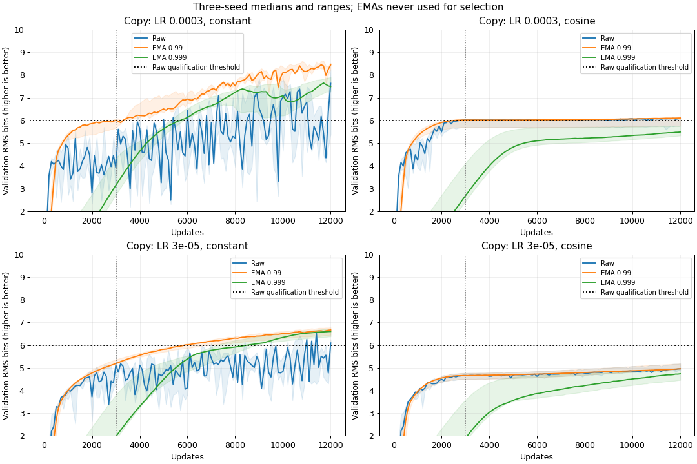
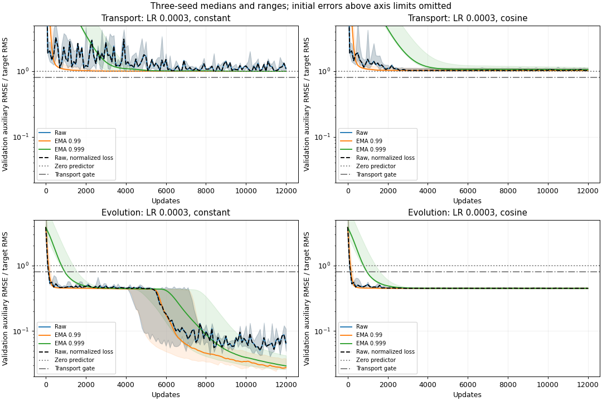

<!-- SPDX-FileCopyrightText: 2026 Samudra Authors -->
<!-- SPDX-License-Identifier: CC-BY-4.0 -->

# Learning-rate and EMA qualification results

All 36 qualification runs completed 12,000 updates on L40S GPUs. Weight averaging
substantially improved copying precision under constant learning rates. The
predeclared raw-weight qualification gate failed, so no scientific competition
or recovery runs were submitted. Transport remained near the error of predicting
zero even with averaging and normalized loss. The evolved-velocity diagnostic
learned substantially better predictions.

The [protocol](../FOLLOWUP.md) requires a common copying recipe to sustain at least
6 raw RMS bits and a common transport recipe to achieve normalized RMSE below
0.8 in all three seeds over their final three validation evaluations. Selection
uses the minimum copying bits or maximum transport normalized RMSE across all
nine seed/checkpoint combinations at updates 11,800/11,900/12,000, with no test or
EMA selection.
The selected copying recipe, LR 3e-4 with cosine decay, scored 5.750 bits in its
worst seed. The selected transport recipe, cosine decay with normalized loss,
scored 1.134 normalized RMSE. Both requirements failed. The machine-readable
[decision](competition.decision.json) and [empty competition manifest](competition.json)
preserve this outcome.

Copying predicts the input temperature value through a shared transformer and a
scalar output head. Auxiliary-only runs train a separate head for either a smooth
transport term or an evolved velocity field, with main-loss coefficient zero.
Transport predicts `g(S,u) = -P_4 d(S*u)/dx / 4`, where x is the periodic
spatial coordinate and `P_4` retains Fourier modes through 4. Evolved velocity
predicts `roll(v,-1) + 0.1*g(v,v)`, a one-grid-cell periodic shift plus a transport
term; no physical time interval is assigned to this manufactured map. T, S, u and
v are independent random Fourier fields. Every model receives all four fields
and the spatial query position. All tasks use the same base model: width 128, four blocks, two
heads, and 822,914 parameters. Each run sees 768,000 fresh examples. Constant
schedules warm up for 100 updates; cosine schedules reach LR 3e-7 at update 3,000
and hold it through 12,000. EMA weights with decays 0.99 and 0.999 are observational
averages updated after each step and do not change raw training.

Effective RMS bits are `-log2(RMSE / 0.1292985189)`; the denominator is the
analytic temperature standard deviation, and higher bits are better. Auxiliary
normalized RMSE divides physical-unit RMSE by target RMS on the corresponding
validation or test sample; predicting zero scores one. Training-loss normalization
uses a separate 8,192-example calibration sample, fixed across runs. Unless a value is identified as a count, budget or worst-seed
gate statistic, the tables give median [minimum, maximum] across seeds 11/22/33.
These observed seed ranges are not confidence intervals. Validation uses 1,024
fixed examples; final test uses 8,192 independent examples. No test-selected
checkpoint or EMA is reported as the winner.

| Copy recipe | Raw validation bits, 3,000 updates | Raw validation bits, 12,000 updates | EMA 0.99 validation bits, 12,000 | EMA 0.999 validation bits, 12,000 |
| --- | --- | --- | --- | --- |
| LR 3e-4, constant | 3.91 [2.68, 4.40] | 7.63 [5.40, 8.21] | 8.44 [8.25, 8.55] | 7.49 [7.30, 7.90] |
| LR 3e-4, cosine | 6.02 [5.69, 6.05] | 6.08 [5.76, 6.13] | 6.10 [5.76, 6.13] | 5.49 [5.33, 5.75] |
| LR 3e-5, constant | 5.12 [4.29, 5.30] | 6.09 [5.77, 6.25] | 6.67 [6.45, 6.78] | 6.60 [6.38, 6.72] |
| LR 3e-5, cosine | 4.66 [4.51, 4.77] | 4.96 [4.89, 5.19] | 4.96 [4.94, 5.19] | 4.74 [4.46, 4.90] |

The final checkpoint alone gives a different impression from the stability gate.
For LR 3e-4 constant, the minimum raw precision over all seeds and the last three
validation checkpoints was only 4.15 bits, despite its final median of 7.63.
EMA 0.99 raised this stability statistic to 7.60 bits, and EMA 0.999 to 7.25.
For LR 3e-5 constant, these three statistics were 4.31, 6.43 and 6.36 bits.
EMA would therefore change copying qualification, but transport would still fail
and the overall qualification decision would remain unchanged. EMA selection was
excluded by the protocol. Cosine decay stabilized the raw LR-3e-4 run near six bits while
leaving one seed below the threshold. Smaller initial LR plus early cosine decay
produced lower precision in this budget.

Final independent-test precision for LR 3e-4 constant was 7.69 [5.39, 8.25] raw
bits, 8.50 [8.40, 8.51] with EMA 0.99, and 7.55 [7.31, 7.97] with EMA 0.999.
The stronger averaging window was not uniformly better. The raw learning-curve
fluctuations and EMA improvement support optimization variability as a contributor
to the first wave's copying error. They do not identify gradient noise as the sole
cause or establish a precision floor. No architecture or arithmetic change was
needed to obtain the higher EMA precision.

A scalar bias correction fitted on final validation and applied to the independent
test set raised the LR-3e-4 constant raw result to 8.27 [5.88, 8.41] bits. The
lowest-precision seed remained well below every EMA-0.99 seed after correction.
Thus subtracting a single output offset did not reproduce the EMA improvement.
For the selected cosine recipe, squared bias accounted for only 0.19–2.31% of
final raw test MSE, and bias correction changed the median from 6.117 to 6.123 bits.
Bias-corrected test metrics are diagnostics; uncorrected results remain primary.

| Auxiliary, original physical-unit MSE | Raw test normalized RMSE | EMA 0.99 | EMA 0.999 |
| --- | --- | --- | --- |
| Transport, constant LR 3e-4 | 1.086 [1.012, 1.134] | 1.0002 [1.0002, 1.0004] | 1.0001 [1.0000, 1.0001] |
| Transport, cosine LR 3e-4 | 1.024 [1.010, 1.084] | 1.022 [1.009, 1.078] | 1.045 [1.010, 1.125] |
| Evolved velocity, constant LR 3e-4 | 0.068 [0.050, 0.107] | 0.029 [0.029, 0.041] | 0.032 [0.028, 0.046] |
| Evolved velocity, cosine LR 3e-4 | 0.456 [0.449, 0.457] | 0.455 [0.448, 0.456] | 0.455 [0.448, 0.456] |

Normalizing auxiliary losses by calibrated target mean square left their measured
standalone errors almost unchanged. The selected normalized cosine transport
recipe had a worst-window score of 1.133780, versus 1.133801 without normalization;
this small difference determined the predeclared selection but does not show a
useful gain. Under constant LR, EMA reduced the transport error to approximately
the zero-prediction baseline. It did not meet the 0.8 skill threshold. Normalized
and original-loss results, raw and both EMAs, are retained in
[conditions.csv](conditions.csv). The evolved-velocity target was diagnostic and
was not substituted for transport after seeing these results.

For the selected copying recipe, saved 4-bit threshold-crossing checkpoints were at updates
1,800/600/700 for seeds 11/22/33, with actual raw precision 5.52/4.67/4.58 bits.
Seeds 22 and 33 also saved 6-bit checkpoints at update 3,000, with 6.019/6.050 bits;
seed 11 never saved a 6-bit checkpoint. No selected seed saved an 8-bit checkpoint.
A saved threshold checkpoint is the third consecutive passing validation, so its
actual precision can exceed its threshold label. All 17 saved precision checkpoints
across copying recipes were checked against the first such crossing. Their actual steps, precision,
and checkpoint hashes are in [milestones.csv](milestones.csv). None was used for a
scientific continuation because the qualification gate failed. There are no new
joint-training bits-lost or on/off recovery measurements from this follow-up.

Raw copying and transport both failed qualification. Transport remains an
unresolved control even when EMA makes copying adequate: the experiment still
lacks a useful second task for the specified matched-dependence comparison. EMA improves the readout of the
copying model, but changing the gate to EMA or replacing transport would require
a new experiment decision. This run supplies no evidence about precision lost to
newly introduced competition or its recovery.

The smoke job, 22290958, checked three short GPU cases, including normalized loss
and a checkpoint fork. All raw and EMA metrics were finite; peak allocated GPU
memory was 0.404 GiB. Qualification array 22290960 completed all 36 tasks with
exit 0:0 and no restarts. Every full run reached 12,000 updates before its
900-second measured-training cap. The array used 2,455.666 measured training
seconds (0.6821 GPU-hours); smoke added 0.805 measured seconds. Allocated GPU time
including smoke, validation, test and startup was 3,772 seconds (1.0478 GPU-hours).
CPU completion job 22291018 used no GPU. No infrastructure retry or extra wave
was submitted. All devices were NVIDIA L40S.

Training source was pinned to `ae60e6ee394b70749c14732f94d69d2891d05d12` and the
qualification manifest hash was
`4fc3848ed0773f8e0b99b81ab97cc8f5015930a28f40f801e2ff7205434dd428`.
The [submission receipt](../FOLLOWUP.md) identifies the immutable code archive,
container and run root. [Scheduler accounting](sacct.psv) and
[verification.csv](verification.csv) preserve per-run receipts. All 36 latest
checkpoints were loaded; raw and both EMA tensors were finite. Configurations,
source hashes, device type, array indices, steps and complete histories matched.
Weights, Adam and RNG state remain on Torch. The competition manifest generator
ran from the pinned source on CPU and selected only raw validation measurements.

[runs.csv](runs.csv) contains per-seed raw/EMA test metrics;
[conditions.csv](conditions.csv) contains all recipes at validation updates 3,000
and 12,000 and final test; [curves.csv.gz](curves.csv.gz) contains complete plotted
trajectories. [records.json.gz](records.json.gz) preserves full configurations,
raw/EMA histories, weighted gradient probes, spectra and provenance. Artifact
hashes are in [SHA256SUMS](SHA256SUMS). All 16 focused CPU tests and applicable
pre-commit checks passed. Tests cover unchanged raw training with EMA, exact
resume/fork state, parent-hash rejection, loss scaling, schedules and validation-only
selection. Figures and the standalone report received visual and cold-reader checks. Reproduce the exports and plots from the
compact records with
`python -m experiments.precision_competition.followup_report --output experiments/precision_competition/followup_results`.
