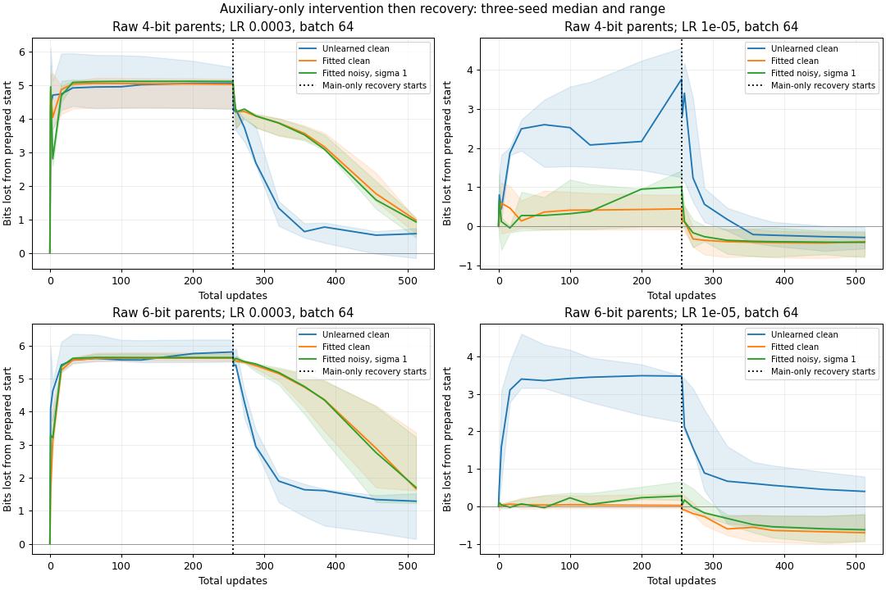
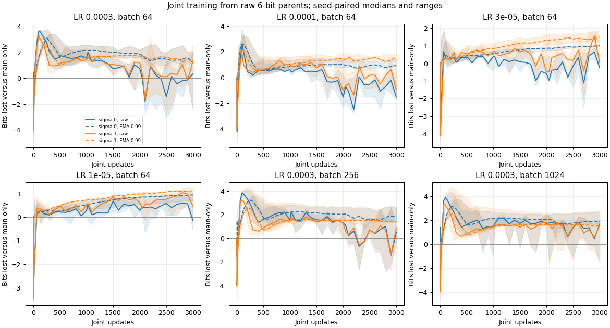
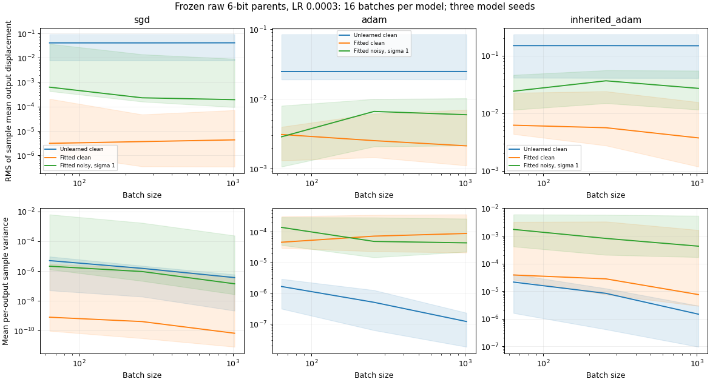

<!-- SPDX-FileCopyrightText: 2026 Samudra Authors -->
<!-- SPDX-License-Identifier: CC-BY-4.0 -->

# Auxiliary noise, learning rate, and preservation of copying

All 60 GPU bundles completed: six preparations, 36 perturbation bundles and 18
joint-training bundles. Auxiliary-only updates caused large copying errors at LR
3e-4 even when the auxiliary head already predicted its clean target accurately.
Reducing LR to 1e-5 largely preserved copying for that fitted target. Label noise
increased frozen-update variance, but the accumulated copying penalty did not
follow a simple inverse-batch rule. In joint training, raw final-checkpoint
comparisons remained variable; EMA 0.99 showed a copying penalty in every seed
and setting, including clean auxiliary targets. EMA 0.999 gave different results
at the largest LR. These are finite optimization effects in this specific model;
they do not establish an error floor or a universal cost law for regression.

The auxiliary target is `0.1 - S` at the query position. S is independent of the
copied temperature T and has the same distribution. Both fields are available in
the query and context. Added label noise is independent Gaussian noise, absent
from the inputs, with standard deviation sigma times the temperature standard
deviation `s = 0.1292985189`. All auxiliary accuracy measurements use the clean
target. Normalized auxiliary RMSE divides by s; the constant predictor 0.1 has
population normalized RMSE one. Both task losses are divided by s squared.
The architecture is the original width-128, four-block point-query transformer;
this is not a real-ocean or full Skyline forecast. T and S are periodic fields
on 128 positions, with independent uniform[-1,1] sine/cosine coefficients at
modes 1–4 and 12–15; fine-mode amplitudes are one eighth of coarse amplitudes.
Context tokens contain T, S, two independent velocity-like fields and position.
Two query tokens contain those same four local values and position at a uniformly
sampled query location. The copy head predicts T at that location. The exact
generator and amplitudes are in [benchmark.py](../benchmark.py).

A GPU bundle is one seed/precision/LR/batch setting containing several trajectories.
Each perturbation bundle has seven conditions: original unlearned auxiliary head,
fitted clean head, fitted head with sigma 0.1/0.3/1, main-only, and fitted clean
with a constant loss offset. Each joint bundle has main-only, fitted clean joint,
and fitted sigma-1 joint conditions. The unlearned head is the original parent
head, which received no auxiliary-loss training.

Copy precision is `-log2(RMSE/s)`. Loss from the start is starting bits minus current
bits. The matched-control penalty is main-only bits minus intervention bits at the
same update and weight view; positive values mean worse copying. A weight view
is either current parameters (raw) or an exponential moving average (EMA). Both
EMAs start at the prepared parameters; after every update,
`EMA = decay * EMA + (1 - decay) * current_parameters`. These quantities
are different: an intervention can preserve its initial accuracy while missing
improvements achieved by the main-only control. Numerical summaries below give
median [minimum, maximum] across model seeds 11/22/33, unless explicitly identified
as single-seed values, counts, budgets or probe medians. Seed ranges are not
confidence intervals. Full curves retain all seeds and both EMAs.

All six auxiliary linear-head fits passed the predeclared 0.2 normalized-RMSE gate.
The backbone and copy-head tensors remained identical to their source checkpoint.
Head fitting used 4,096 separate examples; the following measurements use a new
1,024-example validation set. Threshold labels name the source checkpoints,
whose actual precision differs from the label.

| Seed / threshold label | Parent training update | Copy bits | Fitted auxiliary normalized RMSE | Fitted head weight norm |
| --- | ---: | ---: | ---: | ---: |
| 11 / 4 bits | 1,800 | 4.82 | 0.0269 | 3.45 |
| 22 / 4 bits | 600 | 4.76 | 0.0195 | 2.69 |
| 33 / 4 bits | 500 | 4.18 | 0.0166 | 2.04 |
| 11 / 6 bits | 6,200 | 6.15 | 0.0370 | 10.88 |
| 22 / 6 bits | 5,600 | 6.57 | 0.0178 | 5.06 |
| 33 / 6 bits | 7,400 | 6.91 | 0.0127 | 4.56 |

Original auxiliary-head weight norms were 0.56–0.59; fitted norms were 3.5–19.4
times larger, and fitted bias magnitudes reached 14.61. Therefore fitted versus
unlearned comparisons also change how the head transmits gradients into the
backbone. Clean versus noisy fitted conditions share the same fitted head and
avoid that particular difference. The 4- and 6-bit source models also differ in
training history; they are not an isolated intervention on precision alone. No
comparable three-seed raw 8-bit starting set was available.

Perturbation trajectories use fresh Adam, 256 auxiliary-only updates, then 256
main-only recovery updates while retaining optimizer moments and EMAs. Their
main-only controls receive 512 uninterrupted main updates. Removing the main loss
is deliberate here; this stage measures displacement and recovery, while the
later joint stage retains both losses. Copy loss is `mean((prediction-T)^2)/s^2`;
auxiliary loss is `mean((prediction-(0.1-S+noise))^2)/s^2`. Joint training adds
them with equal weight. Auxiliary-only updates train the shared transformer and
auxiliary head; recovery/main-only updates train the transformer and copy head;
joint updates train both heads and the transformer. Each condition starts from the same copy
function and paired example/noise streams. Validation uses 256 fixed examples.
The independent 8,192-example test is evaluated only after recovery, so the
unrecovered results below are validation measurements.

| LR, batch 64, 6-bit parents | Unlearned clean: bits lost from start at 256 | Fitted clean | Fitted sigma 1 |
| --- | --- | --- | --- |
| 3e-4 | 5.81 [5.51, 6.18] | 5.62 [5.54, 5.79] | 5.64 [5.63, 5.75] |
| 1e-4 | 4.84 [3.77, 4.95] | 3.80 [3.69, 4.27] | 3.84 [3.72, 4.24] |
| 3e-5 | 4.10 [3.02, 4.40] | 1.18 [1.14, 1.97] | 1.45 [1.43, 2.21] |
| 1e-5 | 3.47 [2.24, 3.48] | 0.03 [-0.04, 0.34] | 0.28 [0.17, 0.67] |

At LR 1e-5 the fitted-clean model lost only 0.03 median bits from its start, but
its median penalty against the improving main-only control was 0.89 bits.
For LR 3e-4, fitted-clean and sigma-1 control penalties were 4.76 and 4.78 bits at
256 updates. After 256 recovery updates those penalties fell to 1.68 and 1.31;
at LR 1e-5 they fell to 0.28 and 0.29. Recovery reduced damage but did not generally
catch the continuously trained control within this budget. EMA trajectories are
saved separately; the 1,000-update averaging horizon of EMA 0.999 is long relative
to each 256-update phase.

At LR 3e-4 and 256 updates, increasing batch from 64 to 256 to 1,024 did not
reduce the fitted-clean median control penalty: 4.76, 4.89 and 4.96 bits.
The [LR/batch figure](lr-and-batch.png) uses equal updates. Equal examples give
a different comparison: at 16,384 examples, these batches have taken 256/64/16
updates, and fitted-clean control penalties were 4.76/3.36/-0.60 bits.
These [matched-exposure results](matched-exposure.png) do not isolate variance
reduction from the number of optimizer steps. A negative early control penalty
also need not mean improvement over the starting model: fresh-Adam main-only
updates can themselves temporarily reduce precision.

Auxiliary accuracy differs substantially across these trajectories. For the
6-bit parents at batch 64, unlearned-clean median normalized RMSE after 256
updates was 0.078 at LR 3e-4 and 0.803 at LR 1e-5. Fitted-clean values were
0.245 and 0.018; fitted sigma-1 values were 0.242 and 0.248. The
[clean auxiliary learning curves](auxiliary-learning.png) therefore accompany
copy damage. An exploratory accuracy match uses the first observed point in
fixed bands of target normalized RMSE ±10%, without interpolation. At the 0.1
band, LR 3e-5 and batch 64, only seed 22 overlaps between unlearned and fitted
clean: both reach about 0.109, at updates 256 and 64, with control penalties
4.67 and 1.37 bits respectively. This is one seed at different budgets and with
different heads, not a three-seed causal estimate. [All observed matches](matched-auxiliary.csv)
retain the achieved errors, steps and missing coverage.

All three 6-bit preparations qualified, so the complete predeclared 18-bundle
joint subset ran; no effect size was used to select it. Joint runs start anew
from the prepared model with fresh Adam and EMA, retaining both losses for 3,000
updates. The following penalties use the final independent test set, with the
same weight view used for the intervention and its main-only control.

| LR / batch | Raw clean joint | Raw sigma-1 joint | EMA 0.99 clean joint | EMA 0.99 sigma-1 joint |
| --- | --- | --- | --- | --- |
| 3e-4 / 64 | 0.39 [-2.54, 1.98] | 1.34 [-2.38, 2.56] | 1.56 [1.15, 2.11] | 1.70 [1.29, 2.08] |
| 1e-4 / 64 | -1.54 [-2.06, -0.56] | -0.93 [-1.50, 0.56] | 1.03 [0.81, 1.18] | 1.60 [1.60, 1.76] |
| 3e-5 / 64 | -0.33 [-0.40, 0.08] | 0.06 [-0.10, 0.80] | 0.82 [0.80, 1.09] | 1.49 [1.47, 1.59] |
| 1e-5 / 64 | -0.28 [-0.80, 0.85] | 0.23 [-0.41, 1.03] | 0.76 [0.58, 1.00] | 1.03 [0.98, 1.11] |
| 3e-4 / 256 | 0.64 [-0.70, 0.84] | 0.64 [-0.54, 1.17] | 1.72 [1.61, 2.63] | 1.58 [1.35, 2.62] |
| 3e-4 / 1,024 | 1.50 [-1.42, 1.72] | 1.44 [-1.54, 1.82] | 1.78 [1.77, 2.66] | 1.66 [1.31, 2.74] |

EMA 0.999 is not interchangeable with EMA 0.99. At LR 3e-4, batch 64, its clean
and noisy penalties were -0.33 [-1.14, 1.48] and -0.26 [-1.08, 1.32] bits;
at LR 1e-5 they were 0.62 [0.43, 0.80] and 0.79 [0.75, 0.87]. Both EMAs were
predeclared and neither was used for run selection. [Test summaries](test-summary.csv)
include every view. The additional sigma-1 penalty against clean joint training
with EMA 0.99 was 0.67 [0.40, 0.77] bits at LR 3e-5, batch 64, but
-0.12 [-0.46, 0.09] at LR 3e-4, batch 1,024. Noise does not have one consistent
penalty across these settings. Joint EMA-0.99 clean auxiliary normalized RMSE
medians were 0.015–0.018 and noisy medians 0.018–0.041 across the six settings;
the auxiliary accurately predicted its clean target in both cases.

Matched joint exposure is also retained at 65,536 and 131,072 examples. At the
latter budget and LR 3e-4, raw clean-joint control penalties were -0.02/1.63/3.74
bits for batches 64/256/1,024, corresponding to 2,048/512/128 updates.
Thus the apparent batch ranking depends on which budget is held fixed. No
convergence or asymptotic batch-scaling claim follows from either endpoint.

Frozen probes restore the same prepared checkpoint before each of 16 independent
batch updates and evaluate copy displacement on 64 fixed held-out inputs. SGD,
fresh Adam and inherited Adam are separate diagnostics. The reported mean is
RMS of the sample-mean displacement vector; variance is the mean per-output
unbiased sample variance. Its estimate has only 16 batches per model, and the
three model seeds have broad ranges. Displacement is the updated copy prediction
minus its starting prediction, in unnormalized field units. Mean displacement RMS
has field units; variance and MSE change have squared field units.

For fitted 6-bit models, LR 3e-4 and batch 64, median displacement variance was
7.86e-10 with clean SGD and 2.12e-6 with sigma-1 SGD. Fresh-Adam values were
4.55e-5 and 1.38e-4 respectively. At batch 1,024, sigma-1 variances fell to
1.39e-7 for SGD and 4.34e-5 for fresh Adam. Clean fresh-Adam variance instead
increased to 8.77e-5 in this small probe sample. Increasing batch did not uniformly
reduce finite-update output variance for every optimizer/condition.
Inherited-Adam zero-gradient coasting displaced copy outputs by median RMS
0.00141 at LR 3e-4; fresh Adam and SGD coasting gave zero. This confirms why
inherited moments were excluded from the primary trajectories.

Copy-MSE change is computed from finite displacement as twice starting error
(starting prediction minus target) times displacement, plus squared displacement,
averaged over batches and held-out outputs. This algebra uses no linearized-network
assumption. Recomputing it from saved vectors reproduced the recorded summaries;
it is a consistency check, not an independent measurement of the same quantity. Squared RMS of the sample mean contains a finite-sample
variance contribution; [probes.csv](probes.csv) also records the diagnostic
estimate `squared sample mean - sample variance / 16`, which can be negative.
Very small clean-SGD effects should not be treated as exact zeros or numerical
floors. The probe vectors, rather than a gradient-cosine surrogate, are retained
for further uncertainty analysis.

The constant-loss-offset trajectory adds one to the differentiated loss scalar.
Its copy-RMSE trajectory differed from clean fitting by at most 4.27e-8 across
all 36 bundles. It was not bitwise identical on GPU: maximum final parameter
difference was 2.03e-5, while paired data/noise RNG states were identical. These
observed discrepancies are small relative to the copying effects above. The
frozen probes labeled offset reuse the clean update; the actual nonzero-offset
negative control is exercised by the full trajectories.

These results distinguish auxiliary learning, label noise, finite optimizer
updates and stale optimizer moments. They do not isolate a fundamental regression
precision cost from optimizer choice, head conditioning or training history. The
raw/EMA differences and the substantial fitted-head norms remain material limits
on transfer to a full transformer field predictor. No new targets, capacities,
dependent tasks, tolerance losses or ocean-model runs were added.

All 60 GPU allocations and both CPU callbacks completed with exit 0:0 and zero
Slurm restarts. GPU allocation was 9,238 seconds (2.5661 hours), including frozen
probes, head preparation, evaluation and startup. Measured trajectory training was
7,100.315 seconds (1.9723 hours), excluding preparation and frozen probes. Every
perturbation trajectory reached 256+256 updates and every joint trajectory reached
3,000. No 30-minute allocation limit was reached; no retry was submitted. All
GPUs were L40S. Training source was pinned to
`144d593554af0839f399992b54583bed7312dc25`.

[Scheduler accounting](sacct.psv), [joint submission](joint-submission.txt), the
[filtered joint manifest](joint-manifest.json), and preparation/perturbation/joint
verification CSVs preserve the execution receipts. All 306 trajectory checkpoints
were loaded and checked for finite raw/EMA tensors, complete histories and exact
endpoints. Prepared source hashes, unchanged copy tensors and inherited Adam
moments were verified. Joint starting validation metrics were identical across
its three conditions. Full weights remain on Torch; compact JSON archives are
partitioned by stage, precision label and seed, with per-run provenance included.

[Trajectory data](trajectories.csv.gz) and [summaries](trajectory-summary.csv.gz)
retain absolute loss and matched-control penalties; [matched examples](matched-examples.csv.gz)
retain exact common exposure points. [Test endpoints](test-endpoints.csv) label
post-recovery versus joint tests. The [protocol and submission record](../NOISE.md)
define all fixed comparisons. Reproduce exports and plots with
`python -m experiments.precision_competition.noise_report --output experiments/precision_competition/noise_results`.
Artifact hashes are in [SHA256SUMS](SHA256SUMS). All 26 focused CPU tests and
applicable pre-commit checks passed; the four added tests protect paired budgets,
weight-view comparisons, seed aggregation and the finite-displacement identity.
