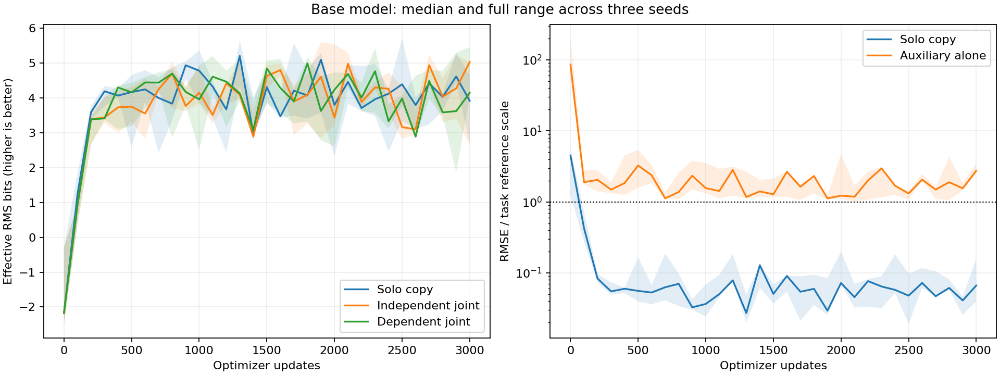
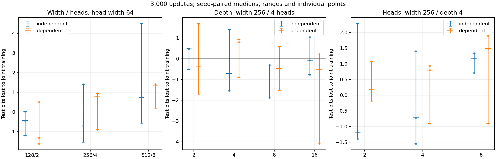
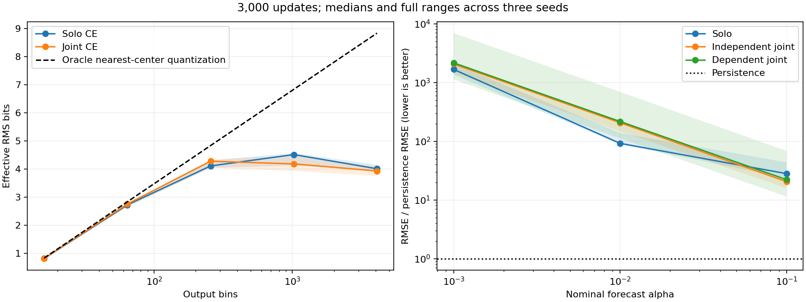

<!-- SPDX-FileCopyrightText: 2026 Samudra Authors -->
<!-- SPDX-License-Identifier: CC-BY-4.0 -->

# First-wave results, November 8, 2026

All 222 trained runs and the direct-wire control completed. The clearest evidence for precision competition
comes from the near-persistence forecast: at nominal change coefficient 0.01,
adding an independently generated velocity task increased main-output RMSE in all
three seeds, by a median 0.68 bits (1.60 times the RMSE). The base copying experiment
showed a median improvement under joint training. This screen does not establish
that competing tasks generally displace precision, or that additional parameters
reduce that effect.

There is a major limitation in the copy comparisons. Their auxiliary task predicts
a small, smooth transport term, and every trained transport auxiliary was worse
than predicting zero at the final checkpoint. Its standalone normalized RMSE was
2.86 [2.62, 3.58]. The forecast auxiliary predicts an evolved velocity field and
reached normalized RMSE 0.48 [0.46, 0.49] in the independent condition. Thus the
forecast comparison supplies evidence involving a useful learned auxiliary. The
transport comparisons cannot establish the proposed mechanism of an easier task
outcompeting precision.

Unless identified as a count, total or single-control measurement, performance
summaries give the median [minimum, maximum] across seeds 11/22/33.
Effective RMS bits are `-log2(RMSE / 0.1292985189)` for every main task.
Auxiliary normalized RMSE divides by that auxiliary target's measured test RMS;
one is the error of predicting zero. Bits lost are calculated within each seed as `log2(RMSE_joint / RMSE_solo)`, then
aggregated. Positive values mean worse precision; one bit means twice the RMSE.
All trained arms reached exactly 3,000 optimizer updates and 192,000 fresh examples.
Tables use final test RMSE on 8,192 examples, with no checkpoint selection. Separate
validation curves use 1,024 examples every 100 updates. Ranges describe these three
seeds and are not confidence intervals. These are empirical RMS measurements, not
worst-case bounds.

| Main task and condition | Independent joint: bits lost | Dependent joint: bits lost |
| --- | --- | --- |
| Copy, width 128 / depth 4 / 2 heads | -0.44 [-1.19, 0.02] | -1.32 [-1.62, 0.50] |
| Affine transformation of temperature | -0.50 [-0.54, 2.45] | 1.00 [-0.86, 1.00] |
| Nonlinear transformation of temperature | -0.48 [-1.17, 0.44] | -0.73 [-0.98, 0.09] |
| Forecast, alpha 0.1 | -0.58 [-0.93, -0.45] | -0.98 [-1.06, 1.29] |
| Forecast, alpha 0.01 | 0.68 [0.63, 1.22] | 0.65 [0.29, 2.96] |
| Forecast, alpha 0.001 | 0.11 [0.02, 0.31] | 0.05 [-0.27, 2.05] |

For copying and transformations, the independent auxiliary is `g(S,u)` and the
dependent auxiliary is `g(T,u)`, with independent, identically distributed T and S.
For forecasting, the main target is always `T + alpha*g(T,u)`; the auxiliary is `F(v)` or `F(u)`, with
`F(w) = roll(w,-1) + 0.1*g(w,w)`. Only the second shares velocity u with the main
target; u and v have identical independent distributions. Here `g` differentiates a product
and retains Fourier modes 1–4. All arms receive all four fields. The
[protocol](../README.md) defines the manufactured fields and matched controls.

Copying did not consistently have a larger joint-training penalty than the two
simple calculations. Dependence did not have a consistent direction: the paired
dependent-minus-independent penalty for base copying was -0.43 [-1.33, 0.94]
bits, and for the alpha-0.01 forecast it was 0.02 [-0.39, 1.74]. These observed seed ranges
are too broad to claim a negligible dependence effect. They also do not support a
claim that dependence is systematically worse in this experiment.

The base solo copy reached 3.93 [2.67, 4.64] effective RMS bits relative to the
source temperature standard deviation, 0.12930. Its final squared bias accounted
for 81–99% of its MSE across seeds. Validation precision fluctuated after the
initial improvement. For example, the median independent-joint validation penalty
was 0.04 bits at update 1,000, -0.90 at 2,000, and -0.37 at 3,000. Fixed-step
comparisons therefore depend on the selected budget even without selecting a
checkpoint for favorable results. The learning curves do not support a monotone precision-cost law. In the nine
base independent-joint Adam probes at updates 1,000/2,000/3,000 across three seeds,
adding the auxiliary reduced held-out main MSE in five and increased it in four.
These probes compare single updates from identical optimizer states, not
cumulative explanations of training behavior. Across the 222 trained arms, 173
sustained 4 main-output bits for three consecutive validation measurements; none sustained
8, 12, 16 or 20 bits. Those higher thresholds remain unreached within this budget.
They are not demonstrated error floors.

| Copy architecture | Parameters | Independent joint: bits lost | Dependent joint: bits lost |
| --- | ---: | --- | --- |
| Width 128, 2 heads of width 64, 4 blocks | 822,914 | -0.44 [-1.19, 0.02] | -1.32 [-1.62, 0.50] |
| Width 256, 4 heads of width 64, 4 blocks | 3,283,202 | -0.72 [-1.55, 1.40] | 0.79 [-0.90, 0.94] |
| Width 512, 8 heads of width 64, 4 blocks | 13,122,050 | 0.73 [-0.57, 4.50] | 1.36 [0.19, 1.42] |

Increasing width with fixed head width did not consistently reduce degradation;
the largest model had worse median penalties. Depth at fixed width also had no
monotone relation to the penalty. Repartitioning width 256 into 2/4/8 heads keeps
parameter count fixed and gave independent-joint median penalties -1.19/-0.72/1.17
bits. These are outcomes of one constant-learning-rate recipe and a fixed update
budget. They do not isolate capacity from optimization or compare equal FLOPs.

Every forecast arm lost to persistence. At alpha 0.1, 0.01 and 0.001, the median
independent-joint RMSE was respectively 20.6, 207 and 2,066 times persistence RMSE;
solo ratios were 28.1, 92.0 and 1,669. The measured persistence errors were only
about 0.335%, 0.0335% and 0.00335% of the temperature scale. These small increments
explain why several bits of state accuracy can still yield poor forecast skill.
The auxiliary velocity error was approximately unchanged across these three
alphas. The alpha-0.01 joint penalty with a learned velocity auxiliary is compatible with
competition for shared weights. Its cause is not isolated by these measurements.
Poor solo forecast skill and the fluctuating copy baseline limit transfer to
Skyline, the ocean forecasting model whose nearly persistent output fields
motivated this experiment. No standalone evolved-velocity arm was run, so its
learning cost cannot be compared directly with standalone precision cost.

| CE output bins | Solo RMS bits | Independent joint: bits lost | Solo classification accuracy, median |
| --- | --- | --- | ---: |
| 16 | 0.82 [0.82, 0.83] | -0.004 [-0.010, -0.001] | 96.6% |
| 64 | 2.73 [2.67, 2.77] | -0.010 [-0.031, 0.032] | 90.8% |
| 256 | 4.12 [4.04, 4.31] | -0.022 [-0.168, -0.012] | 70.4% |
| 1,024 | 4.52 [4.14, 4.58] | 0.022 [-0.054, 0.634] | 43.0% |
| 4,096 | 4.02 [3.97, 4.16] | 0.080 [0.065, 0.205] | 12.7% |

The coarse categorical outputs were near their quantization limits and had small
joint penalties. Increasing bins beyond 1,024 did not improve continuous accuracy
at this budget. The oracle nearest-center RMSE at 4,096 bins was 0.000282, while
the learned solo median was 0.00799. CE uses argmax bin centers here; continuous
probability-weighted means, NLL and Brier scores are also saved. The classification
head grows with bin count, loss gradient scales are not matched, and the transport
auxiliary remains unskilled. These results do not establish why language models
behave differently. At 256 bins under independent joint training, bin-center MSE had a 0.86 [-0.21, 0.87] bit
penalty, while tolerance loss had -0.08 [-0.59, 0.15]; target coarsening and loss
formulation warrant separate treatment.

FP32/FP64/BF16 solo copy medians were 3.93/4.89/3.06 bits. Their independent-joint
penalties were -0.44/-0.23/-0.97 bits, with overlapping, broad seed ranges. Higher
arithmetic precision did not make this optimizer reliably learn high-precision
copying. This is a retraining comparison, not a same-checkpoint numerical test.
The direct wire achieved 25.23 bits with RMSE 3.29e-9: it copies the FP32 input
exactly, but the metric compares against an FP64 reference. The label "exact wire"
therefore does not mean zero error against that reference.

Removing current temperature from the query reduced solo copy precision to
3.15 [3.10, 3.31] bits. A physical residual skip increased it to 6.43 [5.12, 6.77],
but independent joint training lost 1.96 [0.76, 2.06] bits. The residual head is learned and
can add error to the exact skip. The filter-before and coarse-velocity controls
are retained in [conditions.csv](conditions.csv); the coarse-only velocity control had an independent-joint median penalty of
1.34 bits, versus -0.44 with fine velocity present. That comparison does not show
the larger penalty with fine velocity that the hypothesis predicts. Filtering
velocity before multiplication gave -0.03 bits, versus -0.44 after multiplication;
these small median differences have broad seed ranges. The main-error high-frequency RMS on eight assembled fields was
0.00130 [0.00112, 0.00131] for solo copy and 0.00135 [0.00119, 0.00172] for
independent joint copy, with frequencies above mode 4 counted as high.
The filtered-product task was not learned well enough to attribute the result to the usefulness of its
high-frequency input. This wave did not run the proposed full block-placement
comparison or a real Skyline forecast.

The most useful next comparison would first establish stable solo precision and
auxiliary skill with an explicitly budgeted optimizer check, then repeat the
matched joint arms. The present run does not justify an exponential law, an
arithmetic error floor, negligible task dependence, or guaranteed relief from more
parameters. No continuation was submitted.

The array used 3.404 allocated GPU-hours; qualification added 0.0064, for 3.411 total.
Measured training was 1.902 GPU-hours, with 6.33–174.39 seconds per trained arm.
All arms stopped at the update limit; none hit the 600-second training cap. There
were no failed tasks, preemptions or recovery submissions. Array execution spanned
about 11 hours 10 minutes because launches were quota-limited. GPU counts were
115 L40S, 49 RTX PRO 6000 Blackwell, 31 B200, 14 H100, 12 H200 and 2 A100. Pairs
were not constrained to identical GPU types. Hardware and kernels can affect
floating-point trajectories, and measured seconds are not a clean capacity-cost
comparison. The primary comparisons use equal updates and examples.

The pinned training source is `90ef3a7c011f8bf2c4d2d012f8ce3f8bcb9155cf`.
[Submission receipts](../submission.md) identify the container, immutable archive,
manifest and job IDs. [Scheduler accounting](sacct.psv) contains one allocation row
per task and the qualification/callback jobs. [Verification](verification.csv)
records all 223 source/configuration receipts and checkpoint sizes; each checkpoint
was loaded, checked against its result/history step, and had finite model tensors.
Large weights remain on Torch. [Artifact checksums](SHA256SUMS) cover this compact
report. The stored result source hash matched the staged benchmark for every arm.

[conditions.csv](conditions.csv) contains all 75 condition summaries, including the
single wire. [runs.csv](runs.csv) retains each seed and final test metrics;
[curves.csv](curves.csv) and [bits-lost.csv](bits-lost.csv) retain exact common
validation updates; [thresholds.csv](thresholds.csv) retains unreached thresholds.
[records.json.gz](records.json.gz) preserves configurations, full validation probes,
final metrics, error spectra and per-run provenance. The older `copy-curves.png`
is explicitly a seed-11 illustration; the three figures above use all paired seeds.
The ten focused CPU tests and all applicable pre-commit checks passed after adding
the analysis. Figures were inspected, and manifest/configuration, task indices and
endpoint agreement were checked for every arm. Qualification records omit redundant
configuration IDs, which remain derivable from the full saved configurations.
Reproduce the summaries and figures with
`python -m experiments.precision_competition.analyze --results experiments/precision_competition/results`.
