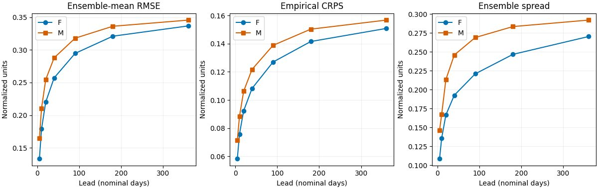
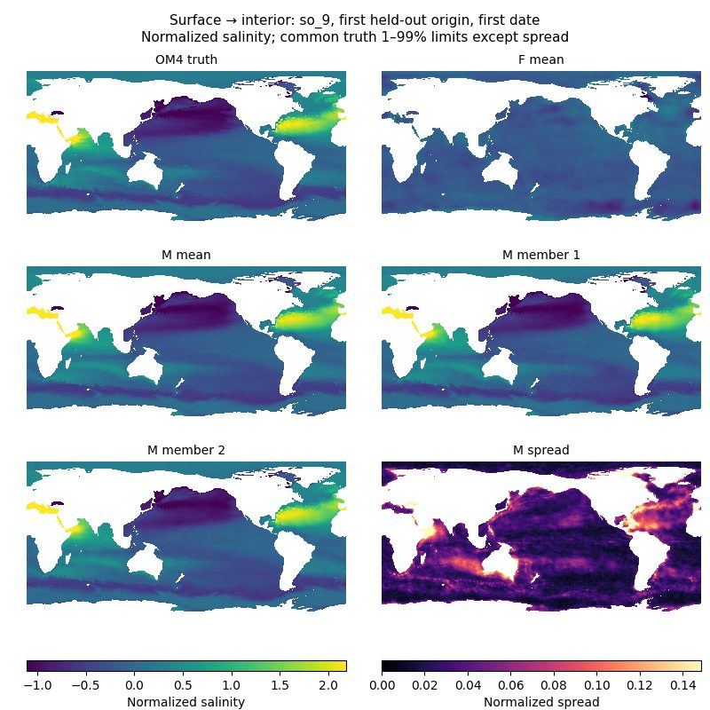
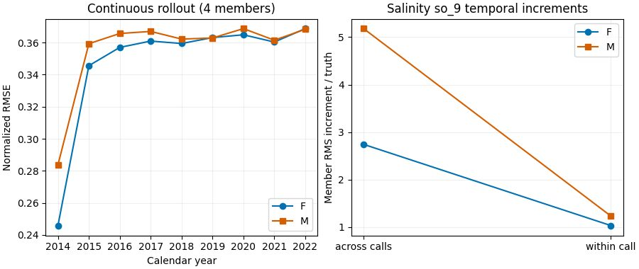

<!--
SPDX-FileCopyrightText: 2026 Samudra Authors
SPDX-License-Identifier: CC-BY-4.0
-->

# Structured multitask C: completion learned, forecasting tradeoff remains

The shared stochastic U-Net learns the three requested completion tasks, but the approved 50% forecast
mixture does **not** preserve the matched forecast-only control's forecast scores. Its larger ensemble
spread also comes with substantially larger salinity jumps between autoregressive calls. This is a useful
multitask baseline, not yet evidence that completion training improves ocean forecasting.

Both arms finished 70 epochs on two Torch RTX PRO 6000 Blackwell GPUs. F is forecast-only; M uses
49.56% forecast / 25.28% surface / 12.42% missing-variable / 12.75% spatial-gap contexts in the realized
training draws. They share initialization, architecture, optimizer recipe, total contexts and calls;
**M sees approximately half as many forecast contexts**. Differences cannot isolate task interference
from reduced forecast exposure. One training seed was run. This is an experiment/results record,
not intended to merge. [Protocol](MULTITASK.md), [execution and recovery record](MULTITASK-RUNS.md).

## Held-out forecasts

Final epoch-70 EMA is primary. Thirty fixed quarterly origins, sixteen members, seven leads and all
77 channels produce 16,170 rows per arm. Metrics first use wet-cell area weighting within each field,
then equal channel/origin weighting. Lower RMSE and CRPS are better; normalized units allow aggregation
across variables. Forcing is OM4 tauuo/tauvo/hfds; no hfds anomalies or future ocean observations are supplied.

| Nominal lead | F RMSE | M RMSE | F empirical CRPS | M empirical CRPS |
| --- | ---: | ---: | ---: | ---: |
| 5 days | 0.13355 | 0.16462 | 0.05841 | 0.07127 |
| 40 days | 0.25715 | 0.28789 | 0.10819 | 0.12174 |
| 180 days | 0.32113 | 0.33635 | 0.14156 | 0.15034 |
| 360 days | 0.33690 | 0.34580 | 0.15085 | 0.15678 |

M is worse at every tested lead. At 360 days this is **+2.64% RMSE and +3.93% CRPS**. Paired
origin-year block bootstrap intervals for M minus F are [0.00722, 0.01042] RMSE and
[0.00542, 0.00647] CRPS (10,000 resamples, 95% descriptive intervals). These capture sampled test-year
variation, not training-seed uncertainty; overlapping annual windows also leave dependence across years.

Validation-selected checkpoints give F epoch 60 and M epoch 70. Their 360-day RMSE is 0.33602 versus
0.34580 and CRPS 0.15018 versus 0.15678: the direction survives checkpoint policy. The historical C
run remains in the [first-wave report](RESULTS.md), but is not a matched control: hardware, rank count,
pointwise-convolution backend and validation policy changed. F is the relevant control here.

M's 360-day spread is 0.29202 versus F's 0.27026. Empirical 5–95% interval coverage is 74.62% versus
73.65%. Do not compare finite-ensemble empirical quantile coverage directly with an ideal continuous
90% interval: order-statistic effects matter with sixteen samples. Wider ensembles alone do not imply
better calibration or better joint spatial/temporal distributions.

## Completion on unseen dates

Each arm completes the same thirty held-out origins and masks, with sixteen samples and no historical
ocean state. These are **same-time conditional reconstruction tasks, not future-interior forecasts**.
Surface completion supplies SSH and top-level temperature at both target dates, requesting other fields.
Variable completion hides one randomly selected whole family; gap completion hides a spatial rectangle.
Only requested wet entries are scored; supplied values are copied exactly and excluded. Each arm has
9,992 scored channel/date/task rows. Average channels/frames within each origin first, then origins:
otherwise the variable task overweights origins hiding a 19-channel family relative to SSH alone.

| Task | F RMSE | M RMSE | F CRPS | M CRPS | M member-range coverage |
| --- | ---: | ---: | ---: | ---: | ---: |
| Surface → interior | 0.99463 | 0.28066 | 0.56568 | 0.12830 | 84.34% |
| Missing variable family | 0.98135 | 0.19064 | 0.62886 | 0.08719 | 84.38% |
| Spatial gap | 1.06550 | 0.33721 | 0.72087 | 0.16323 | 84.24% |

M clearly learned these tasks. **F was never trained on completion masks**: its poor scores measure
unfamiliar-task transfer, not superiority over a trained regression or completion-only probabilistic model.
A dedicated completion baseline is needed for that comparison. M's full member-range coverage is below
the continuous-exchangeable sixteen-member reference 15/17 = 88.24%, indicating residual undercoverage
under this diagnostic. Its empirical 5–95% coverage is about 76% across the three tasks.

This fixed first origin is 2014-10-15, with the first reconstructed date 2014-10-20. It shows normalized
salinity `so_9`; surface SSH/SST are conditioning and are not presented as inferred outputs. Every map
renders the 360×180 grid at exactly one display-image pixel per model cell, without interpolation.
Truth, means and members share truth-based 1–99% color limits; spread has a separate scale. This map is
an illustration, not a spatial-distribution score. Full individual samples are retained in the raw artifacts.

## Continuous rollout: point scores conceal a continuity problem

Each arm also completed 299 two-output calls, 598 frames through 2022-12-24 from the 2014-10-15 origin,
without resetting to truth. Four members are used here, unlike the sixteen-member origin-based evaluation.
All 46,046 score rows per arm and 3,588 bulk rows are finite. Nominal five-day ticks and actual calendar
elapsed days are both retained; this is not a 100-year stability demonstration.

In 2022, channel/date-averaged normalized RMSE is nearly tied: **F 0.36870, M 0.36831**. Empirical CRPS
is F 0.18277, M 0.18341; fair CRPS is F 0.14905, M 0.15095. The near tie after many years does not
reverse M's worse initialized forecasts. Four-member empirical CRPS/coverage should not be compared
numerically with sixteen-member scores without accounting for ensemble size.

For `so_9`, average individual-member RMS temporal increments divided by truth are:

| Transition | F | M |
| --- | ---: | ---: |
| Within a jointly predicted two-date pair | 1.03× | 1.23× |
| Across successive autoregressive calls | 2.74× | 5.18× |

The across-call excess is much larger, and M makes it worse. These are averages of member diagnostics,
not diagnostics of the ensemble mean. The first across-call increment includes initialization-to-first-output.
This pattern is consistent with insufficient temporal coordination of sampled outputs across calls;
it does not by itself identify whether noise injection, the objective, or task allocation is responsible.

A separate bulk diagnostic also warns against interpreting more spread as better physics. Over the whole
trajectory, the temporal standard deviation of the volume-mean temperature proxy is truth 0.00400,
F average member 0.00286 and M average member 0.00522. Ensemble-mean values are 0.00245 and 0.00311.
M goes from F's weak variability to excessive individual-member variability on this proxy. These are full
trajectory standard deviations, including seasonal and slow changes, not detrended interannual variance.
The geometry uses cosine latitude, binary masks and nominal full layer thicknesses: it is an approximate
volume-temperature diagnostic, **not observational heat-content validation**.

## What to test next

Recommended next wave, pending approval:

1. **Lower completion allocation**, e.g. 80% forecast / 10% surface / 5% variable / 5% gap, against the
   existing recipe. Test whether most completion capability can be retained with a smaller forecast cost.
2. **Match forecast exposure explicitly** with a compute-accounted comparison. Doubling the current
   50%-forecast training restores approximate forecast contexts but also doubles updates; pair it with an
   equally extended forecast-only control to separate extra optimization from the task mixture.
3. **Add a task-trained surface-completion baseline** with the same conditioning and budget, comparing
   regression and stochastic scoring. F's unfamiliar-task failure cannot establish generative advantage.
4. **Target across-call continuity** with a narrowly controlled temporal-increment or trajectory score,
   retaining marginal CRPS. Check both within/across-call increments and bulk variability so that smoothing
   away sample variability is not mistaken for success. Persistent/temporally correlated sampling is another
   hypothesis, not yet a demonstrated fix.

Prioritize the smaller task mixture and continuity comparison if the budget permits only two new arms.
Require forecast scores, requested-only completion scores, coverage and temporal diagnostics together;
aggregate forecast RMSE alone would miss the largest issue in this wave.

## Reproduction, artifacts and limits

- [Analyzer](analyze_multitask.py): `uv run python experiments/score-trained-samudra-1deg/analyze_multitask.py
  --artifacts /path/to/downloads`. It reads the original job folder names; default download root is `/tmp`.
- [Forecast summaries](results/multitask-forecast/) include primary and validation-selected channel/origin
  reductions. [Completion, continuous and uncertainty tables](results/multitask/) accompany all plots.
- Full raw outputs remain under `/scratch/jr7309/runs/score-multitask-1deg-20261012/outputs/` on Torch:
  `eval-full-F-19758710`, `eval-full-M-19758711`,
  `eval-secondary-qualification-F-19760788/selected`, `eval-secondary-qualification-M-19760790/selected`,
  `eval-completion-F-19762850`, `eval-completion-M-19762851`,
  `eval-continuous-F-19762854/F`, `eval-continuous-M-19762855/M`.
  These contain raw rows, manifests, resolved configs, maps and calibration artifacts. Large raw tables
  exceed this repository's 250 KB/file limit; committed summaries preserve the reported reductions.
- Training source `a4b90dfdd`; added secondary evaluators source `8150d606e`. Immutable source/config
  snapshots and checkpoint roles are recorded in manifests. The analyzer does not alter checkpoints.
- F training used 46.64 allocated RTX GPU-hours including its interruption; M used 46.27 including its
  failed startup, approximately **92.92 RTX GPU-hours total training**. Qualifications/evaluations are
  additional, itemized in the execution record. F resumed epoch 5 and repeated an interrupted portion of
  epoch 6; resumed RNG/logging and earlier startup failures remain part of provenance.
- The train/validation/held-out split and existing normalization stores follow the approved protocol.
  Completion is synthetic OM4, not Argo/EN4 or another observational interior reference. No new observation
  trajectory export/scoring was submitted for F/M, and this report does not extend first-wave observational
  conclusions to them. No new training wave has been started.
