<!--
SPDX-FileCopyrightText: 2026 Samudra Authors
SPDX-License-Identifier: CC-BY-4.0
-->

# Score-trained Samudra: first-wave forecast and continuous-rollout results

**Status, 2026-10-12:** all training, all four primary annual evaluations, and the continuous eight-year
drift/structure diagnostics completed successfully. Persistence and training-period seasonal-climatology
references and all eight checkpoint sensitivity evaluations also completed and passed their common-target
audits. Trajectory export reproduced the original diagnostics exactly. Secondary observation scoring also
completed: all 612 rows from twelve trajectories passed coverage, provenance and aggregation checks.
The first wave is complete. This is an experiment/results record, not intended to merge.

## What the completed comparison establishes

The stochastic U-Nets produce useful forecast distributions: at 360 nominal days, C/D reduce empirical
CRPS by about **31% versus plain MSE B**, and ensemble-mean RMSE by **5.8%**. Against the stronger reused
dynamic-MSE control A, the improvements are about **28% in CRPS and 2.4% in RMSE**.

The **RMSE margin depends materially on checkpoint policy**: comparing validation-selected checkpoints
reduces C/D's 360-day advantage over A to about **0.6%**, with paired year-block intervals spanning zero.
The CRPS improvement remains about **28%**. Final epoch-70 EMA remains the primary comparison; this
sensitivity limits how broadly its point-score gain should be interpreted.

There are four qualifications:

- **A still has the best aggregate RMSE at short and intermediate leads.** C/D overtake A at 180 and 360 days.
  This is not a uniform improvement at every lead or in every variable.
- **C/D remain underdispersed.** At 360 days, the target lies inside their 16-member range about 82.5% of the
  time, versus 88.24% for 16 exchangeable forecast members and a verifying target. Their finite-member-adjusted
  RMS spread/error ratios are 0.84 and 0.86, with 1 as the calibrated reference under the usual exchangeability
  assumptions. Positive spread alone did not establish this.
- **D has no clear advantage over C in aggregate RMSE/CRPS, but does improve several structure diagnostics.**
  Its members better match OM4's velocity and SSH increments in the continuous rollout. Temperature/salinity
  results are mixed; 550 m salinity still changes too much, especially between successive model calls.
- **Observation scores show small, mixed changes.** Against A, C/D ensemble means improve geostrophic
  velocity and heat-content RMSE by less than 1%, but worsen SST by 1.19%/0.90% and EKE by about 0.7%.
  Members improve SST residual-variance agreement but worsen upper-ocean heat-content variance-map error.
  The OM4 CRPS gains are not evidence of calibrated distributions against observations.

The primary forecast and calibration results are OM4-to-OM4, initialized with complete ocean states.
Secondary observations verify surface diagnostics and monthly layer-integrated heat content, not individual
interior profiles. This does not establish surface-only initialization or the full joint ocean distribution.
“Score-trained” here means an almost-fair **CRPS scoring rule**, not a denoising-score diffusion
model. Sampling takes one stochastic U-Net call per two output states; it has no iterative diffusion decoder.

## Matched evaluation and controls

| Arm | Objective | Training | Primary evaluation |
| --- | --- | --- | --- |
| A | Dynamic MSE | Reused existing control; no retraining | Final epoch-70 EMA, deterministic |
| B | Plain MSE | New seed-15 run | Final epoch-70 EMA, deterministic |
| C | Marginal almost-fair CRPS | New seed-15 run; four training members | Final epoch-70 EMA, 16 independently evolving members |
| D | C plus block and depth/time difference scores | New seed-15 run; frozen training-only auxiliary coefficients | Final epoch-70 EMA, 16 independently evolving members |

The common recipe is 1° OM4, two input/two output states, four autoregressive calls per training context,
InstanceNorm, bfloat16, Rust loading, existing normalization and `tauuo/tauvo/hfds` forcing. No `hfds_anoms`
are used. Both stochastic models have the same backbone as B, plus 13,280 noise-projection parameters.

All arms are evaluated on **30 common origins**, from 2014-10-15 through 2021-12-09, at nominal leads
5/10/20/40/90/180/360 days. Each arm supplies 16,170 origin/lead/channel rows. There are 77 channels:
19 depths each of U, V, temperature and salinity, plus SSH. Models, masks, normalization, target timestamps
and saved target maps were checked for consistency. A's checkpoint loaded strictly into the common evaluator.

“Days” in the evaluator mean source steps multiplied by five. Two leap-year boundaries have six-day spacing;
72 forecast states consequently span 360 or 361 calendar days. Actual timestamps are retained in every raw
row. The common evaluation contract is in [annual-contract.json](results/annual-contract.json).

The headline score averages per-channel, per-origin wet-area scores, after normalizing each channel by its
existing standard deviation. It is **not a single globally pooled RMSE**, a volume-weighted score, or a
physical-unit average across unrelated quantities. U/V together account for 38 of the 77 equally weighted
channels, and SSH for one. Physical-unit breakdowns below help expose the resulting trade-offs.

A is a historical recipe-matched control, not a bitwise identical training execution. Its training source
and annual training-time validation differ from the experiment-local B/C/D trainer. B/C/D used the disclosed
two 90-day validation origins per epoch. These results use final EMA checkpoints and never select checkpoints
using held-out scores. Raw and validation-selected checkpoint sensitivities are reported separately below.

## Forecast scores

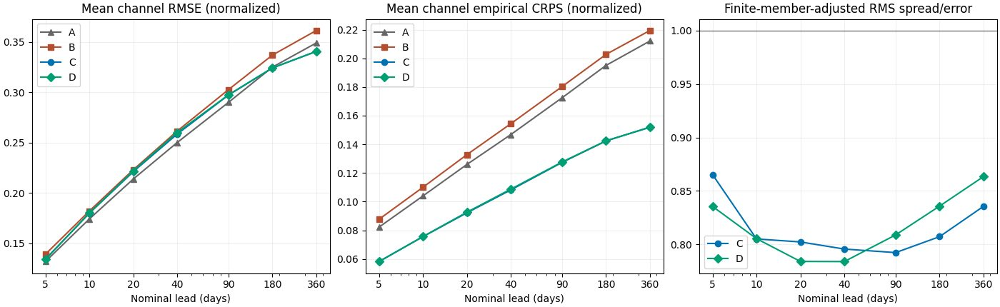

Mean normalized channel RMSE, lower is better:

| Nominal lead | A: dynamic MSE | B: plain MSE | C: CRPS | D: structured CRPS |
| --- | ---: | ---: | ---: | ---: |
| 5 days | 0.13162 | 0.13889 | 0.13403 | 0.13370 |
| 40 days | 0.25003 | 0.26143 | 0.25846 | 0.25991 |
| 90 days | 0.29005 | 0.30273 | 0.29734 | 0.29756 |
| 180 days | 0.32510 | 0.33709 | 0.32423 | 0.32437 |
| 360 days | 0.34919 | 0.36159 | 0.34076 | 0.34080 |

At 360 nominal days:

| Metric | A | B | C | D |
| --- | ---: | ---: | ---: | ---: |
| Empirical CRPS, normalized | 0.21208 | 0.21942 | 0.15196 | 0.15186 |
| Fair CRPS, normalized | 0.21208 | 0.21942 | 0.14447 | 0.14410 |
| Mean member RMSE, normalized | 0.34919 | 0.36159 | 0.43266 | 0.43726 |
| Mean normalized spread | 0 | 0 | 0.27514 | 0.28256 |
| Target inside member range | — | — | 82.47% | 82.64% |
| Finite-member-adjusted RMS spread/error | — | — | 0.836 | 0.863 |

For deterministic predictions, empirical CRPS equals MAE. Fair CRPS removes the finite-ensemble bias from
the pairwise term; it is reported separately, not silently substituted for empirical CRPS. Individual stochastic
members have larger errors than the ensemble mean. That is compatible with a useful distribution and does
not mean every sampled trajectory should outperform a point forecast.

The spread/error ratio above is `sqrt(17/16) * sqrt(mean(spread²)) / sqrt(mean(mean_forecast_RMSE²))`, over
the same origin/channel rows. The correction accounts for sampling error in a 16-member ensemble mean.
The range reference is `15/17`. Interpolated 5th–95th percentile coverage is also retained in the raw tables,
but its finite-ensemble reference is not simply 90%, so that number is not the primary calibration conclusion.

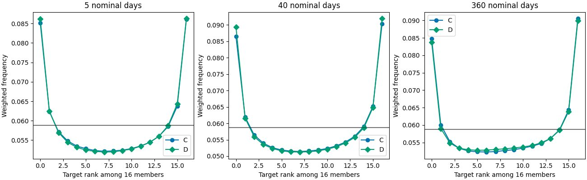

Rank histograms give every channel and origin equal total weight, then use cosine-latitude wet-area weights
within each field. Exact ties are randomized with a separate RNG. The horizontal line is the uniform
17-bin reference. The excess at the ends is consistent with the range/spread evidence of underdispersion;
these histograms do not diagnose all spatial or temporal dependence errors.

## Physical-unit trade-offs

Mean physical RMSE across origins and the 19 depths within each 3D family, at 360 nominal days. Depths have
equal weight here; this is not a volume-weighted mean:

| Variable | Units | A | B | C | D |
| --- | --- | ---: | ---: | ---: | ---: |
| Temperature | °C | 0.32471 | 0.37922 | 0.32743 | 0.32643 |
| Salinity | OM4 salinity units | 0.07242 | 0.08767 | 0.08405 | 0.08297 |
| U velocity | m/s | 0.03274 | 0.03353 | 0.03185 | 0.03178 |
| V velocity | m/s | 0.03144 | 0.03198 | 0.03035 | 0.03046 |
| SSH | m | 0.04383 | 0.04990 | 0.04282 | 0.04296 |

For example, C improves salinity RMSE over B but remains about 16% worse than A on this physical-unit
depth average. A's temperature RMSE also remains slightly better than C/D. An aggregate win should not be
presented as an across-the-board interior-state improvement. The per-channel tables retain every depth:
[A](results/annual-channel-A.csv), [B](results/annual-channel-B.csv), [C](results/annual-channel-C.csv),
[D](results/annual-channel-D.csv), plus the [family summary](results/annual-family.csv).

## Persistence and training-only seasonal climatology

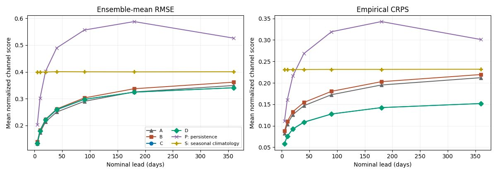

P holds the latest true input fixed. S predicts the mean for each of 73 seasonal centers, fitted only to
the **2,830 source states from 1975-01-03 through 2013-10-05**. The first 56 bins have 39 contributing years;
the last 17 have 38. It uses no held-out states or validation targets. The existing normalization remains
shared with the learned models, as requested. All references use the same 30 origins, seven leads, original
wet masks and verifying timestamps as A/B/C/D.

| At 360 nominal days | A | B | C | D | P: persistence | S: seasonal |
| --- | ---: | ---: | ---: | ---: | ---: | ---: |
| Mean normalized channel RMSE | 0.34919 | 0.36159 | 0.34076 | 0.34080 | 0.52603 | 0.40056 |
| Empirical CRPS, normalized | 0.21208 | 0.21942 | 0.15196 | 0.15186 | 0.30098 | 0.23183 |

All learned arms improve aggregate RMSE over both references at every evaluated lead. C/D improve 360-day
RMSE by about **14.9% over seasonal climatology** and **35.2% over persistence**. S is a deterministic seasonal
mean, so its CRPS is MAE; this comparison does **not** test against a probabilistic climatological ensemble.

The aggregate gain is not a uniform salinity win. At 360 days, the depth-averaged physical salinity RMSE is
0.08405/0.08297 for C/D versus 0.08666 for S: only about 3.0%/4.3% better. Moreover, P's **normalized** salinity
RMSE, 0.05967, is slightly lower than C/D's 0.06111/0.06016, even though its **physical** depth average is worse
(0.09216). Depth-dependent normalization changes the weighting, so both summaries are retained. B's physical
salinity RMSE, 0.08767, is slightly worse than S. These results reinforce the thermodynamic weaknesses rather
than removing them. C/D's physical temperature RMSE is 0.32743/0.32643 °C versus S's 0.42507 °C.

See [all leads](results/reference-comparison.csv), [physical and normalized family scores](results/reference-family.csv),
[reference depth scores](results/reference-channel.csv), and [all reference metric rows](results/reference-raw/).
The fall in persistence error from 180 to 360 days is consistent with the seasonal cycle returning toward
the initialization season; it is not evidence that the model was stepped incorrectly.

## Paired uncertainty

Descriptive 95% intervals resample whole origin years (2014–2021), preserving paired arms and taking the
ratio of resampled score sums. There are 4,000 fixed-seed resamples. All channels from an origin stay together.
Partial years retain their actual numbers of origins. These intervals quantify variation across this set of
forecast years, **not training-seed uncertainty**. There are only eight blocks, and overlapping annual forecast
windows can remain dependent across adjacent blocks.

| 360-day comparison | Metric | Relative change | Year-block interval |
| --- | --- | ---: | ---: |
| C vs B | RMSE | −5.76% | [−6.59%, −4.96%] |
| C vs A | RMSE | −2.41% | [−3.17%, −1.71%] |
| C vs B | Empirical CRPS | −30.75% | [−31.09%, −30.42%] |
| C vs A | Empirical CRPS | −28.35% | [−28.64%, −28.09%] |
| D vs C | RMSE | +0.014% | [−0.189%, +0.179%] |
| D vs C | Empirical CRPS | −0.066% | [−0.221%, +0.062%] |

All leads and comparisons are in [annual-paired-year-intervals.csv](results/annual-paired-year-intervals.csv).

## Checkpoint sensitivity

All eight additional evaluations use the same 30 origins, seven leads and 16 members for C/D. The final raw
checkpoints contain unaveraged epoch-70 weights. The validation-selected checkpoints contain EMA weights:
all four training configurations use `test_using_ema: true`, and the trainer saves the best checkpoint inside
that validation context. Their stored epochs are **A 53, B 48, C 65, D 63**. No checkpoint was selected by
these held-out scores.

A's stored selection policy is validation rollout RMSE at 360 days. B selects by ensemble-mean RMSE, and C/D
by empirical CRPS, averaging two validation origins and leads 10/20/40/90 days (eight members for C/D during
selection). These policies are different. This sensitivity is not a replacement for the fixed final-EMA
comparison, nor a comparison of identically tuned early-stopping rules.

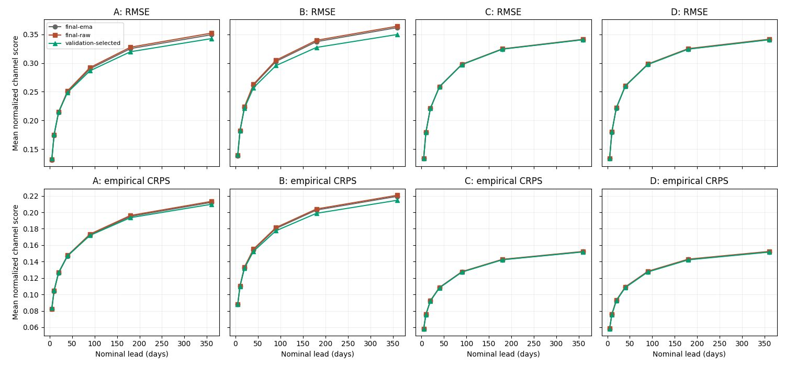

At 360 nominal days:

| Arm | Final EMA RMSE | Final raw RMSE | Validation-selected RMSE | Selected empirical CRPS |
| --- | ---: | ---: | ---: | ---: |
| A | 0.34919 | 0.35201 | 0.34245 | 0.20976 |
| B | 0.36159 | 0.36402 | 0.34959 | 0.21464 |
| C | 0.34076 | 0.34124 | 0.34055 | 0.15176 |
| D | 0.34080 | 0.34140 | 0.34044 | 0.15153 |

Final raw weights slightly worsen every arm. Validation selection helps A/B more than C/D. Comparing
selected checkpoints, C versus A changes RMSE by **−0.56%**, with the same descriptive paired origin-year
bootstrap giving **[−1.65%, +0.31%]**; D versus A is **−0.59% [−1.54%, +0.10%]**. The empirical CRPS changes
are **−27.65%** for C and **−27.76%** for D. Thus the large probabilistic-score improvement persists, but
the point-score advantage over the strongest deterministic control is small under this policy. The intervals
still describe forecast-year variation, not training-seed uncertainty or uncertainty over selection policies.

Selected C/D member-range coverage is **82.71%/83.22%**, still below the 16-member reference of 88.24%.
Changing checkpoints does not resolve underdispersion. See the [summary](results/sensitivity-summary.csv),
[physical family breakdown](results/sensitivity-family.csv), [paired intervals](results/sensitivity-paired-year-intervals.csv),
and [all per-origin metric rows](results/sensitivity-raw/).
Continuous structure and observation diagnostics continue to use final epoch-70 EMA; this sensitivity does
not establish how the earlier selected checkpoints behave on those diagnostics.

## Fixed-date fields

These maps all use the first prespecified initialization, 2014-10-15 12:00. The 360-day target is
2015-10-10 12:00. No dates or members were selected for favorable results. Member 0 is shown for C/D;
the original cluster NPZ files also retain member 1.

Each map panel is exactly 360 × 180 image pixels for the 360 × 180 data grid, with nearest-neighbor rendering.
The horizontal and vertical axes are grid indices; Gaussian latitude spacing is not reprojected. Full-field
panels share the full combined range across truth and predictions, with a separate spread scale. This can
hide small open-ocean variations when a small basin has an extreme value. The additional error maps use a
common symmetric 99th-percentile absolute-error scale; each panel states its fraction beyond that scale.
Both views are provided so range choices are explicit. Units are those in the table above.

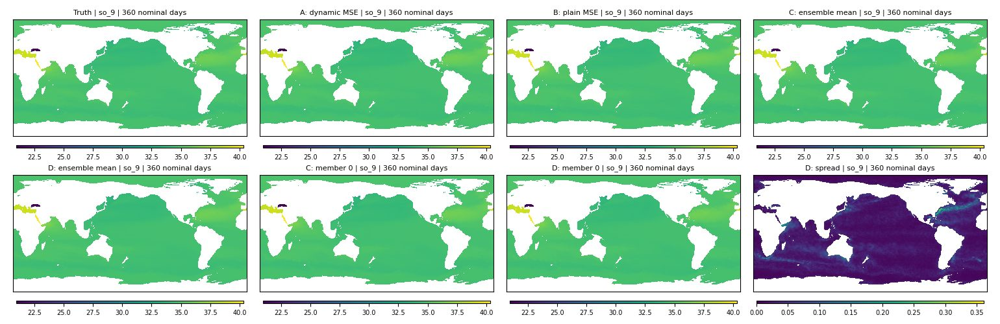

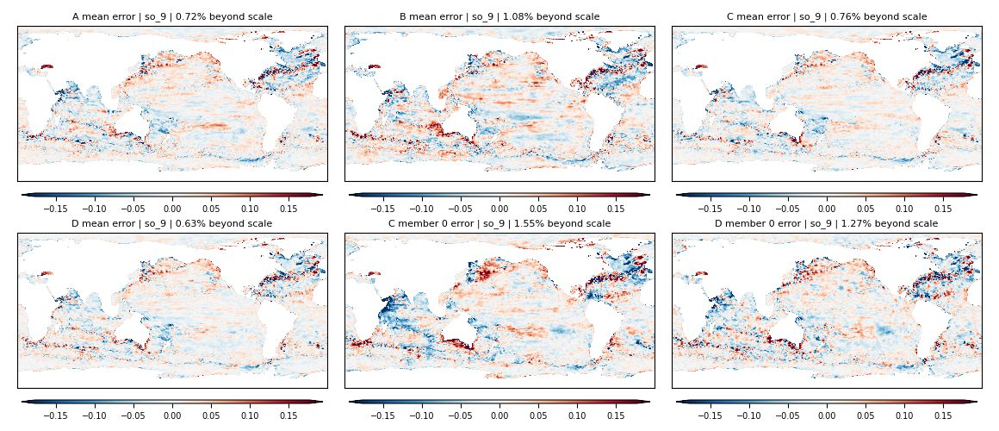

Other fixed-date assets:

- SSH: [fields](results/annual-zos-360d.jpg), [errors](results/annual-error-zos-360d.jpg).
- Surface temperature: [fields](results/annual-thetao_0-360d.jpg), [errors](results/annual-error-thetao_0-360d.jpg).
- 550 m U velocity: [fields](results/annual-uo_9-360d.jpg), [errors](results/annual-error-uo_9-360d.jpg).
- 550 m salinity at 40 nominal days: [fields](results/annual-so_9-040d.jpg).

## Continuous eight-year rollout

All four arms initialize once, with the latest input at 2014-10-15 12:00, and evolve through 2022-12-24 12:00
without resets: **299 model calls, 598 predicted states, 2,992 actual elapsed days** (2,990 nominal days).
C/D each use four independently evolving members here. All predictions and reported diagnostics are finite.
This is one initial condition and one training seed, not a test of 100-year stability.

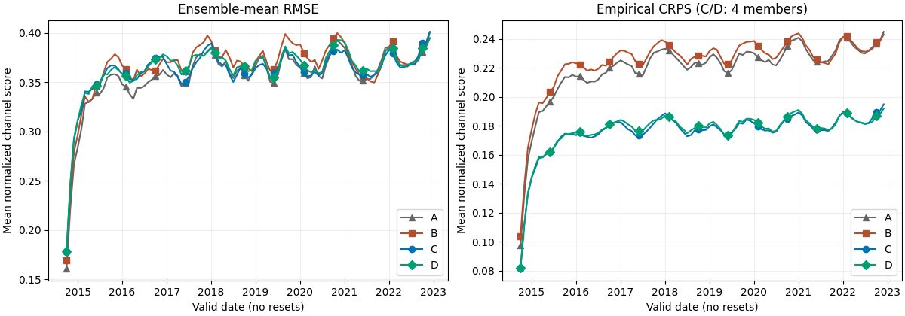

The mean normalized channel RMSE over output dates in 2022 is **0.3774 / 0.3782 / 0.3767 / 0.3764** for
A/B/C/D. The annual-forecast gain therefore does not translate into a large point-score improvement at this
long horizon. Regional rankings also differ. C/D's empirical CRPS is 0.1863/0.1854, versus 0.2362/0.2366 for
A/B. These four-member scores should not be compared directly with the 16-member annual CRPS: the lead times,
verification dates and finite-ensemble biases differ. C/D's member-range coverage in 2022 is 55.6%/55.9%,
below the four-member exchangeability reference of 60%.

### What the members preserve, and what they miss

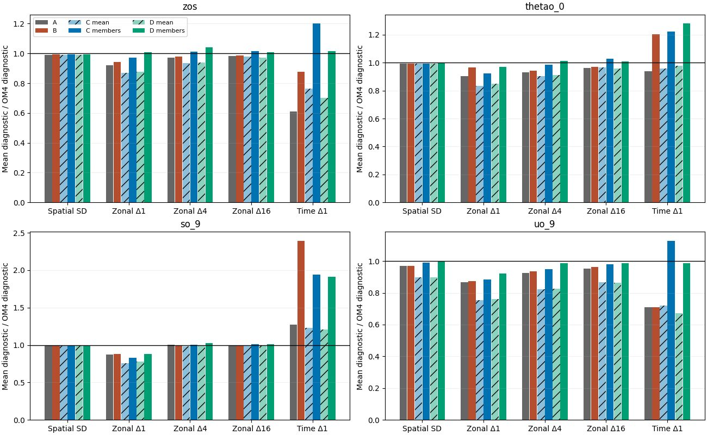

The table reports model/OM4 ratios of physical RMS increments, averaged over all 598 output dates. The time
diagnostic includes the transition from the last true input to the first prediction. One is the reference,
not a fitted optimum. For C/D, each
member's nonlinear statistic is computed first, then averaged across members; the figure separately shows
statistics of the ensemble mean with hatching.

| Diagnostic | A | B | C members | D members |
| --- | ---: | ---: | ---: | ---: |
| SSH, adjacent-longitude increment | 0.922 | 0.941 | 0.970 | 1.008 |
| SSH, consecutive-time increment | 0.609 | 0.876 | 1.202 | 1.016 |
| 550 m U velocity, adjacent-longitude increment | 0.868 | 0.874 | 0.883 | 0.923 |
| 550 m U velocity, consecutive-time increment | 0.710 | 0.710 | 1.128 | 0.987 |
| Surface temperature, adjacent-longitude increment | 0.903 | 0.964 | 0.922 | 0.970 |
| Surface temperature, consecutive-time increment | 0.938 | 1.203 | 1.222 | 1.281 |
| 550 m salinity, adjacent-longitude increment | 0.875 | 0.880 | 0.830 | 0.881 |
| 550 m salinity, consecutive-time increment | 1.270 | 2.393 | 1.943 | 1.912 |

D improves these velocity/SSH diagnostics relative to C, despite their almost identical annual aggregate
scores. It also improves adjacent-depth velocity differences: depth-averaged U/V RMS-difference ratios are
**0.985/0.972** for D versus **1.100/1.244** for C. These are adjacent-depth field differences, not vertical
derivatives divided by layer separation. Temperature and salinity show mixed results: D's surface temperature
varies too much between dates, and its 550 m salinity still has weaker spatial increments and much stronger
temporal increments than OM4. Matching a few moments does not establish a correct joint distribution.

Zonal differences use periodic offsets of 1, 4 and 16 grid cells and joint wet masks. They are not isotropic
spectra or differences at a fixed physical distance. Time differences have the source's nominal five-day
support, with two six-day intervals shared by all arms. The [vertical/covariance table](results/continuous-vertical.csv)
retains every depth pair; the per-arm structure tables retain all 77 channels.

### A discontinuity between two-output blocks

A post-hoc diagnostic splits consecutive salinity differences by their position in the two-output model
call. Each call predicts two states. The difference between those states is "within call"; the difference
from the previous call's second state to this call's first state is "between calls." That group includes
the initial transition from the last true input to the first prediction.

| 550 m salinity, temporal-increment RMS / OM4 | Within call | Between calls |
| --- | ---: | ---: |
| A | 0.954 | 1.587 |
| B | 1.957 | 2.830 |
| C members | 1.131 | 2.757 |
| D members | 1.234 | 2.591 |
| C ensemble mean | 0.829 | 1.628 |
| D ensemble mean | 0.856 | 1.561 |

OM4 itself has almost equal RMS changes for these two phases (0.00803 and 0.00802 salinity units), so the
alternation is not explained by that reference. Fresh noise is drawn for each stochastic model call, shared
through its two-output prediction; that is one possible contributor. **A/B also show the alternation**, so
this is not evidence that noise alone causes it. Output-head differences and autoregressive feedback are
other hypotheses. This diagnostic was added after seeing the temporal-increment error and was not used for
checkpoint or date selection. Raw phase summaries are retained for
[A](results/continuous-phase-A.csv), [B](results/continuous-phase-B.csv),
[C](results/continuous-phase-C.csv) and [D](results/continuous-phase-D.csv).

### Bulk behavior

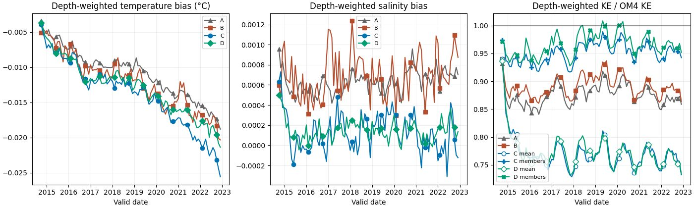

The volume-proxy mean temperature errors in 2022 are approximately **−0.017 / −0.018 / −0.022 / −0.019 °C**
for A/B/C/D. For C/D, kinetic energy computed from the ensemble-mean velocity is about **0.759× OM4**,
whereas the mean of member kinetic energies is **0.951×/0.962× OM4**. Reporting only the mean field would
therefore obscure variability retained by individual members. The corresponding deterministic A/B ratios
are 0.865/0.884. This does not demonstrate energy conservation: the quantities use cosine-latitude weights,
binary wet masks and nominal full-layer thicknesses, not exact OM4 partial-cell geometry. They are bulk
proxies, not exact heat/salt inventories.

## Secondary observation verification

Grace job **132094** completed in 1:18:04 with
[online W&B synchronized](https://wandb.ai/ocean_emulators/default/runs/g3l9tndq). It scored the continuous
October-2014-initialized forecasts, using final epoch-70 EMA checkpoints and four members for C/D.
These are prescribed-forcing, full-OM4-state initializations with no observational assimilation or fine-tuning.
There is one continuous trajectory per deterministic arm and four per stochastic arm, not repeated independent
eight-year forecasts. Twelve exported stores passed exact replay verification against the original diagnostics.

DUACS/OISST retain **583 five-day timestamps, 2015-01-03 through 2022-12-24**. ARGO-IAP uses complete
monthly means and whole years, giving **84 months, January 2015 through December 2021**. December 2022 is
incomplete, so that year is excluded from OHC RMSE. Residual-variance diagnostics use the full common span:
598 surface samples from October 2014 through December 2022, and 97 complete OHC months from November 2014
through November 2022. No daily observation skill is measured here.

The metric implementation derives geostrophic velocity from SSH and compares it with absolute DUACS
geostrophic velocity; it does not score the model's prognostic U/V directly. EKE is formed from geostrophic
velocity anomalies about each field's time mean. OISST is compared with the top temperature level. OHC
integrates temperature over each layer with the existing model/observation thickness rules. Fields are
interpolated horizontally to each observation grid, using original per-channel wet masks. Scalar RMSE is
the **square root of the equal-year mean annual MSE**, with area weighting within each year.

| Primary RMSE | Units | A | B | C mean | D mean |
| --- | --- | ---: | ---: | ---: | ---: |
| Geostrophic velocity | m/s | 0.194195 | 0.195785 | 0.193555 | 0.193755 |
| Instantaneous EKE | m²/s² | 0.045504 | 0.045566 | 0.045799 | 0.045811 |
| SST | °C | 0.88802 | 0.91606 | 0.89857 | 0.89598 |
| OHC 0–700 m | GJ/m² | 4.10265 | 4.09262 | 4.06577 | 4.08593 |
| OHC 700–2000 m | GJ/m² | 2.70092 | 2.68955 | 2.68272 | 2.68108 |

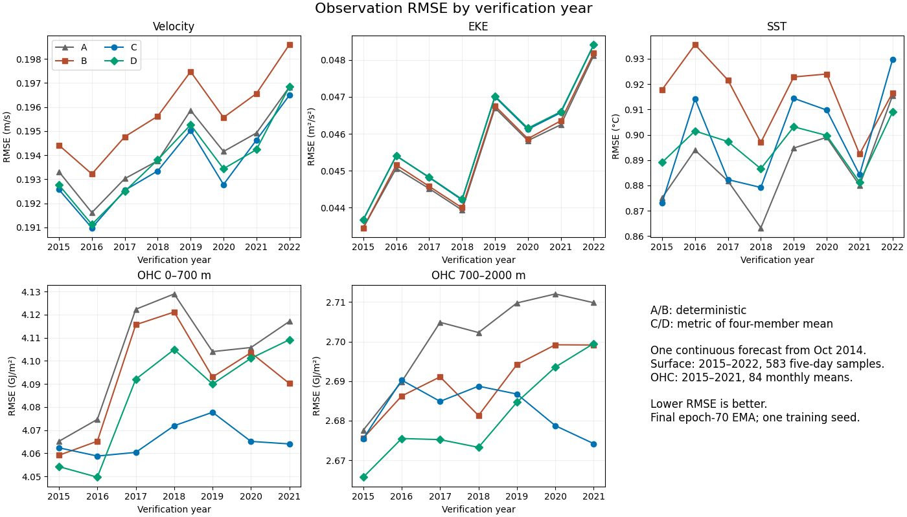

Relative to A, C/D mean-field velocity RMSE improves **0.33%/0.23%**, shallow OHC **0.90%/0.41%**, and
intermediate OHC **0.67%/0.73%**. SST worsens **1.19%/0.90%**, and EKE worsens **0.65%/0.68%**. C/D beat
B in four of the five primary metrics; B retains lower EKE error. D's added structure loss does not produce
a consistent observation advantage over C: it improves SST and intermediate OHC slightly, while worsening
velocity, EKE and shallow OHC slightly.

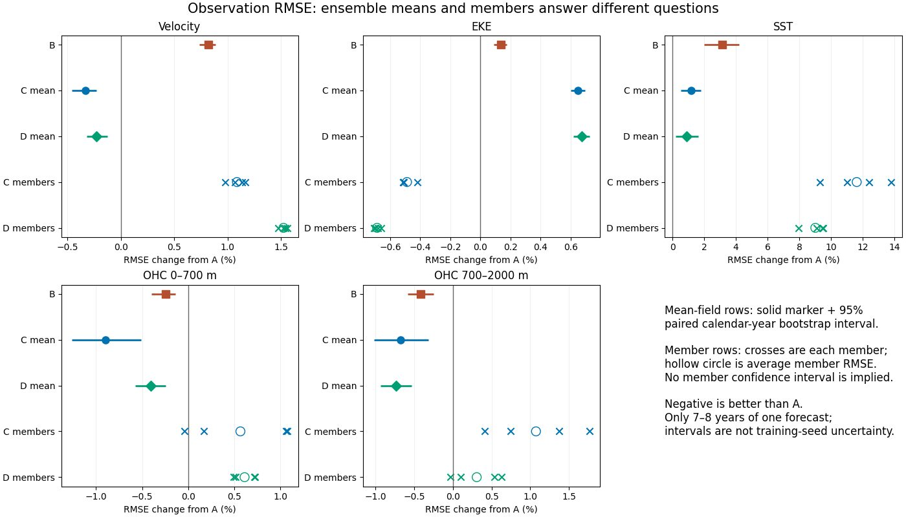

The mean-field intervals use 10,000 paired calendar-year resamples, reconstructing root mean annual MSE
before computing each relative change. For example, C versus A has velocity **−0.33% [−0.46%, −0.23%]**,
SST **+1.19% [+0.54%, +1.79%]**, and shallow OHC **−0.90% [−1.26%, −0.51%]**. These are descriptive
intervals over seven or eight years of **one evolving forecast**. Cross-year dependence, training-seed
variation, initialization variation and observation systematic errors are not resolved by those intervals.

### Members and variability

The average of individual-member RMSEs is kept separate from RMSE of the ensemble-mean field:

| Metric | C mean-field RMSE | C average member RMSE | D mean-field RMSE | D average member RMSE |
| --- | ---: | ---: | ---: | ---: |
| Geostrophic velocity, m/s | 0.193555 | 0.196307 | 0.193755 | 0.197153 |
| EKE, m²/s² | 0.045799 | 0.045282 | 0.045811 | 0.045191 |
| SST, °C | 0.89857 | 0.99131 | 0.89598 | 0.96810 |
| OHC 0–700 m, GJ/m² | 4.06577 | 4.12586 | 4.08593 | 4.12772 |
| OHC 700–2000 m, GJ/m² | 2.68272 | 2.72992 | 2.68108 | 2.70923 |

Unlike the other point metrics, EKE improves when scoring individual members rather than the ensemble mean.
Computing kinetic energy after averaging velocities removes energy associated with member spread; these
operations are not interchangeable. The member-average EKE RMSE beats A by 0.49% for C and 0.69% for D.
This is not a probabilistic scoring rule and does not establish observational calibration.

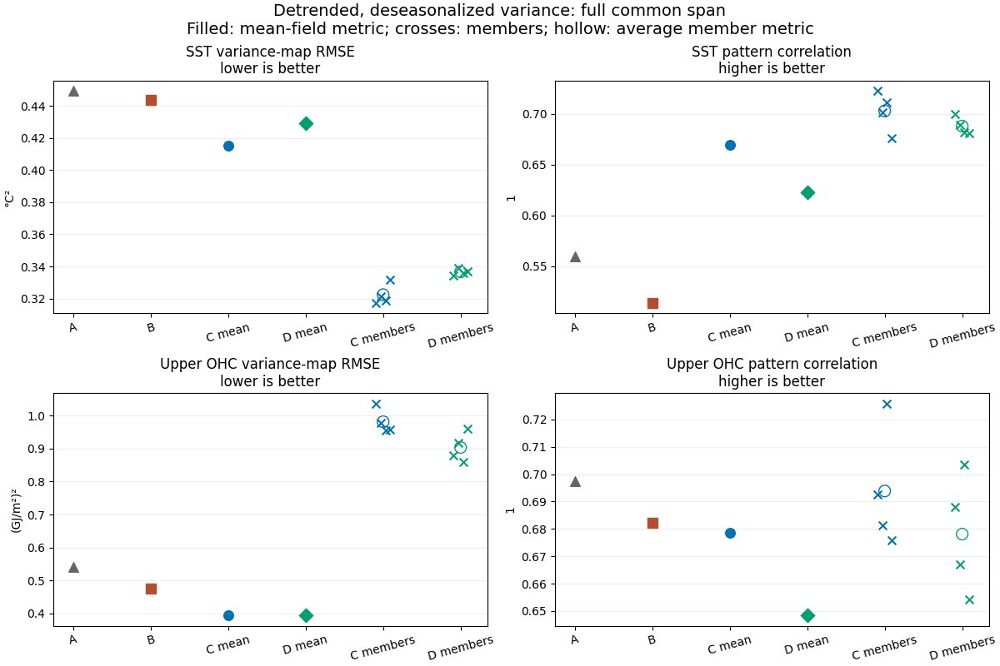

After detrending and deseasonalizing, the average member SST variance-map RMSE is **0.3224 °C² for C** and
**0.3366 °C² for D**, versus **0.4493 °C² for A**: approximately 28%/25% lower error. Average member SST
pattern correlations are 0.703/0.688 versus A's 0.560. This is useful evidence of better SST variability
despite worse instantaneous SST predictions. It does not extend uniformly to the interior: average member
upper-OHC variance-map RMSE is **0.9815/0.9034 (GJ/m²)²** for C/D versus **0.5419 for A**, approximately
81%/67% worse. Their mean-field OHC variance errors are lower than A's, but mean-field pattern correlations
are lower too. Map-RMSE alone does not reveal whether regional variance is too high or too low.

### Coverage and limits

All twelve trajectories have identical recorded paired-cell counts per metric. The retained fractions of
observed ocean cells are **94.02% velocity, 92.88% EKE, 98.09% SST, 99.04% shallow OHC and 98.85%
intermediate OHC**. These are cell-count fractions, not area fractions; coastal erosion from interpolation
and the geostrophic equatorial exclusion qualify the domain being scored.

Layer-geometry differences are shared across arms: mean absolute model/observation column-thickness
disagreement is **26.49 m** for 0–700 m and **48.59 m** for 700–2000 m, with model partial-column fractions
13.27% and 4.48%. Thus absolute OHC RMSE includes representativeness/geometry error as well as temperature
error; this evaluation does not decompose them. The direct scorer evaluates only the twelve listed forecasts:
the inherited observation preset's `baselines: [om4]` does **not** add an OM4 reference automatically here.
There is no matched OM4-versus-observation baseline in this set, so shared model bias and new forecast error
cannot be separated. These results also do not verify instantaneous interior profiles or interior velocity,
observational ensemble CRPS/calibration, or 100-year stability.

## Proposed next-wave decisions

The first wave supports C as a useful simple generative baseline, with D retained for structure comparisons.
The following experiments are proposals for approval:

1. **Reproducibility:** repeat B/C/D at seeds 16/17. D's structural improvements now justify retaining it in
   this comparison, while its aggregate RMSE/CRPS remains effectively tied with C. Prespecify a common
   checkpoint-selection policy and retain the final-EMA comparison: the present A/B point scores are
   substantially more sensitive to selection than C/D's.
2. **Continuity between calls:** compare persistent or temporally correlated noise with the current fresh
   noise, alongside a deterministic control for output-head/feedback alternation. Check whether salinity
   jumps improve without erasing calibrated spread; the present diagnostic does not identify the cause.
3. **Underdispersion:** compare C's four-member training with an eight-member version at the same exposure,
   while reporting the additional compute. Add a validation-only spread-calibration diagnostic as a cheap
   reference, clearly separated from dynamically generated, physically coherent members.
4. **Variable trade-offs:** compare C against a version with fixed, training-derived channel weights motivated
   by A's temperature/salinity advantage. Check whether thermodynamic gains cost velocity/SSH skill instead
   of optimizing only the 77-channel headline. Include member OHC variability as a guard against apparently
   good mean-field scores hiding poor sampled interiors.
5. **Structured multitask learning:** use C as the simpler provisional generative baseline and retain D for
   structural comparison. Add masking/tasks with a matched forecast-only control. These
   results do not require changing to diffusion, nor do they establish that diffusion would be inferior.
6. **Observation interpretation:** add the matching held-out OM4 reference, common-column OHC or
   layer-mean temperature, and signed regional variance differences. These separate inherited data/geometry
   mismatch from forecast degradation and distinguish excessive variability from missing variability.

No next-wave training has been submitted.

## Provenance and reproduction

The [execution record](RUNS.md) contains job IDs, immutable training/evaluator sources, paths, validation
deviations, qualification and recovery. Annual evaluation jobs are A 212403, B 212404, C 212406 and D 212407,
all using evaluator `0ed45a791` and epoch-70 EMA checkpoints. W&B links and exact checkpoint paths are in the
[evaluation contract](results/annual-contract.json). Full original manifests on Beta include checkpoint
SHA-256 and container fingerprints.

New B/C/D training consumed about **121.89 allocated B200 GPU-hours**. Including qualification, cancelled
notification preflights, annual evaluations, continuous diagnostics, reference evaluation and checkpoint
sensitivities and trajectory export, approximately **127.3 GPU-hours** have been used, within the
approximately 200-GPU-hour first-wave envelope. These are allocation
costs, not kernel-active GPU time. A's historical training cost is excluded; it was reused. Equal epochs and
training contexts are not equal compute, and no equal-compute superiority claim is made.
Observation job 132094 used **41.64 allocated CPU-hours**, with about 40.1 GiB peak RSS; the failed preflight
adds 1.30 CPU-hours. It requested no GPUs. All campaign callbacks have been retired after completion.

[annual-summary.csv](results/annual-summary.csv) contains the plotted aggregate scores.
[annual-raw/](results/annual-raw/) retains all per-origin/channel/lead metrics, split by arm/lead into small
gzip CSV parts. Read every part once; the split is purely for repository file-size limits. Units and all
normalization values are retained, and no origin was dropped from aggregation. `analyze_score.py` validates
completeness, unique keys, finite scores, unit conversions, checkpoint epochs, common manifests, saved target
equality, rank counts and member diversity before generating any tables or figures.

Reproduce with `uv run python experiments/score-trained-samudra-1deg/analyze_score.py`, passing `--A`, `--B`,
`--C`, `--D` paths to the downloaded `outputs/eval-full-<arm>-<job>/` directories, `--data-manifest` pointing
to B's `outputs/train-B/data-manifest.json`, and `--output` for the generated assets. All remote paths are
relative to the campaign root documented in `RUNS.md`.

Continuous results use source `1c76b81ca` and job 212420. Reproduce their analysis with
`uv run python experiments/score-trained-samudra-1deg/analyze_continuous.py <downloaded-continuous-full-212420> <output>`.
The analyzer checks all 46,046 unique score rows per arm, finite diagnostics, matching truth statistics,
epoch-70 checkpoints, 598 timestamps and saved field/mask consistency. Per-arm `continuous-scores-*.csv`
retain date-level scores; `continuous-global-*.csv.gz` retain every date/slot bulk diagnostic;
`continuous-structure-*.csv`, `continuous-phase-*.csv` and `continuous-vertical.csv` retain physical
structure summaries. Year/family summaries are also included. Original per-channel/date score files,
manifests, full diagnostic arrays and selected field maps remain under the recorded Beta output directory.

Reference job 212427 used source `dcdda50e2` and synchronized at
[W&B 6ul9j3mf](https://wandb.ai/ocean_emulators/default/runs/6ul9j3mf). Its
[manifest](results/reference-manifest.json.gz) records fitting dates/counts, bins, normalization and exact source.
Reproduce the audit and comparison with
`uv run python experiments/score-trained-samudra-1deg/analyze_references.py <downloaded-references-212427> <results-directory>`.
The results directory must contain the primary `annual-raw/` files and evaluation contract. The audit requires
all 32,340 unique finite reference rows, exact common targets, expected seasonal counts and physical-unit conversions.

Checkpoint sensitivity job 212432 used source `46104028f`. Reproduce with
`uv run python experiments/score-trained-samudra-1deg/analyze_sensitivity.py <downloaded-sensitivity-212432> <results-directory> <primary-download-parent>`.
The last directory contains `score-eval-full-A-212403/` for saved-truth comparisons. The audit checks all
129,360 secondary rows, common targets and normalization, stored checkpoint roles/epochs, finite fields,
rank-histogram totals and stochastic diversity. Full [manifests](results/sensitivity-manifests.json.gz) retain
selection identities, checkpoint fingerprints, source and online W&B URLs. The primary tables are unchanged.

Observation job 132094 used source `71c226400`. Download `observation_metrics.csv`, `manifest.json` and
`COMPLETE.json` from `outputs/observations-132094/`, then run
`uv run python experiments/score-trained-samudra-1deg/analyze_observations.py <downloaded-observations-132094> <results-directory>`.
The results directory must contain `annual-contract.json`. The audit checks all 612 unique finite score rows,
model labels, checkpoint paths/epochs, variable order and normalization, actual product support, paired-cell
counts, year/sample completeness, and the primary scalar/annual-MSE aggregation identity. Source and local
SHA-256 values match for all three downloaded files. Exact raw bytes are retained in
[observation-raw.csv.gz](results/observation-raw.csv.gz), with [manifest](results/observation-manifest.json.gz),
[completion marker](results/observation-complete.json.gz) and [audit fingerprints](results/observation-audit.json.gz).
Readable [primary scores](results/observation-primary.csv), [mean/member summaries](results/observation-member-summary.csv)
and [paired intervals](results/observation-paired-year-intervals.csv) support the plots. Context columns without
applicable uncertainty/coverage are blank, while all 612 metric values are finite. Runtime invalid-division
warnings did not produce missing metric values; masks and paired support remain explicit in these outputs.
