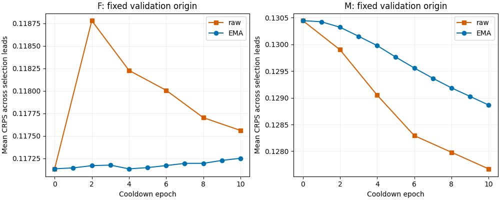

<!--
SPDX-FileCopyrightText: 2026 Samudra Authors
SPDX-License-Identifier: CC-BY-4.0
-->

# Saved-checkpoint validation: raw M was still improving

The first part of the authorized wave is complete. M's raw forecast validation scores improved at every
saved cooldown checkpoint through epoch10. The original slow EMA lagged behind this improvement;
F's EMA remained essentially flat while raw F recovered from an initial degradation. These curves
support testing stronger adaptation, but do not establish how far M can recover or whether it will match F.
The separate 30-epoch pair is running; this report contains no results from that pair.

Mean empirical CRPS across the original selection leads10,20,40,90,180,360, using the fixed validation
origin2013-10-10 and eight members with seed26000000:

| Cooldown epoch | F raw | F EMA | M raw | M EMA |
| --- | ---: | ---: | ---: | ---: |
| 0: original EMA starting weights | 0.117135 | 0.117135 | 0.130445 | 0.130445 |
| 2 | 0.118780 | 0.117170 | 0.129901 | 0.130322 |
| 4 | 0.118228 | 0.117134 | 0.129051 | 0.129979 |
| 6 | 0.118007 | 0.117171 | 0.128292 | 0.129559 |
| 8 | 0.117703 | 0.117195 | 0.127980 | 0.129187 |
| 10 | 0.117561 | 0.117252 | 0.127670 | 0.128866 |

The raw model did not plateau at a saved checkpoint before the schedule ended. Its last improvement
is smaller than its earlier improvements, but learning rate was also decaying: this does not distinguish
an optimization plateau from a schedule-imposed slowdown. The EMA/raw asymmetry is consistent with
task adaptation in M and useful smoothing of perturbations in F. It is not evidence that EMA is generally
harmful. This is one validation origin and one training/sampling seed, not a statistical robustness claim.

Completion retention uses four quarterly validation origins with sixteen members, identical request masks
across arms/checkpoints, and equal-origin reductions after averaging active channels/frames. Epoch0
uses the parent EMA; epochs4 and10 use raw cooldown weights. For M surface-to-interior completion:

| Epoch | Normalized RMSE | Empirical CRPS | Member-range coverage |
| --- | ---: | ---: | ---: |
| 0 | 0.27448 | 0.12468 | 86.80% |
| 4 | 0.28704 | 0.13341 | 79.04% |
| 10 | 0.29660 | 0.13997 | 74.82% |

Missing-variable and gap completion also deteriorate; [all task summaries](diagnostic-results/completion.csv)
retain the numbers. Thus additional forecast adaptation was already changing the learned completion
distributions, not merely overcoming an EMA reporting artifact. The new wave measures whether further
forecast recovery is worthwhile alongside this retention cost. No held-out intermediate-checkpoint
selection was performed.

## Verification and reproduction

Jobs F19831109 / M19831110 each completed exit0 in4m16s:0.1422 RTX GPU-hours combined.
Each arm has six forecast stages with539 finite rows each, and three completion stages with1324 finite
rows each. All18 stages have COMPLETE markers and W&B records. Paired keys and completion masks
match across epochs/arms; known/request masks are disjoint; all dates lie within the configured
2013-10-05 through2014-10-05 validation window. Epoch0 loaded parentEMA70 and later checkpoints
loaded the declared raw cooldown epoch. The old metadata prose said "Same thirty forecast origins" in
completion manifests; actual origins[0,9,18,27] and evaluation_split=validation are correct and were audited.
That stale prose does not describe this diagnostic; no raw artifacts were rewritten.

The EMA trajectory is extracted from the original cooldown `experiment.log` annual-validation records;
raw scores are newly evaluated with the matching origin, sample count and forecast RNG. Epoch0 is a
new evaluation of the original EMA starting checkpoint. Per-lead and family reductions are available in
[diagnostic-results](diagnostic-results/). [Analyzer](analyze_diagnostic.py):
`uv run python experiments/score-trained-samudra-1deg/adaptation/analyze_diagnostic.py --artifacts /tmp`.
It requires the two job folders plus `cooldown-F-experiment.log` and `cooldown-M-experiment.log`.

Raw artifacts remain on Torch under `/scratch/jr7309/runs/score-multitask-1deg-20261012/outputs/`
`eval-adaptation-diagnostic-F-19831109` and `eval-adaptation-diagnostic-M-19831110`; each stage manifest
contains its online W&B URL, source and checkpoint fingerprint. Source38c5a514d. For the new production
pair's protocol, qualification recovery and monitoring, see [README](README.md).
