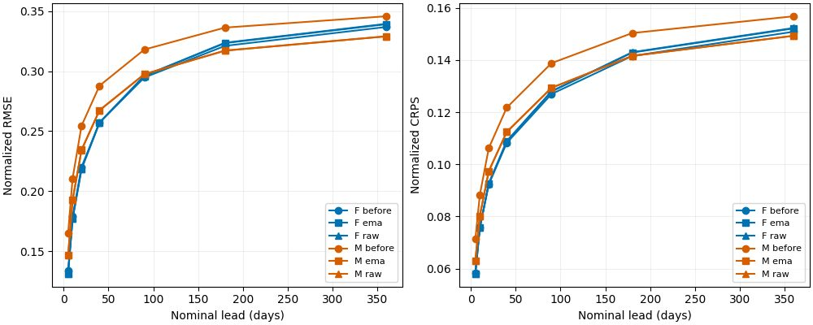
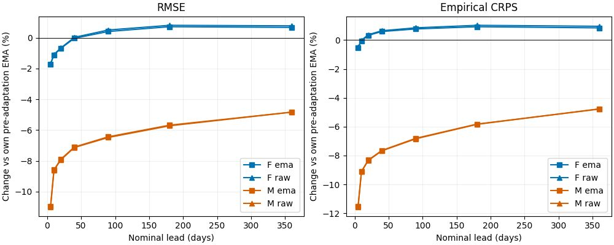

<!--
SPDX-FileCopyrightText: 2026 Samudra Authors
SPDX-License-Identifier: CC-BY-4.0
-->

# Stronger forecast adaptation: long-lead recovery, substantial forgetting

Thirty epochs of forecast-only adaptation reverse the annual aggregate ordering: multitask-pretrained
M now beats forecast-only F at180 and360 days. However, M still trails at shorter leads and on
salinity/temperature even at360 days. Completion skill and coverage deteriorate substantially.
The earlier ten-epoch result was not evidence that forecasting could not recover through adaptation;
this result is also not evidence of a generally superior shared representation.

## Fixed held-out forecasts

Thirty identical held-out origins, sixteen ensemble members, seven leads and77 channels; keys match
the original evaluation exactly. Final EMA is primary, final raw a predeclared sensitivity.
Metrics average area-weighted field scores equally across channels and origins, using existing normalization.
F and M start from their respective original epoch70 EMA, not from the ten-epoch checkpoints.

| Checkpoint | F RMSE360d | M RMSE360d | F empirical CRPS360d | M empirical CRPS360d |
| --- | ---: | ---: | ---: | ---: |
| Original EMA | 0.336898 | 0.345802 | 0.150850 | 0.156780 |
| 10-epoch EMA | 0.337477 | 0.342933 | 0.151159 | 0.155413 |
| 30-epoch EMA | 0.339174 | 0.329087 | 0.152123 | 0.149282 |
| 30-epoch raw | 0.339515 | 0.329090 | 0.152291 | 0.149308 |

M's final EMA beats adapted F by2.97% RMSE and1.87% CRPS at360 days. Relative to its own
original checkpoint, M improves4.83% RMSE and4.79% CRPS; F worsens0.68% and0.84%.
Raw versus EMA is now nearly identical for M (RMSE0.329090 versus0.329087).
That is consistent with resolving inherited EMA lag, although the new schedule simultaneously changed
learning rate, duration and EMA policy: it does not isolate the cause of recovery.

The aggregate crossover hides material differences:

- M still trails F at5 days by11.67% RMSE /8.53% CRPS; at90 days by0.55% /1.11%.
- At5 days, M temperature RMSE is62.98% worse and salinity38.20% worse.
- At360 days, M temperature/salinity RMSE remain12.51% /10.24% worse. Velocity RMSE is
  3.72% /4.88% better (u/v). SSH RMSE is0.78% better but CRPS1.20% worse.

Thus long-lead aggregate improvement is driven by velocities, not uniform recovery of the interior.
Normalization and the relative magnitudes of family errors matter even with equal channel weighting.
[Family scores](results/forecast-family.csv), [lead scores](results/forecasts.csv), and per-origin CSVs
in the same directory preserve this breakdown.

## Completion retention and temporal behavior

EMA completion uses the same30 origins,16 members and requested wet entries. Active channels/frames
are averaged within each origin before averaging origins. F never trained on these masks, so its
completion output is an unfamiliar-input diagnostic rather than a trained completion control.

| M task | RMSE original → adapted | CRPS original → adapted | Member-range coverage original → adapted |
| --- | ---: | ---: | ---: |
| Surface-to-interior |0.280661 →0.394920 |0.128298 →0.204143 |84.34% →54.95% |
| Missing variable |0.190635 →0.282320 |0.087189 →0.151905 |84.38% →51.99% |
| Spatial gap |0.337214 →0.438016 |0.163227 →0.238410 |84.24% →57.70% |

This is substantial forgetting, exceeding the earlier short cooldown's degradation. The reported
coverage is the entire finite ensemble range, not a nominal calibrated confidence interval.

The separate continuous four-member rollout also improves:2022 mean RMSE is0.352872 for M versus
0.366605 for F; empirical CRPS0.177273 versus0.181818. These use continuous trajectories rather
than reinitialized forecasts, and four-member CRPS should not be compared directly with16-member CRPS.
For so_9, across-call member increment RMS relative to truth falls from5.18× to3.66× for M,
but remains above F's2.56×. Within-call ratios are0.88× for M and0.86× for F.
Better long-lead scores therefore do not remove the mismatch in temporal variability.
[Completion](results/completion.csv), [continuous scores](results/continuous.csv),
[increment diagnostics](results/increments.csv).

## Interpretation and next decisions

The validation-only diagnostic showed continued improvement over the first ten epochs; the longer
adaptation confirms that this improvement extends to held-out long-lead scores. Shared pretraining
can yield a useful forecast starting point, but these runs do not establish positive transfer at fixed
forecast exposure: after adaptation M has approximately65 forecast-equivalent epochs versus F's100.
Only one training seed was used, and overlapping forecast origins are not independent replicates.
Small differences are point estimates, not demonstrated statistical significance.

A next wave should separate objectives: an exposure-matched forecast control tests transfer fairly;
forecast-heavy adaptation retaining some auxiliary examples tests the forecast/forgetting tradeoff.
Evaluate short-lead temperature/salinity and long-lead velocities separately, keeping completion
retention and temporal increments as explicit criteria. Temporal dependence remains a separate issue
for a marginal-score objective. These are recommendations only; no additional wave was submitted.
All results use OM4 synthetic targets, not observational interior verification or100-year stability.

## Provenance and reproduction

Training source949fdf81828b2f0b97bf775585460294547126a8; evaluation source
6383f0a0710943644e853b58d06799ff9820a8c6. Training F19831717/M19831718 completed30 epochs,
2640 fresh fixed-decay0.99 EMA updates, terminal LR0;39.5811 RTX GPU-hours combined.
Evaluation F19874047/M19874048 completed exit0 ongr101 in18:36/18:37,
0.6203 RTX GPU-hours combined. All eight completion manifests identify epoch30 and the evaluation
commit. Per arm:16170 EMA forecast rows,16170 raw rows,9992 completion rows,46046 continuous
score rows,3588 bulk rows; numeric metrics and108 NPZ artifacts per arm are finite.

Remote root `/scratch/jr7309/runs/score-multitask-1deg-20261012`:
`outputs/eval-adaptation-F-19874047` and `outputs/eval-adaptation-M-19874048`.
Immutable configs/checkpoint paths are in those manifests; checkpoint weights remain under
`outputs/adaptation-{F,M}-forecast/saved_nets`. Dataset remains1-degree OM4 with Rust loading,
existing normalization and no hfds anomalies. See [setup](README.md).

Online W&B evaluation runs:
F [EMA](https://wandb.ai/ocean_emulators/default/runs/stoef4m4),
[raw](https://wandb.ai/ocean_emulators/default/runs/v6jejf44),
[completion](https://wandb.ai/ocean_emulators/default/runs/ehzs0xyu),
[continuous](https://wandb.ai/ocean_emulators/default/runs/yfjo3atu);
M [EMA](https://wandb.ai/ocean_emulators/default/runs/9zgs2mbp),
[raw](https://wandb.ai/ocean_emulators/default/runs/ps1aahz1),
[completion](https://wandb.ai/ocean_emulators/default/runs/nab8nm42),
[continuous](https://wandb.ai/ocean_emulators/default/runs/9t8974we).

Reproduce figures and CSVs using `uv run python experiments/score-trained-samudra-1deg/adaptation/analyze.py
--artifacts /tmp` with the original and adaptation artifact directories downloaded there.
The callback93e450c9-cd96-4af6-9c39-0212cc7ba421 is retired; no evaluation remains running.
