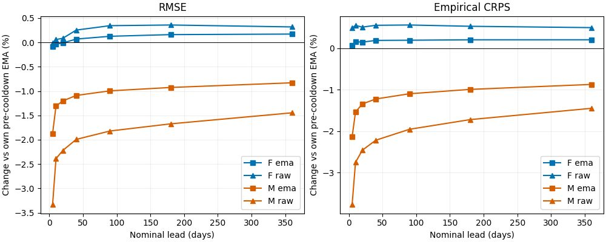

<!--
SPDX-FileCopyrightText: 2026 Samudra Authors
SPDX-License-Identifier: CC-BY-4.0
-->

# Forecast-only cooldown: modest recovery, incomplete transfer

Ten epochs of forecast-only cooldown improve M's forecasts while barely changing F. M still trails F
at every tested lead, including when comparing final raw weights. M retains most of its completion skill,
but completion scores and coverage deteriorate. The large across-call salinity jumps remain.

This is one seed and one short low-learning-rate schedule. It supports partial recovery through forecast
adaptation; it does not establish the best attainable transfer or isolate the original loss of forecast
exposure from task interference. [Setup and execution](README.md), [pre-cooldown report](../MULTITASK-RESULTS.md).

## Forecasts

Thirty fixed held-out origins, sixteen members, identical target rows/seeds and original evaluation
protocol. Equal channel/origin means of area-weighted field metrics; lower is better. Final cooldown EMA
is primary. Raw weights are a predeclared sensitivity check, not a held-out-selected replacement.

| Checkpoint | F RMSE, 360d | M RMSE, 360d | F empirical CRPS | M empirical CRPS |
| --- | ---: | ---: | ---: | ---: |
| Before: epoch-70 EMA | 0.336898 | 0.345802 | 0.150850 | 0.156780 |
| After: cooldown EMA | 0.337477 | 0.342933 | 0.151159 | 0.155413 |
| After: cooldown raw | 0.337973 | 0.340799 | 0.151601 | 0.154509 |

M's EMA improves **0.83% RMSE / 0.87% CRPS** at 360 days, while F worsens 0.17% / 0.20%.
The between-arm deficit narrows from 2.64% to **1.62% RMSE**, and from 3.93% to **2.81% CRPS**.
With both arms' final raw weights, M still trails by 0.84% RMSE / 1.92% CRPS.

M's gains are larger at short leads: at five days its EMA improves 1.87% RMSE / 2.13% CRPS; raw
improves 3.33% / 3.76% relative to its pre-cooldown EMA. Nevertheless, M still has a 21.06% five-day
RMSE deficit versus cooldown F EMA. This is not simply a problem confined to long rollouts.

Negative changes are improvements. [Absolute curves](results/forecast.jpg) and
[all lead scores](results/forecasts.csv) are also available. Raw M moves further than EMA in the helpful
direction, consistent with inherited EMA lag over this short adaptation. Raw F instead worsens slightly.
These are point estimates; no repeated training seeds or new uncertainty intervals were computed for
this follow-up, and small changes should not be treated as established general improvements.

## Completion retention

Only EMA was re-evaluated for completion and continuity. Same thirty origins, tasks and request masks,
sixteen members; average active channels/frames within each origin, then average origins. All scores
below concern requested wet entries. Supplied values remain excluded.

| M task | RMSE before → after | CRPS before → after | Full member-range coverage before → after |
| --- | --- | --- | --- |
| Surface → interior | 0.28066 → 0.28839 | 0.12830 → 0.13379 | 84.34% → 79.05% |
| Missing variable family | 0.19064 → 0.19600 | 0.08719 → 0.09106 | 84.38% → 80.25% |
| Spatial gap | 0.33721 → 0.34511 | 0.16323 → 0.16904 | 84.24% → 79.42% |

M retains useful completion capability but loses roughly 2–3% in RMSE and 4–5 percentage points of
member-range coverage. Spread changes little, so the coverage loss is not explained simply by a large
collapse in spread. Calibration/conditional accuracy changed as the model adapted to forecasting.
The sixteen-member exchangeable range-coverage reference is 15/17 = 88.24%, so even the original
completion ensembles undercovered on this diagnostic. F remains an unfamiliar-mask transfer control,
not a trained completion baseline; its surface-completion RMSE is still 0.98718 after cooldown.

## Continuous rollout

Four-member trajectories through 2022 use the original continuous-run seeds and no resets. In calendar
2022, F RMSE changes 0.36870 → 0.36848; M changes 0.36831 → 0.36571. Empirical CRPS changes
F 0.18277 → 0.18213 and M 0.18341 → 0.18220. These late-trajectory aggregates do not override the
initialized-forecast comparison and use fewer members than the forecast table.

Individual-member `so_9` RMS temporal increments divided by truth:

| Transition | F before → after | M before → after |
| --- | --- | --- |
| Across autoregressive calls | 2.743× → 2.728× | 5.179× → 4.907× |
| Within jointly predicted pairs | 1.034× → 1.013× | 1.233× → 1.159× |

M moves toward truth, but still has nearly five times truth's across-call salinity changes. Forecast-only
cooldown alone does not solve temporal coherence. The first across-call increment includes initialization
to the first output; these are averages of member diagnostics, not ensemble-mean diagnostics.

## Interpretation and next step

This was a useful inexpensive check: the multitask model can recover some forecasting skill through
forecast-only adaptation, with measurable loss of completion calibration. The current short cooldown
neither closes the forecasting gap nor removes the continuity problem. A longer adaptation or a different
EMA schedule might move farther, but that remains untested. For a next approved wave, a smaller retained
completion fraction during adaptation would test the retention tradeoff, while a separate matched temporal
objective comparison would directly target across-call jumps. No further training has been submitted.

## Verification and provenance

Both training runs completed ten epochs, exactly 100% forecast contexts, and both raw/EMA checkpoints
have epoch 10 and terminal optimizer LR **0.0**. Training including failed startup attempts used
13.9861 RTX GPU-hours. Evaluations F19815733 / M19815734 completed exit 0 in 19:38 / 19:20,
0.6494 RTX GPU-hours combined. Total for this follow-up: approximately **14.64 RTX GPU-hours**.

Each arm produced 16,170 finite EMA forecast rows, 16,170 raw rows, 9,992 completion rows and 46,046
continuous score rows across 598 frames, plus 3,588 finite bulk rows. Paired keys and all ninety completion
masks match; known/request masks are disjoint. Checkpoints loaded strictly. All eight evaluation stages
have completion markers and synced W&B runs:

| Arm | EMA forecast | Raw forecast | Completion | Continuous |
| --- | --- | --- | --- | --- |
| F | [d0u8gh04](https://wandb.ai/ocean_emulators/default/runs/d0u8gh04) | [fpbwholk](https://wandb.ai/ocean_emulators/default/runs/fpbwholk) | [967rtpok](https://wandb.ai/ocean_emulators/default/runs/967rtpok) | [0h4rm8wp](https://wandb.ai/ocean_emulators/default/runs/0h4rm8wp) |
| M | [o91qrsm3](https://wandb.ai/ocean_emulators/default/runs/o91qrsm3) | [ta169iaq](https://wandb.ai/ocean_emulators/default/runs/ta169iaq) | [jer2ofvn](https://wandb.ai/ocean_emulators/default/runs/jer2ofvn) | [0z132r64](https://wandb.ai/ocean_emulators/default/runs/0z132r64) |

[Reproducible analyzer](analyze.py): `uv run python experiments/score-trained-samudra-1deg/cooldown/analyze.py
--artifacts /path/to/downloads`. Original and cooldown job folders must be present, with original names.
[CSV summaries](results/) retain lead, origin, task, year and increment reductions. Full artifact directories
are on Torch under `/scratch/jr7309/runs/score-multitask-1deg-20261012/outputs/eval-cooldown-F-19815733`
and `eval-cooldown-M-19815734`; source `2b2b3dbeed6f30b3f0ef127d3ad3386bcc25f292`. Earlier job paths
are in the pre-cooldown report. These are synthetic OM4 results; no new observational evaluation was run.
