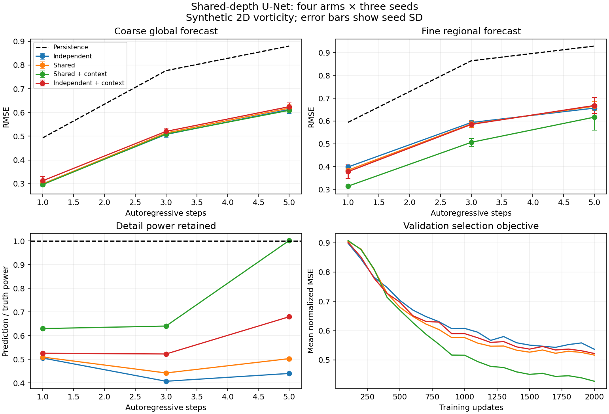

<!-- SPDX-FileCopyrightText: 2026 Samudra Authors -->
<!-- SPDX-License-Identifier: CC-BY-4.0 -->

# Local shared-depth U-Net experiment

A paired 2×2 test of shared versus independent coarse/fine parameters, with and without current coarse-global context. This is an experiment/results record, not intended to merge. These synthetic results do not establish ocean forecasting skill or cross-source transfer. See the [doubled-update follow-up](../results_longer/REPORT.md) for the independent-context optimization-budget control and gradient-path audit.

## Results

Mean ± sample standard deviation over three training seeds; lower RMSE is better. Units are the synthetic vorticity units (initial spatial SD approximately one). Every run uses the same held-out test examples.

| Arm | Parameters | Coarse RMSE, step 1 | Fine RMSE, step 1 | Fine RMSE, step 5 |
|---|---:|---:|---:|---:|
| Independent | 30,453 | 0.2997 ± 0.0127 | 0.3983 ± 0.0090 | 0.6566 ± 0.0085 |
| Shared | 19,276 | 0.2992 ± 0.0052 | 0.3842 ± 0.0066 | 0.6650 ± 0.0196 |
| Shared + context | 19,340 | 0.2966 ± 0.0038 | 0.3141 ± 0.0027 | 0.6169 ± 0.0566 |
| Independent + context | 30,517 | 0.3127 ± 0.0171 | 0.3778 ± 0.0306 | 0.6681 ± 0.0349 |
| Persistence | — | 0.4934 | 0.5942 | 0.9289 |



- shared versus independent, step 1: mean paired fine RMSE change -3.53%; individual seeds -5.58%, -3.76%, -1.25%.
- shared versus independent, step 5: mean paired fine RMSE change +1.28%; individual seeds +0.73%, +3.77%, -0.67%.
- shared_context versus independent_context, step 1: mean paired fine RMSE change -16.45%; individual seeds -23.48%, -8.56%, -17.31%.
- shared_context versus independent_context, step 5: mean paired fine RMSE change -7.79%; individual seeds -9.51%, -3.65%, -10.20%.

These paired seed differences are descriptive, not confidence intervals over independent datasets. All seeds share one fixed train/validation/test dataset.

## Interpretation

Sharing without context improves one-step fine RMSE modestly across all three seeds, while coarse skill is nearly unchanged. Its five-step advantage does not persist. Sharing with context improves fine RMSE against the corresponding independent-context control in every seed at both one and five steps, using roughly 37% fewer parameters. The shared-context arm also has the lowest mean one-step coarse RMSE, although differences between coarse results are small compared with seed variation.

The one-step shared-context detail power ratio is only about 0.63, so the best model still smooths fine structure. Its mean five-step ratio near one conceals seed values of about 0.80, 1.39, and 0.81; this does not establish calibrated amplitudes or correct placement of fine structures. Validation curves are still improving for the shared-context arm at the training-budget boundary. These are fixed-budget optimization/transfer results, not converged rankings. A larger or longer run, new data seeds, and a fine-data-budget sweep would be needed to establish robust transfer or sample efficiency.

## Detail and spatial extent

| Arm | Detail RMSE, step 1 | Detail power / truth, step 1 | Detail power / truth, step 5 | Fine RMSE: 80 / 112 / 128 patch |
|---|---:|---:|---:|---|
| Independent | 0.2306 ± 0.0052 | 0.505 | 0.440 | 0.4016 / 0.3983 / 0.3983 |
| Shared | 0.2258 ± 0.0025 | 0.509 | 0.503 | 0.3899 / 0.3842 / 0.3842 |
| Shared + context | 0.1965 ± 0.0015 | 0.630 | 1.002 | 0.3274 / 0.3141 / 0.3141 |
| Independent + context | 0.2234 ± 0.0151 | 0.526 | 0.680 | 0.3782 / 0.3778 / 0.3778 |

Detail is the residual after 4×4 area averaging and piecewise-constant prolongation, not a sharp Fourier band. Its power ratio detects smoothing that RMSE alone can reward. Extent tests score the same physical 32×32 center, changing patch size and halo together (24, 40, 48 fine cells). The 128-cell test supplies extra surrounding data; it is not evidence of transfer to new grid spacing. Five-step rollouts predict the whole regional patch and coarse globe autoregressively without refreshing either from truth. Local boundary errors can propagate into the scored center during rollout.

## Architecture and controls

- One physical input channel: vorticity. Fine input: 128×256 full field; coarse global input: 32×64; training patch: 112×112, scoring only central 32×32.
- Fine-only detail width 4; shared-resolution width 8; bottleneck width 12. Each core has one 2× down/up pair. Ratio between fine and shared grids is 4 in each direction.
- Uses the repository's `ConvNeXtBlock` with expansion factor 2, dilation 1, no normalization, and pointwise linear projections. A subclass changes only padding: both axes periodic for the synthetic global domain, zero exterior for regional patches. This is an experimental staged network built from Samudra blocks, not the unchanged production `Samudra.forward_once`.
- Coarse input is exactly a 4×4 area average. Fine input is split into that same coarse field and its zero-block-mean detail residual. The detail encoder reduces to the shared physical grid; no availability-mask channels are used.
- Fine prediction combines a coarse tendency with a projected zero-block-mean fine correction. Coarse examples omit the detail path. Sharing ties the entire coarse route (input adapter, U-Net core, tendency head); independent routes start as exact copies.
- Context is cropped from the CURRENT coarse global feature map, then linearly projected into the local core input. It never uses future truth. Fine loss backpropagates through this context in both context arms, so “independent” means untied weights, not isolated optimization.
- All arms start from identical corresponding weights, see identical batches/crops within seed, and take 2,000 updates with batch size 4. Each update includes both coarse and fine losses. This matches task exposure and widths, not parameter count or FLOPs.
- Loss is the equal mean of coarse and interior-fine MSE divided by their respective training-set persistence MSE. AdamW, weight decay 1e-4, learning rate cosine decay .001 → .0002, gradient clipping 5.
- Select the best checkpoint using the mean normalized one-step validation MSE every 100 updates. Test is evaluated after selection, using 64 fixed examples; validation uses 32 fixed examples. All final comparisons use these selected checkpoints.

## Data and numerical checks

48 training, 12 validation, and 12 test trajectories generated with independent seeds 12001/12002/12003. Ten frames per trajectory; train times 0–8, evaluation starts 0–4 to allow five-step rollouts. Splits are by whole simulation, not overlapping spatial patches.

Dealiased pseudo-spectral incompressible 2D vorticity evolution on [0,2π) × [0,4π), viscosity .002, RK4 timestep .02 and forecast interval .4. Initial fields combine low and intermediate Fourier modes; no forcing. This is a synthetic torus, not a spherical ocean.

- Halving simulator timestep: one-forecast-interval RMSE 6.98e-06 on two independent verification trajectories.
- Mean vorticity conservation and decreasing enstrophy checked.
- Aligned patch restriction equals cropping the restricted global field; detail has zero block mean.
- All four models start at persistence and have finite backward passes; parameter identity checked for tied versus untied routes.
- Full-domain versus aligned cropped core interior maximum discrepancy: 4.77e-07.
- Saved checkpoints are reloaded before held-out evaluation. Final metrics, environment metadata, and source/data hashes are in the adjacent JSON files.

## Cost and scope

Training plus periodic validation across 12 runs took 231.6 seconds (3.86 minutes) on the local NVIDIA GB10, excluding data generation and final tests. Maximum reported PyTorch allocated GPU memory was 219.4 MiB, including the resident dataset; this is not total driver/process memory.

This tests whether sharing is feasible and useful under one small synthetic training distribution. It does not test fine-data sample efficiency, heterogeneous sources, native LLC geometry, conservation across assembled tiles, or long-term ocean stability. Parameter savings and performance changes should be reported together. The 100-update pilot was bring-up only and is excluded from these tables.

## Reproduction and artifacts

Run from the repository root with `PYTHONPATH=src` and a working PyTorch CUDA environment:

```bash
python experiments/shared_depth_unet/run.py --output experiments/shared_depth_unet/outputs/reproduction --steps 2000 --seeds 0 1 2 --eval-every 100
python experiments/shared_depth_unet/summarize.py --input experiments/shared_depth_unet/outputs/reproduction --output experiments/shared_depth_unet/reproduced_results
```

`outputs/main/` holds the generated dataset, all twelve checkpoints, training histories, and exact run source snapshot. It is ignored by Git. Checked-in `provenance.json` contains the configuration, runtime metadata, base commit, and source, imported block, and dataset SHA256 hashes. The four hash strings are explicitly recorded as non-secret false positives in the scanner baseline. The final script adds lint/type cleanups and a guard against reusing incompatible run directories. Exact executed source can be reconstructed with the adjacent `executed-source.patch`:

```bash
patch -o /tmp/shared-depth-executed.py experiments/shared_depth_unet/run.py < experiments/shared_depth_unet/results/executed-source.patch
```

The reconstructed file SHA256 matches `provenance.json`. `final_verification.json` records bit-identical checkpoint forward outputs for all four arms (seed 0) between the executed and final source. Dataset and checkpoint binaries remain local; they are not uploaded to W&B or committed to Git.
