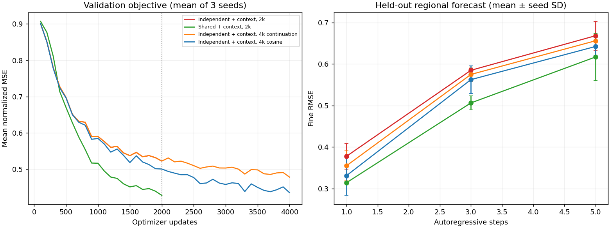

<!-- SPDX-FileCopyrightText: 2026 Samudra Authors -->
<!-- SPDX-License-Identifier: CC-BY-4.0 -->

# Does independent + context catch up with twice the updates?

Follow-up to the original four-arm local vorticity study. Experiment/results record, not intended to merge.

## Held-out results

Mean ± sample SD across the same three training seeds. Same dataset, architecture, validation objective, test examples, and per-update coarse/fine exposures as the original study. Each 4k run receives twice the original task exposure and approximately twice its training compute. The shared 2k reference is unchanged.

| Model / budget | Coarse RMSE, step 1 | Fine RMSE, step 1 | Fine RMSE, step 5 | Selected updates |
|---|---:|---:|---:|---|
| Independent + context, 2k | 0.3127 ± 0.0171 | 0.3778 ± 0.0306 | 0.6681 ± 0.0349 | 1500, 2000, 2000 |
| Shared + context, 2k | 0.2966 ± 0.0038 | 0.3141 ± 0.0027 | 0.6169 ± 0.0566 | 2000, 2000, 2000 |
| Independent + context, 4k continuation | 0.3043 ± 0.0131 | 0.3549 ± 0.0359 | 0.6560 ± 0.0157 | 4000, 3800, 3200 |
| Independent + context, 4k cosine | 0.2958 ± 0.0101 | 0.3311 ± 0.0476 | 0.6422 ± 0.0213 | 4000, 3800, 3200 |

- Independent + context, 4k continuation, lead 1, versus shared + context at 2k: mean paired change +13.04%; seeds +20.57%, -0.77%, +19.31%. Positive means independent is worse.
- Independent + context, 4k continuation, lead 5, versus shared + context at 2k: mean paired change +6.88%; seeds +12.68%, -3.70%, +11.66%. Positive means independent is worse.
- Independent + context, 4k cosine, lead 1, versus shared + context at 2k: mean paired change +5.45%; seeds +11.47%, -12.10%, +16.99%. Positive means independent is worse.
- Independent + context, 4k cosine, lead 5, versus shared + context at 2k: mean paired change +4.76%; seeds +11.82%, -7.87%, +10.32%. Positive means independent is worse.



## Reading the result

The 4k controls improve on the original independent-context mean, with the stretched cosine schedule recovering most of the original one-step fine-error gap. Its mean fine RMSE remains 0.3311 versus 0.3141 for shared at 2k, and its coarse mean essentially matches the shared reference (0.2958 versus 0.2966). The cosine control beats the shared fine reference in one seed and trails in two, at both one and five steps. Seed variation is substantial; this does not establish a statistically reliable remaining gap.

The original 2k result therefore supports a fixed-budget advantage, not an irreducible advantage of sharing. More independent training recovers much of the difference. The gradient audit independently confirms that shared coarse blocks receive direct fine-example updates, but this longer-training comparison does not prove that those gradients, rather than other effects of tying parameters, cause the accuracy difference.

## What the two longer controls change

- **4k continuation:** Replay the original 2,000 updates with the same example schedule and learning-rate schedule, keeping the resulting AdamW state. Continue for 2,000 more updates at the final learning-rate floor, 0.0002. The original study saved selected model weights but not final optimizer state, so replay is necessary for a genuine optimizer continuation.
- **4k cosine:** Train from the same initial weights and same 4,000-example schedule, but stretch the cosine learning-rate decay from 0.001 to 0.0002 across 4,000 updates. This changes the early learning rate and therefore is a fresh budget-matched control rather than an exact continuation.
- Prefix and extension schedules are generated separately and concatenated. Calling the original schedule generator with 4,000 instead of 2,000 changes the prefix's time/crop draws, so doing that would not preserve the original examples.
- The continuation replays select the same 2k checkpoints as the original. Maximum validation-objective discrepancy over all seeds/checkpoints is 7.07e-07. Maximum output discrepancy on a fixed validation batch from those selected checkpoints is 1.9e-05. GPU execution is numerically close, not bitwise identical; the initial strict-bitwise bring-up attempt stopped before any continuation and is excluded from this comparison.
- Checkpoint selection examines one-step validation loss every 100 updates, including the original first 2,000 updates. The held-out test is evaluated only on the selected model. Three- and five-step predictions are autoregressive with no truth refresh.

## Why sharing is not simply extra forward passes

Both context arms execute a global U-Net core once and a regional U-Net core once per update. Both take one AdamW optimizer step on the mean of coarse and fine losses. The shared arm uses the same parameter tensors in both executions; the independent arm has two parameter sets. Fine gradients are summed into shared weights from both regional and global-context paths before that single optimizer step.

We backpropagated the fine loss alone through each original seed-zero selected checkpoint on the same fixed batch. We then repeated it with the global context tensor detached, keeping the local prediction graph intact:

| Arm | Fine-loss gradient norm in global core | With context detached |
|---|---:|---:|
| shared_context | 1.483821 | 1.277310 |
| independent_context | 1.682791 | 0.000000 |

Independent global-core weights receive fine gradients only through context; detaching context removes them. Shared global-core weights also participate directly in the regional computation, so fine gradients remain after detaching context. Gradient magnitudes are diagnostic of connectivity, not proof that one path causes the accuracy gain, and are not comparable measures of learning quality between separately trained models.

## Interpretation limits

This tests whether extra optimization/task exposure closes the observed gap at a specified budget. It does not isolate the causal benefit of fine-to-coarse transfer from regularization, optimization conditioning, or shared feature semantics. There is no shared-at-4k arm here. Both independent-context and shared-context already learn from fine examples via the context path; sharing adds direct regional gradients and also exposes the regional weights directly to coarse supervision.

The three seeds share one synthetic dataset, so these are descriptive seed comparisons, not confidence intervals over ocean data. Neither 4k schedule proves asymptotic convergence. The old limitations about fine-detail smoothing, patch boundaries, paired data, and long-rollout stability remain.

## Artifacts and checks

All six fits completed, totaling 247.4 seconds of training/validation on the GB10, excluding final held-out tests and the stopped prefix-check bring-up. Full checkpoints, final optimizer states, and per-run histories remain locally under `outputs/longer/`. Adjacent JSON files contain raw metrics, gradient checks, and provenance, including the original dataset hash. The executed source is the checked-in `longer.py` at its recorded SHA256.

Reproduce from the repository root in a PyTorch CUDA environment with `PYTHONPATH=src`, after generating the original study's `outputs/main/` artifacts:

```bash
python experiments/shared_depth_unet/longer.py
python experiments/shared_depth_unet/summarize_longer.py
```

Use a fresh `outputs/longer/` directory. The script refuses to overwrite completed fits.
