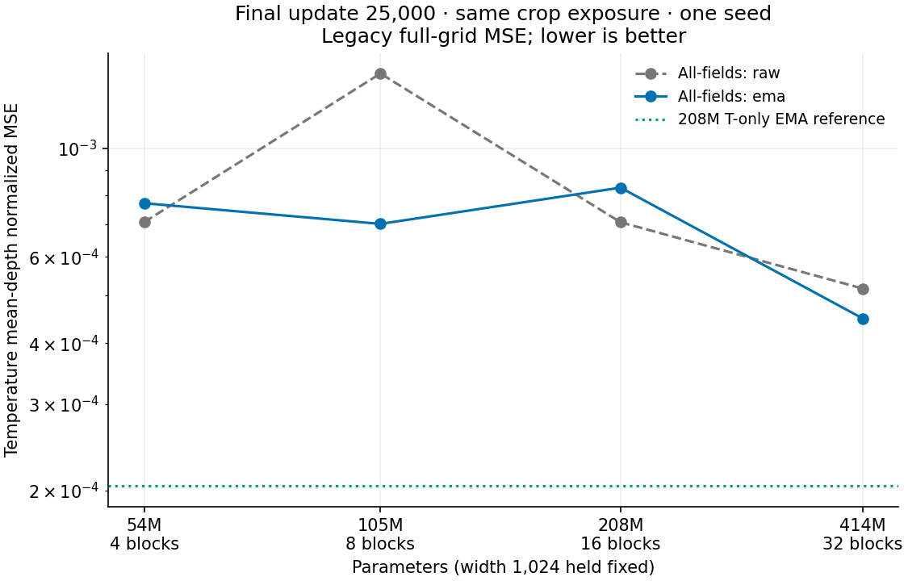
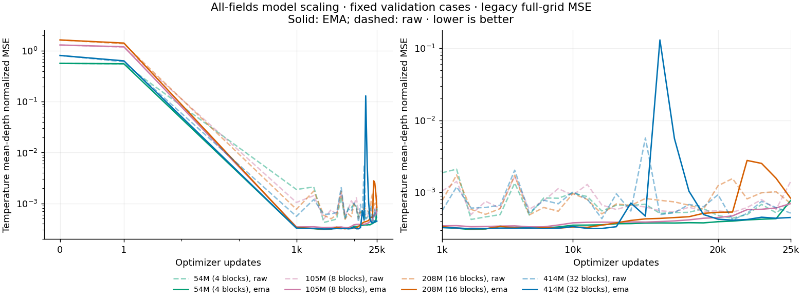

<!-- SPDX-FileCopyrightText: 2026 Samudra Authors -->
<!-- SPDX-License-Identifier: CC-BY-4.0 -->

# All-fields model scaling

The 414M model finished with 45.9% lower EMA temperature MSE than the 208M all-fields baseline, improving all 19 depths. The size trend is not monotonic: the 54M and 105M models also beat the 208M baseline at the final update. The 414M model still has 2.20× the temperature MSE of the 208M temperature-only reference and is worse than that reference at every depth. These are fixed-validation results from one seed per size, not a held-out scaling law.

| Parameters / blocks | Final raw T MSE | Final EMA T MSE | EMA vs 208M all-fields | Allocated GPU-hours |
| --- | ---: | ---: | ---: | ---: |
| 53.8M / 4 | 0.000706399 | 0.000771983 | −7.1% | 19.72 |
| 105.2M / 8 | 0.001420413 | 0.000700457 | −15.7% | 37.33 |
| 208.0M / 16, reused baseline | 0.000705935 | 0.000830579 | Reference | 69.45, previous run |
| 413.5M / 32 | 0.000516882 | 0.000449134 | −45.9% | 135.82 |

Values use the published OM4 per-channel means and standard deviations for normalization. Legacy full-grid MSE zeros land error in the numerator but keeps all rectangular grid cells in the denominator, then averages the channels equally. Temperature MSE averages its 19 depth channels; lower is better. All rows use update 25,000, without selecting a checkpoint by validation score. The temperature-only reference (Torch job 22106880) has final EMA MSE 0.000204427. It used the same 25,000-update budget, 6.4 million crop draws, input data, 16-block initial parameters, and final-update evaluation rule; its output task was temperature only. The export checks these configuration/source matches and its validation dates, counts, and persistence values. Every run uses the same eight validation dates and 64 sampled locations per depth per date. The export checks source/configuration equivalence apart from block count. It separately verifies matching validation dates, channel counts, and persistence scores.

Increasing size did not remove instability. The 414M model's EMA temperature MSE reached 0.130591 at update 16,000, then recovered; its raw-weight peak was 0.005707 at update 15,000. The best logged EMA temperature MSE over updates 1,000–25,000 was similar across sizes: 0.000306, 0.000333, 0.000313, and 0.000313 for 4, 8, 16, and 32 blocks. Those minima are selected using validation and are only trajectory diagnostics. The final-update improvement should not be read as a lower error floor or a stable monotonic scaling result.

The 414M EMA model improved salinity and SSH as well as temperature relative to the 208M baseline, but both velocity components worsened. Its aggregate MSE over all 77 channels was 0.0337494 versus 0.0307856 for the baseline, 9.6% higher. The 105M model had the lowest final EMA all-channel MSE, 0.0295648. Full field scores are in [final-metrics.csv](report/final-metrics.csv).

[Temperature curves at all 19 depths](report/validation-temperature-depths.png) · [All supervised fields](report/validation-fields.png) · [Per-channel validation data](report/validation-per-channel.csv.gz) · [Metrics and provenance](report/summary.json.gz)

All three new runs completed 25,000 optimizer updates and 6.4 million crop draws, with bitwise agreement of raw and EMA parameters across all four DDP replicas. Their successful allocations totalled 192.87 GPU-hours. Qualification added 1.04 GPU-hours, including a 12m47s initial attempt that stalled before initial validation while the GPUs reported 100% activity with only 1.4–1.6 GiB allocated, matching the [documented RTX6000 NCCL P2P symptoms](../../../docs/torch.md#nccl-gotcha-on-rtx6000-nodes). The replacement passed after setting `NCCL_P2P_DISABLE=1` and `TORCH_NCCL_ASYNC_ERROR_HANDLING=1`; these settings were used for the three new training runs. The total new suite cost was 193.91 GPU-hours, excluding the reused baseline and temperature-only reference.

| Stage | Torch job | Elapsed | Outcome |
| --- | --- | --- | --- |
| Initial qualification | 22183438 | 00:12:47 | Cancelled; logs preserved |
| Replacement qualification | 22185310 | 00:02:53 | Completed, all sizes passed |
| 4 blocks | 22185313 | 04:55:44 | Completed, exit 0:0 |
| 8 blocks | 22185315 | 09:19:57 | Completed, exit 0:0 |
| 32 blocks | 22185320 | 33:57:19 | Completed, exit 0:0 |

Artifacts are at `torch:/scratch/jr7309/skyline-scaling-20261107/`. The renderer is [render_results.py](render_results.py). The originally submitted gated training jobs 22183440, 22183477, and 22183479 were cancelled before allocation when the qualification attempt was replaced.

## Matched protocol

This experiment tested whether increasing the size of the all-fields, single-depth skyline model improves temperature forecasts under the same training recipe. Each crop queries temperature, salinity, and both velocity components at one sampled depth, plus SSH only when the sampled depth is the uppermost layer. We varied transformer depth while holding width at 1,024 and attention heads at eight. The completed 16-block run is the baseline.

| Blocks | Parameters | Relative to baseline | Run |
| --- | ---: | ---: | --- |
| 4 | 53,809,153 | 0.259× | Fresh initialization |
| 8 | 105,197,569 | 0.506× | Fresh initialization |
| 16 | 207,974,401 | 1× | Completed Torch job 22106889 |
| 32 | 413,528,065 | 1.988× | Fresh initialization |

All new runs used the original training source commit `753edeac5faa46412957b70ce5e02d6337bdefbc`, container, and [all-fields configuration](../../../src/samudra/configs/temperature_skyline/comparison_all_fields.json), changing only `model.layers`. Each received 25,000 optimizer updates and 6.4 million accepted crop draws (four GPUs × 32 crops × two accumulation steps). Sampling is paired by unchanged rank-specific, model-independent NumPy random generators for crop selection and date ordering; per-crop sequence identity was not logged separately. Model initialization uses a separate Torch random generator; different model shapes have different initial parameter tensors. Inputs are two states in a native quarter-degree 33×33 crop, with a five-day target. Coverage sampling, its importance correction, legacy full-grid per-channel MSE, AdamW, warmup and cosine schedule, EMA, and fixed validation cases remain as specified in the [output-task protocol](../output-task-comparison/README.md).

The primary comparison uses mean normalized temperature MSE across the 19 depth channels at update 25,000, using the legacy full-grid denominator on the same fixed validation dates and locations, reporting raw and EMA weights separately. The figures show temperature error against parameter count, validation trajectories, and per-depth temperature RMSE. Lower errors are better. Other fields were supervised and their scores are reported to expose tradeoffs. Each run has one seed. Updates and crop exposure are matched; FLOPs and runtime are not. The common learning rate is not tuned independently for each model size, so the result measures this fixed recipe's scaling behavior. The whole-column experiment was cancelled at the user's request and is excluded from this comparison.

Container: `ghcr.io-m2lines-ocean-emulator-physicsnemo-26.05-4f86be45a09cb9eba1b51b6273e0189941b02495.sif`. Source archive SHA-256: `be8ff1f2d47a91838fe3b8253b8c9a1be9f7abb9b7d2f71dff5a9e93ee936000`. These match the completed 16-block baseline.
