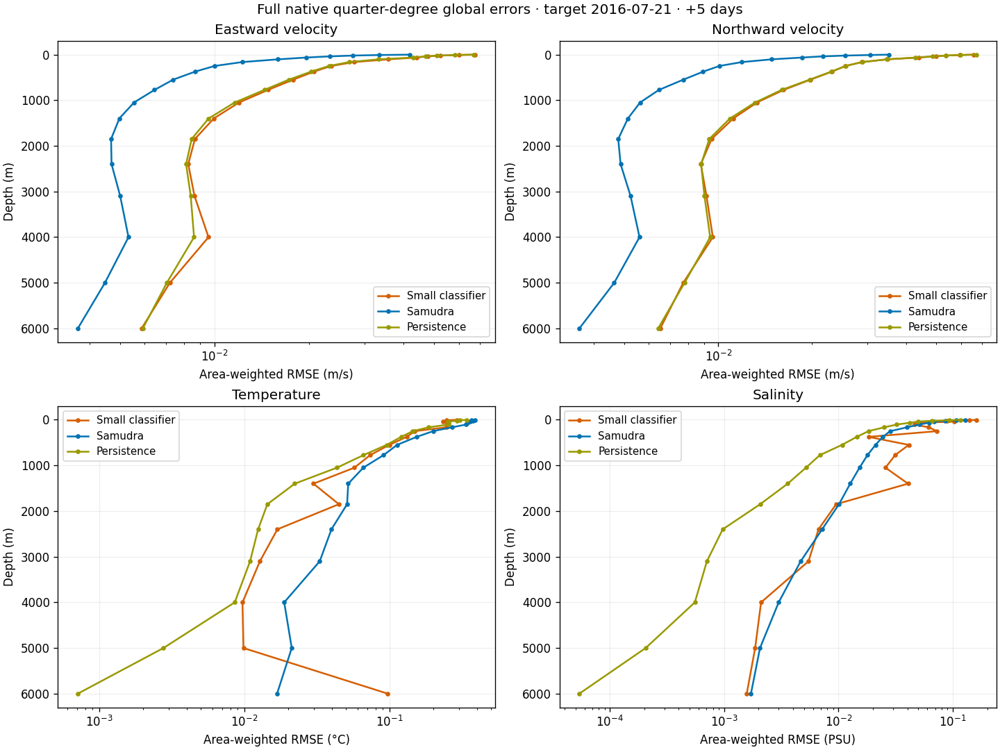

<!-- SPDX-FileCopyrightText: 2026 Samudra Authors -->
<!-- SPDX-License-Identifier: CC-BY-4.0 -->

# Full quarter-degree state comparison

Four RTX PRO 6000 Blackwell GPUs completed one five-day forecast for target **July 21, 2016**, covering **10,669,976 wet location/depth queries** and **43,370,201 valid scalar outputs**. The small all-fields classifier improves the global temperature score relative to Samudra. Samudra has lower global errors for salinity, both velocity components, and sea surface height. All models use the same two true input states five days apart, matching wet masks, identical per-channel preprocessing means and standard deviations, and the same OM4 target. This is one test date from single trained checkpoints.

| Field | Classifier normalized MSE | Samudra normalized MSE | Persistence normalized MSE | Classifier normalized RMSE change vs Samudra | Depths with lower classifier area RMSE |
|---|---:|---:|---:|---:|---:|
| Temperature | 0.00045648 | 0.00055632 | 0.00024888 | **−9.4%** | 18/19 |
| Salinity | 0.00156051 | 0.00070339 | 0.00034596 | +48.9% | 8/19 |
| Eastward velocity | 0.07612968 | 0.02119900 | 0.07115982 | +89.5% | 0/19 |
| Northward velocity | 0.11921353 | 0.02951417 | 0.11736553 | +101.0% | 0/19 |
| Sea surface height | 0.00140558 | 0.00101937 | 0.00137149 | +17.4% | 0/1 |

Each normalized MSE is the mean of per-channel MSE values after dividing errors by the channel's training standard deviation. Each channel uses the full 720×1440 denominator with zero contribution from land. A field averages its 19 channels, except SSH's single channel. RMSE changes use the square root of those averages, with negative changes favoring the classifier. Physical area-weighted RMSE counts use wet cells only and are a separate metric. Persistence copies the latest input and has lower normalized MSE than the classifier in every field. [All 231 channel/model metric rows](report/global-metrics.csv) include physical RMSE, MAE, bias, wet counts, and both full-grid and wet-only normalized MSE. [Field aggregates](report/global-field-metrics.csv) preserve the table values.

The classifier has lower physical area-weighted temperature RMSE at every depth except 6000 m. Rare large errors also remain at 1850 m, where the five largest area-weighted squared-error contributions account for 75.7% of its global area-weighted squared error at that depth. The largest is at 44.5940°N, 357.625°E, with OM4 7.7005 °C and classifier −17.7271 °C. At 6000 m, the five largest contributions account for 24.6%. These values remain in every reported metric.

## Models and repeatability

The small all-fields classifier has 18.5M parameters, four width-512 transformer blocks, continuous inputs, 17×17 native crops and five field-query outputs at a sampled depth. It uses 8,192 fixed category centers per field/depth channel in normalized units, two-hot training targets, smooth head initialization and final 25,000-update EMA weights. Inference uses BF16 computation, argmax categories and FP32 bin centers. Four volumetric fields are predicted together for each location/depth, with SSH retained from surface queries. All 19 depths require separate backbone evaluations.

Samudra is the quarter-degree two-input/one-output model from run 211241, epoch 62, using its saved model weights. Its configuration enables BF16 internally and returns float32 arrays. The new all-77-channel evaluation uses the exact historical checkpoint and configuration. Its temperature output differs from the earlier cache by an RMS of 0.0131 °C at the surface, 0.00178 °C at 1850 m and 0.000626 °C at 6000 m. The cause of this repeatability difference remains unresolved. A triangle-inequality bound using the measured cache discrepancy places the classifier's global normalized temperature RMSE improvement against the historical cache between 5.8% and 12.8%, so the aggregate temperature ranking survives this discrepancy. This interval is a bound rather than a recomputed historical score. [Sensitivity calculation](report/cache-sensitivity.json). This report consistently uses the newly evaluated Samudra output. The classifier qualification subsets match all nine cached regional temperature subsets exactly. [Samudra receipt](report/samudra.json.gz) records the differences at every depth, and [provenance](report/provenance.json.gz) records checkpoint hashes and configuration.

An initial qualification enforced exact Samudra-cache agreement and failed. A second qualification retained and measured the discrepancy, verified all 77 outputs were finite, and supplied the Samudra forecast reused in the full comparison. The global run verified every wet location/depth was processed exactly once and that all 43,370,201 wet scalar predictions were finite. Land is NaN in the saved physical arrays. Model sizes, spatial context, training budgets and checkpoint selections differ between the classifier and Samudra.

## Runtime

| Work | Measured time |
|---|---:|
| Classifier inference pipeline, slowest of four GPU ranks | **13 min 49 s** |
| Four-GPU production allocation, including assembly and compressed export | **15 min 6 s** |
| Samudra global forward and CPU transfer on one GPU | **1.94 s** |
| Samudra setup and forward together | **5.26 s** |
| Total allocated compute including both qualification jobs | **1.113 GPU-hours** |

Classifier timing includes crop preparation, transfer, forward evaluation, argmax readout and chunk output. Samudra consumes the entire global state in one forward pass. Its forward timer starts after inputs and model are resident on the GPU. The 1.94 s measurement therefore covers a smaller processing scope than the classifier pipeline. Samudra was evaluated during qualification and reused during production. The production allocation consumed 3,624 GPU-seconds and the two qualifications consumed 384 combined. Transfer to this workstation and CPU report rendering occurred afterward. [Execution receipt](execution.json.gz) preserves job IDs, costs and the full-array checksum.

## Global fields and errors

Every map has columns for OM4, classifier, Samudra, classifier error and Samudra error. Global displays sample every fourth native row and column, giving a 1° lattice with equal-size hard pixels. All scores use the full native quarter-degree wet grid. Within each row, field panels share the OM4 0.5th–99.5th percentile range. Error panels share a symmetric limit at the pooled 99.5th percentile of absolute errors from the two models. Values beyond these limits saturate, including the rare errors described above. Each page contains up to four depths.

| Field | 2.5–40 m | 65–250 m | 375–1050 m | 1400–3100 m | 4000–6000 m |
|---|---|---|---|---|---|
| Temperature | [Maps](report/global-thetao-00.png) | [Maps](report/global-thetao-04.png) | [Maps](report/global-thetao-08.png) | [Maps](report/global-thetao-12.png) | [Maps](report/global-thetao-16.png) |
| Salinity | [Maps](report/global-so-00.png) | [Maps](report/global-so-04.png) | [Maps](report/global-so-08.png) | [Maps](report/global-so-12.png) | [Maps](report/global-so-16.png) |
| Eastward velocity | [Maps](report/global-uo-00.png) | [Maps](report/global-uo-04.png) | [Maps](report/global-uo-08.png) | [Maps](report/global-uo-12.png) | [Maps](report/global-uo-16.png) |
| Northward velocity | [Maps](report/global-vo-00.png) | [Maps](report/global-vo-04.png) | [Maps](report/global-vo-08.png) | [Maps](report/global-vo-12.png) | [Maps](report/global-vo-16.png) |

[Global sea surface height](report/global-zos-00.png)

## Regional fields and errors

Native 64×64 patches cover the same North Pacific, Gulf Stream and Agulhas cells as earlier reports. Rows show 2.5, 250 and 1850 m, with SSH shown once. Each cell occupies 3×3 pixels without interpolation. Regional color ranges include all compared values, with common field and symmetric error ranges per row. Dashed boxes show the classifier input context.

| Region | Temperature | Salinity | Eastward velocity | Northward velocity | SSH |
|---|---|---|---|---|---|
| North Pacific | [Maps](report/north-pacific-thetao.png) | [Maps](report/north-pacific-so.png) | [Maps](report/north-pacific-uo.png) | [Maps](report/north-pacific-vo.png) | [Maps](report/north-pacific-zos.png) |
| Gulf Stream | [Maps](report/gulf-stream-thetao.png) | [Maps](report/gulf-stream-so.png) | [Maps](report/gulf-stream-uo.png) | [Maps](report/gulf-stream-vo.png) | [Maps](report/gulf-stream-zos.png) |
| Agulhas | [Maps](report/agulhas-thetao.png) | [Maps](report/agulhas-so.png) | [Maps](report/agulhas-uo.png) | [Maps](report/agulhas-vo.png) | [Maps](report/agulhas-zos.png) |

[Regional metrics](report/regional-metrics.csv) include persistence and use area-weighted wet-cell RMSE.

## Regional spectra

The spectra use identical fully wet 64×64 tiles for all models, falling back to the fully wet 32×32 tile nearest the center within the same displayed 64×64 regional patch. Panels without such a tile are labeled. A fitted plane is removed from each field or prediction-minus-OM4 error array, then a periodic Hann window is applied. Fourier power is normalized by mean squared window amplitude and summed in radial shells of width 1/tile-side cycles per cell. The plots cover nonzero radial frequencies through 0.5 cycles per cell. Shading marks wavelengths of 2–4 native cells. Lower error power indicates lower error at that scale. Grid-cell wavelength has latitude- and direction-dependent physical length. Detrending removes mean and planar errors, so integrated spectra differ from raw map MSE.

| Field | Field spectra | Error spectra |
|---|---|---|
| Temperature | [Figure](report/thetao-field-spectra.png) | [Figure](report/thetao-error-spectra.png) |
| Salinity | [Figure](report/so-field-spectra.png) | [Figure](report/so-error-spectra.png) |
| Eastward velocity | [Figure](report/uo-field-spectra.png) | [Figure](report/uo-error-spectra.png) |
| Northward velocity | [Figure](report/vo-field-spectra.png) | [Figure](report/vo-error-spectra.png) |
| SSH | [Figure](report/zos-field-spectra.png) | [Figure](report/zos-error-spectra.png) |

[Radial spectral values](report/regional-spectra.csv.gz) retain tile locations and sizes. The available [classifier training validation curves](../samudra-small-classifier/README.md#available-validation-history) use earlier sampled validation dates. This full-state evaluation supplies one test forecast.

## Artifacts and reproduction

The physical arrays contain classifier, Samudra, OM4 target and persistence, each float32 [77,720,1440], plus masks, coordinates, cell areas, channel names and normalization. They occupy about 470 MiB compressed and are retained at `/scratch/jr7309/skyline-full-state-20261111/full/arrays.npz` on Torch and `/home/jder/.local/state/codex-async-followup/workflows/skyline-full-state-artifacts/arrays.npz` on this workstation. Their SHA-256 is recorded in the execution receipt. The GitHub report contains figures and numerical tables.

[Inference harness](infer.py), [compressed run configuration](config.json.gz), [completion receipt](report/COMPLETE.json.gz), and [renderer](render.py) preserve the run. Decompress the configuration before passing it to the harness. The run used source commit `ea592e8a71ebf9b50285ef835d641aae1de4d3c9`; the inference harness was subsequently formatted with identical Python AST, with both file hashes recorded. Run the renderer with `CUDA_VISIBLE_DEVICES='' uv run python experiments/temperature_skyline/full-state-comparison/render.py /path/to/arrays.npz`.

This draft experiment/results record is not intended to merge. OM4 is the ocean-model target, and the evaluation covers one date.
