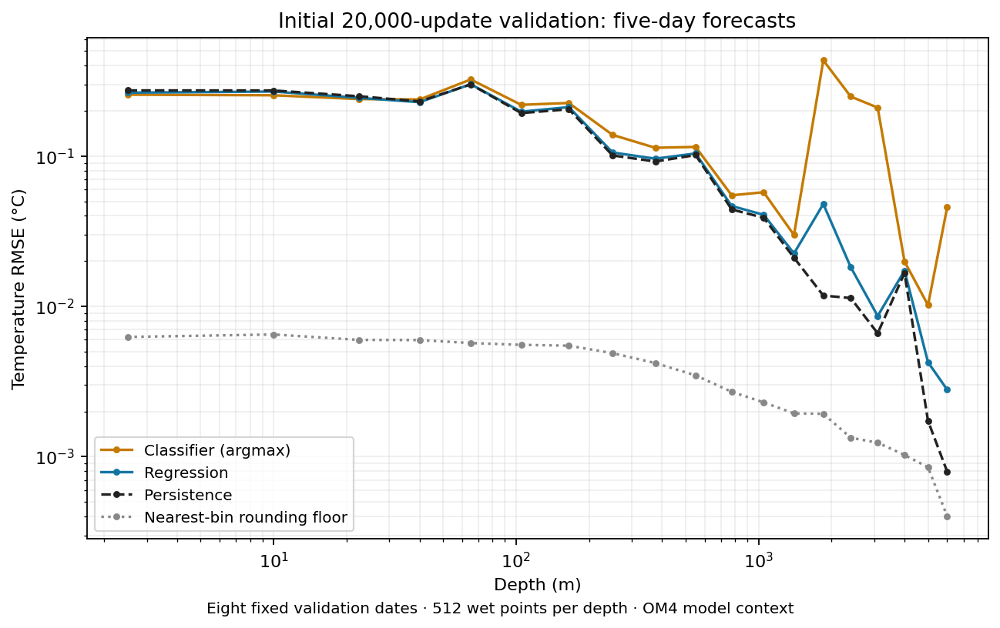

<!-- SPDX-FileCopyrightText: 2026 Samudra Authors -->
<!-- SPDX-License-Identifier: CC-BY-4.0 -->

# Initial 20,000-update temperature skyline results

Both small-model runs completed 20,000 optimizer updates. Neither beats
persistence on aggregate validation error. The classifier has large errors at a small number of deep
ocean points. Regression is substantially better there, but still trails
persistence at most depths.

These are the eight fixed validation dates used during training, with 64
area-proportionally sampled wet points per date at each of 19 depths: 512
date-cell cases per depth. The forecast uses OM4 states at t−5 days and t to
predict temperature at t+5 days. States are five-day model averages, not
observations. Best-error selection minimizes mean-depth normalized MSE over
the ten validation checkpoints recorded every 2,000 updates. Checkpoints were
selected on this same validation set; these are not independent test scores.
Both models use the same sampled dates and cells.

| Model | Final mean-depth normalized MSE | Best-error normalized MSE | Selected update |
| --- | ---: | ---: | ---: |
| Absolute classifier, argmax | 0.009771 | 0.006504 | 14,000 |
| Regression | 0.0004267 | 0.0003894 | 18,000 |
| Persistence | 0.0003503 | — | — |

Normalization divides each temperature error by its training-set standard
deviation at that depth, then averages MSE equally across depths. The selected
regression checkpoint is 11.2% worse than persistence by this measure. The
final classifier beats persistence at 3 of 19 depths; final regression at 4.
The classifier's best-likelihood checkpoint is update 20,000, with bin NLL
4.0418 nats. Calibration and candidate-error detection remain untested.

At the final update, surface RMSE is 0.2558°C for classification, 0.2639°C for
regression, and 0.2732°C for persistence. At 1,850 m, the corresponding values
are 0.4329°C, 0.0480°C, and 0.0118°C. Five date-cell cases account for 99.8% of
the classifier's squared error at that depth; its largest error is 8.20°C.
The nearest-bin rounding floor is only 0.00193°C there. The representation
admits much smaller errors than observed; this does not establish why the
trained classifier selects incorrect bins.

[All-depth CSV](final-per-depth.csv), [summary and validation curves](summary.json),
and the final/best-error JSON files retain the reported numbers and selection
criteria. The classifier has 210,067,456 parameters; regression has 207,969,281.
Both use effective batch 32 and a 33×33 crop from two observed states.

Execution receipts: classifier job 21770500 and regression job 21770502 both
completed with exit 0:0. Automatic checkpoint recovery was exercised by two
classifier restarts and five regression restarts. Final allocation segments
lasted 1h42m55s and 55m10s; these are not total campaign times. Both COMPLETE.json
files confirm step 20,000 in full training mode (`qualification=false`, meaning
this was not the bounded smoke test). Latest optimizer checkpoints
and selected weight checkpoints are preserved. Replayed steps after preemption
produce duplicate local log records and W&B repeated-step warnings; aggregate
progress from the latest attempt/record for each step.

Matched comparison job 21793092 completed successfully in 4m46s on H200,
source `aa0e47c4be8703632d266a678bca768dbf085cc0`. All three selected
checkpoints used identical 9,728 date-cell-depth targets. The frozen baseline
is epoch 62 of October 8 run 211241, using its published evaluator's model
weights. Regression at update 18,000 beats Samudra RMSE at all 19 depths and
has mean-depth normalized MSE 0.0003894 versus Samudra's 0.0009506 (59.0%
lower). It still trails persistence on the aggregate metric. Classifier at
update 20,000 beats Samudra at 14 of 19 depths, but its deep outliers dominate
the aggregate error; the update-14,000 classifier beats Samudra at 3 depths.
These are the same validation cases used for checkpoint selection, not an
independent test. [Matched all-depth CSV](matched-per-depth.csv) and
[full comparison receipts](matched-comparison.json) preserve the metrics.

[Outlier investigation](outliers/README.md) traces the five largest classifier
errors at 1,850 m to warm deep basins. Replayed training draws show only one
example above 15°C at this depth. Nearest training states have targets close
to truth, yet the classifier also mispredicts those training examples. Full
probabilities and input gradients are included in that investigation.
