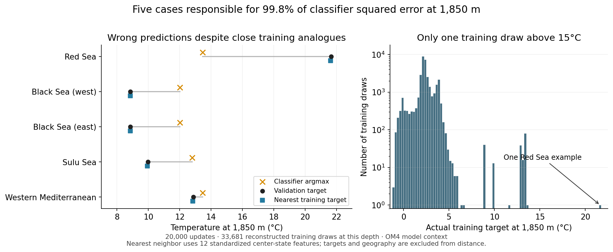

<!-- SPDX-FileCopyrightText: 2026 Samudra Authors -->
<!-- SPDX-License-Identifier: CC-BY-4.0 -->

# Five deep-temperature classifier outliers

The five largest classifier errors at 1,850 m occur in the Red Sea, Black Sea
(two cases), Sulu Sea, and western Mediterranean. They account for 99.81% of
squared error among all 512 evaluated validation date-cell cases at this
depth: 64 wet cells sampled in proportion to cell area on each of eight fixed
validation dates. This is a sampled subset of the validation grid, also used
for checkpoint selection. Excluding
them reduces classifier RMSE from 0.43287°C to 0.01891°C. This exclusion is a
diagnostic, not a revised evaluation score.

These results use the final 20,000-update absolute-temperature classifier,
whose readout selects the most probable of 2,048 bins. OM4 states at t−5 days
and t predict the five-day mean temperature at t+5 days. Every case below
changes by less than 0.001°C between the supplied current state and target.
The forecast errors therefore greatly exceed the actual changes.

| Basin | Target date | Truth °C | Classifier °C | Target of nearest training input °C | Share of depth SSE |
| --- | --- | ---: | ---: | ---: | ---: |
| Red Sea | 2013-12-04 | 21.6625 | 13.4588 | 21.6288 | 70.151% |
| Black Sea, west | 2014-06-22 | 8.8515 | 12.0207 | 8.8487 | 10.469% |
| Black Sea, east | 2014-10-05 | 8.8526 | 12.0207 | 8.8503 | 10.462% |
| Sulu Sea | 2013-10-15 | 9.9699 | 12.8041 | 9.9340 | 8.373% |
| Western Mediterranean | 2014-10-05 | 12.8736 | 13.4588 | 12.8287 | 0.357% |

The training sampler was replayed through all accepted updates and its final
point-sampling and frame-order random-number states exactly match the saved
checkpoint. This reconstructs 33,681 training draws at 1,850 m, containing
33,680 unique date-cell pairs. Updates discarded by preemption are excluded.
The declared training interval is 1975-01-03 through 2013-10-05; both history
records and the target must lie inside it. Only 233 draws exceed 5°C, and only
one exceeds 15°C. That single warmest
example is a Red Sea target of 21.6288°C. The source data contain thousands of
warm historical states at the outlier locations; very few were selected as
training targets. At the Red Sea cell, the historical training-period range
is 21.5561–21.6615°C, just 0.001°C below this validation target at its maximum.

The nearest-neighbor distance is the root mean square difference across 12
center-cell inputs: temperature, salinity, zonal and meridional velocity at
1,850 m, sea-surface height, and surface heat flux, at both history times.
Each channel uses the training normalization. Geography and target values
are excluded from distance. This is a simple physical-state comparison;
it does not compare the full 33×33 crop or the model's learned representation.
The search covers every reconstructed training draw at this depth.

For a comparison with misleading targets, the same search was restricted to
training targets within ±0.25°C of each incorrect prediction. These are called
"confusable" neighbors in the JSON; the target filter is only a diagnostic
and is not used in training or ordinary nearest-neighbor retrieval.

| Basin | Nearest distance | Nearest misleading-target distance | True-bin training draws | Predicted-bin training draws |
| --- | ---: | ---: | ---: | ---: |
| Red Sea | 0.575 | 2.750 | 0 | 35 |
| Black Sea, west | 0.214 | No eligible target | 12 | 0 |
| Black Sea, east | 0.195 | No eligible target | 12 | 0 |
| Sulu Sea | 0.146 | 3.900 | 7 | 3 |
| Western Mediterranean | 0.623 | 1.138 | 12 | 35 |

Bins use depth-specific asinh-spaced centers in standardized temperature,
with assignment boundaries halfway between centers. At 1,850 m the finite
support spans approximately −17.916 to 21.900°C. The Red Sea target bin spans
21.6428–21.7068°C; the single 21.6288°C training target falls in its neighbor.
Thus zero exact-bin exposure should be read alongside the single nearby
example, not as absence of every similar historical temperature.

The closest training states have targets near the truth in all five cases.
The misleading-target neighbors are Mediterranean examples when they exist.
No sampled 1,850 m target is within ±0.25°C of 12.0207°C, the prediction for
both Black Sea cases. These counts are depth-specific: the classifier head
is shared across depths, so a zero count here does not mean the class was
unseen globally. Historical analogues at the exact validation cell are also
included in the JSON, separately from examples actually drawn for training.

Predictions change sharply during training. The Red Sea case reaches
21.421°C at update 10,000, then returns to 13.459°C by update 14,000. The west
Black Sea case reaches 8.840°C at update 14,000, then returns to 12.021°C.
[Checkpoint trajectories](checkpoint-trajectories.png) show all ten recorded
checkpoints. Only six validation targets at this depth exceed 5°C; the sixth,
at 13.432°C in the Mediterranean, is predicted accurately by the same
13.459°C output selected for two outliers.

GPU replay reproduced all five modal predictions exactly. The winning bins
carry only 1.62–5.19% probability. Only 1.36–5.11% of probability lies within
±0.5°C of the truth. Distribution means are 2.46–4.43°C, so replacing argmax
with the mean does not fix these cases.

For both Black Sea cases, the runner-up bin is centered on 8.8397°C, close to
the 8.85°C truth. But the exact target-containing bin spans 8.8510–8.8738°C
and ranks 212th and 148th. Adjacent temperature bins have very different
probabilities. The nearby 8.8397°C bin received 28 training labels at this
depth, versus 12 for the true bin. Full probabilities were replayed in BF16
with batch size one; small probability differences from the original batched
validation are expected, although all argmax bins agree.

The model also makes the same modal error on the nearest actual training
examples and on historical inputs from each exact validation cell. The Red
Sea training target of 21.6288°C is itself predicted as 13.4588°C. Both nearest
Black Sea examples are predicted as 12.0207°C, and the nearest Sulu example is
predicted as 12.8041°C. This demonstrates errors on training examples, not
only unfamiliar validation dates. [Full probabilities and analogues](explanations.json)
record these forwards; [probability plots](probability-distributions.png)
show the five distributions.

Gradients measure the predicted-bin minus true-bin logit margin with respect
to standardized input values. The forecast query is a separate transformer
token containing depth, location, and the current center-cell temperature.
That temperature also appears in the crop, so both derivatives must be added
before summing absolute values by channel. The percentage denominator sums
absolute derivatives over all wet input values, spatial cells, and both
history times, including this combined temperature path; it excludes
geographic-coordinate derivatives. After this correction, 1,850 m temperature is the largest channel
for both Black Sea cases (72% and 64% of total absolute input derivative),
Sulu (40%), and the Mediterranean (9%). The Red Sea case instead has heat flux
as its largest channel (11%); deep-temperature sensitivity there is small.
These are local sensitivities of this particular margin, not causal
training-example influence or a physically valid intervention. The
[combined gradient summary](combined-gradient-summary.json) applies this
chain rule to the saved raw gradients; the raw explanation file reports the
crop and direct-query derivatives separately.

The evidence supports a failure to learn stable predictions for rarely
sampled warm deep basins. Sparse class exposure, a shared output head, and
an absolute categorical objective are possible contributors; this audit does
not isolate their causal effects. The intended error detector scores another model's candidate temperature
using its histogram density (bin probability divided by physical bin width).
These five cases raise concern about such scores in warm basins; forecast
error detection and calibration have not been evaluated here.
A residual categorical control and stronger sampling coverage of rare basins
are motivated follow-ups, not demonstrated remedies.

CPU audit job 21794125 completed 0:0 in 46 seconds, source
`7ee18afc657183ff42b0d0d495819a80169f77c1`. Its artifacts are under
`/scratch/jr7309/temperature-skyline-20261102/outlier-audit-v1/`, including the
2.2 MB `training-points.npz` with all reconstructed features and targets.
The saved classifier is `runs/210m-absolute-20k-v1/latest.pt` under the same
experiment root. GPU analysis job 21794214 completed 0:0 in 34 seconds using the same source;
its raw probability and gradient arrays are in
`/scratch/jr7309/temperature-skyline-20261102/outlier-explanation-v1/`.
Both completion callbacks were handled and retired. No trained weights changed.

The Samudra comparison also completed (21793092). It matches evaluation
dates, cells, depths, targets, and the two historical input states and fields.
The fixed baseline is epoch 62 of the October 8 Samudra run 211241, loaded
without further training. The linked regression outputs come from the
matched scalar-regression specialist control described in the
[parent report](../README.md). On these five cases,
Samudra absolute errors range from 0.0173 to 0.1174°C, all smaller than the
classifier errors. [Matched outlier predictions](matched-outlier-predictions.json)
contain classifier, regression, and frozen Samudra outputs.

[Cases CSV](cases.csv), [complete nearest-neighbor audit](audit.json),
[checkpoint records](checkpoint-trajectory.json), and
[figure PDF](outlier-diagnosis.pdf) preserve the reported results.
