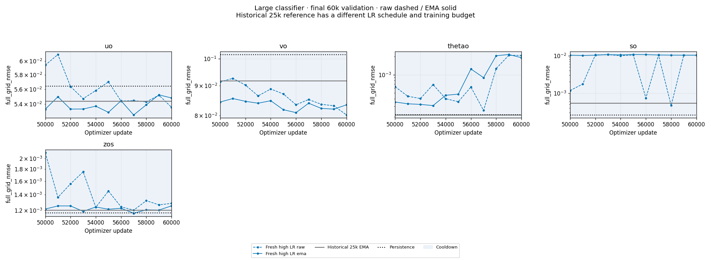

<!-- SPDX-FileCopyrightText: 2026 Samudra Authors -->
<!-- SPDX-License-Identifier: CC-BY-4.0 -->

# Large all-fields classifier: longer high-learning-rate training

The fresh large classifier completed 60,000 updates, including 10,000 updates of cooldown. At the fixed final EMA checkpoint, meridional-velocity MSE is 9.1% lower than the historical 25k classifier; zonal-velocity MSE is 0.8% higher. Temperature and salinity MSE are substantially worse. The longer, higher-rate run therefore did not improve all fields together.

## Validation results

The table reports channel-normalized MSE, averaged equally across depths within each field; lower is better. All rows use the same eight held-out dates and 64 fixed sampled locations per depth per date. EMA means exponential-moving-average weights. Persistence copies the latest input state to the five-day target.

| EMA checkpoint | T | S | u | v | SSH |
|---|---:|---:|---:|---:|---:|
| New run, 25k | 0.0003459 | 0.0009356 | 0.0605232 | 0.1059812 | 0.0013627 |
| New run, 50k before cooldown | 0.0003528 | 0.0102696 | 0.0533390 | 0.0843711 | 0.0012155 |
| New run, 55k | 0.0004768 | 0.0107187 | 0.0529367 | 0.0818550 | 0.0012132 |
| New run, 60k primary | 0.0019154 | 0.0102797 | 0.0548228 | 0.0834341 | 0.0012543 |
| Historical cosine, 25k | 0.0002154 | 0.0005413 | 0.0543883 | 0.0917497 | 0.0012040 |
| Persistence | 0.0002187 | 0.0002612 | 0.0564352 | 0.1016504 | 0.0011725 |

Final u and v MSE beat persistence by 2.9% and 17.9%, respectively. Final T, S and SSH MSE are worse than persistence. Temperature's large final error is concentrated at 65 m and 105 m, which contribute about 90% of the field's summed normalized MSE. Salinity at 1,850 m contributes 96% of that field's error. These are depth-level observations; this report does not identify individual outlier causes.

Between 50k and 60k, hard-bin NLL decreased in all five fields, while MSE decreased only for v. Temperature MSE rose 5.43-fold. The cooldown interval therefore improved categorical scores without consistently improving the argmax scalar forecasts. There is no constant-rate continuation control, so these changes cannot be attributed solely to cooldown, and the results do not establish whether a longer cooldown would help.

| Field | Hard-bin NLL at 50k EMA | Hard-bin NLL at 60k EMA |
|---|---:|---:|
| thetao | 2.54711 | 2.43973 |
| so | 1.98935 | 1.81977 |
| uo | 3.41992 | 3.41656 |
| vo | 3.48788 | 3.46750 |
| zos | 3.20880 | 3.18204 |

[Full MSE curves](report/fields-full_grid_nmse.png) · [Cooldown MSE curves](report/cooldown-fields-full_grid_nmse.png) · [Full NLL curves](report/fields-full_grid_nll.png) · [Cooldown NLL curves](report/cooldown-fields-full_grid_nll.png) · [Learning-rate schedule](report/learning-rate.png)

Per-depth MSE: [T](report/thetao-full_grid_nmse.png), [S](report/so-full_grid_nmse.png), [u](report/uo-full_grid_nmse.png), [v](report/vo-full_grid_nmse.png). Corresponding per-depth NLL figures are in the report directory. Full-history figures use logarithmic update axes from update one; initialization remains in the CSVs. Raw and EMA curves are both shown.

Downloads: [all channel validation curves](report/validation-channels.csv.gz), [field validation curves](report/validation-fields.csv.gz), [fixed endpoints](report/fixed-endpoints.csv.gz), [training history](report/training-progress.csv.gz). The primary comparison uses fixed final checkpoints, not the best score selected from each curve.

## Training protocol and limits

This experiment trained one fresh 216,370,176-parameter classifier for 60,000 updates. The learning rate warms up linearly for 200 updates to 0.0008, stays at that rate through update 50,000, then follows a cosine cooldown over 10,000 updates to 0.00002. Full optimizer, EMA and sampling-state checkpoints are retained at 0, 10k, 25k, 50k, 55k and 60k. The 50k checkpoint preserves the state before cooldown for possible later experiments.

The architecture, input data and sampling recipe match the [original large all-fields classifier](../large-all-fields-classifier/README.md): width 1024, 16 transformer blocks, eight heads, 33×33 quarter-degree crop, four field queries at each sampled depth plus surface SSH, and 8,192 fixed categorical centers. Continuous inputs, two-hot cross-entropy, sigma-four smooth head initialization and discrete argmax readout are unchanged. The output has 77 channels: T/S/u/v at 19 depths and surface SSH. All predictions target absolute states five days ahead from two input states.

Four RTX PRO 6000 GPUs use microbatches of 32 and two gradient-accumulation steps, giving effective batch 256. Seed 20261106, 128 crops per loaded time window, coverage sampling, normalization, masks and EMA follow the original run. Observed optimizer updates took approximately 2.39 seconds, with steady GPU utilization usually 93–98%. Hardware was held fixed for comparison, and jobs were eligible for normal and preemptible lzanna capacity. Allocations requested 24 hours with checkpoint/requeue recovery. Actual compute accounting includes every allocation and any replayed updates.

The qualification ran 16 updates at the full 0.0008 learning rate from fresh initialization. It checks finite gradients, losses and all 77 validation metrics, exact initialization and data identity against the earlier large classifier, and complete optimizer/EMA/sampling checkpoints. This short stability check cannot establish stability over the full training run. Production uses the stated 200-update warmup.

Training uses OM4 `om4_quarterdeg_v2` with split bounds 1975-01-03 to 2013-10-05; validation lies in the subsequent 2013-10-05 to 2014-10-05 split. Validation origin indices are 4071, 4081, 4091, 4101, 4111, 4121, 4131 and 4142. Validation uses the original eight held-out dates and the same fixed 64 sampled points per depth per date across checkpoints and the historical reference, with raw and exponential-moving-average (EMA) weights at initialization, 1/50/100/200/500/750 updates, then every 1,000 updates. Model weights are retained for each validation. The final 60k EMA checkpoint is the primary endpoint; 50k and 55k show behavior through cooldown. The report includes per-field and per-depth normalized MSE, hard-bin NLL, persistence and curves/CSVs. For channel c, normalized MSE estimates `(1 / (H × W)) × Σ_wet ((prediction − target) / σ_c)²`, where σ_c is the dataset channel standard deviation and land contributes zero. These are importance-weighted estimates from sampled wet locations, not exhaustive global inference; fields average their channels equally. Hard-bin labels use midpoint boundaries between adjacent fixed centers, with ties assigned to the lower bin and out-of-range targets assigned to the open-ended edge classes. Hard-bin NLL scores that categorical probability mass; lower values are better for both metrics. Persistence copies the latest input state and uses exactly the same MSE samples, masks and normalization; it has no categorical NLL. Two-hot training does not by itself establish probability calibration. The fixed final 25k EMA weights of the original classifier are a historical reference with a different learning-rate schedule and training budget. This single-seed experiment cannot isolate the effects of rate, total training or cooldown length.

[Production configuration](train.json) · [Qualification configuration](qualify.json) · [Configuration differences and schedule checks](configuration-audit.json.gz)

This is an experiment/results record, not intended to merge. No full-grid inference or additional training arms are included.

## Execution and retained artifacts

Training and qualification consumed **166.96 allocated GPU-hours**, including preemption, failed allocations and replayed updates. Qualification job 23871950 passed 16 updates at the full peak rate. Production began as 23875476, recovered one preemption, then stopped near 38k when scratch reached its 5 TB quota. Resume 24027829 exposed explicit disk-quota errors in telemetry and W&B logging. The final resume, 24030810, completed 60k; final CPU audit 24030812 passed. Each update used batch 256, for 15,360,000 accepted training examples. Model replicas and EMA update counts agree.

The audit verified identical initial parameters and source data against the historical classifier, finite training statistics and all 134 raw/EMA validation records, every requested full-state checkpoint, and identical sampling RNG/frame-stream states at 25k versus the historical run. Source `051c647598da10b82739963b04020e7a0c1d1c1c` and scientific configuration were unchanged across all allocations. Strict resume restored optimizer, EMA, global update and all four rank sampling states. Numerical trajectories can still vary with GPU execution, and this is a single-seed comparison on a finite validation sample.

To recover quota, 90 immutable per-validation weight files (77.9 GB) were copied to `/archive/jr7309/skyline-large-high-lr-20261120/all-fields-60k/`, verified with SHA-256, then replaced by links at their scratch paths. No retained result was deleted. Archive is not mounted on compute nodes; those older validation weights must be staged back before compute-node inference. Full optimizer checkpoints at 0/10k/25k/50k/55k/60k and newer validation weights remain under `/scratch/jr7309/skyline-large-high-lr-20261120/all-fields-60k/`. The checkpoint used after quota recovery passed a complete ZIP CRC check.

Evidence: [final checkpoint audit](report/final-audit.json.gz), [scheduler accounting](report/accounting.txt.gz), [archival checksums](report/archive-receipt.json.gz), [resume integrity](report/resume-integrity.json.gz). CPU audits and DTN archival time are separate from the GPU-hour total. No full-grid inference was run for this experiment.
