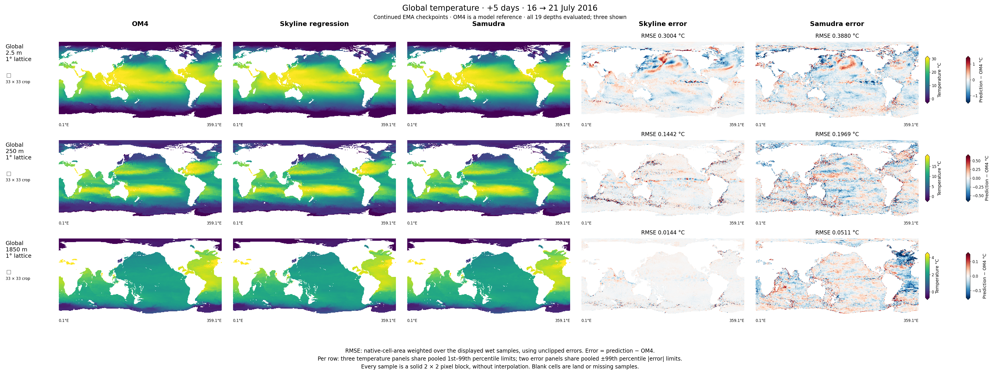
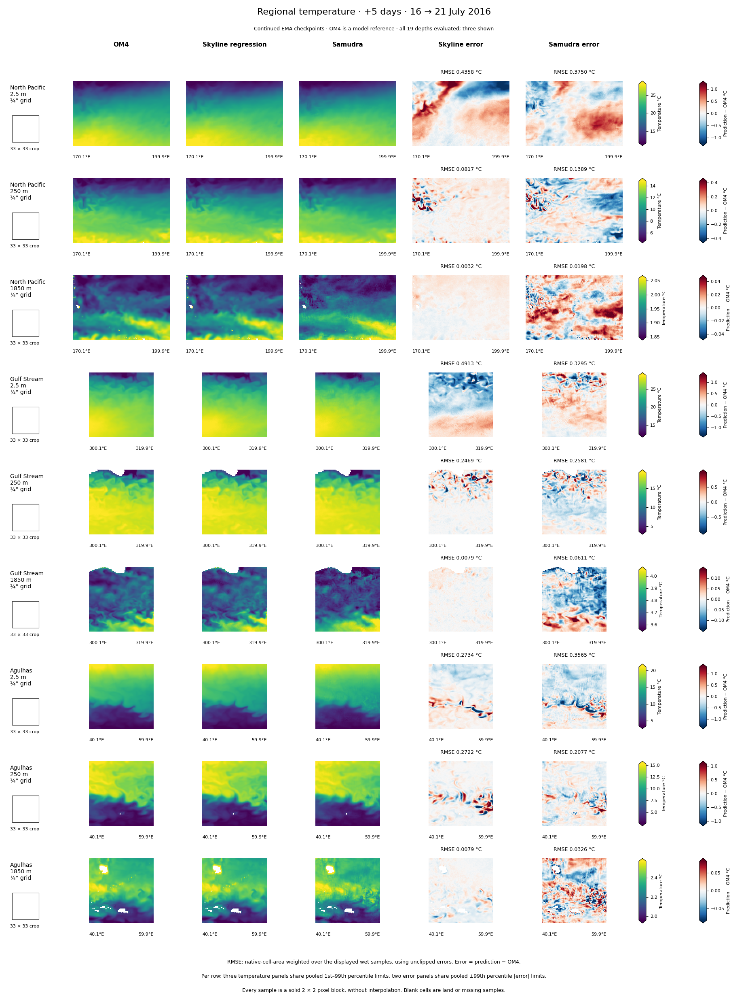

<!--
SPDX-FileCopyrightText: 2026 Samudra Authors
SPDX-License-Identifier: CC-BY-4.0
-->

# Continued-checkpoint temperature maps and confidence assessment

Continued skyline regression reduces held-out mean-depth normalized MSE by
**12.6% versus the initial skyline**, **59.3% versus Samudra**, and **5.7% versus
persistence**. It beats Samudra's global RMSE at all 19 depths, but beats
persistence at only 6 of 19. The aggregate benefit therefore does not imply
improvement at every depth or region. Classifier surprise improves as an error
detector, while disagreement with regression remains the stronger detector.

These are fresh predictions from regression EMA at continued update 7,711 and
classifier EMA at update 7,624. Both checkpoints were selected using the same
9,728 validation cases as the initial runs; regression minimizes mean-depth
normalized MSE and classification minimizes bin negative log likelihood (NLL).
Held-out map errors did not select checkpoints. The classifier's selected
minimum-NLL checkpoint differs from its minimum-error checkpoint.
[Training, raw/EMA comparison, and selection](../continuation-results/README.md)
records the training changes and compute. This is an experiment/results record
and is not intended to merge.

## Updated figures

The [global figure](report/comparison-global.png) has three depth rows.
The [regional figure](report/comparison-regional.png) groups North Pacific,
Gulf Stream, and Agulhas, with 2.5 m, 250 m, and 1,850 m together for each region.
Columns show OM4, skyline regression, Samudra, skyline-minus-OM4 error, and
Samudra-minus-OM4 error. Each error panel labels native-cell-area-weighted RMSE
for that row's displayed points, using unclipped predictions.

Both figures forecast July 21, 2016 from July 16. Global points use a 1° lattice;
regional points use the native quarter-degree grid. Every prediction uses a
33×33 quarter-degree crop. The outlined 33×33-cell box beside each row is drawn
to scale in the displayed grid. Samples are solid 2×2 pixel squares without
interpolation. Within a row, temperature panels share pooled 1st–99th percentile
limits and error panels share symmetric pooled 99th-percentile absolute-error
limits. Limits vary between rows and between the initial and continued figures;
compare RMSE labels rather than color intensity across versions. Land and missing
samples are blank. [Figure values and layouts](comparison-metrics.json).

## Held-out forecast scores

All scores below are +5-day forecasts targeting January 23, April 22,
July 21, and October 24, 2016, matching the
[initial report](../maps-initial/README.md). Within each depth, dates have equal
weight. The dense date uses native cell-area weights on its global lattice;
the other dates use 512 area-proportionally sampled wet points per depth.
Normalized MSE divides physical MSE by the depth's training temperature variance,
then averages equally across all 19 depths. Lower is better.

| Model | Initial mean-depth normalized MSE | Continued mean-depth normalized MSE |
|---|---:|---:|
| Skyline regression | 0.000497684 | 0.000434889 |
| Classifier argmax | 0.006073328 | 0.000470333 |
| Samudra | 0.001067588 | 0.001067588 |
| Persistence | 0.000461274 | 0.000461274 |

Classifier argmax maps the highest-probability bin to its temperature center
before scoring physical error.

Samudra remains the October 8 quarter-degree two-input/one-output model,
run 211241, epoch 62, with its published `model` weights. Both systems receive
the same two OM4 states and forcing fields; Samudra sees the globe and skyline
sees a local crop. OM4 is a model reference, not observational truth.
The single-date regional figure still has cases where Samudra wins, including
surface North Pacific and Gulf Stream. Global four-date scores should not be
read as a claim that skyline wins at every date or location.
[Per-depth and regional scores](report/per-depth.csv),
[per-date scores](report/per-date.csv), and [headline metrics](headline-metrics.json).

## Confidence and surprise

A large Samudra error exceeds the depth-specific 90th percentile of absolute
Samudra error on four fixed 2015 calibration dates. The table assesses that
threshold on the four 2016 dates and averages metrics equally across depths.
Assessment prevalence is 10.9%. Higher AUROC, average precision, and captured
squared-error fraction are better. Surprise means negative log density per °C,
including unequal bin widths and the physical normalization Jacobian.

| Detector | Initial AUROC | Continued AUROC | Continued average precision | Samudra squared error in top 10% of score weight |
|---|---:|---:|---:|---:|
| Classifier density surprise on Samudra | 0.809 | 0.820 | 0.307 | 30.9% |
| Absolute Samudra–regression difference | 0.916 | 0.924 | 0.718 | 55.7% |
| Absolute Samudra–persistence difference | 0.919 | 0.919 | 0.710 | 55.3% |
| Classifier predictive standard deviation | 0.559 | 0.608 | 0.150 | 13.3% |

Ranking and selection occur separately within each depth, using the same
equal-date and spatial weighting as the forecast scores. Captured weighted
squared-error fractions are then averaged equally across depths.
Boundary ties can make selected weight slightly exceed 10%; the exact fractions
are recorded in [detector scores](report/detection.csv). Classifier density
surprise's captured squared error increased from 26.4% to 30.9%, but the cheaper
disagreement scores still capture more. This is evidence of error ranking,
not calibrated probabilities that Samudra is wrong.

OM4 has lower bin perplexity than Samudra at all 19 depths. The classifier
uses 2,048 asinh-spaced temperature centers per depth. Perplexity is the
exponential of weighted mean bin NLL; lower means more probability assigned
to the candidate's bin. It is vocabulary-dependent, not an absolute confidence
measure; no climatological likelihood baseline was evaluated.

| Depth | OM4 perplexity | Samudra perplexity |
|---|---:|---:|
| 2.5 m | 56.7 | 102.9 |
| 250 m | 28.6 | 92.6 |
| 1,850 m | 6.87 | 309.9 |

Coverage and surprise flag rates use the same within-depth date/spatial weights
and equal-depth averages as the forecast scores. The classifier's nominal 90% central intervals cover **97.56%** of OM4 targets,
down from 98.76% initially. Nominal 50%, 80%, and 95% intervals cover 70.87%,
92.58%, and 99.15%. Coverage assumes uniform density within each bin and remains
too high. A 95th-percentile OM4-surprise threshold calibrated on 2015 flags
5.12% of 2016 OM4 cases; that stable tail rate does not establish full calibration.

## Verification and reproduction

Torch job **22009444** completed 1,102,317 matched point–date–depth predictions
in 1h13m08s on four RTX PRO 6000 Blackwell GPUs: **4.8756 GPU-hours**. All four
rank receipts and the overall completion marker exist. Checkpoint hashes and
EMA identities match the validation-selected transferred files.
[Provenance](provenance.json) and [artifact manifest](artifact-manifest.json).

All 649 point chunks match the initial archive exactly in date, row, column,
depth, area, latitude, longitude, global-lattice membership, OM4 target,
Samudra prediction, and persistence prediction. All 60 comparison panels passed
saved-pixel uniformity checks; all 24 RMSE labels match the per-date CSV.
The pointwise archive was copied through Torch's DTN and its SHA-256 verified.
Its retained location is
`torch:/scratch/jr7309/temperature-skyline-20261102/maps-continuation-v1/continuation-pointwise.tar`.
The [complete structured report](report/summary.json.gz) retains all scoring rows.

Reproduce the figure and headline calculations with the shared
[comparison renderer](../maps-initial/render_comparison.py) and
[summary script](../maps-initial/summarize.py), passing this directory as
`--output-root` and `--weights-label 'Continued EMA checkpoints'`; the renderer
also takes the verified continuation archive as its positional argument.
The initial report and figures are preserved. These are one-seed continuations;
more exposure, coverage sampling, batch size, optimizer schedule, and EMA
changed together, so gains cannot be assigned to any one change. The held-out
assessment contains four dates, and correlated ocean points are not independent
replicates. No confidence intervals are claimed.
