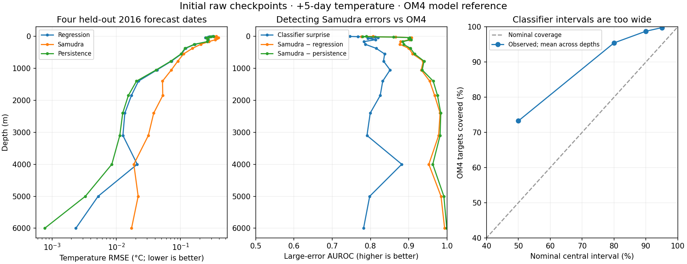

<!--
SPDX-FileCopyrightText: 2026 Samudra Authors
SPDX-License-Identifier: CC-BY-4.0
-->

# Initial-checkpoint maps and confidence assessment

Regression reduces mean-depth normalized temperature MSE by **53.4% versus
Samudra**, while remaining **7.9% worse than persistence**. Classifier surprise
identifies larger Samudra errors, but disagreement with persistence or regression
is a stronger detector. The classifier's nominal 90% intervals cover 98.8% of
OM4 targets on average across depths, so predictive coverage is not calibrated.

These results use the initial raw checkpoints: regression update 18,000 selected
by validation error, and classification update 20,000 selected by validation bin
NLL. They do not evaluate the ongoing Engaging EMA continuation. Samudra is the
October 8 quarter-degree baseline, run 211241, epoch 62, using its published
`model` weights. Checkpoint hashes and exact dates are in [provenance.json](provenance.json).

All forecasts use two input OM4 states and matching forcing fields to predict
+5-day temperature. Samudra sees the global grid; specialists see native
quarter-degree 33×33 crops. OM4 supplies the model reference, not observations.
Training targets end by October 5, 2013. Checkpoint-selection validation
targets follow that boundary; each validation window, including both history
states and its target, lies within October 5, 2013–October 5, 2014. Four 2015 dates calibrate detection thresholds; four 2016 dates assess
performance. These are held-out assessment results, with one seed per specialist
and different training histories across models. Correlated locations are not
independent replicates, and no confidence intervals are claimed.

## Forecast errors

Normalized MSE divides each depth's temperature MSE by its training temperature
variance, then averages equally across the 19 depths. Lower is better. Within a
depth, the four global assessment dates receive equal weight. Dense-map points
use native cell areas; other dates already sample wet locations by cell area.

| Model | Mean-depth normalized MSE | Depths beating Samudra RMSE |
|---|---:|---:|
| Regression | 0.0004977 | 18 / 19 |
| Samudra | 0.0010676 | — |
| Persistence | 0.0004613 | — |
| Classifier mode | 0.0060733 | — |

Regression beats persistence at 5 / 19 depths. Its sole depth losing to Samudra
is 4,000 m: RMSE 0.0212°C versus 0.0188°C. Persistence at that depth is 0.00853°C.
The classifier's mode remains sensitive to large errors despite useful candidate
likelihoods. [All depths and regions](report/per-depth.csv) and
[per-date scores](report/per-date.csv) retain physical RMSE and bias.

## Can classifier surprise detect Samudra errors?

A large error exceeds the depth-specific 90th percentile of absolute
Samudra-minus-OM4 error on the 2015 calibration dates. Assessment prevalence
averages 10.9% across depths. Scores use Samudra predictions and input OM4 states;
future OM4 targets are used only to evaluate detection.

The table averages each metric equally across 19 depths. Higher is better.
AUROC 0.5 indicates chance ranking. Average precision depends on prevalence.
The final column is the fraction of Samudra squared error captured by the
highest-scoring 10% of assessment weight within each depth; boundary ties are
included, yielding about 10.02% selected weight.

| Detector | AUROC | Average precision | Squared error captured |
|---|---:|---:|---:|
| Classifier density surprise on Samudra | 0.809 | 0.277 | 26.4% |
| Classifier bin surprise on Samudra | 0.802 | 0.265 | 25.4% |
| Classifier predictive standard deviation | 0.559 | 0.130 | 10.9% |
| Absolute Samudra–regression disagreement | 0.916 | 0.701 | 55.2% |
| Absolute Samudra–persistence disagreement | 0.919 | 0.710 | 55.3% |

This establishes useful ranking information in candidate surprise, but does not
show a benefit over the cheaper disagreement controls. Predictive standard
deviation alone carries little ranking information here.
[Per-depth and regional detector scores](report/detection.csv) include error
thresholds, prevalence, rank correlations, and actual selected weight.

## Does OM4 receive low surprise?

Mean bin perplexity is lower for OM4 than Samudra at every depth. Perplexity is
`exp(mean bin NLL)`; lower means more probability on the scored candidate bins.
It depends on the vocabulary and is not an absolute calibration score. No
climatological likelihood baseline was evaluated.

| Depth | OM4 perplexity | Samudra perplexity |
|---|---:|---:|
| 2.5 m | 225.1 | 297.5 |
| 250 m | 113.6 | 247.2 |
| 1,850 m | 16.4 | 195.9 |

Density surprise is negative log probability density per °C and accounts for
unequal bin widths; it can be negative. The maps use a shared surprise scale
for OM4 and Samudra within each figure. No assessed OM4 value lies outside the
finite histogram support.

Coverage uses the histogram CDF with uniform density within each bin. Nominal
50%, 80%, 90%, and 95% central intervals cover **73.3%, 95.4%, 98.8%, and 99.8%**
of targets, respectively, averaged across depths. This indicates overcoverage
under that within-bin assumption. Separately, the calibration 95th-percentile
OM4-surprise threshold flags 5.35% of assessment OM4 cases on average. That
stable tail rate does not establish calibrated predictive probabilities.

## Maps and point outputs

Dense maps forecast **July 21, 2016 from July 16**. Global queries lie on a 1°
lattice; North Pacific, Gulf Stream, and Agulhas boxes use every wet native
quarter-degree point. Every specialist prediction still uses its native quarter-degree
crop. Region metrics cover this one dense date and use global calibration
thresholds; global metrics cover all four assessment dates.

| Region | 2.5 m | 250 m | 1,850 m |
|---|---|---|---|
| Global | [map](report/map-global-depth-00.png) | [map](report/map-global-depth-07.png) | [map](report/map-global-depth-13.png) |
| North Pacific | [map](report/map-north-pacific-depth-00.png) | [map](report/map-north-pacific-depth-07.png) | [map](report/map-north-pacific-depth-13.png) |
| Gulf Stream | [map](report/map-gulf-stream-depth-00.png) | [map](report/map-gulf-stream-depth-07.png) | [map](report/map-gulf-stream-depth-13.png) |
| Agulhas | [map](report/map-agulhas-depth-00.png) | [map](report/map-agulhas-depth-07.png) | [map](report/map-agulhas-depth-13.png) |

Each map shows OM4, regression, Samudra, classifier mode, regression/Samudra
errors, and OM4/Samudra density surprise. Colors clip at pooled percentiles;
metrics include all values. Point data and metrics cover all 19 depths even
though figures show three representative depths.

Torch job **21803874** completed 1,102,317 matched point–date–depth cases in
39m42s on four H200s: **2.647 GPU-hours**, excluding prior qualification and
baseline preparation. The job produced 12 maps, 76 depth-region metric rows,
380 detector rows, and three CSVs. [Artifact manifest](artifact-manifest.json)
records verification and the pointwise archive checksum.

The complete 57.1 MiB pointwise archive is retained on Torch at
`/scratch/jr7309/temperature-skyline-20261102/maps-initial-v1/initial-pointwise.tar`.
It contains NPZ chunks for all eight dates, reports, and provenance. NPZ fields
include location/date/depth, reference and predicted temperatures, both candidate
NLLs, CDF values, predictive standard deviation, and support flags. It stores
candidate scores, not all 2,048 probabilities at every query.
The archive was copied locally and its SHA-256 verified against Torch.
[Full structured report](report/summary.json.gz), [headline calculations](headline-metrics.json),
and [reproduction script](summarize.py) accompany the figures.

Map figures are lossless PNG rasters rendered from the original point values.
Each sample becomes one solid 2 × 2 pixel block across all 12 figures.
Adjacent samples touch without interpolation. Blank cells are land or missing samples.
The archive retains the earlier scatter-marker figures; its point data and all
numerical scores are unchanged. [Raster layouts](raster-layout.json) record the sample dimensions and panel
positions; the renderer checks that every saved sample block has one constant
color. The structured JSON report is gzip
compressed without changing its contents. [Preview renderer](render_previews.py).
