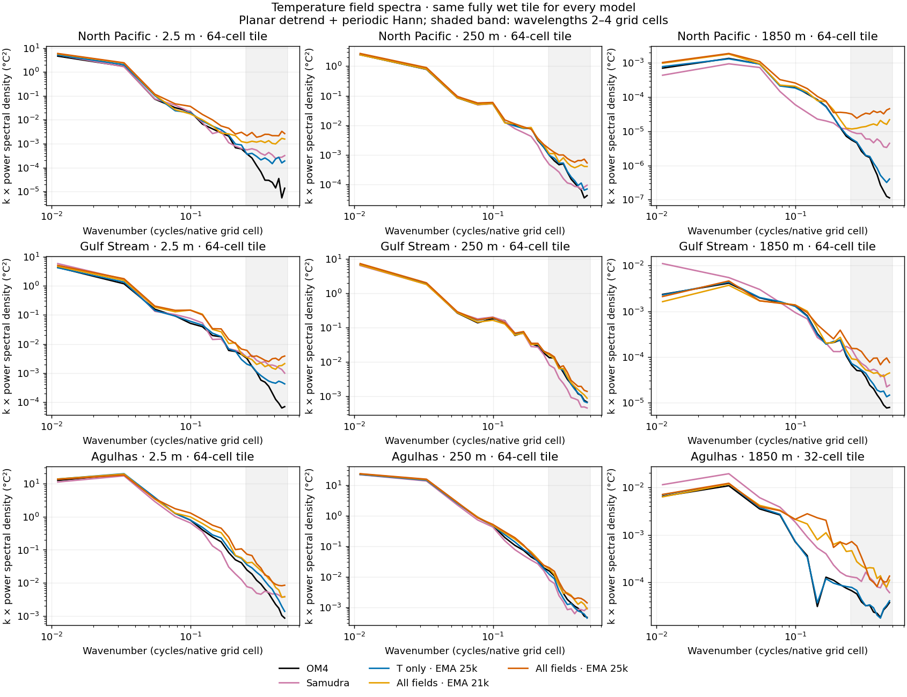

<!-- SPDX-FileCopyrightText: 2026 Samudra Authors -->
<!-- SPDX-License-Identifier: CC-BY-4.0 -->

# Temperature noise before the validation spike

The all-fields skyline model already has excess short-wavelength temperature structure at the 21,000-update EMA checkpoint, immediately before the sharp validation-error jump near 22,000 updates. The native maps show fine-grained errors, particularly in the deep North Pacific, and the spectra have an elevated high-wavenumber tail. This resembles the fine-scale artifacts in Samudra, although these measurements do not establish a shared cause or identical spatial pattern. The [validation trajectory](report/validation-context.png) plots mean normalized full-grid MSE across each field's depth channels; the [temperature values](report/temperature-validation.csv) retain every raw/EMA evaluation.

The skyline models are 208M-parameter dense transformers that predict the crop center from two 33×33 ocean-column crops. The T-only control and all-fields model share initialization, input data, 25k-update budget, and sampling/EMA recipe. T-only queries one temperature at a sampled depth; all-fields queries T, S, u, v at that depth and SSH only on surface draws. Output supervision and query count differ; see the [matched protocol](../output-task-comparison/README.md).

On the nine region/depth tiles tested, the 21k all-fields model has 1.09–19.55 times OM4's field power at wavelengths of 2–4 native grid cells. Its error power in that band exceeds Samudra's in six of nine tiles: all three North Pacific and all three Agulhas tiles. It is lower than Samudra's in the three Gulf Stream tiles. The 25k model has more short-wave error power than the 21k model in all nine tiles, by 1.17–2.26 times.

The large power ratios need physical context. At 1,850 m in the North Pacific, short-wave error RMS is 0.0050 °C for all-fields 21k, 0.0075 °C for all-fields 25k, 0.0031 °C for Samudra, and 0.0007 °C for T-only 25k. Whole-region RMSE there is 0.0105, 0.0203, 0.0198, and 0.0033 °C respectively. Short-wave error RMS is the square root of the detrended, window-corrected error band power on the spectral tile; whole-region RMSE uses the larger wet regional population. They give different rankings. Late deterioration also includes broad temperature bias: for example, the North Pacific 250 m regional mean error shifts from +0.011 °C at 21k to +0.102 °C at 25k. The error maps should be read alongside the spectra.

## Field power relative to OM4

Ratios compare each model's power with OM4 on the same fully wet tile and in the same 2–4-cell wavelength band. A ratio above one means more short-wave structure than OM4; it is not a calibrated probability of error. Field power includes both physical structure and prediction artifacts.

| Region | Depth | Samudra / OM4 | T only 25k / OM4 | All fields 21k / OM4 | All fields 25k / OM4 |
| --- | ---: | ---: | ---: | ---: | ---: |
| North Pacific | 2.5 m | 5.79× | 3.65× | 19.55× | 37.59× |
| North Pacific | 250 m | 0.62× | 1.16× | 2.20× | 3.15× |
| North Pacific | 1850 m | 4.09× | 1.19× | 11.48× | 25.14× |
| Gulf Stream | 2.5 m | 3.41× | 1.26× | 3.21× | 5.64× |
| Gulf Stream | 250 m | 0.51× | 1.04× | 1.09× | 1.29× |
| Gulf Stream | 1850 m | 2.22× | 1.28× | 2.16× | 4.05× |
| Agulhas | 2.5 m | 0.73× | 1.67× | 2.49× | 3.49× |
| Agulhas | 250 m | 0.60× | 0.78× | 1.23× | 1.49× |
| Agulhas | 1850 m | 2.91× | 1.09× | 5.14× | 6.41× |



[Error spectra against OM4](report/error-spectra.png) · [Native temperature maps](report/temperature-maps.png) · [Native error maps and regional RMSE](report/error-maps.png) · [All metrics](report/metrics.csv)

## Population and method

This is one held-out five-day forecast, initialized July 16, 2016 and verified July 21, using two true input states. OM4 is the reference ocean simulation, not observational truth. We evaluate every wet native quarter-degree point in the North Pacific (170–200°E, 25–45°N), Gulf Stream (300–320°E, 25–45°N), and Agulhas (40–60°E, 50–30°S) regions at 2.5, 250, and 1,850 m. Each native grid cell occupies the same two-by-two display pixels in the maps, with hard boundaries and no interpolation. Different regions contain different numbers of points. Temperature color scales and error color scales are shared across models within each row. Error colors saturate at the largest model-specific 99th-percentile absolute error for that row; displayed RMSE uses all wet points with native cell-area weights.

Each spectral tile is selected solely from the wet mask: use a fully wet 64×64 square nearest the region center, falling back to 32×32 if necessary. Eight tiles use 64×64; Agulhas at 1,850 m uses 32×32. Each of the nine tiles is one region–depth combination; its location can differ across depths because the wet mask changes. Every model uses exactly the same tile for a given combination. The black dashed map boxes locate them; [tile indices](report/tiles.json) and native coordinates in the archived fields make the selection reproducible. We remove a least-squares plane and apply a periodic 2-D Hann window with mean-square window correction. Spectral plots use the repository's `isotropic_spectrum`; band power is the direct full-FFT sum for radial wavenumbers 0.25–0.5 cycles per native grid cell. These are grid-coordinate wavelengths, not isotropic physical distances in kilometres. A supplementary metric including Fourier-plane corners keeps the same six-of-nine comparison against Samudra, so the result does not depend on excluding the diagonal Nyquist modes. All spectral powers are computed in physical temperature units.

The 21k checkpoint was retained because it minimized aggregate all-field EMA validation loss. It precedes the abrupt 22k spike but follows the earlier gradual temperature deterioration. We do not have the 3k–10k weights, so this does not identify when noise first appeared. The 25k checkpoints use their final EMA states. Samudra is the frozen quarter-degree two-input/one-output October 8 run 211241, epoch 62, using its published `model` weights as in the [earlier report](../maps-continuation/README.md). Inference uses the existing bfloat16 autocast path. We have not separated learned spatial error from numerical-precision effects. This single date, three-region, three-depth comparison establishes a visible and measurable short-wave excess, not its mechanism or global prevalence.

## Reproduction and receipts

Training source was `753edeac5faa46412957b70ce5e02d6337bdefbc`; inference source was `861db88da42d272a43d14adc171607bca0b6cbb2`. Torch job `22184778` completed with exit 0:0 in 19m41s on two GPUs. An earlier attempt, `22183821`, failed after 4m29s while restoring final EMA parameter names; the retry uses the validated EMA tracker API. The successful outputs were generated afresh, and all 27 files agree exactly on OM4 values, Samudra values, coordinates, masks, and cell areas across the three skyline checkpoints. Total allocated diagnostic compute, including the failed attempt, was 0.8056 GPU-hours.

[Checkpoint/source receipts](report/receipts.json.gz) · [Native fields](report/native-fields.npz) · [Renderer](render.py)

```bash
CUDA_VISIBLE_DEVICES='' uv run python experiments/temperature_skyline/pre-spike-noise/render.py \
  --source experiments/temperature_skyline/pre-spike-noise/report/native-fields.npz \
  --output /tmp/skyline-noise-report
```
