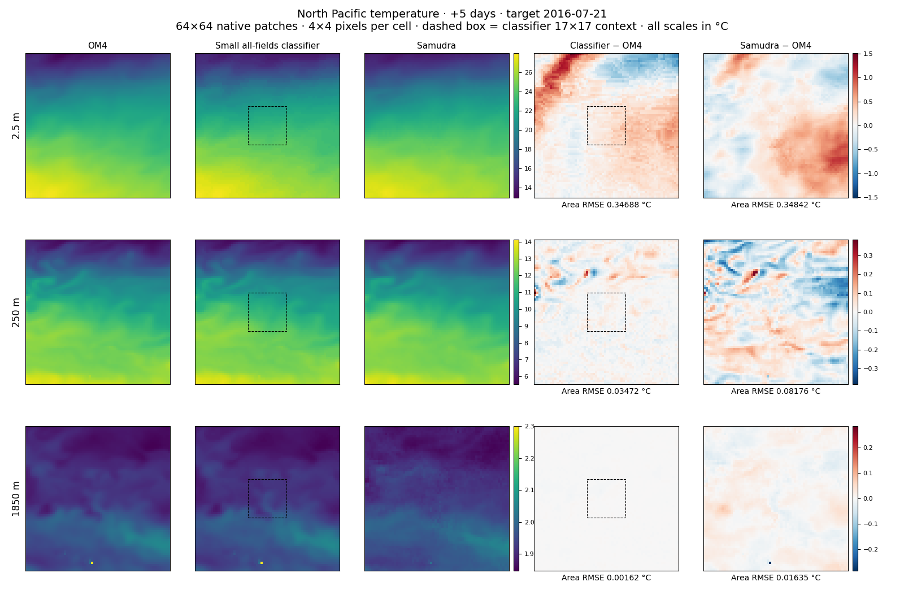
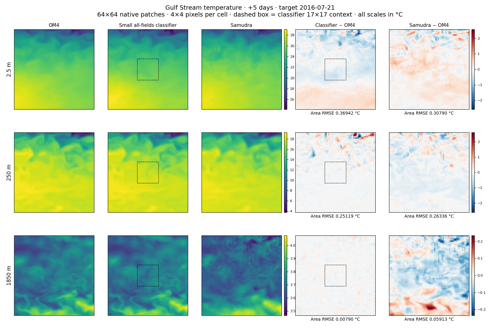
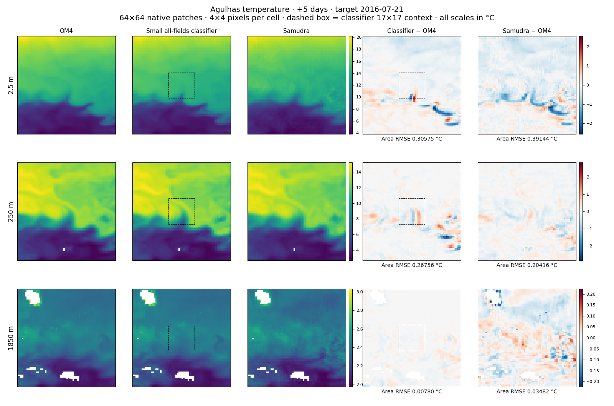
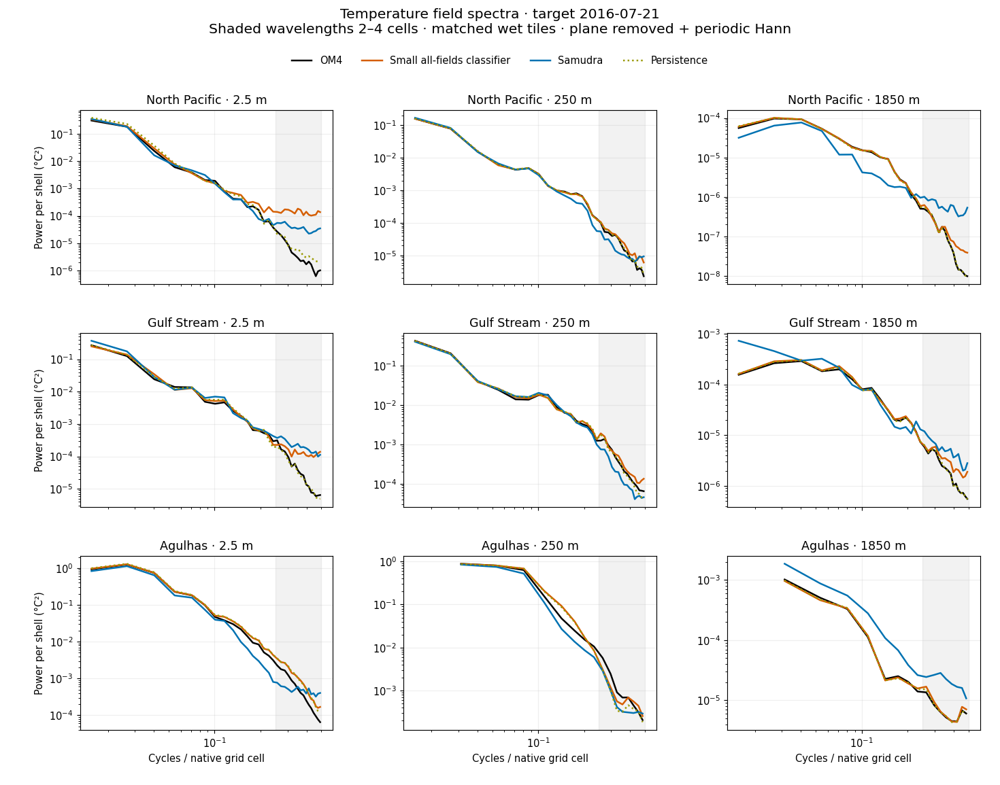
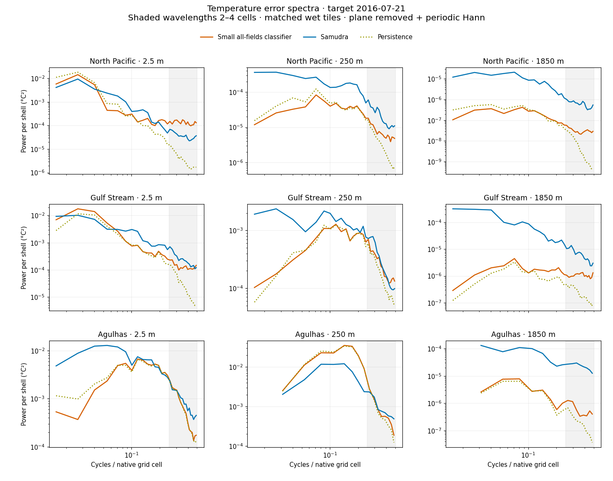
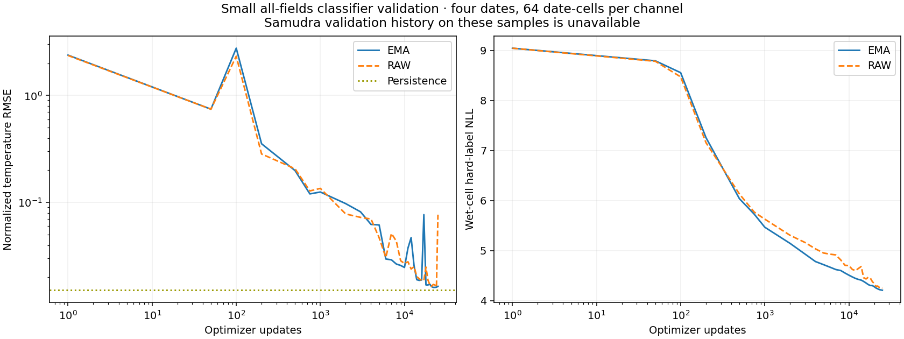
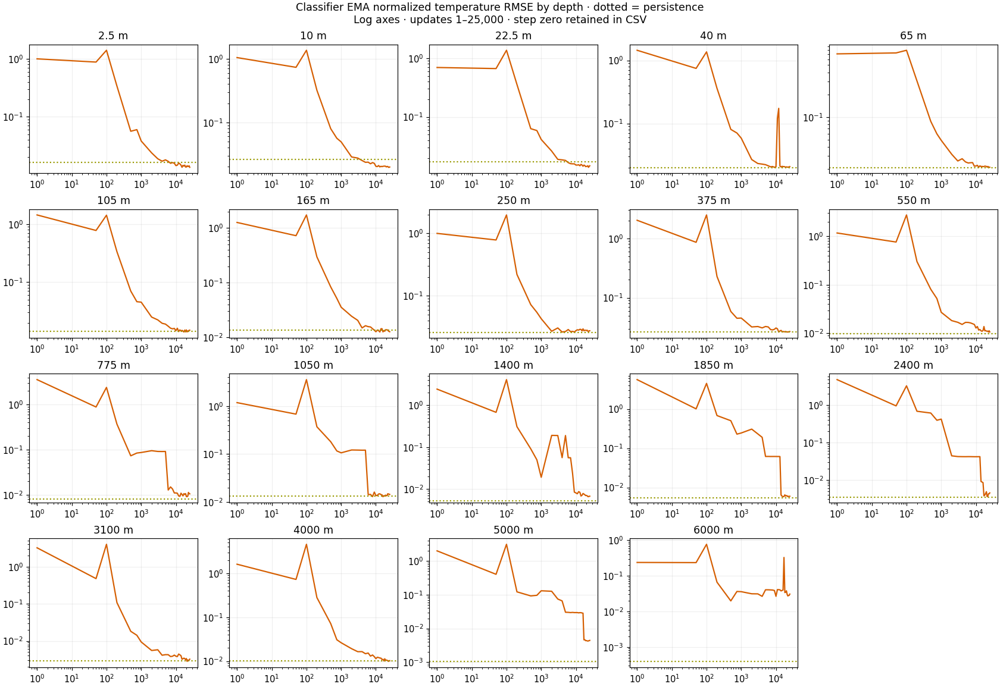

<!-- SPDX-FileCopyrightText: 2026 Samudra Authors -->
<!-- SPDX-License-Identifier: CC-BY-4.0 -->

# Samudra versus the small all-fields classifier

The small all-fields classifier has lower temperature RMSE than Samudra on seven of nine matched region/depth patches. It has lower error power at wavelengths of 2–4 native grid cells on eight of nine. North Pacific surface is the exception for short-wave error, where classifier error power is 3.56 times Samudra's despite 0.44% lower RMSE.

All-fields covers temperature, salinity, both horizontal velocity components at 19 depths, and sea surface height. The classifier has 18.5M parameters, continuous inputs, 17×17 quarter-degree crops, 8,192 output bins, two-hot training targets and smooth head initialization. Predictions use argmax category centers and final 25,000-update EMA weights. Samudra is the quarter-degree two-input/one-output model from run 211241, epoch 62, trained October 8, 2026, evaluated with model weights without EMA. Both predict five days ahead from the same true two-state history spaced five days apart, with target July 21, 2016. Model size, context, training budget and checkpoint selection differ. The comparison covers one held-out date and three regions. OM4 supplies the model target.

All map scores use the same wet cells and cell-area weights in each 64×64 native patch. Each map cell occupies 4×4 pixels with hard boundaries. The three field columns share a scale within each row, and the two error columns share a symmetric scale. Dashed boxes show the classifier's 17×17 input context.

| Region | Depth (m) | Classifier RMSE (°C) | Samudra RMSE (°C) | Classifier RMSE reduction | Short-wave error power classifier / Samudra |
|---|---:|---:|---:|---:|---:|
| North Pacific | 2.5 | 0.34688 | 0.34842 | 0.4% | 3.557 |
| North Pacific | 250 | 0.03472 | 0.08176 | 57.5% | 0.339 |
| North Pacific | 1850 | 0.00162 | 0.01635 | 90.1% | 0.051 |
| Gulf Stream | 2.5 | 0.36942 | 0.30790 | −20.0% | 0.531 |
| Gulf Stream | 250 | 0.25119 | 0.26336 | 4.6% | 0.816 |
| Gulf Stream | 1850 | 0.00790 | 0.05913 | 86.6% | 0.165 |
| Agulhas | 2.5 | 0.30575 | 0.39144 | 21.9% | 0.825 |
| Agulhas | 250 | 0.26756 | 0.20416 | −31.1% | 0.938 |
| Agulhas | 1850 | 0.00780 | 0.03482 | 77.6% | 0.028 |

RMSE covers each full 64×64 wet patch. Spectral ratios use the fully wet tiles described below, including smaller Agulhas tiles at depth. Positive RMSE reduction and error-power ratios below one favor the classifier. Persistence has lower RMSE than the classifier on eight of nine patches and remains in the downloadable metrics and spectra as a baseline.

## Regional fields and errors

## Spectra

Field spectra compare predicted spatial variance with OM4. Error spectra use prediction minus OM4, with lower power indicating lower error at that scale. Each comparison uses the same fully wet tile, 64×64 cells except Agulhas at 250 and 1850 m, which use 32×32 cells. A fitted plane is removed from each field or error array before applying a periodic Hann window. Power is normalized by the window's mean square and summed into radial shells of width 1/L cycles per cell, where L is tile side length. Only nonzero radial frequencies up to 0.5 cycles per cell are shown. Shading spans wavelengths of 2–4 cells. The horizontal axis uses grid-cell units, whose physical length varies with latitude and direction. Vertical scales differ between panels. Detrending removes mean and planar errors, so integrated spectral power differs from raw map MSE.

## Available validation history

The classifier curves use four validation dates, with 16 points per date per channel, totaling 64 date-cells per channel, and retain raw and EMA weights. Temperature RMSE is the square root of mean normalized MSE across the 19 depth channels, after scaling each channel by its training standard deviation. Land contributes zero while remaining in the full-grid denominator, and importance weights correct the nonuniform location/depth sampling. The dotted line gives matched persistence. The NLL panel reports the existing wet-cell hard-label NLL aggregate in nats. The per-depth figure uses normalized RMSE, with lower values better. Logarithmic update axes start at one, and the CSV retains update zero.

A Samudra training/validation trajectory on these same samples is unavailable in the current artifacts. Samudra comparisons here use its cached epoch-62 forecast. The classifier's validation curves and the regional comparison evaluate different dates and spatial samples.

## Training and inference time

The small all-fields classifier completed 25,000 updates and 6.4 million accepted crops on one NVIDIA RTX PRO 6000 Blackwell Server Edition GPU. Its production allocation lasted **5,564 seconds, or 1 h 32 m 44 s**, equivalent to **1.546 GPU-hours**. This includes validation and checkpoint writes. Dividing the allocation by 25,000 gives **0.223 seconds per update** at effective batch 256. The earlier failed launch adds 12 GPU-seconds to this arm. Shared performance qualification consumed another 1,240 GPU-seconds across experiments. [Compute receipt](../soft-priors-25k/report/compute-receipt.json).

The regional inference job allocated one GPU for **249 seconds, or 4 m 9 s**. Its application timer recorded **232.1 seconds**, including setup, data access, model loading, prediction and output writes for four models across 11 tasks. Those models were the two small classifiers and the original all-fields regression and classification models. Nine tasks supplied these temperature patches, totaling 36,731 wet temperature queries per model, and two supplied selected salinity cases. The inference microbatch was 32. The receipt provides combined workload timing. This earlier map job did not record per-model inference times. The isolated classifier throughput measurement below now supplies a full-state estimate. Samudra predictions were reused from a prior cache. [Inference receipt](../soft-priors-25k/report/map-provenance.json.gz).

A subsequent isolated throughput benchmark measured the final small all-fields classifier on one RTX PRO 6000 Blackwell GPU. A full quarter-degree state requires **10,669,976 wet location/depth queries**, producing u, v, temperature and salinity jointly at each query, plus 690,297 surface SSH values obtained in the same surface-depth queries. This totals **43,370,201 valid scalar outputs**. The model reruns its backbone for each depth query.

| Inference batch | Estimated full-state pipeline time |
|---|---:|
| 32 | 74.13 min |
| 64 | **71.78 min** |
| 128 | 73.09 min |

These estimates scale measured per-depth throughput by exact global wet-cell counts. The benchmark sampled 1,024 globally distributed wet points at each of 19 depths, with three repeats at each batch size. Pipeline timing includes crop construction and metadata, transfer to GPU, BF16 forward evaluation, argmax selection, FP32 bin-center lookup, scalar CPU transfer and a finite-value check. It uses the existing data sampler, including target preparation as evaluation overhead. Full-repeat extrapolations at batch 64 span **71.62–72.27 minutes**. This short-run spread does not measure variation across a sustained global sweep.

GPU-only forward and readout at batch 64 extrapolate to **24.20 minutes** with input batches already resident on the GPU. Setup and checkpoint loading took 12.64 seconds, and reading and normalizing the two input states and evaluation target together took 1.40 seconds. These setup and read costs are additional to the pipeline estimate. Global array assembly and disk serialization remain unmeasured. A dense 77×720×1440 float32 output occupies **304.54 MiB**. The practical current-pipeline estimate is about **1 h 12 min for one five-day forecast of all 77 channels from the two-state history**, plus setup and output writing. Peak allocated GPU memory at batch 64 was 0.934 GB.

Job 22753814 on node gr105 consumed 116 allocated GPU-seconds for the benchmark. [Timing receipt](inference-timing.json.gz), [per-depth timings](inference-timing-by-depth.csv), and [benchmark script](benchmark_inference.py) preserve the measurements. Samudra run 211241's training duration and isolated inference timing remain unavailable in these artifacts.

## Data and reproduction

[Map metrics](map-metrics.csv), [spectral curves](spectra.csv.gz), and [raw/EMA temperature validation](validation-temperature.csv.gz) contain the plotted measurements. The [renderer](render.py) reads the saved [matched physical fields](../small-regression-25k/report/source-fields.npz), [source and checkpoint receipt](../small-regression-25k/report/map-render-receipt.json.gz), and [validation provenance](../small-regression-25k/report/curve-provenance.json.gz). The [parent report](../small-regression-25k/README.md) documents model and training details. Run `CUDA_VISIBLE_DEVICES='' uv run python experiments/temperature_skyline/samudra-small-classifier/render.py` from the repository root.
