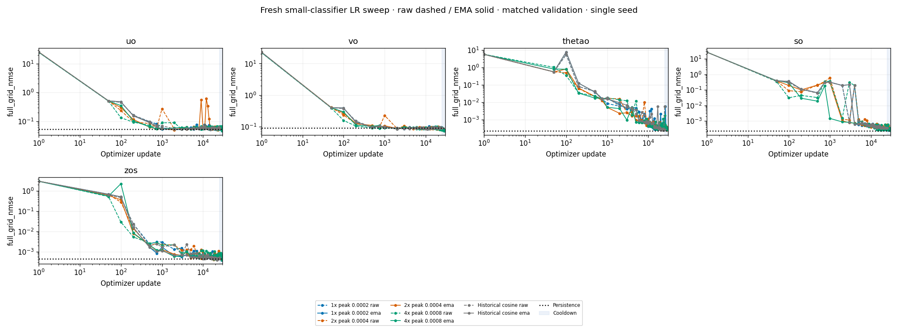

<!-- SPDX-FileCopyrightText: 2026 Samudra Authors -->
<!-- SPDX-License-Identifier: CC-BY-4.0 -->

# Small classifier learning-rate sweep from scratch

All three fresh runs completed 30,000 updates. Raising the peak learning rate did not produce a consistent improvement: at the fixed final exponential-moving-average (EMA) checkpoint, 1× had the lowest temperature, zonal-velocity and SSH MSE; 4× had the lowest salinity and meridional-velocity MSE. MSE decreased in every field in every arm between 25k and 30k, during cooldown. These are one-seed results on four validation dates, with 64 sampled cases per depth; small differences do not establish a reliable ranking.

## Final results

The table reports normalized MSE, averaged equally across channels within each field. Lower is better. Channels use the historical Samudra full-grid denominator: land contributes zero, so deeper channels receive less effective weight. Coverage-sampling importance weights estimate this metric from the fixed validation samples. Persistence copies the latest input state to the five-day target. Temperature and salinity remain worse than persistence at all three final checkpoints. Native probabilities are retained; the scalar prediction is the most probable fixed bin center.

| EMA checkpoint | T | S | u | v | SSH |
|---|---:|---:|---:|---:|---:|
| 1×, 30k | 0.0002654 | 0.0002583 | 0.0513086 | 0.0759467 | 0.0004360 |
| 2×, 30k | 0.0002742 | 0.0002790 | 0.0622152 | 0.0779041 | 0.0004723 |
| 4×, 30k | 0.0002879 | 0.0002500 | 0.0518620 | 0.0748502 | 0.0004853 |
| Historical cosine, 25k | 0.0002709 | 0.0003459 | 0.0575404 | 0.0917103 | 0.0004571 |
| Persistence | 0.0002296 | 0.0002299 | 0.0525356 | 0.0915186 | 0.0004484 |

Higher rates gave lower final velocity hard-bin NLL despite mixed MSE rankings: u NLL was 3.4074/3.3949/3.3746 and v NLL was 3.4882/3.4475/3.4422 for 1×/2×/4×. Hard-bin NLL evaluates the probability assigned to the bin containing the target. Two-hot training changes the learned categorical probabilities; hard-bin NLL is a diagnostic here, not proof of calibrated confidence. All arms use the same vocabulary, so their NLL values are comparable.

[Full MSE curves](report/fields-full_grid_nmse.png) · [Cooldown MSE curves](report/cooldown-fields-full_grid_nmse.png) · [Full NLL curves](report/fields-full_grid_nll.png) · [Cooldown NLL curves](report/cooldown-fields-full_grid_nll.png)

Per-depth curves: [temperature](report/thetao-full_grid_nmse.png), [salinity](report/so-full_grid_nmse.png), [u](report/uo-full_grid_nmse.png), [v](report/vo-full_grid_nmse.png). The report directory also contains corresponding per-depth NLL figures. Curves show raw and EMA weights, with logarithmic update axes for the full training history; initialization is recorded separately rather than placed at log zero.

Machine-readable data: [all channel curves](report/validation-channels.csv.gz), [field curves](report/validation-fields.csv.gz), [fixed 25k and 30k endpoints](report/fixed-endpoints.csv.gz), [training progress](report/training-progress.csv.gz).

## Experiment

Data are OM4 `om4_quarterdeg_v2`, with the training split bounded by 1975-01-03 and 2013-10-05 and validation split by 2013-10-05 and 2014-10-05. Fixed validation origin indices are 4071, 4094, 4118 and 4142; each contributes 16 wet grid locations at each depth. The 77 output channels are T, S, u and v at 19 depths plus surface SSH. Outputs predict absolute states five days ahead. Channel errors are divided by the dataset channel standard deviation before squaring. Exact settings are in [the 1× configuration](1x-train.json.gz); other arms differ only in learning rate.

Three fresh all-fields classifiers trained at peak learning rates 0.0002, 0.0004 and 0.0008. Each warms up linearly for 100 updates, holds its peak through update 25,000, then cools down with a cosine schedule over 5,000 updates to the same absolute rate of 0.00002. The experiment therefore runs 30,000 updates per arm. The common final rate is a design choice for this sweep.

The model matches the [earlier small all-fields classifier](../soft-priors-25k/README.md)'s 18.52M parameters, width 512, four transformer blocks, eight heads and 17×17 native quarter-degree crop. Inputs are continuous, and scalar outputs use argmax over 8,192 channel-specific fixed centers. Two-hot training loss and Gaussian-smoothed head initialization with sigma four bins are retained. The current NumPy CPU initializer avoids the previously observed Torch convolution crash. Its formula matches the historical initializer up to floating-point rounding.

All arms use seed 20261110, one RTX6000 GPU, effective batch 256, logical sampling groups of 32, paired into physical GPU batches of 64 with four gradient-accumulation steps per update, and prefetched batches. Each loaded time window supplies 2,048 accepted crops. The [coverage proposal](../../../src/samudra/skyline/coverage.py), EMA, masks, normalization and four-date validation samples are retained. Coverage mixes the base location distribution equally with a proposal that gives equal mass to geometric groups of input states; importance weights correct the resulting sampling bias. RTX6000 hardware is held fixed to keep the learning-rate comparison and timing comparable across arms.

Raw and EMA validation runs at initialization and updates 1, 50, 100, 200, 500, 750, then every 1,000 updates through 30,000. Full optimizer/EMA/RNG/frame-stream checkpoints are retained at initialization, 10k, 25k and 30k. Every validation retains its model weights. The fixed 30k EMA checkpoint is the primary endpoint, with 25k results showing behavior immediately before cooldown. The historical small 25k run used cosine decay throughout training and supplies a schedule benchmark.

A short qualification ran all three rates for 12 updates with the production data pipeline. Tests cover warmup and cooldown boundaries, restart across cooldown, immutable checkpoint retention and the existing branch and soft-prior paths. This is a single-seed experiment/results record and is not intended to merge.

## Verification and compute

The checkpoint audit verified identical initial parameters and initial raw/EMA validation across all three arms, identical configurations except learning rate, and identical final per-rank RNG and frame-stream states. All 77 channel metrics were finite. Each arm retained full optimizer, EMA and sampling state at updates 0, 10,000, 25,000 and 30,000. Each completed 7,680,000 accepted examples. The 25k sampling states also match the historical small run. That historical benchmark used 25k updates and cosine decay throughout, and its head initializer differs by floating-point rounding; it is not a matched schedule-only control. Numerical training repeatability is imperfect, and this experiment has no independent seeds or independent validation resampling.

Training and qualification consumed **6.684 allocated GPU-hours**, including interrupted allocations and replay after recovery. Initial production jobs 23856629/23856635/23856638 used eight CPUs and 48 GiB each. They were checkpointed and replaced with jobs 23858683/23858686/23858688 using the historical 16 CPUs and 64 GiB. Restoring CPU resources did not immediately restore historical throughput; the cause was not established. All runs completed, and no artificial GPU load was added. The 12-update qualification was job 23855424; CPU audits were 23856627 and 23864386. GPU cost excludes CPU audit allocations.

Initial production used source `d7f166a5be0b124da907f7b0c16afcce42107a73`; resumed jobs used `b7abb23f54e1be8b569cbf237ea6aff9660c0ab7`, which adds explicit manual-resume authorization and preserves job-specific provenance. Saved configuration and data identity remain strict resume requirements. The recovery did not change architecture, objective, sampling or schedule. [Checkpoint audit](report/audit-train.json.gz) and [scheduler accounting](report/accounting.txt.gz) preserve the execution evidence. Full checkpoints remain under `/scratch/jr7309/skyline-small-lr-sweep-20261120/{1x,2x,4x}-train/`.
