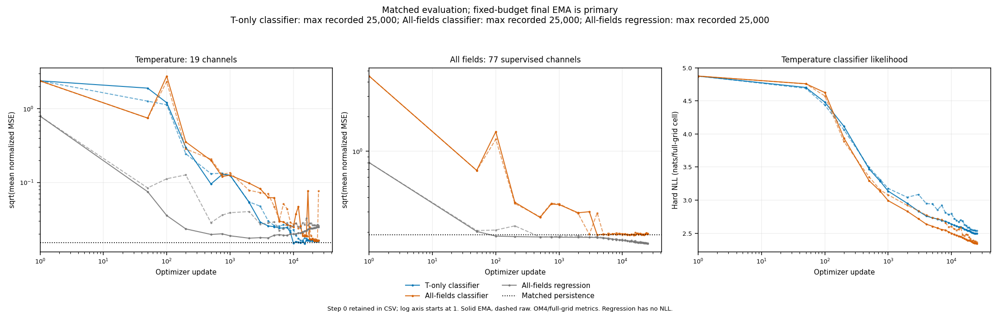

<!-- SPDX-FileCopyrightText: 2026 Samudra Authors -->
<!-- SPDX-License-Identifier: CC-BY-4.0 -->

# Small all-fields regression control: 25,000-update results

The fresh regression control completed 25,000 optimizer and EMA updates in job **22668910**, using 6.4 million accepted crop examples. At the fixed final EMA endpoint, its 77-channel normalized MSE is 0.0254371 versus 0.0369863 for the matched all-fields classifier and 0.0356650 for persistence. The aggregate improvement comes from velocity: regression has higher temperature, salinity and surface-height error. This is one seed on four validation dates, with 64 sampled date-cells per channel; it does not establish a general advantage for either objective. [Completion receipt](report/curve-receipt.json).

| Final EMA metric group | Regression MSE ↓ | Classifier MSE ↓ | Persistence MSE ↓ | Regression MSE vs classifier | Regression RMSE vs classifier |
|---|---:|---:|---:|---:|---:|
| Temperature | 0.0006274 | 0.0002709 | 0.0002296 | +131.6% | +52.2% |
| Salinity | 0.0005347 | 0.0003459 | 0.0002299 | +54.6% | +24.3% |
| Eastward velocity u | 0.0402675 | 0.0575404 | 0.0525356 | -30.0% | -16.3% |
| Northward velocity v | 0.0616032 | 0.0917103 | 0.0915186 | -32.8% | -18.0% |
| Surface height | 0.0010305 | 0.0004571 | 0.0004484 | +125.4% | +50.1% |
| All 77 channels | 0.0254371 | 0.0369863 | 0.0356650 | -31.2% | -17.1% |

MSE is normalized per channel, with the inherited full-grid denominator; field rows average their 19 depth channels, except surface height's one channel. The 77-channel row gives every channel equal weight. RMSE changes are computed from the square root of each row's mean MSE; they are not physical-unit errors. Negative changes favor regression. Velocity contributes 98.8% of the regression aggregate and 99.6% of the classifier aggregate. Thus the lower overall score is not an improvement across all fields, despite equal nominal channel weights.

Regression has lower final EMA MSE than the all-fields classifier at 16 of 19 u depths and 18 of 19 v depths, but only 1 temperature depth and 2 salinity depths. Against persistence, regression improves 18 u depths and all 19 v depths; no temperature or salinity depth improves, and surface height is worse. The field-level pattern extends across depths rather than depending only on one aggregate channel: [temperature](report/thetao-depth-rmse.png), [salinity](report/so-depth-rmse.png), [u](report/uo-depth-rmse.png), [v](report/vo-depth-rmse.png).

The training trajectory separates the fields. Regression EMA temperature MSE at updates 2,000 → 10,000 → 25,000 is 0.0003070 → 0.0003959 → 0.0006274; salinity rises from 0.0002857 at 2,000 to 0.0005347 at 25,000. Over the same endpoints, u falls from 0.0472250 to 0.0402675 and v from 0.0833325 to 0.0616032. These observed trajectories do not by themselves establish why the errors diverge. The primary comparison remains final update-25,000 EMA, without choosing each field's best checkpoint.

Final raw regression 77-channel MSE is 0.0257235 versus EMA 0.0254371; temperature is 0.0006687 raw versus 0.0006274 EMA. Both final raw and EMA curves are retained. Classifier raw temperature has the previously reported deep-water spike, so mixing its raw endpoint with regression EMA would misstate the chosen comparison. [Field RMSE and classifier NLL](report/field-curves.png) and [temperature NLL by depth](report/temperature-depth-nll.png) retain the completed classifier likelihoods. Regression has no categorical NLL or probability output; classifier likelihood does not establish calibration. Temperature-only classifier auxiliary channels remain unsupervised and are excluded from forecast comparisons.

Machine-readable data: [all 77 raw/EMA channels](report/validation-channels.csv.gz), [field aggregates](report/validation-fields.csv), [77-channel aggregates](report/validation-aggregate.csv), [training progress](report/training-progress.csv.gz), and [source/configuration receipts](report/curve-provenance.json.gz). CSVs include update zero, while logarithmic plot axes start at one. These are sparse validation results; matched maps below assess spatial accuracy and short-wave structure on selected patches. This experiment/results record is not intended to merge.

## Matched map results

All new-model maps use fixed final update-25,000 EMA weights. The small all-fields regressor has higher temperature RMSE than the matched small all-fields classifier on all nine region/depth patches: 5.4–573% higher, with a 55.6% median increase across patches. At 1,850 m, regression/classification RMSE is 0.01089/0.001617°C in the North Pacific, 0.03368/0.007899°C in the Gulf Stream and 0.04486/0.007798°C in Agulhas. Regression beats the small T-only classifier on only 1/9 patches (North Pacific surface, by 0.38%). It beats the original all-fields regressor on 8/9 patches, with reductions of 1.1–60.8% on those eight; Agulhas surface is 0.20% worse. It beats the original T-only regressor on 1/9, the two original classifiers on 0/9, persistence on 1/9 and cached Samudra on 3/9. Counts describe these patches, not global averages. [Map metrics](report/map-metrics.csv) include RMSE, bias, prediction type and spectral measurements. [Input/checkpoint hashes and render receipt](report/map-render-receipt.json.gz) and [physical arrays](report/source-fields.npz) preserve the plotted comparisons.

All standard maps predict the July 21, 2016 OM4 target from the same two-state history at +5 days (later input time index 4273). Region-major rows cover centered 64×64 native patches in the North Pacific, Gulf Stream and Agulhas at 2.5, 250 and 1,850 m. The renderer verifies coordinates, dates, masks and targets before joining caches and requires every wet prediction. RMSE uses cell-area weights on matched wet cells. Native pixels have hard boundaries and equal size, with common field/error color ranges within each row. Context boxes show 17×17 cells for the small models and 33×33 for original Skyline models.

- Temperature with original regression benchmarks: [fields](report/temperature-regression-fields.png), [errors](report/temperature-regression-errors.png).
- Temperature with original classifier benchmarks: [fields](report/temperature-classifier-fields.png), [errors](report/temperature-classifier-errors.png).
- Surface velocity: [fields](report/velocity-fields.png), [errors](report/velocity-errors.png).
- Targeted 1,850 m salinity: [fields](report/salinity-fields.png), [errors](report/salinity-errors.png).

Surface velocity favors regression on three of four panels. Gulf Stream u/v RMSE is 0.03605/0.03043 m/s for small regression versus 0.04273/0.04266 for small all-fields classification; Agulhas is 0.05437/0.05360 versus 0.06449/0.04989. Regression also beats persistence and original all-fields regression on the first three panels, but loses on Agulhas v. T-only auxiliary outputs are excluded because they were not supervised. Cached Samudra temperature is included in metrics; no cached Samudra u/v or salinity is used.

Spectra sum Fourier power at radial frequencies 0.25–0.5 cycles per native cell (wavelengths 2–4 cells), after planar detrending and a periodic Hann window. Each comparison uses the same fully wet 64×64 tile, or the nearest-to-center fully wet 32×32 tile when necessary. Both prediction power and prediction-minus-OM4 error power are divided by OM4 field power in that band. Across T patches, regression has lower prediction and error power than small all-fields classification on 2/9: North Pacific surface and Gulf Stream 250 m. North Pacific surface prediction/error ratios are 5.17/4.91 for regression versus 21.32/21.13 for classification, 1.13/0.69 for persistence and 5.79/5.94 for Samudra. Conversely, Agulhas 1,850 m ratios are 2.73/1.65 for regression versus 1.12/0.089 for classification. For all four velocity panels, regression has lower error power: 0.41–0.73× OM4 versus 0.72–1.79× for classification. Regression's velocity field power is only 0.43–0.75× OM4, so lower error power coexists with reduced predicted short-wave variance. Excess fine-scale power remains in both model families across these examples.

The salinity panels are selected validation diagnostics, separate from the held-out July 2016 forecast. Their +5-day target dates are June 22 and October 5, 2014. At the prior outliers (row/column 534/138 and 529/156; 43.5947°N, 34.625°E and 42.3456°N, 39.125°E), OM4 is 22.366186/22.313528 PSU. Small regression predicts 22.360134 PSU at both points, independently generated outputs that coincide with the original all-fields regressor at these two points; absolute errors are 0.006052/0.046606 PSU. Small all-fields classification predicts 22.363953 PSU at both, with errors 0.002234/0.050425 PSU. Persistence errors are 0.000202/0.000164 PSU. The original all-fields classifier's lowest center is 27.692825 PSU, producing errors above 5.3 PSU at both points. The small all-fields classifier's nearest-center floors are 0.002234/0.000314 PSU; regression has no categorical center floor. Errors are computed before rounding the displayed predictions. [Exact point outputs and checkpoint hashes](report/salinity-outliers.csv) also retain classifier probabilities and center support bounds.

Both dates use the same 64×64 salinity rectangle (rows 502–565, columns 106–169), containing both target points. Its 503 wet cells include cells outside the Black Sea. Its June/October RMSE is 0.03634/0.05175 PSU for small regression, 0.04578/0.04527 for small classification, 0.05431/0.05147 for original regression and 0.000657/0.000990 for persistence. No fully wet 32×32 tile is available there, so salinity spectra are omitted. These regional scores differ from the two point diagnostics. All classifiers use argmax-bin centers; regression uses a scalar head evaluated in BF16, as described below. The small models share the backbone, sampling and training budget, but differ in output head, loss and head initialization. This single-seed comparison cannot assign the spatial differences to discretization alone. Original benchmarks also differ in size, context and training. Their checkpoint selections are inherited from the [prior report](../soft-priors-25k/README.md#benchmark-identities): both original regressors use final 25,000-update EMA; original T classification uses likelihood-selected EMA at 27,624 total updates; original all-fields classification uses final 15,000-update EMA. Cached Samudra uses epoch-62 model weights from run 211241, without EMA. OM4 is a model target, and one held-out date plus selected validation cases does not establish observational forecast skill.

## Regional temperature spectra

[Field spectra](report/temperature-field-spectra.png) and [error spectra](report/temperature-error-spectra.png) show regions by row and depths by column. Curves include both small classifiers, small and large all-fields regression, large T-only regression, Samudra, and persistence; field spectra also include OM4. Lower error power is better. Matching field power alone does not establish forecast accuracy.

Each panel uses the identical fully wet tile for every model, with its size shown in the title. Error spectra use prediction minus OM4. A plane is fitted and removed from each field or error array before applying a periodic Hann window. Power is normalized by the window's mean square and summed in radial frequency shells of width 1/L cycles per grid cell, where L is the square tile side length in cells. Only nonzero radial frequencies up to 0.5 cycles per cell are plotted. The horizontal axis is cycles per native grid cell, not cycles per kilometer; physical wavelength varies with latitude and direction. The shaded band spans wavelengths of 2–4 cells. Vertical scales differ across panels. These spectra omit mean/planar bias and therefore do not integrate to the reported raw map MSE. All targets are July 21, 2016; checkpoint identities and comparison limits are described above.

[Radial-shell CSV](report/temperature-spectra.csv.gz) includes tile coordinates and model identities. [CPU reproduction script](render_spectra.py) reads the saved map arrays and checks that shell powers sum to the Fourier power over the included frequencies.

## Scalar-output precision

The regression head ran under BF16 autocast, then cast its scalar output to FP32. Every saved wet prediction lies exactly on the BF16 normalized-value lattice after the physical-unit transform. Thus this is a scalar regression control with finite BF16 readout precision; casting afterward does not restore missing digits. Classifiers also use BF16 logits, but their point outputs select FP32 category centers.

A CPU oracle rounds each saved OM4 target to its nearest BF16 normalized value. This readout floor is 0.013–0.946% of actual regression MSE across the nine temperature patches and below 0.004% on the surface-velocity patches. On the salinity rectangles its RMSE is 0.01280/0.01262 PSU, or 12.4%/5.9% of actual regression MSE. These are best-possible readout floors, not estimates or upper bounds on error caused by BF16. A small floor does not rule out larger BF16 effects on learned predictions or training. No FP32-head training or inference control was run. [Oracle table](report/bf16-oracle.csv), [reproduction script](bf16_oracle.py).

## Matched control setup

This control matches the 17×17 input crop and width-512, four-block backbone of the [completed soft-prior classifiers](../soft-priors-25k/README.md). The earlier temperature-only/all-fields regressors had approximately 208 million parameters and 33×33 crops. Those larger models remain historical benchmarks; they cannot isolate the effect of categorical output in the smaller model. This run supplies the small all-fields regression comparison.

| Property | New all-fields regression | Completed all-fields classifier |
|---|---|---|
| Backbone and input crop | Width 512, four blocks, 17×17 cells | Same |
| Total parameters | 14,321,665 | 18,523,648 |
| Output-head parameters | 513 | 4,202,496 |
| Training objective | Normalized mean squared error | Two-hot cross entropy |
| Point readout | Scalar evaluated in BF16 | Fixed center of argmax category |
| Head initialization | Independent scalar-head initialization | Gaussian smoothing across category rows, sigma four bins |
| Probability output | None | 8,192-category distribution |
| Primary endpoint | Final update-25,000 EMA, complete | Final update-25,000 EMA, complete |

The head, objective and head initialization change together. Parameter counts therefore differ even though the remaining model matches. This comparison does not isolate a parameter-count effect from an objective or readout effect. The completed temperature-only classifier appears as an additional task comparison; its auxiliary outputs are unsupervised and are not treated as forecasts.

## Fixed training and evaluation setup

The [production configuration](all-fields-regression-25k.json) uses source `ea592e8a71ebf9b50285ef835d641aae1de4d3c9`, the same source as the completed classifiers. All models take continuous OM4 quarter-degree fields from two times five days apart and predict five days after the latest input. Targets comprise temperature, salinity and both velocity components at 19 depths, plus surface height: 77 channels. OM4 is ocean-model output, not observational truth.

Regression uses the existing full-grid normalized MSE objective with equal channel weights across the 77 channels. Its target objective is the sum of squared normalized errors over wet channel-cells divided by 77×H×W, with land contributing zero. Every channel has coefficient 1/77; no extra temperature or auxiliary-field multiplier is applied. Sampling weights correct the nonuniform depth/location proposals. Values are normalized with the same per-channel mean and standard deviation. Vocabulary bounds and the `bins` setting remain in the copied configuration for provenance but are unused by the regression head/loss; `categorical_target: hard` does not turn regression into classification.

The run started at update zero with fresh optimizer and EMA state and seed 20261110. The learning rate warmed up for 100 updates to 2×10⁻⁴, then decayed by cosine to 2×10⁻⁵ at update 25,000. Effective batch is 256: eight logical draws of 32, grouped into physical batches of 64. All three runs use seed 20261110 and the same deterministic NumPy sampling/frame-stream recipe. Coverage sampling, date reuse, prefetch, validation-frame caching and EMA settings match the classifiers. At update 25,000, the NumPy sampler and frame-stream states match the completed all-fields classifier exactly, as does the source receipt. All 1,251 logged importance-weight means, effective-sample-size fractions and accepted-example counts also match. These checks support matching sampled training data; the full per-example stream was not logged. Torch random-number-generator states were not compared because the different head sizes consume different initialization draws; sampling uses a separate NumPy seed. [Sampling check and checkpoint hashes](report/sampling-check.json.gz). The completed run consumed 6.4 million accepted crop examples and reached 25,000 EMA updates. EMA is the exponential moving average of parameters, with decay min(0.999, (1+n)/(10+n)) at update n.

The primary comparison uses final update-25,000 EMA, with raw and EMA curves retained from initialization onward. All three runs reached that endpoint; intermediate comparisons use equal update counts. Validation uses the same four dates and 16 sampled points per depth per date, or 64 date-cells per channel. Normalized MSE retains the full rectangular-grid denominator with land contributing zero and the sampling correction retained. RMSE is the square root of the mean normalized-channel MSE; it is not a physical-unit RMSE or an average of depth RMSEs. Persistence copies the latest input onto the same targets.

The [CPU curve renderer](render_curves.py) compares regression, all-fields classifier and temperature-only classifier, retaining all 77 raw/EMA channel records in CSV. It plots all 19 depths of each volumetric field, the single surface-height channel aggregated across sampled locations/dates, and matched persistence. Unsupervised temperature-only auxiliary channels are retained only in CSV and excluded from scientific plot comparisons. Categorical negative log likelihood (NLL) is available only for classifiers; regression has no categorical probabilities or NLL. A classifier's hard-label NLL does not establish probability calibration. Step zero remains in CSV; logarithmic update axes begin at one. The renderer rejects changed validation samples, normalization, backbone configuration or undocumented production-config differences.

## Qualification and compute

Qualification job **22668484** completed four optimizer and EMA updates, accepting 1,024 examples at effective batch 256. All 77 channels at updates 0, 1, 2 and 4 were finite for raw and EMA weights; validation origins, counts and persistence matched the completed classifier. [Qualification receipt](qualification-receipt.json), [validation and provenance data](qualification-data.json.gz).

Actual saved GPU initialization tensors outside the output head matched the completed classifier exactly. The CPU comparison also matched those tensors within the CPU environment. Local CPU and container initialization hashes differ; no cross-environment identity is claimed. The recorded CPU non-head tensor hash is `febf6602102b9dcea88747e5a0937396efe4dfaf309971f6025ae4db4d555e4f`. The full initial-parameter digest matched the saved regression step-zero snapshot. These checks establish the intended initial backbone match, not identical later trajectories. The classifier performance qualification already showed numerical trajectory differences under execution changes, and this remains a single-seed comparison on sparse validation samples.

Qualification consumed **58 allocated GPU-seconds**, production **5,337**, and maps **53**, totaling **5,448 GPU-seconds (1.513 GPU-hours)**. Production time-weighted GPU utilization after the first 120 s was 60.0%, including validation/checkpoint work. Reused classifier compute is excluded. [Compute receipt](report/compute-receipt.json). Production finished within its eight-GPU-hour total cap and 2 h 05 min scheduler reservation. The map allocation finished within its separate one-GPU-hour cap. Earlier pending job 22668714 was canceled before allocation and consumed zero GPU-seconds. No engineering fix was required for that scheduling change. No additional training arm is authorized by this record.
