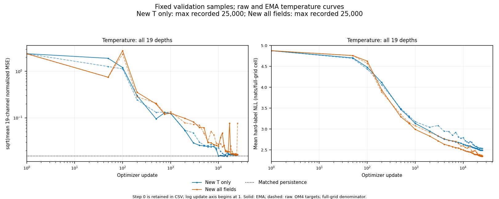

<!-- SPDX-FileCopyrightText: 2026 Samudra Authors -->
<!-- SPDX-License-Identifier: CC-BY-4.0 -->

# Fresh 25,000-update soft-prior results

Both fresh runs completed 25,000 optimizer and EMA updates: temperature-only job **22617264** and all-fields job **22617266**, each with 6.4 million accepted crop examples. At the fixed final EMA endpoint, all-fields temperature normalized MSE is 5.06% higher than temperature-only (2.50% higher RMSE), while its hard-label likelihood score is better at every depth. Both final EMA temperature point scores remain worse than matched persistence. These are single-seed results on four validation dates and 64 sampled date-cells per channel; they do not establish a repeatable multitask benefit or penalty. [Completion and timing receipt](report/curve-receipt.json).

| Final weights | Temperature normalized MSE ↓ | Normalized RMSE ↓ | Temperature hard-label NLL ↓ |
|---|---:|---:|---:|
| T-only EMA | 0.000257861 | 0.0160580 | 2.49712 |
| All-fields EMA | 0.000270904 | 0.0164592 | 2.34733 |
| T-only raw | 0.000265633 | 0.0162983 | 2.53694 |
| All-fields raw | 0.005928010 | 0.0769936 | 2.36671 |
| Matched persistence | 0.000229571 | 0.0151516 | — |

All scores use update 25,000, without selecting the best observed checkpoint. Temperature MSE and NLL average the 19 depth channels with the inherited full-grid denominator; normalized RMSE is the square root of that average MSE, not physical °C or the average of per-depth RMSEs. NLL is in nats per full-grid cell; lower is better. Persistence copies the latest input to the same five-day target and has no categorical likelihood. Final EMA MSE is 12.3% above persistence for T-only and 18.0% above for all-fields.

The EMA temperature MSE trajectories at updates 2,000 → 10,000 → 25,000 are 0.002890 → 0.0002273 → 0.0002579 for T-only and 0.009536 → 0.0006125 → 0.0002709 for all-fields. T-only was below persistence at updates 10,000 and 15,000 but did not retain that advantage at the fixed final endpoint. Its NLL continued to improve. These early values belong to the fresh 25,000-update learning-rate schedule; they are not continuations of the earlier 2,000-update experiment.

Final all-fields EMA temperature MSE is lower than T-only at 5 of 19 depths; its NLL is lower at all 19. T-only beats persistence at 7 depths and all-fields at 4. The final raw all-fields point score has a large deep-water failure: the 6,000 m channel contributes 96.2% of its sum of temperature channel MSEs (channel MSE 0.10834). EMA avoids that final raw spike. The raw and EMA likelihood scores remain close, showing that likelihood and argmax point errors rank behavior differently; neither establishes probability calibration. [Per-depth normalized RMSE](report/temperature-depth-rmse.png), [per-depth NLL](report/temperature-depth-nll.png).

The supervised all-fields salinity, u, v and surface-height EMA aggregates all remain above their matched persistence MSEs. Temperature-only auxiliary outputs have no supervision and are not forecasts. [Field MSE/NLL curves](report/field-curves.png) show those supervised tasks. The new runs share validation samples and normalization; original-model scalar scores are not mixed into these curves. Original-model benchmarks use the matched maps below.

Machine-readable results: [all 77 channels, raw and EMA](report/validation-channels.csv.gz), [field aggregates](report/validation-fields.csv), [training progress](report/training-progress.csv.gz), and [source/configuration receipts](report/curve-provenance.json.gz). CSVs include update zero; plotted update axes are logarithmic and start at one. Map job **22626759** completed; matched maps and their limits are reported below. Sparse validation curves alone do not establish spatial-noise behavior. This remains an experiment/results record, not intended to merge.

## Training setup

Both runs started from random initialization at update zero. They do not continue the earlier 2,000-update checkpoints. Each combines two-hot targets with smooth head initialization, the “both” arm of the [earlier pilot](../soft-priors/README.md). Two-hot targets divide probability between the two category centers bracketing the target. Smooth initialization correlates neighboring head rows with a Gaussian of sigma four bin indices; subsequent training leaves every row separately trainable.

The [temperature-only config](temperature-both-25k.json) and [all-fields config](all-fields-both-25k.json) retain the 17×17 quarter-degree input crop, four-block width-512 backbone, 18,523,648 parameters, five field queries, and 8,192 centers equally spaced in the asinh coordinate for each channel. Inputs are continuous ocean states at five days before initialization and at initialization; the target is five days later. The five fields are temperature, salinity, eastward velocity, northward velocity (19 depths each), and surface height (one channel), totaling 77 channels. Each field query requests one scalar for the sampled depth; surface height is supervised only at the surface. Values use per-channel dataset mean and standard deviation. The vocabulary centers are uniformly spaced after the inverse-hyperbolic-sine transform; supports come from 32 training-only dates with a 10% extrema margin and are recorded in the configs. Each point prediction is the fixed center of its argmax category, without a continuous mean or offset. Temperature-only training zeros the other fields' losses while retaining temperature's all-fields coefficient.

Both configs use seed 20261110 and fresh optimizer/EMA state. The learning rate warms up for 100 updates to 2×10⁻⁴, then follows a cosine schedule to 2×10⁻⁵ at update 25,000. Each arm stops at 25,000 updates or eight total allocated GPU-hours, whichever comes first. The replacement jobs had caps of 28,792 s (temperature-only) and 28,788 s (all-fields) after charged startup failures. Each completed arm consumed 6.4 million accepted crop examples. EMA denotes the exponential moving average of model parameters; its decay is 0.999 with update-n decay min(0.999, (1+n)/(10+n)). Final update-25,000 EMA is the primary endpoint, with intermediate raw and EMA scores retained. Any arm stopped by the allocation cap is reported as incomplete and excluded from that endpoint; intermediate comparisons use matched update counts.

The accepted stream still consists of eight logical batches of 32 examples per optimizer update, for effective batch 256. The selected implementation groups each pair into a physical GPU batch of 64, prefetches batches, and caches validation frames. Coverage sampling, date reuse, examples per update, temperature loss coefficient and optimizer schedule match between the two new arms. Auxiliary loss coefficients differ by design. Both use the same optimized implementation. Each logical draw selects 32 examples from an 8,192-candidate pool: a half-base, half-geometric-coverage proposal uses eight input-feature groups per depth, with exact inverse-proposal correction. A frame supplies 2,048 accepted examples (eight optimizer updates) before advancing; the next frame is prefetched. See the [sampling implementation](../../../src/samudra/skyline/coverage.py) for the base distribution and correction.

## Performance qualification and its limit

Qualification used source `ea592e8a71ebf9b50285ef835d641aae1de4d3c9`, archive SHA-256 `c9a0e0ffa7aaa3dac98286b1fc5438e0ffaa825f842bbb4e2a423a6434a0d0c3`, on an NVIDIA RTX PRO 6000 Blackwell Server Edition. The completed production runs used that same source archive. The 100-update screen measured median update times of 0.24600 s for physical batch 32, 0.25139 s for batch 128, and 0.20222 s for prefetched batch 64. The selected batch-64 path then underwent a paired 2,000-update all-fields qualification in job 22615178.

| Measurement | Baseline batch 32 | Selected batch 64 |
|---|---:|---:|
| Median optimizer-update time (s) | 0.23598 | 0.20455 |
| Full training-loop elapsed time (s) | 587.34 | 449.35 |
| Mean GPU utilization after 120 s (%) | 44.19 | 60.04 |
| Final EMA temperature normalized MSE | 0.00489063 | 0.01431469 |
| Final EMA temperature MSE at 2,400 m | 0.00237986 | 0.17962154 |
| Final EMA all-channel hard-label NLL | 3.03538 | 3.03310 |

Elapsed time includes validation and data waits. These are one paired measurement on this hardware; they do not establish a universal speedup. Profiling records BF16 attention query/key/value projections and head computation, followed by FP32 logits and loss. In the selected 100-update probe, frame-advance waits totaled 0.819 s of 22.98 s wall time (3.6%). CPU crop extraction took 6.65 s; coverage sampling including extraction took 16.90 s. These overlap GPU work and must not be added as wall-time fractions. Current-frame reuse and next-frame prefetch already reduce disk waits. The attention kernels are fused CUTLASS memory-efficient scaled-dot-product attention, not FlashAttention. [Profile, training and validation data](qualification-run-data.json.gz).

The [qualification receipt](qualification-receipt.json) records identical initial parameter hashes, source/configuration apart from the three performance options, final NumPy/Torch/CUDA random-number-generator states and frame-stream state, and validation origins/counts/persistence. Both runs accepted 512,000 examples, reached 2,000 optimizer and EMA updates, and passed finite-loss/gradient/validation checks. The 100-update profiles also have identical accepted-input hashes.

Post-update numerical equivalence is false. Temperature MSE rose from 0.00489 to 0.01431, with most of the aggregate difference coming from depth index 14 (2,400 m). The all-channel negative log likelihood (NLL) changed only from 3.03538 to 3.03310. The combined implementation changes produced a different training trajectory; equality of initial states and sampled data does not establish equal forecasts. Release required matching initialization/data/configuration and sampler end states, finite execution, and improved utilization; it did not require equal point accuracy. The accepted-input hash covers the 100-update probes; final-state equality alone does not prove every 2,000-update input tensor was identical. The 2,000-update qualification tested all-fields only, not temperature-only numerical behavior. Both production arms share the selected implementation.

These qualification scores use one seed and four validation dates, with 16 points per depth per date: 64 sampled date-cells per channel. Temperature MSE averages 19 normalized channels; NLL averages all 77 channels. Each channel loss treats land as zero but retains the full rectangular-grid denominator, implemented by wet-fraction scaling and inverse-proposal correction; the [evaluator](../../../src/samudra/skyline/comparison_eval.py) specifies the sums. Lower is better. Sparse validation can make rare deep-water errors dominate; the NLL result does not establish calibrated probabilities. The completed performance work consumed **1,240 GPU-seconds**, including the failed diagnostic attempt, profiling and paired qualification. Initial production jobs 22617080 and 22617082 then failed before model/data initialization because the configs had not been copied to the cluster, consuming another 8 and 12 GPU-seconds. The files were copied and their hashes verified before the replacement submissions above. The 20 s is charged to the respective eight-hour caps. Both permitted engineering fixes have been used; the earlier fix corrected a profiling dtype assertion. The completed production allocations used 5,493 GPU-seconds for T-only and 5,564 for all-fields. Time-weighted GPU utilization after the first 120 s was 59.9% and 58.5%, including validation and checkpoint writes. Including the 20 s startup failures, 1,240 s performance work, and 249 s matched-map allocation, total charged compute is **12,566 GPU-seconds (3.491 GPU-hours)**. [Cost receipt](report/compute-receipt.json). Qualification costs are outside the production caps.

## Matched quantization check

An oracle assigns each known OM4 target its nearest physical category center. Its RMSE measures the vocabulary's best possible pointwise quantization error; it is not a learned forecast. The check uses the actual 8,192 float32 centers, transformed into physical units in float64, and compares with the cached original temperature-only regression model at EMA update 25,000. Oracle and regression use exactly the same wet cells and area weights.

All nine full native regional patches use origin 4273, targeting 2016-07-21 at five-day lead. These full cached regions are larger than the planned centered 64×64 display patches. Every target lies inside the finite center support. Regression RMSE is 9.3–331.3 times the oracle RMSE on these patches; finite bin spacing alone therefore does not impose the observed regression error here. This does not show that a trained classifier can reach the oracle or establish support coverage on other dates, regions or fields. [CSV](matched-oracle.csv), [source normalization and oracle receipt](matched-oracle.json.gz).

| Region | Depth (m) | Wet cells | Oracle area RMSE (°C) | Original T regression area RMSE (°C) | Regression / oracle |
|---|---:|---:|---:|---:|---:|
| North Pacific | 2.5 | 9,600 | 0.001489 | 0.493321 | 331.3 |
| North Pacific | 250 | 9,599 | 0.001024 | 0.079485 | 77.6 |
| North Pacific | 1850 | 9,581 | 0.000350 | 0.003270 | 9.3 |
| Gulf Stream | 2.5 | 6,400 | 0.001643 | 0.430268 | 261.9 |
| Gulf Stream | 250 | 6,273 | 0.001516 | 0.246048 | 162.4 |
| Gulf Stream | 1850 | 6,215 | 0.000548 | 0.008827 | 16.1 |
| Agulhas | 2.5 | 6,400 | 0.001299 | 0.275050 | 211.8 |
| Agulhas | 250 | 6,398 | 0.001115 | 0.269966 | 242.2 |
| Agulhas | 1850 | 6,263 | 0.000360 | 0.008822 | 24.5 |

## Matched maps

Both new models are 8,192-bin classifiers trained with two-hot targets and smooth head initialization; every categorical scalar prediction is the argmax-bin center. New T-only supervises temperature, while new all-fields supervises all five fields. Both new models use fixed update-25,000 EMA weights for every map and ranking below. The two new models have lower temperature RMSE than the original all-fields regressor on all nine region/depth patches: reductions range from 11–87% for new T-only and 16–92% for new all-fields. Against the original T-only regressor they win on 7/9 and 6/9 patches; against the original T-only classifier, 6/9 and 4/9; against the original all-fields classifier, 7/9 and 6/9. New T-only beats new all-fields on 5/9. These are patch counts, not global averages. Persistence remains better on 7/9 and 8/9 patches, respectively; the new models beat cached Samudra temperature on 6/9 and 7/9. [Per-patch RMSE, bias and spectra](report/map-metrics.csv) include every comparison. [Inference receipts](report/map-provenance.json.gz) record model/checkpoint/source identities; [physical fields](report/source-fields.npz) and [render checks](report/map-render-receipt.json) preserve the plotted data.

The maps use the same OM4 initial history and +5-day target, July 21, 2016 (zero-based OM4 time index 4273 for the later input state), on centered 64×64 native patches in the North Pacific, Gulf Stream and Agulhas at 2.5, 250 and 1,850 m. Coordinates, targets and wet masks are checked before joining caches; every wet prediction is required. Each row uses a shared field/error color range and area-weighted physical RMSE. Pixels are displayed without interpolation; context boxes show the new 17-cell and original 33-cell crops at the same scale.

- Temperature against original regressors: [fields](report/temperature-regression-fields.png), [errors](report/temperature-regression-errors.png).
- Temperature against original classifiers: [fields](report/temperature-classifier-fields.png), [errors](report/temperature-classifier-errors.png).
- Gulf Stream and Agulhas surface u/v: [fields](report/velocity-fields.png), [errors](report/velocity-errors.png).
- Targeted Black Sea 1,850 m salinity: [fields](report/salinity-fields.png), [errors](report/salinity-errors.png).

For surface u/v, the new all-fields model has RMSE 0.04273/0.04266 m/s in the Gulf Stream and 0.06449/0.04989 m/s in Agulhas. The original all-fields regressor is better on all four panels; persistence is better on three. Relative to the original all-fields classifier, the new model changes RMSE by less than 0.6% on every panel. T-only auxiliary outputs are excluded because they were not supervised. No cached Samudra u/v or salinity is used.

Short-wave power sums Fourier power at radial frequencies 0.25–0.5 cycles per grid cell (wavelengths 2–4 cells), after planar detrending and a periodic Hann window. Each comparison uses the same fully wet 64×64 tile if available; otherwise it uses the 32×32 fully wet tile nearest the patch center. North Pacific surface temperature power is 21.8× OM4 for new T-only and 21.3× for new all-fields, compared with 1.13× for persistence, 5.79× for Samudra, 3.65× for original T regression, 15.3× for original T classification, 37.6× for original all-fields regression and 25.4× for original all-fields classification. Across the remaining eight T tiles, the new models range from 0.61–2.53× OM4. Their surface u/v power ranges from 0.99–1.72×, versus 0.75–1.22× for persistence. Excess fine-scale power remains in these predictions; the statistic alone cannot identify its cause or establish physical coherence.

The two previously problematic salinity points are separate selected validation cases with +5-day target dates: June 22, 2014 at 43.5947°N, 34.625°E (row 534, column 138), and October 5, 2014 at 42.3456°N, 39.125°E (row 529, column 156). OM4 salinity is 22.366186 and 22.313528 PSU. The original classifier predicts its lowest center, 27.692825 PSU, at both points. Its center support is 27.692826–41.766738 PSU, so even the nearest center incurs 5.326640/5.379298 PSU absolute error. The new all-fields classifier's training-audited support is 20.951313–48.508251 PSU. Its nearest-center errors are 0.002234/0.000314 PSU, but its actual prediction is 22.363953 PSU on both dates: absolute errors 0.002233/0.050425 PSU. Both targets lie within the new center range; the October prediction remains above its quantization floor. Original regression errors are 0.006052/0.046606 PSU; persistence errors are only 0.000202/0.000164 PSU. [Exact point predictions, probabilities, center bounds and checkpoint hashes](report/salinity-outliers.csv) preserve this distinction. Endpoint categories have open tails; the quoted support limits refer to available scalar readout centers.

All paired salinity values above and below are ordered June 22 / October 5. The salinity map RMSE includes all 503 wet cells in each 64×64 rectangle, including cells outside the Black Sea. New all-fields RMSE is 0.04578/0.04527 PSU, original classification 4.94547/4.94517 PSU, original regression 0.05431/0.05147 PSU, and persistence 0.000657/0.000990 PSU. These regional scores are distinct from the two point diagnostics. Original models differ in architecture, task, context and training/checkpoint budgets, so their comparisons do not isolate the new loss or initialization. This is one held-out forecast date plus two selected validation diagnostics from single-seed runs. OM4 is an ocean-model target; these maps do not establish observational forecast skill.

## Benchmark identities

Origin denotes the initialization record index in the quarter-degree dataset. Origin 4273 initializes on 2016-07-16 and targets 2016-07-21. Display patches are centered native 64×64 cells within North Pacific 170–200°E/25–45°N, Gulf Stream 300–320°E/25–45°N, and Agulhas 40–60°E/50–30°S.

| Benchmark | Parameters | Crop | Selected weights |
|---|---:|---:|---|
| Original T regression | 207,974,401 | 33×33 | Final 25,000-update EMA |
| Original all-fields regression | 207,974,401 | 33×33 | Final 25,000-update EMA |
| Original T classifier | 210,067,456 | 33×33 | Likelihood-selected EMA at 27,624 total updates; 2,048 bins |
| Original all-fields classifier | 55,907,328 | 33×33 | Final 15,000-update EMA; 2,048 bins |

The [original regression/noise report](../pre-spike-noise/README.md) identifies its cached runs. The original T classifier checkpoint SHA-256 is `50ad50aaed2bd3305adeb519c7bfad17b34e57f657b3f81a2d5bb039afd425d5`; its cached inference archive SHA-256 is `1452f66cf69306297e2780895f233aa4be38faa93f7e753a2eb7c90dfbea0b9a`. Cached Samudra uses the October 8, 2026 quarter-degree two-input/one-output run 211241, epoch-62 model weights (no EMA), with true two-state history; checkpoint SHA-256 `1f62b6303519d54a2976d7e13deac4a3311512b7a090db0f61e3e288d76ba841`. Its cached targets and Samudra temperatures match the classifier cache exactly on the nine display patches.
