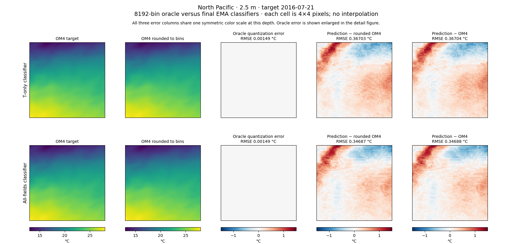
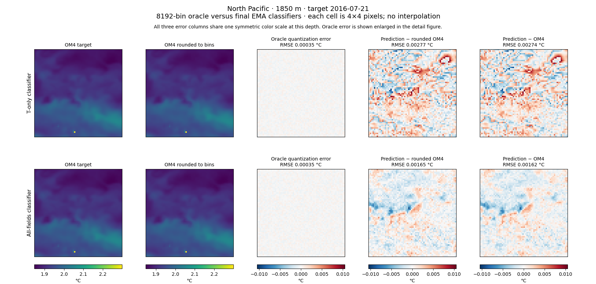
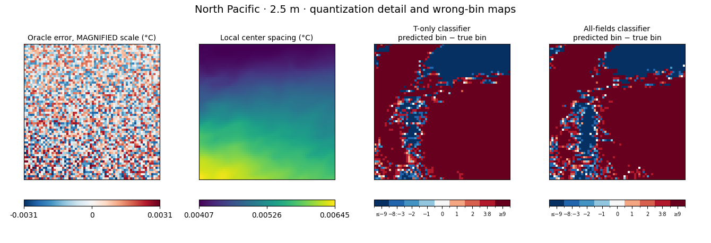
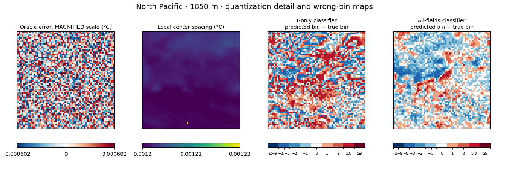
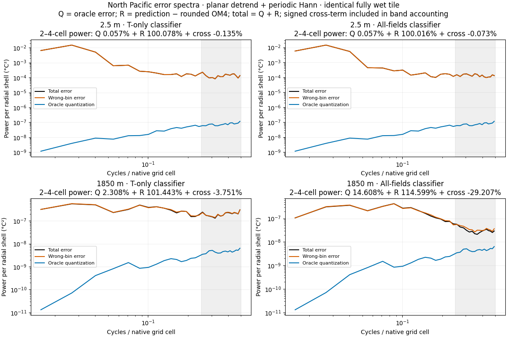
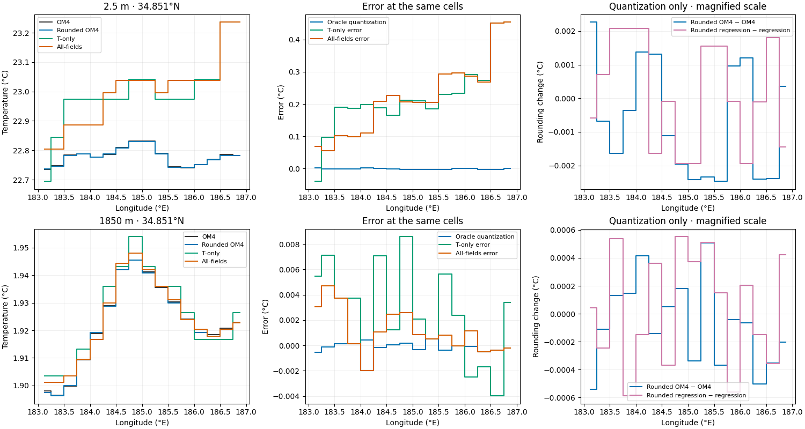

<!-- SPDX-FileCopyrightText: 2026 Samudra Authors -->
<!-- SPDX-License-Identifier: CC-BY-4.0 -->

# North Pacific temperature: quantization and prediction error

Rounding OM4 temperature to the classifiers' 8192 fixed output centers produces much less error than either classifier on these patches. Surface fine-scale error remains almost unchanged after subtracting that rounding error. At 1850 m, rounding is visible and has a larger power relative to the all-fields model's error, although wrong-bin predictions remain common.

These are the same native quarter-degree 64×64 North Pacific patches used in the [25k report](../README.md), at 2.5 m and 1850 m, for target 2016-07-21 (input origin 4273). Both classifiers use final 25,000-update EMA weights, 18.5M parameters, and 17×17 input crops. Both predict five days ahead from the same two input ocean states and forcing inputs. T-only predicts temperature; All-fields predicts temperature, salinity, both horizontal velocity components, and surface height. This is one date and region; it does not establish a global noise fraction.

| Depth | Model | Rounding-only RMSE (°C) | Prediction RMSE (°C) | Median absolute bin error | Within one bin |
|---|---|---:|---:|---:|---:|
| 2.5 m | T-only | 0.001486 | 0.367042 | 44 | 1.83% |
| 2.5 m | All-fields | 0.001486 | 0.346881 | 40 | 2.47% |
| 1850 m | T-only | 0.000353 | 0.002744 | 2 | 49.51% |
| 1850 m | All-fields | 0.000353 | 0.001617 | 1 | 76.64% |

Each depth uses its own temperature vocabulary, with centers spaced uniformly after an asinh transform and therefore nonuniformly in physical temperature. Absolute bin error is the absolute difference between predicted and oracle center indices; within one bin includes exact predictions. RMSE uses wet-cell area weights. Bin statistics count wet cells equally. All 4096 cells in each patch are wet. Local center spacing is 0.00407–0.00645 °C at the surface and 0.001201–0.001227 °C at 1850 m. No target lies outside the vocabulary support.

## Maps

Let Y be OM4 temperature, Q(Y) its nearest allowed output center, and P the saved argmax prediction. The exact decomposition is:

`P − Y = [Q(Y) − Y] + [P − Q(Y)]`.

The first term is unavoidable rounding error for a perfect discrete predictor. The second measures deviation from that oracle prediction. These terms are correlated: their squared errors and spectral powers cannot be added without a signed cross-term. This diagnostic does not isolate every causal effect of quantization on model training or argmax decisions.

All three error columns share a symmetric scale within each depth. Each native cell occupies exactly 4×4 pixels, with hard boundaries and no interpolation. The detail figures magnify the rounding error and show predicted bin minus oracle bin; outer categories group large errors.

## Fine-scale error power

The following ratios divide each component's 2–4-cell wavelength power by total prediction-error power in that same 2–4-cell band. They sum to 100% only after including the signed cross-term; the rounding ratio alone is not a percentage of noise causally explained.

| Depth | Model | Rounding power / total | Wrong-bin residual power / total | Cross-term / total |
|---|---|---:|---:|---:|
| 2.5 m | T-only | 0.057% | 100.078% | −0.135% |
| 2.5 m | All-fields | 0.057% | 100.016% | −0.073% |
| 1850 m | T-only | 2.308% | 101.443% | −3.751% |
| 1850 m | All-fields | 14.608% | 114.599% | −29.207% |

At the surface, rounding power is about 1/1750 of total fine-scale error power. At 1850 m, the all-fields map operates much closer to individual bin steps. Its residual still has more fine-scale power than total error because the cross-term cancels part of that power. Increasing vocabulary precision alone therefore has no demonstrated guarantee of removing the visible texture.

The spectra use the same fully wet 64×64 patch for every component, subtract a fitted plane, apply a periodic Hann window, and normalize power by mean squared window amplitude. The shaded band is radial frequency 0.25–0.5 cycles per native grid cell. These are error spectra, distinct from field-power comparisons in the parent report.

## Transects and regression rounding control

The transects use the central wet row and central 16 columns, selected without looking at prediction error. Their right panels enlarge only the change caused by rounding.

Rounding the original T-only regression predictions to these same centers changes RMSE from 0.386471 to 0.386605 °C at the surface, and from 0.003489 to 0.003496 °C at 1850 m. The rounding changes have 2–4-cell power of 1.302e-6 and 6.927e-8 °C², respectively, close to the corresponding OM4 rounding powers (1.236e-6 and 7.406e-8 °C²). This control uses the older 208M-parameter, 33×33-crop regression model. It is not the pending matched small regression experiment.

[Metrics CSV](metrics.csv) · [Spectra CSV](spectra.csv) · [Analysis arrays](fields.npz) · [Source hashes and receipt](receipt.json.gz) · [Reproduction script](render.py)

The script checks the pointwise, area-weighted MSE, and spectral-band decompositions. Saved float32 predictions agree with their nearest physical bin center to within 1.43e-6 °C. Run from the repository root with `CUDA_VISIBLE_DEVICES='' uv run python experiments/temperature_skyline/soft-priors-25k/quantization/render.py`.
