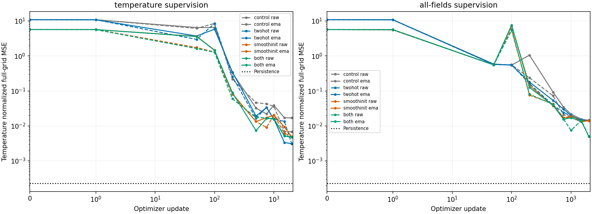
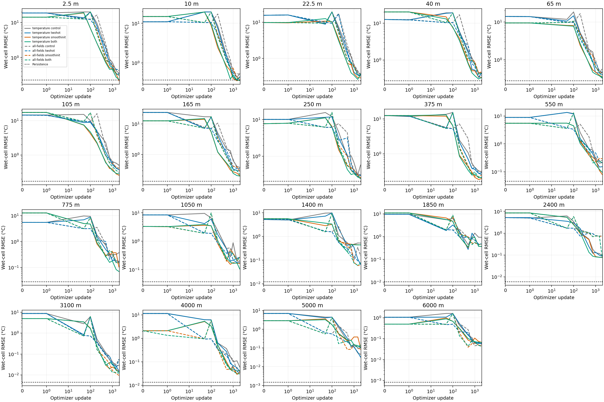
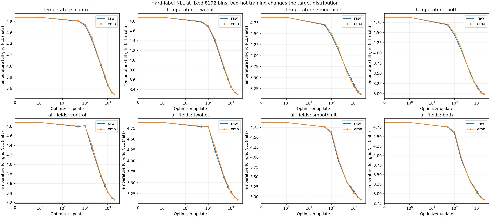

<!-- SPDX-FileCopyrightText: 2026 Samudra Authors -->
<!-- SPDX-License-Identifier: CC-BY-4.0 -->

# Soft-target and smooth-initialization discrete pilot

All six new runs completed 2,000 updates. With temperature-only supervision, two-hot targets reduced final EMA temperature normalized MSE by 81.7% versus the matched 8,192-bin hard-target control and improved 18 of 19 depths. With all-fields supervision, combining two-hot targets and smooth initialization reduced temperature MSE by 65.5% and improved 15 of 19 depths. Either change alone left the all-fields aggregate temperature score near the control. The target is five-day OM4 quarter-degree ocean-model output, not observations. Each channel score uses 64 sampled date-cells: 16 points per depth on each of four validation dates, rather than exhaustive maps. These are single-seed observations; small differences are inconclusive, and numerical repeatability is limited as documented below.

Every prediction is still the fixed center of one argmax-selected category. The output vocabulary, parameter count and model architecture are unchanged across this comparison. No continuous mean, offset or readout was introduced. Full categorical distributions remain available from the retained checkpoints.

| Training change | T-only temperature MSE | Change vs control | All-fields temperature MSE | Change vs control |
|---|---:|---:|---:|---:|
| Hard target, independent initialization | 0.016978 | — | 0.014417 | — |
| Two-hot only | 0.003106 | −81.7% | 0.014445 | +0.2% |
| Smooth initialization only | 0.004867 | −71.3% | 0.014105 | −2.2% |
| Both | 0.004763 | −71.9% | 0.004968 | −65.5% |

Scores use EMA at exactly update 2,000; lower is better. Temperature MSE averages 19 normalized channels with the inherited full-grid denominator. Matched persistence is **0.00022957**, better than every model in this screen. The earlier flat-2,048 pilot also remains better on this aggregate metric: 0.002584 for T-only and 0.003019 for all-fields. That comparison changes vocabulary and head size, so it is secondary to the matched 8,192-bin controls here.

Two-hot T-only training first crossed the predeclared 0.02 temperature-MSE threshold at update 500 versus 1,500 for its control. Combining both changes in all-fields first crossed at update 750 versus 1,500. These crossings were retained at update 2,000. The first observed crossing of 0.005 was update 1,500 for two-hot T-only and update 2,000 for both/all-fields; neither control crossed it. Validation is sparse between recorded updates, so these are observed crossings rather than exact convergence times.

The corresponding elapsed training-loop times to 0.02 were 3.39 versus 8.23 minutes for two-hot T-only, and 4.13–4.35 versus 12.65 minutes for both/all-fields. Elapsed time includes validation and data waits; different nodes, shared I/O and historical execution times limit hardware-efficiency conclusions. The [threshold table](time-to-skill.csv) contains every predeclared threshold, raw/EMA results, timing bounds and final retention. [Elapsed-time curves](temperature-time.png) and [early-update curves](temperature-early.png) show the same receipts.

The gains are not confined to one depth, but the aggregate is sensitive to rare deep-water failures. Over the upper 550 m, temperature-only MSE falls from 0.001789 to 0.001053 with two-hot, 0.000585 with smooth initialization, and 0.000636 with both. The corresponding all-fields values are 0.001599, 0.001205, 0.001285 and 0.000906. Thus two-hot has the best full-depth T-only score while smooth initialization has the best shallow T-only score. Physical RMSE in the figure is measured in °C over wet cells; the aggregate table uses normalized full-grid MSE.

At 1,850 m, all three new T-only models still predict 13.447°C for the previously identified 9.970°C case at 7.37°N, 119.375°E, target date 2013-10-15. It accounts for 97.5–99.1% of that depth's squared error. All three new all-fields models predict 9.472°C for the 13.432°C case at 37.10°N, 19.875°E on the same date, accounting for 98.0–98.5% of that depth's error. The changes do not eliminate these failures. [All final raw/EMA cases](depth13-cases.csv) retain their probabilities and error contributions; none is removed from the reported aggregates. The [earlier rarity audit](../discrete-rarity/README.md) gives their training exposure and historical predictions.

The reported hard categorical NLL is measured in nats with the full rectangular-grid denominator, not the wet-cell mean. It declines for every new arm. Final T-only NLL is 3.491 for the control, 3.300 for two-hot, 3.114 for smooth initialization and 2.980 for both. All-fields temperature NLL is 3.268, 3.119, 2.925 and 2.840 respectively. All use the same 8,192-bin vocabulary. Two-hot changes the target distribution learned during training; these hard-label validation scores do not establish calibrated probabilities. The NLL ranking also differs from the scalar-MSE ranking.

[All-fields curves](all-fields-curves.png) and [field endpoints](endpoints.csv) show the auxiliary tasks. Both/all-fields reduces salinity MSE from 0.2251 to 0.1952 and SSH from 0.001852 to 0.000674; velocity MSE changes are small. Non-temperature outputs of T-only runs are unsupervised and are not scientific forecasts.

The CSVs also include `wet_cell_leaf_error_rate`, an inverse-proposal-weighted estimate of wrong-bin frequency normalized by wet coverage. Finite-sample importance estimates can exceed one; they are not clipped. `quantization_full_grid_nmse` is the error from replacing each target with its encoded true-bin center. `greedy_full_grid_nmse` equals ordinary argmax MSE for these flat heads; it is retained for compatibility with the earlier coarse/fine pilot. This screen does not establish observational forecast skill.

Machine-readable curves: [aggregate](validation-aggregate.csv), [by field](validation-fields.csv), [all 77 channels, raw and EMA](validation-channels.csv.gz). [Run receipts](receipts.json.gz) preserve source/configuration, initial hashes, completion and accounting. The complete validation-curve data contain updates 0, 1, 50, 100, 200, 500, 750, 1,000, 1,500 and 2,000; fixed-budget final EMA, rather than the best observed checkpoint, defines the primary comparison.

## Matched setup and objectives

Two-hot targets place probability on the two centers bracketing the normalized physical target, linearly weighted by physical distance. Exact-center targets become one-hot; values outside the finite centers use the endpoint category. Training minimizes their weighted cross-entropy. The hard midpoint-assigned categorical NLL is unchanged in validation and is a diagnostic when comparing these different target objectives. Two-hot training changes what the classifier is asked to estimate; this experiment does not establish calibrated likelihoods. There is no class-frequency or density weighting.

Smooth initialization applies a Gaussian kernel with sigma four bin indices, truncated at four sigmas, to the independent random head weights and biases. Bin indices are equally spaced in the vocabulary's asinh coordinate. At each boundary, dividing by the kernel's local L2 norm preserves each row’s theoretical marginal variance under independent, identically distributed initialization, before matching the actual global weight and bias RMS to the original independent initialization. The head remains an ordinary fully trainable linear layer, with 8,192 separately trainable output rows. There is no continuing smoothness penalty or weight tying. Initial adjacent-row cosine similarity, weight/bias RMS, and validation-logit RMS are recorded. Matching parameter RMS does not guarantee matching logit RMS on a finite set of inputs.

All eight scientific arms share the same seed, 17×17 native quarter-degree crop, four-block width-512 backbone, 18,523,648 total parameters, five field queries, training examples, coverage sampling, batch 256, date reuse, optimizer and 2,000-update schedule. Bounds are copied from the pilot's training-only audit and never refit. All 19 depths remain targets. Temperature-only supervision zeros the other four fields' losses while retaining temperature's all-fields coefficient. The two-hot-only model has exactly the control's initial weights; smoothing changes only head weights and biases and consumes no extra random draws. A CPU comparison of old and new source gives identical control state tensors. GPU qualification reproduces the old control initialization hash and the sampling/persistence invariants under the original container; post-update model-score differences are retained as numerical-repeatability diagnostics.

Adjacent-bin cross-entropy has precedent in [Distribution Focal Loss](https://arxiv.org/html/2006.04388v1); its continuous expectation readout is not used here. [Histogram-loss experiments](https://arxiv.org/html/2402.13425v3) motivate testing target representations for optimization, but do not establish an advantage for this ocean task. The neighboring-row initialization is experimental. These citations motivate the comparison, not a claim that either change is already proven to accelerate this model.

All six new runs were capped at 2,000 updates or two allocated GPU-hours each. Qualification covered the six new arms and both existing controls. The pilot's batch and data recipe remain matched despite its previously low utilization; no longer run is released automatically. This is an experiment/results record and is not intended to merge.

Physical RMSE is reported in each channel’s units over wet cells. Normalized MSE uses the inherited full-rectangular-grid denominator and inverse-area sampling correction, averaged equally over the requested channels; temperature aggregates all 19 depths. Persistence copies the latest input to the five-day target and uses identical samples and weighting. The 1,850 m outlier diagnostics rank individual validation date-cells by their contribution to that depth’s weighted squared error. Historical controls share initialization, data and recipe, but their post-update trajectories are not numerically identical on repeat. Original and new qualification receipts and source provenance accompany the comparison.

Initial neighboring-row cosine similarity changes from 0.000749 to 0.984505. Weight RMS is 0.02551605 in both cases; bias RMS agrees within floating-point rounding. Qualification validation-logit RMS is 0.579853 for independent initialization and 0.581371 for smooth initialization, a 0.26% difference on the same two-date qualification inputs. These measurements are in [initialization.csv](initialization.csv). The model input remains continuously embedded ocean fields, with two input times and one five-day target. The scalar output remains discrete throughout.

## Reproducibility and compute

The source for all six new runs is `ff13600ecba53b2a0de49fe0424c029047be6de0`; historical controls use `0e174c2a884dc2be743239002db3e25a37a011bb`. All use the same published container on NVIDIA RTX PRO 6000 Blackwell GPUs. The [qualification receipt](qualification-receipt.json) records exact initial hashes, CPU default-control forward/backward parity, identical final qualification sampling RNG and frame-stream states, matching configurations and persistence, finite states, and expected EMA/checkpoint counts.

Qualification initially required every numeric per-channel metric to satisfy `abs(new - reference) <= 1e-10 + 1e-6 * abs(reference)`. Initial weights and update-zero metrics matched exactly, but post-update metrics failed. Repeating the unchanged historical source also failed: all-fields EMA temperature MSE at update 1 was 4.070623 versus its original 4.096314; the new-source repeat gave 4.096314. At EMA update 4, the maximum across channels of the historical-source temperature-only NLL difference was 0.001533. The source of this numerical non-repeatability was not isolated. The release criterion was amended to require the exact initialization/data/sampling/persistence checks and finite training checks above, while treating post-update numerical differences as diagnostics. This does not prove trajectory equivalence over 2,000 updates or establish significance of small improvements.

[Control-repeatability CSV](control-repeatability.csv) summarizes all 77 channel maxima and temperature aggregates at updates 0, 1, 2 and 4. `old_repeat` and `new_repeat` are audit job 22594243 using historical and new source; `new_v2` is qualification job 22593710 using new source. Channel maxima include unsupervised non-temperature outputs in T-only runs, which are not scientific forecasts.

| Arm | Completed job | Allocated seconds |
|---|---:|---:|
| T-only two-hot | 22594960 | 703 |
| All-fields two-hot | 22594966 | 703 |
| T-only smooth initialization | 22595643 | 638 |
| All-fields smooth initialization | 22594972 | 755 |
| T-only both | 22594974 | 717 |
| All-fields both | 22595644 | 637 |

The six completed runs used 4,153 GPU-seconds. Two startup SIGSEGV failures, before any training record, used another 49 seconds; their one retry wave succeeded with unchanged code and the failed time deducted from each arm's allocation cap. Two eight-arm qualifications and a four-control audit used 821 seconds. Total new compute was **5,023 GPU-seconds = 1.395 GPU-hours**; reused historical controls are excluded. Each completed arm consumed 512,000 accepted crop examples and completed 2,000 EMA updates. Final logged GPU-utilization windows ranged from 35% to 48%; every run finished in 10.6–12.6 minutes, below the two-hour cap. No further run is implied by this report.
