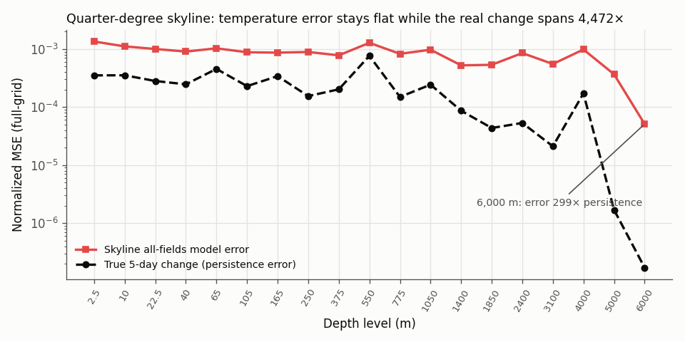
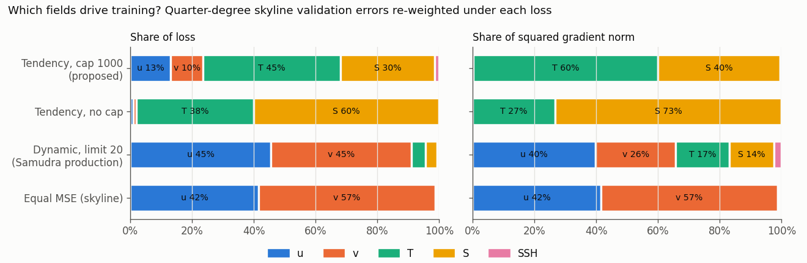
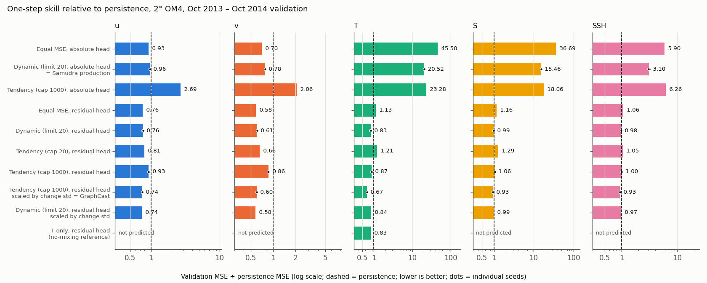
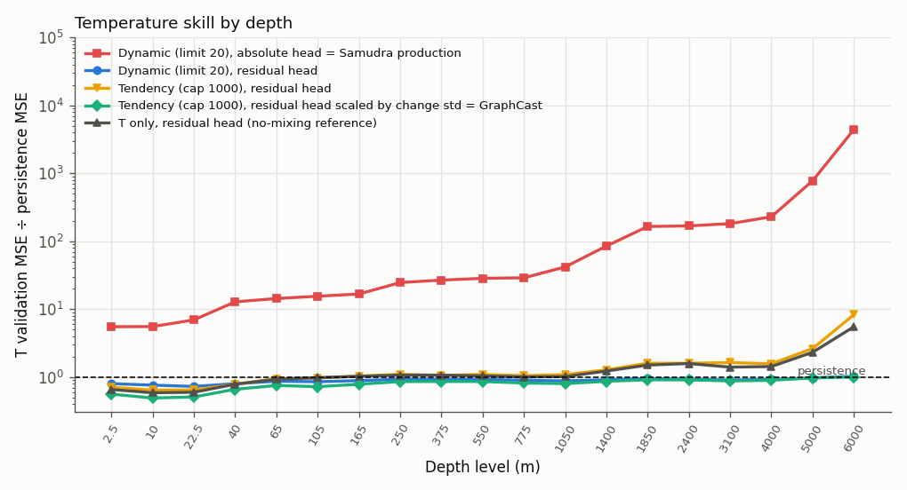
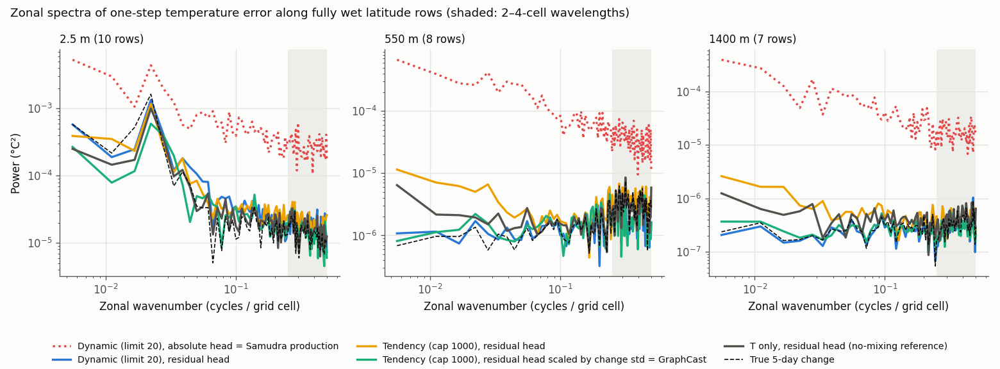

<!-- SPDX-FileCopyrightText: 2026 Samudra Authors -->
<!-- SPDX-License-Identifier: CC-BY-4.0 -->

# Why temperature degrades when one model predicts many ocean fields: root cause, fix and evidence

**This is an experiment and results record, not intended to merge.** It accompanies the tendency-loss change on `loss/tendency-normalized` and explains why that change on its own is not the fix.

## Summary

When a Samudra-style model predicts temperature together with salinity, velocities and SSH, its temperature forecast gets worse than a model trained on temperature alone. The temperature skyline experiment showed this at quarter degree: excess short-wave noise, worse with more parameters. The cause is not an information-theoretic limit. Three properties of how the model is parameterized and scored combine to produce it:

1. **The model predicts the absolute state, not the change** (`pred_residuals: false`). Five-day temperature change is only 1–2% of temperature's normalized spread near the surface, and far less at depth. So the network must reproduce the current value to better than 1% precision just to tie persistence. The leftover reconstruction error is a floor that does not depend on the physics.
2. **The loss is scored in state units.** Inputs and targets are normalized by each channel's climatological standard deviation, but a five-day change is about 470× larger, relative to that spread, for meridional velocity than for temperature. Under equal weights velocity takes 99% of the loss, and largely unpredictable eddy velocity dominates the gradients.
3. **The output layer has to span three orders of magnitude.** Even when predicting the change, one output layer must emit changes of about 0.5 (surface velocity) and 0.0004 (deep temperature) in normalized units.

GraphCast and Keisler (2022) handle all three the same way: predict the residual, scale the network output by each variable's change standard deviation, and score the loss in those change units. In a controlled factorial experiment on real 2° OM4 data, that parameterization took temperature from **20.5× worse than persistence** (Samudra's production recipe) to **0.67× persistence**, identical on two seeds. It beats persistence in every field and at every depth to within 1%, and it does better on temperature than a matched model trained on temperature alone (0.83). Predicting many fields stops hurting temperature and starts helping it.

**The fix needs all three parts.**

- **Residual head.** It removes most of the failure on its own (45.5× → 1.13×).
- **Tendency loss.** Without output scaling it gives no gain over Samudra's existing `DynamicLoss`, and it costs velocity skill.
- **Output scaling.** With `DynamicLoss` it does not improve temperature (0.84).

Only the full GraphCast combination reaches 0.67.

## The problem

Results already on `experiment/temperature-point-skyline` (PR #956):

- **The noise comes from predicting all fields, not from the inputs.** The 208M "all fields" skyline queries T, S, u and v at one depth (plus SSH at the surface). Its temperature MSE is 4× worse than a matched temperature-only model, and its field spectra have 2–38× OM4's power at 2–4-cell wavelengths. The temperature-only model, trained on identical inputs, is nearly clean.
- **Scale does not fix it.** Temperature error is not monotonic in model size and has instability spikes, and the best-ever temperature MSE is about 3.1e-4 at every size.
- **Samudra shows a related short-wave excess.** It was trained with `DynamicLoss` (limit 20) and `pred_residuals: false`.

## Root cause analysis

### It is not an information limit

The temperature-only model reads the same inputs and predicts temperature far better, so the information is there. The error is also the wrong shape for an information limit. Under MSE, unpredictable small scales are averaged away, which gives *less* short-wave power than the truth (blur). The skyline shows *more* (noise). That is estimation error, not missing information.

### Cause 1: absolute-state output leaves an error floor



On the quarter-degree skyline validation set, the all-fields model's temperature error is roughly flat at 5e-4 to 1e-3 (normalized MSE) at every depth. Meanwhile the true five-day change, the persistence error, spans 4,472× from surface to abyss. At 6,000 m the model is 299× worse than persistence. An error that does not track the physics is the signature of an output floor: the network has to rebuild the absolute value through many layers, and its imprecision is spatially incoherent noise.

### Cause 2: the loss is dominated by velocity



Re-weighting the same per-channel validation errors under each loss shows what the optimizer sees ([loss-shares.csv](report/loss-shares.csv)):

- **Equal MSE (the skyline recipe):** temperature is 0.7% of the loss and gradient. Velocity is 99%.
- **`DynamicLoss`, limit 20 (Samudra production):** temperature is 4.6% of the loss and 17% of the gradient.
- **Tendency weights:** temperature becomes a large share. Without a cap, the deepest salinity and temperature channels take over, which shows a cap is needed.

`DynamicLoss` is sometimes described as equivalent to GraphCast's weighting. It is not. Its weights are the inverse of the model's own running loss, so its gradient is that of Σ log L_c: every channel is pushed toward the same *relative* improvement, however predictable it is. GraphCast's weights are fixed from the data. `tests/test_loss.py` on `loss/tendency-normalized` pins this down, including the gradient identity, the effect of the cap, and an equivalence test against GraphCast's `normalization.InputsAndResiduals`.

### Cause 3: one output layer, three orders of magnitude

On the 2° training data, the root-mean-square five-day change in normalized units is 0.54 for v at the surface and 4.0e-4 for temperature at 6,000 m ([twodeg-persistence-rms.csv](report/twodeg-persistence-rms.csv)). A residual head removes cause 1, but the output layer must still produce values that differ by about 1,350× in typical size. GraphCast's network emits unit-variance residuals, which are multiplied by `diffs_stddev_by_level` before being added to the input. Keisler normalizes the whole state by per-variable change standard deviations.

## The intervention

| Component | GraphCast (`weathernext/utils/normalization.py`, `losses.py`) | Keisler 2022 | Samudra today |
|---|---|---|---|
| Predict the change | Yes (`InputsAndResiduals`) | Yes (`nodes["data"] += nodes["change"]`) | Available, off in production (`pred_residuals: false`) |
| Output scaled by change std | Yes (`diffs_stddev_by_level`) | Yes (`temporal_normalizer`, per variable) | Not implemented |
| Loss in change units | Yes (MSE of normalized residuals, plus latitude and level weights) | Implied by normalization | `DynamicLoss`; fixed tendency weights on `loss/tendency-normalized` |

## Evidence: controlled factorial on real 2° OM4

### Setup

- **Data:** public `Samudra/v2026-09/om4_twodeg` (90 × 180, 19 levels). All 77 prognostic channels plus `tauuo`, `tauvo` and `hfds`, normalized with the release's `OM4_means` and `OM4_stds`.
- **Splits:** training on 1990–1993 (292 five-day steps); validation on Samudra's window, 2013-10-05 to 2014-10-05 (72 one-step forecasts).
- **Model:** a small CNN with 4 residual 3×3 blocks of width 48, zonally periodic, with wet masks as inputs.
- **Training:** 1,500 AdamW updates, batch 4, cosine learning rate from 1e-3. The model, data order, initialization and budget are identical in every arm; only the loss and the output head change.
- **Losses:** Samudra's own `DynamicLoss` and `loss_fn_from_metric`, and the `TendencyLoss` and `persistence_rms` from `loss/tendency-normalized`, run unmodified.
- **Metric:** validation MSE ÷ persistence MSE per field, summed over depths in the full-grid units of the loss. Below 1 beats persistence.

The statistics script also ran over the full 1975–2013 training range. Every channel's persistence RMS is within 5% of the 1990–1993 values (median ratio 0.998), and the 2° statistics match the quarter-degree skyline's: v 0.115 vs 0.102, temperature at 6,000 m 1.5e-7 vs 1.7e-7. So 2° shows the same imbalance as quarter degree.

### Results



Validation MSE ÷ persistence MSE (lower is better; below 1 beats persistence). Where two seeds ran, the mean is shown, and the seeds differ by at most 0.02 in every field. Full table: [skill-by-field.csv](report/skill-by-field.csv).

| Arm | Seeds | u | v | T | S | SSH |
|---|---:|---:|---:|---:|---:|---:|
| Equal MSE, absolute head | 1 | 0.93 | 0.70 | 45.50 | 36.69 | 5.90 |
| **Dynamic (limit 20), absolute head: Samudra production** | 2 | 0.96 | 0.78 | **20.52** | 15.46 | 3.10 |
| Tendency (cap 1000), absolute head | 1 | 2.69 | 2.06 | 23.28 | 18.06 | 6.26 |
| Equal MSE, residual head | 1 | 0.76 | 0.58 | 1.13 | 1.16 | 1.06 |
| Dynamic (limit 20), residual head | 2 | 0.76 | 0.61 | 0.83 | 0.99 | 0.98 |
| Tendency (cap 20), residual head | 1 | 0.81 | 0.66 | 1.21 | 1.29 | 1.05 |
| Tendency (cap 1000), residual head | 2 | 0.93 | 0.86 | 0.87 | 1.06 | 1.00 |
| **Tendency (cap 1000), residual head, output scaled by change std: GraphCast** | 2 | **0.74** | **0.60** | **0.67** | **0.93** | **0.93** |
| Dynamic (limit 20), residual head, output scaled by change std | 1 | 0.74 | 0.58 | 0.84 | 0.99 | 0.97 |
| T only, residual head (no-mixing reference) | 1 | — | — | 0.83 | — | — |

**1. The testbed reproduces the failure.** With Samudra's production recipe (absolute head, `DynamicLoss` limit 20), temperature is 20.5× worse than persistence while u and v beat it (0.96, 0.78). On the quarter-degree skyline the same pattern appears: velocity 0.92/0.70, temperature 3.8× persistence in aggregate and up to 299× at depth.

**2. The absolute head is the dominant cause.** Switching only the head takes temperature from 45.5 to 1.13 under equal MSE and from 20.5 to 0.83 under `DynamicLoss`. No loss rescues an absolute head: the tendency loss with an absolute head is still 23× worse than persistence and also wrecks velocity (2.7×, 2.1×).

**3. With a residual head, loss weighting is second-order, and the tendency loss alone does not beat `DynamicLoss`.** Cap 1000 gives temperature 0.87 against `DynamicLoss`'s 0.83, and it costs velocity skill (0.93/0.86 vs 0.76/0.61). Cap 20 is worse on every field.

**4. Output scaling and tendency weighting together are what work.** The full GraphCast parameterization is the best arm for T, S and SSH and within 0.02 of the best for u and v. It is the only multi-field arm that beats the temperature-only model on temperature (0.67 vs 0.83). Output scaling with `DynamicLoss` instead stays at 0.84. The scaling puts every output channel on a common footing, and the tendency loss then spends the gradient where change is predictable. Neither does the job alone.



**5. The deep ocean is where the parameterization matters most.** Production's temperature error grows from 5.5× persistence at the surface to 4,400× at 6,000 m, the same shape as the quarter-degree floor above. The fixed-weight residual arms without output scaling, including the temperature-only reference, still lose to persistence below about 1,400 m (5.5× at 6,000 m for temperature-only). `DynamicLoss`'s adaptive weights keep its residual arm near persistence at depth (worst 1.07×), but it does not gain the GraphCast arm's skill in the upper ocean. With output scaling, temperature is within 1% of persistence or better at all 19 depths. The `DynamicLoss` residual line sits almost on the GraphCast line near 1.



**6. The excess error is gone at every scale, including 2–4-cell wavelengths.** The panels show zonal spectra of the one-step temperature error along fully wet latitude rows; the dashed line is the true five-day change, which is persistence's error. In the 2–4-cell band, production's error is 20×, 11× and 54× the true change at 2.5 m, 550 m and 1,400 m. The residual arms sit at 0.6–1.5×, and the GraphCast arm at 1.06, 0.63 and 0.91 ([temperature-error-spectra.csv](report/temperature-error-spectra.csv)). At 2°, production's excess error is broadband rather than concentrated at the shortest wavelengths, unlike the quarter-degree skyline maps.

## What this shows and what it does not

**Established:**

- **The failure is in the parameterization, not the data.** On real OM4 data, an absolute-state head plus state-unit loss weighting reproduces the reported failure: temperature many times worse than persistence when predicted alongside velocity, and worst at depth.
- **The GraphCast parameterization removes the failure.** It reverses it in this setting, and the improvement replicates across seeds.
- **The components can be separated.** The head, the loss and the output scaling can each be attributed because everything else is held fixed.
- **`DynamicLoss` is not GraphCast's weighting.** This is shown analytically and by unit test, and empirically: it is a different, model-dependent weighting.

**Not established:**

- **Quarter-degree or production scale.** This is 2°, a 0.16M-parameter CNN, 1,500 updates and 4 years of training data. It is not the 208M point transformer at quarter degree, and not Samudra's U-Net.
- **The skyline's specific short-wave pattern.** The skyline predicts each point from its own crop, so its errors are spatially independent. A CNN shares computation across neighbours, so this experiment shows the error floor and the loss imbalance but not that pointwise independence.
- **Long rollouts.** Every result here is a one-step (five-day) forecast. Rollout stability with the new parameterization is untested.
- **Statistical precision for every arm.** Six arms have one seed. The two-seed arms differ by ≤ 0.02, which suggests the large gaps are real, but small differences between single-seed arms (for example 0.83 vs 0.84) are not.
- **Generality of the hyperparameters.** The learning rate, cap and step count were not tuned per arm.

## Recommendations

1. **Turn on residual prediction.** `pred_residuals: true` already exists in Samudra, and it is the largest single improvement here. It is off in the October 8 production run.
2. **Add output scaling to `BaseModel._assemble_prediction`.** Multiply the decoder output by each channel's persistence RMS (normalized) before adding it to the last input. It is a few lines plus plumbing for the statistics that `scripts/compute_tendency_stats.py` now produces.
3. **Use the tendency loss together with output scaling.** On its own it is not better than `DynamicLoss` and costs velocity skill. With output scaling it is the best arm.
4. **Confirm at quarter degree.** Rerun the skyline all-fields arm, and a Samudra U-Net run, with all three changes. Check temperature MSE against temperature-only, the 2–4-cell spectral band, and rollout stability.

## Reproduction

From the repository root, with the `loss/tendency-normalized` code installed:

```bash
export TENDENCY_EXP_WORK=/tmp/tendency_loss   # ~2 GB of cached arrays and checkpoints
python experiments/tendency_loss/run.py load
for arm in equal_abs dynamic_abs tendency_abs equal_res dynamic_res tendency_res \
           tendency20_res tendency_res_scaled tonly_res; do
  STEPS=1500 THREADS=1 python experiments/tendency_loss/run.py train $arm 0
done
STEPS=1500 THREADS=1 python experiments/tendency_loss/run.py train dynamic_res 1   # replicates
STEPS=1500 THREADS=1 python experiments/tendency_loss/run.py train tendency_res 1
STEPS=1500 THREADS=1 python experiments/tendency_loss/run.py train tendency_res_scaled 1
STEPS=1500 THREADS=1 python experiments/tendency_loss/run.py train dynamic_abs 1
PYTHONPATH=experiments/tendency_loss python experiments/tendency_loss/report.py \
  validation-per-channel.csv.gz experiments/tendency_loss/report
python scripts/compute_tendency_stats.py \
  --data https://nyu1.osn.mghpcc.org/m2lines-pubs/Samudra/v2026-09/om4_twodeg/OM4.zarr \
  --output OM4_persistence_rms.zarr --start 1975-01-03 --end 2013-09-30 --time-stride 10
```

**Provenance:**

- **Code.** Experiment code is `loss/tendency-normalized` at `671e9c9` (`TendencyLoss`, `persistence_rms`) plus Samudra `main` at `4f86be4` (`DynamicLoss`, `loss_fn_from_metric`). The checked-in `run.py` differs from the executed script only in where it writes cached data and checkpoints (the executed script's SHA-256 prefix is `a57184d8fbb50dce`). Arms `tendency_res_scaled`, `tendency20_res` and `dynamic_res_scaled` were added after the first runs; adding them did not change other arms' code paths.
- **Data.** Public `https://nyu1.osn.mghpcc.org/m2lines-pubs/Samudra/v2026-09/om4_twodeg/` (`OM4.zarr`, `OM4_means.zarr`, `OM4_stds.zarr`). This store uses a Julian calendar, which is why `compute_tendency_stats.py` now parses dates in the store's own calendar.
- **Quarter-degree inputs.** These come from `experiments/temperature_skyline/all-fields-scaling/report/validation-per-channel.csv.gz` on `experiment/temperature-point-skyline` (208M all-fields model, EMA, update 25,000).
- **Compute.** 14 training runs on CPU, one thread each, totalling 5.5 core-hours; data loading and statistics took a few more minutes.

**Files:**

- [`results/`](results): per-arm, per-channel validation MSE, persistence MSE and neighbour-difference roughness.
- [`report/`](report): figures and CSVs.
- [`run.py`](run.py): data loading, training and evaluation.
- [`report.py`](report.py): figures.
